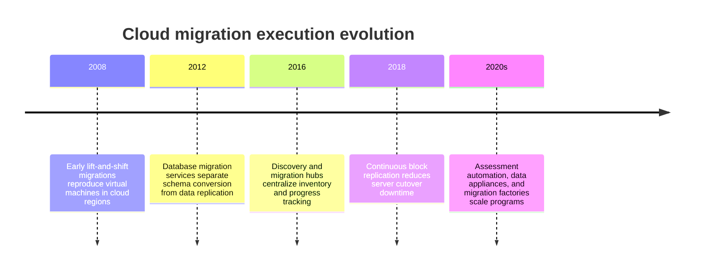
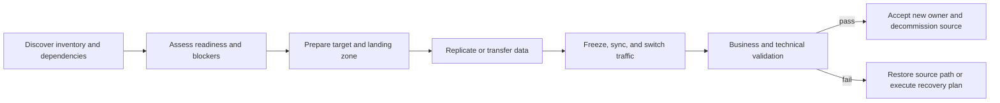
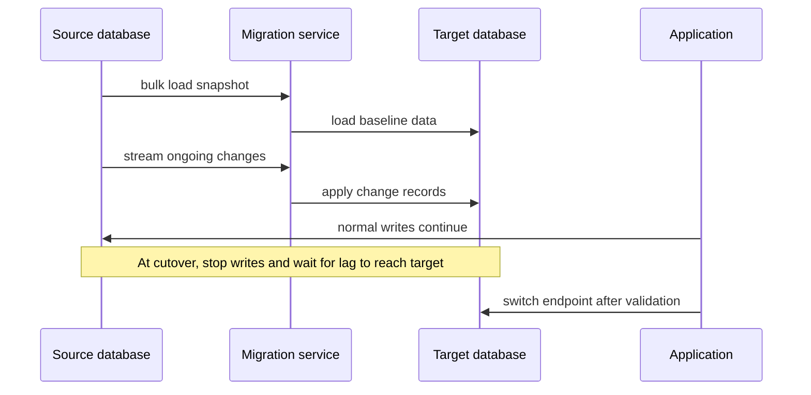
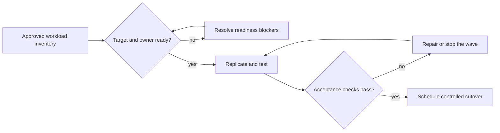
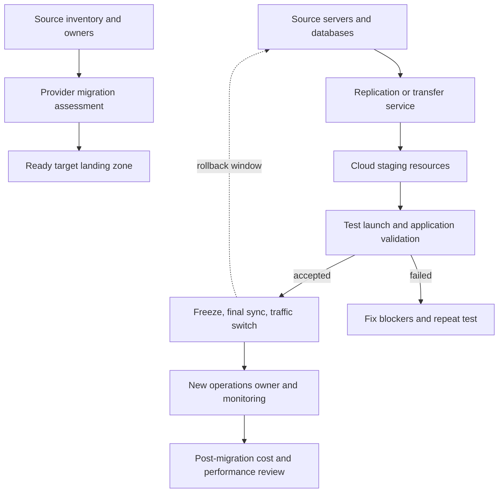

# Chapter: Cloud Migration Execution

Part: [09 — Cloud Computing](PART_OVERVIEW.md) · Status: Drafted

## 1. Introduction

Cloud migration execution moves workloads, data, and operational responsibilities from a source environment to a target cloud service. Provider tools support inventory, assessment, replication, transfer, cutover, and progress tracking, but they do not discover every business dependency or guarantee application correctness after a move.

This chapter focuses on provider migration services and execution mechanics across Amazon Web Services (AWS), Microsoft Azure, and Google Cloud Platform (GCP): discovery, readiness, data movement, replication, cutover, validation, rollback, and migration cost. Part 10 Cloud Architecture owns portfolio strategy, cross-provider workload waves, modernization choices, and hybrid/multi-cloud architecture. Part 09 Landing Zones owns the provider foundation; this chapter consumes that foundation rather than re-teaching it.

## 2. Historical Evolution

Early cloud migrations relied on manual server builds, file copies, and planned outages. Providers introduced discovery appliances, dependency maps, continuous replication, database conversion tools, bulk transfer devices, and unified migration hubs. These services reduce mechanical effort, but architecture still requires dependency sequencing, data consistency, identity transition, business validation, and cutover authority.

Modern tools can automate infrastructure replication and orchestration, but application dependencies and business acceptance remain customer responsibilities. A successful tool task is evidence of movement, not proof of a successful migration.

## 3. Why It Exists

Migration changes where a workload runs, who operates its components, how it accesses data, and how users reach it. A move can fail even when every virtual machine boots: identity may not work, network routes may be incomplete, data may be stale, licensing may be invalid, or monitoring may have no owner.

Provider migration services reduce repetitive discovery and transfer work and offer supported paths for common source platforms. Architects use them to control downtime, data loss, and operational uncertainty while preserving a path to validate or reverse the transition.

## 4. Core Concepts

### 4.1 Migration phases and execution gates

**Definition.** A migration execution plan is a staged process that establishes source facts, validates target readiness, moves data and configuration, switches traffic or ownership, and proves the workload meets acceptance criteria. Provider tools often describe phases such as discover, assess, plan, migrate, and optimize; the exact portal flow is provider-specific.

**Mechanism.** Discovery gathers machine inventory, configuration, utilization, and dependency signals. Assessment maps those facts to candidate targets and identifies blockers. Replication or data transfer moves state while the source remains authoritative. A cutover window stops or redirects writes, verifies synchronization, and changes traffic or ownership. Validation confirms the application and its operators can meet the required behavior.

**Decision implications.** Use explicit entry and exit gates for each phase. A workload is not ready to cut over until target identity, network, security, telemetry, backup, and operational ownership are in place. Part 10 owns portfolio sequencing and strategy; this section owns execution readiness.

**Common failure mode.** A migration dashboard shows “replication complete” and the team assumes the application is ready. The data may be copied while DNS, credentials, scheduled jobs, integrations, and support procedures remain unchanged.

**Scenario.** A payroll service is discovered and assessed, its target environment is provisioned, and database changes replicate continuously. Before cutover, the team freezes writes, verifies replication lag, switches traffic, runs payroll validation, and retains a bounded source rollback window.

### 4.2 Discovery, inventory, and dependency evidence

Discovery records servers, databases, storage, software versions, utilization, network flows, and ownership. A tool may use an appliance, agent, imported inventory, or cloud API integration. These sources have different completeness and sensitivity; a point-in-time scan may miss seasonal load or dormant dependencies.

Combine automated inventory with application-owner interviews, firewall flows, deployment manifests, job schedules, and business calendars. Classify confidence and source for each dependency. Protect discovery credentials and restrict access to infrastructure maps, which can reveal sensitive network and system details.

### 4.3 Assessment, target readiness, and blocking issues

Assessment compares source characteristics and software requirements with target services, regions, quotas, licensing, and performance. Provider tools can recommend instance sizes or identify unsupported operating systems and database features, but their output depends on collection period and pricing assumptions.

Verify target region availability, service quotas, encryption, identity, network paths, backup, monitoring, support, and cost. Record blockers, owners, and exit criteria. Do not treat a tool's “ready” label as a substitute for application-specific integration tests.

### 4.4 Replication and low-downtime server migration

Server migration services can replicate disk blocks or snapshots from a source server to cloud storage and create a target virtual machine for testing or cutover. Continuous replication reduces the amount of data copied during the outage window, but introduces source agents or appliances, network bandwidth, staging storage, and replication monitoring.

Set recovery point objective (RPO) and recovery time objective (RTO) for the migration event. Measure replication lag and bandwidth; avoid competing with production traffic. Test a launch or recovery drill before final cutover, and validate that the target's machine identity, disk layout, and boot configuration are correct.

### 4.5 Database schema, data migration, and change capture

Database migration can involve schema conversion, bulk load, ongoing change replication, and final write freeze. Database migration services may support heterogeneous engine conversion, homogeneous replication, or both. Change data capture (CDC) streams modifications from a transaction log or source API so the target can catch up while the source continues serving.

Validate data types, indexes, stored procedures, extensions, collation, transaction semantics, and application connection behavior. The Part 06 database chapters own engine-specific internals; this chapter addresses the provider migration path and cutover contract.

### 4.6 Bulk data transfer and online/offline movement

Large datasets can move over network transfer, database replication, provider transfer appliances, or a hybrid approach. Online transfer supports incremental changes but consumes bandwidth and time; offline appliances can move large initial datasets where network capacity is limited, then require an incremental sync for cutover.

Estimate transfer duration from usable throughput, not interface line rate. Include encryption, protocol overhead, retries, source throttling, import scheduling, and data verification. For offline transfer, protect the physical device and validate manifests and checksums after import.

### 4.7 Migration waves and dependency sequencing

Part 10 owns portfolio-wave architecture, but provider migration execution still consumes a wave plan. Each wave should group workloads whose dependencies, outage windows, rollback path, and target readiness are understood. Avoid splitting tightly coupled systems across a long transition without an explicit coexistence design.

Define wave entry/exit criteria, source and target owners, migration tooling, communication, business validation, and support coverage. Treat shared identity, DNS, network, and data services as wave dependencies rather than assuming they move with one workload.

### 4.8 Cutover, traffic switching, and rollback

Cutover changes the authoritative runtime or data path. It may update DNS, load-balancer targets, connection strings, application configuration, or routing. A safe cutover defines a write freeze or synchronization boundary, a verification window, rollback authority, and the condition under which rollback is no longer safe because data has diverged.

Keep source and target responsibilities explicit during coexistence. If both systems can accept writes, define conflict resolution and ownership; otherwise enforce a single writer. Measure DNS cache and client retry effects, and do not assume reverting a route also reverses database writes.

### 4.9 Post-migration validation and optimization

Validation compares target behavior against acceptance criteria: user journeys, data integrity, latency, error rates, batch completion, security controls, monitoring, backup, and operational handover. Provider migration tools can report resource state but cannot prove business correctness.

After acceptance, optimize target sizing, commitments, storage tiers, and managed-service choices against observed workload behavior. Avoid premature downsizing before a representative peak period. Part 09 Cost Optimization owns the cost methods; Part 10 owns modernization and broader architecture decisions.

### 4.10 Provider migration service selection

AWS offers services such as Migration Hub, Application Migration Service, Database Migration Service, DataSync, and Snowball-family transfer appliances. Azure Migrate supports discovery, assessment, and migration for servers, databases, and web applications, with Data Box for offline transfer. Google Cloud Migration Center supports inventory and assessment, while Migrate to Virtual Machines and transfer services support execution paths.

Choose tools based on source support, downtime, replication behavior, data volume, target service, identity, region, and operational skill. Verify current product names, service availability, licensing, and support matrices. A provider migration hub may coordinate tools but does not perform every migration step itself.

## 5. Internal Working

A migration program typically registers source environments, deploys an appliance or agent, collects inventory, and stores assessment records in a provider project or account. Migration tooling creates staging resources, replicates disks or data, and exposes test-launch and cutover operations. The control plane reports task status; the data plane moves application bytes and may have independent limits.

For a server, continuous replication reads source disk changes and applies them to a cloud replica. For a database, a bulk baseline is followed by log-based or API-based changes. At cutover, operators pause writes or traffic, wait for final synchronization, redirect clients, and validate. Tool success is only one signal in a broader business acceptance process.

## 6. Design Principles

- Discover dependencies and ownership before selecting a migration tool.
- Verify readiness, quotas, region support, identity, network, and data protection before moving.
- Measure data transfer and replication lag against explicit RPO/RTO objectives.
- Separate bulk transfer, incremental replication, and final cutover procedures.
- Preserve a single-writer model unless conflict resolution is explicitly designed.
- Define cutover authority, acceptance tests, rollback conditions, and source decommissioning.
- Protect discovery credentials and migration metadata.
- Treat migration tooling and staging resources as temporary infrastructure with owners.
- Optimize only after representative target telemetry is available.

## 7. Architecture Patterns

**Discover-assess-migrate factory.** A repeatable provider workflow collects source inventory, assesses blockers, provisions targets, replicates, tests, and records acceptance.

**Continuous replication with short cutover.** Data copies in the background; the final outage is limited to write freeze, lag catch-up, endpoint switch, and validation.

**Offline bulk seed plus online delta.** A transfer appliance moves the large initial dataset; network replication then catches subsequent changes before cutover.

**Strangler coexistence.** A workload migrates in bounded components while source and target temporarily exchange data. This pattern requires explicit ownership and consistency boundaries; Part 10 owns its broader modernization strategy.

## 8. Production Architecture

Production readiness includes source credentials, target landing-zone controls, bandwidth, quotas, replication lag monitoring, test data, business acceptance, rollback authorization, and migration-tool cleanup.

## 9. Implementation

1. Identify workloads, owners, dependency paths, data classes, and business windows.
2. Choose a migration strategy and target from Part 10's portfolio assessment.
3. Select provider discovery and migration tools for source types and target services.
4. Prepare landing-zone identity, network, security, logging, quota, and billing.
5. Assess compatibility, licensing, sizing, data transfer, and service availability.
6. Configure replication or bulk transfer and monitor lag and integrity.
7. Test target launch, application journeys, performance, backup, and operational access.
8. Execute cutover with a write boundary, validation, rollback, and owner handoff.

## 10. Complete Code Examples

- [Dependency graph and migration-wave planner](../code/python/cloud-migration-chapter/01_wave_planner.py)
- [Replication lag and cutover readiness checker](../code/python/cloud-migration-chapter/02_cutover_readiness.py)
- [Data transfer duration and cost estimator](../code/python/cloud-migration-chapter/03_transfer_estimator.py)
- [Migration readiness scorecard](../code/python/cloud-migration-chapter/04_readiness_score.py)

The examples use synthetic inventories, transfer rates, and normalized costs. They do not call provider APIs or guarantee a migration outcome.

## 11. Performance

Migration affects source and target performance through replication reads, network transfer, database change capture, and parallel test traffic. Measure source CPU and storage latency during replication, target apply lag, transfer throughput, and application response during coexistence.

Schedule bulk transfer around business peaks and throttle replication when it threatens production. A compressed or deduplicated transfer can reduce bytes but increase CPU and complexity. Validate target performance at representative load before cutting over.

## 12. Scalability

Migration programs scale through discovery automation, standardized assessments, migration factories, and parallel waves. Parallelism is limited by application dependencies, source capacity, target quotas, network bandwidth, skilled operators, and cutover windows.

Track wave throughput and blocker aging, not just number of migrated servers. Increase parallelism only when rollback, validation, and support can scale with it. Shared services such as DNS or identity may become critical-path bottlenecks.

## 13. Security

Migration tooling often receives broad access to source inventories, credentials, and target infrastructure. Use temporary least-privilege roles, separate discovery from cutover permissions, protect replication channels, and audit access to migration projects. Data copies and staging disks inherit the classification of source data.

Remove temporary agents, credentials, staging resources, and copied datasets after acceptance and retention review. Keep encryption keys and secrets under the target environment's intended control model; do not migrate credentials blindly from source configuration files.

## 14. Observability

Monitor discovery coverage, assessment blockers, replication throughput and lag, transfer retries, test-launch status, cutover progress, data validation, and resource cleanup. Correlate service events with migration wave, source, target, owner, and runbook.

Alert on replication lag exceeding the cutover budget, target quota shortfall, failed data verification, or migration appliance inactivity. Preserve audit evidence and cost attribution for temporary staging resources.

## 15. Failure Scenarios

| Failure | Likely symptom | Architectural response |
|---|---|---|
| Missing dependency | Target starts but a workflow fails | Update dependency map and migrate or replace the missing service |
| Replication lag grows | Cutover window cannot meet RPO | Throttle source load, increase capacity, or reschedule cutover |
| Target quota unavailable | Test launch or scale-out fails | Request quota early or select an approved alternate size/region |
| Data conversion mismatch | Application reads incorrect records | Stop cutover, reconcile schema and checksums, then repeat validation |
| DNS or endpoint switch delayed | Some clients use old and new targets | Track propagation, maintain compatibility, and avoid split writers |
| Identity mismatch | Applications cannot access target dependencies | Validate principals, roles, secret paths, and service policies |
| Rollback after divergent writes | Source is stale relative to target | Freeze writes and reconcile; do not blindly route traffic back |
| Staging resources left running | Unexpected cost and security exposure | Use ownership tags, expirations, and a cleanup gate |

Migration rollback must account for data written after cutover. Reverting traffic is not equivalent to restoring the source to the latest state.

## 16. Testing

Test source discovery completeness, migration tool permissions, replication lag, data integrity, application compatibility, target monitoring, and rollback. Run test migrations with representative datasets and realistic network conditions. Validate that the target can be rebuilt or recovered without relying on undocumented manual steps.

Before cutover, rehearse the freeze, final sync, endpoint change, smoke tests, business acceptance, and rollback decision. After migration, verify backup, restore, alerts, on-call handoff, and decommissioning evidence.

## 17. Common Mistakes

- Treating automated assessment as proof that an application is ready.
- Discovering infrastructure but not business, batch, or identity dependencies.
- Underestimating bandwidth, replication lag, or target quota.
- Starting cutover without agreement on write freeze and rollback authority.
- Moving production data into staging without access and retention controls.
- Leaving temporary migration appliances, agents, credentials, or disks behind.
- Assuming a reverse traffic switch reverses data writes.
- Reporting “migrated” before operational ownership and monitoring transfer.

## 18. Best Practices

- Keep inventory, dependency evidence, assessment, and ownership together.
- Use provider migration tools for supported source/target paths and understand their limits.
- Validate business functionality as well as infrastructure status.
- Measure replication lag and rehearse the exact cutover path.
- Preserve a single-writer boundary during coexistence.
- Keep rollback conditions explicit and time-bounded.
- Remove temporary resources through an auditable cleanup process.
- Capture post-migration cost and performance baselines before optimization.

## 19. Anti-Patterns

**Big-bang migration without dependency evidence.** Moving a large system at once increases outage scope and makes rollback difficult. Use bounded groups with clear acceptance criteria.

**Cutover by tool status.** A replication job reporting success does not prove application behavior, data integrity, or operational readiness.

**Dual writes without reconciliation.** Allowing both source and target to accept writes can create conflicting state. Define a single writer or an explicit conflict model.

**Migrate first, govern later.** Moving workloads before identity, network, logging, and landing-zone controls are ready creates temporary insecure architectures that often become permanent.

## 20. Trade-off Analysis

| Choice | Benefits | Costs and risks | Choose when |
|---|---|---|---|
| Online transfer | Incremental updates and short final cutover | Consumes bandwidth and may affect source | Network capacity and replication support are adequate |
| Offline transfer appliance | Moves large initial data without sustained network use | Shipping, custody, import, and incremental delta still required | Dataset is large and network throughput is constrained |
| Agentless replication | Less source-host change | Source platform and feature support constraints | Supported virtualization platform and access are available |
| Agent-based replication | Supports varied source machines | Agent rollout, permissions, and operational overhead | Source inventory is heterogeneous |
| Rehost first | Faster relocation with fewer code changes | Retains technical debt and cloud mismatch | Time or compatibility limits immediate modernization |
| Modernize during migration | Better cloud fit and operations | Longer schedule and more change risk | Business case justifies redesign and validation effort |

## 21. Comparison Table

| Capability | AWS | Azure | Google Cloud |
|---|---|---|---|
| Migration coordination | Migration Hub | Azure Migrate | Migration Center |
| Server replication | Application Migration Service | Azure Migrate and Modernize | Migrate to Virtual Machines |
| Database migration | Database Migration Service | Azure Database Migration Service | Database Migration Service |
| Bulk/offline transfer | Snowball family and DataSync | Data Box and online transfer tools | Transfer Appliance and Storage Transfer Service |
| Assessment inputs | Discovery, dependency, and utilization data | Appliance/collector discovery and dependency visualization | Inventory, assessment, and cost estimation |

Product names and supported source platforms change. Confirm current regional availability, licensing, replication limits, and the boundary between the coordinating hub and the tool that moves data.

## 22. Real-World Case Study

### Azure Migrate's discover-assess-execute workflow

Microsoft documents Azure Migrate as a platform for discovering workload inventory, assessing readiness and target size, planning costs and dependencies, and executing server, database, web-app, or data migration through integrated and partner tools. The service can use a continuously connected appliance for discovery or a collector for a point-in-time inventory in restricted environments. This is a provider-documented execution model, not a customer migration claim.

The architecture separates planning evidence from execution: inventory and dependency data inform a business case and target readiness; replication or transfer tools move data; a controlled cutover changes traffic and operations. This lets a migration team track blockers and progress centrally while specialized tools handle distinct workload types.

The pattern is useful when an organization needs a common workflow across many workloads. It still depends on complete discovery, accurate cost assumptions, target landing-zone readiness, and business acceptance. A unified portal cannot infer undocumented dependencies or determine whether a workload's data and user flows are correct after cutover.

## 23. Interview Questions

1. What is the difference between migration discovery, assessment, replication, and cutover?
2. What data should be collected before sizing a target VM or database?
3. How does continuous replication reduce downtime, and what does it not solve?
4. When is an offline transfer appliance preferable to network transfer?
5. What conditions make rollback unsafe after cutover?
6. Why can a successful migration-tool task still leave an application unusable?
7. How should migration waves account for shared identity, DNS, and network services?
8. What evidence is required before decommissioning the source environment?

## 24. Hands-on Exercises

1. Run the dependency planner with a cycle and break it into migration waves.
2. Run the cutover checker with high replication lag and delay the switch until the RPO target is met.
3. Run the transfer estimator for online and offline transfer assumptions.
4. Run the readiness scorecard with missing monitoring, owner, or rollback fields and define exit criteria.

## 25. Design Exercises

1. Plan migration of a three-tier application with a database, scheduled jobs, and shared identity; show discovery evidence and cutover dependencies.
2. Migrate a large database with continuous change capture, a short maintenance window, and an explicit rollback boundary.
3. Design an offline seed plus online delta migration for a dataset whose source link is bandwidth-constrained.
4. Build a migration factory that provisions target landing-zone resources, tracks evidence, and decommissions temporary migration infrastructure.

## 26. Architecture Review Questions

- Is inventory complete, current, and linked to accountable workload owners?
- Are source dependencies, data classes, and business windows documented?
- Are target region, identity, network, quotas, logging, and backup ready?
- Does the transfer method meet bandwidth, data-integrity, and RPO/RTO requirements?
- Are cutover, write freeze, validation, rollback, and authority explicit?
- Can the team detect replication lag and data mismatch before switching traffic?
- Are migration tools, agents, credentials, and staging resources removed after acceptance?
- Has operations ownership and cost baseline been transferred to the target team?

## 27. Summary

Cloud migration services automate discovery, assessment, replication, transfer, and progress tracking, but they do not replace dependency analysis, business validation, or cutover governance. Prepare the target foundation, measure replication and transfer, preserve a single-writer boundary, test rollback, and transfer operational ownership before decommissioning the source. Provider tools are execution mechanisms within the broader portfolio and modernization strategy owned by Part 10.

Further reading: [AWS Architecture](CH01_AWS.md), [Microsoft Azure Architecture](CH02_Azure.md), [Google Cloud Platform Architecture](CH03_GCP.md), [Landing Zones](CH15_Landing_Zones.md), and [Cloud Architecture](../10_Cloud_Architecture/PART_OVERVIEW.md). Provider product capabilities should be checked against current documentation before execution.
