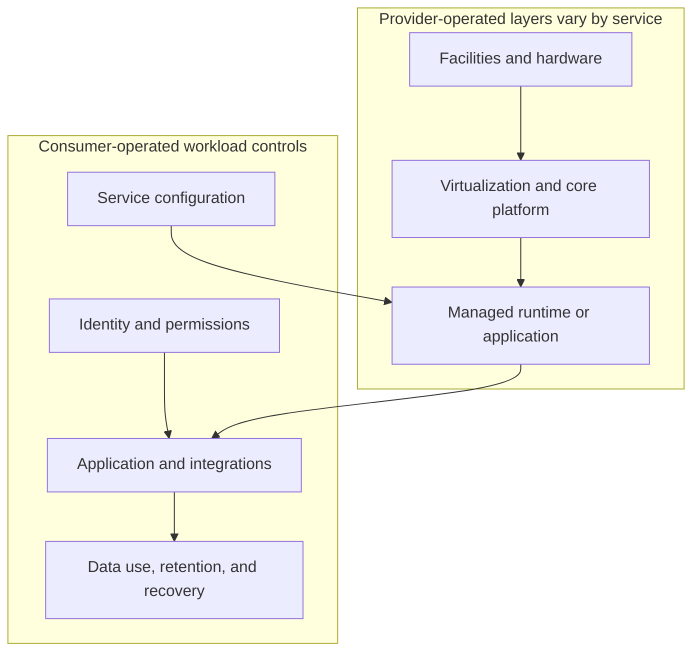
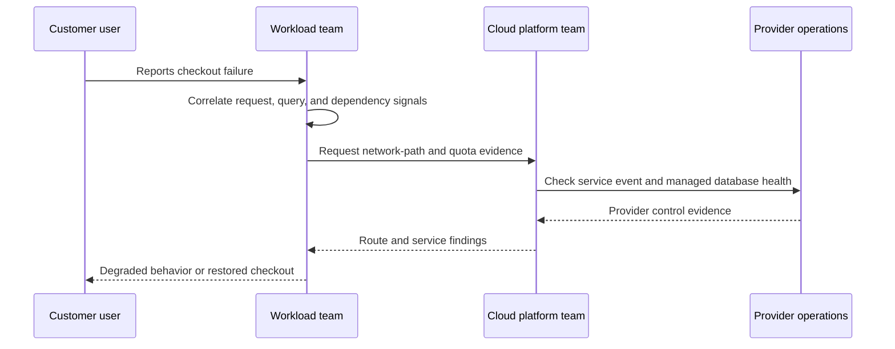
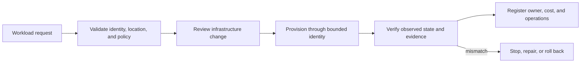
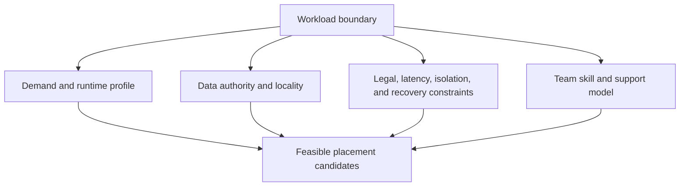
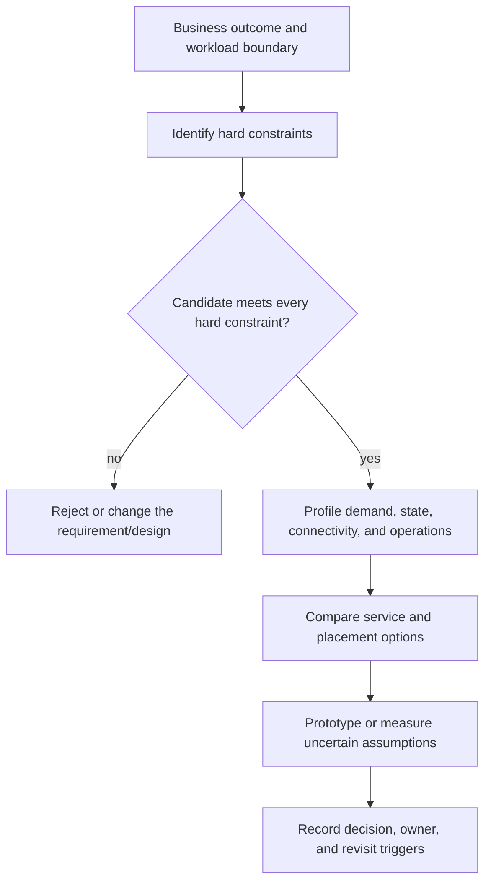

# Cloud Architecture Foundations and Shared Responsibility

Part: [10 — Cloud Architecture](PART_OVERVIEW.md)

Cloud architecture is the deliberate composition of provider services, workload components, organizational boundaries, and operating practices to meet a system's business and technical requirements. It is not simply the act of moving servers into a provider account. The architectural work is to decide which responsibilities to retain, which to delegate, where state and computation belong, what can fail together, and how to prove the resulting system meets its goals.

This chapter establishes a provider-neutral mental model and a practical method for initial workload placement. Part 09 owns the mechanics and product behavior of individual AWS, Azure, and Google Cloud Platform services. Later chapters in this part compose those services into organizational, network, identity, compute, data, resilience, and migration architectures. The Amazon Web Services Well-Architected Framework (AWS WAF) has its own application and review process in [Part 11](../11_AWS_Well_Architected_Framework/PART_OVERVIEW.md).

## Cloud as an Operating Model

Cloud is best understood through the boundary it establishes between a consumer and a provider. The provider operates some combination of physical facilities, hardware, foundational software, managed platforms, and application capabilities. The consumer selects and configures those capabilities, connects them to its workload, and remains accountable for the workload's outcome.

The useful question is not whether a system is “in the cloud.” It is: **which party controls each layer, which party can observe or change it, and who must respond when it fails?** Two workloads can run in the same provider and have radically different operational models. A virtual machine may expose the operating system and runtime to the workload team; a managed application platform may hide those layers while exposing deployment slots, scaling limits, identity bindings, and service-specific failure behavior.

A cloud service therefore creates both an abstraction boundary and a responsibility boundary. Higher-level services reduce the amount of infrastructure a consumer operates, but they do not remove the need to understand service contracts, configuration, data, access, dependencies, or business behavior.

### Service abstraction changes responsibility

Common service-model labels describe broad responsibility shifts, not precise guarantees:

| Service model | Provider commonly operates | Consumer commonly operates |
|---|---|---|
| Infrastructure as a Service (IaaS) | Facilities, hardware, virtualization, and some network/storage primitives | Guest operating system, runtime, application, identities, data, configuration, and workload operations |
| Platform as a Service (PaaS) | IaaS layers plus some operating-system, runtime, or application-platform lifecycle | Application code, data, service configuration, access policy, integration, and workload behavior |
| Software as a Service (SaaS) | The hosted application and the underlying service stack | Tenant configuration, users, access, data use, integration, and business process |
| Function as a Service (FaaS) | Host, runtime orchestration, invocation, and elastic execution infrastructure | Function code, event contract, identity, dependencies, data effects, and execution limits |

The table is a starting hypothesis only. A specific service contract may move a control in either direction. For example, a managed database provider can patch its database hosts while the customer still chooses network reachability, database principals, encryption settings, backup retention, query behavior, and data classification. The team must inspect the chosen service's actual control surface instead of treating its marketing category as a responsibility contract.

The boundary moves upward as the service abstraction increases; workload identity, data use, and business behavior remain design concerns at every level.

### Shared responsibility is control-by-control

Shared responsibility is often summarized as security **of** the cloud and security **in** the cloud. That distinction is useful but incomplete for architecture. A team needs to identify the owner for every material control and the evidence that proves it is operating.

A practical responsibility map separates at least these layers:

| Layer or control | Typical provider responsibility | Typical workload/customer responsibility |
|---|---|---|
| Physical facilities and hardware | Facility access, power, environmental controls, hardware maintenance | Select compliant locations and service scopes; understand provider attestations and limitations |
| Foundational infrastructure | Hypervisor and provider network/storage fabric operation | Configure selected resources and understand service limits and failure boundaries |
| Managed service lifecycle | Operate the contracted platform components and publish service behavior | Choose service configuration, capacity, region, retention, and supported modes |
| Workload identity and authorization | Provide identity and policy primitives | Define principals, grants, trust, privilege boundaries, and access review |
| Application and integration | Operate provider APIs and contracted service endpoints | Secure and operate application code, dependency calls, event handlers, and business workflows |
| Data and its use | Protect provider infrastructure and service components as contracted | Classify, govern, retain, delete, validate, and recover workload data |
| Detection and response | Report relevant provider service events and operate provider response processes | Collect workload telemetry, detect application incidents, coordinate response, and meet notification obligations |

“Typical” matters. The exact division depends on the provider, service tier, contract, region, and configuration. Responsibility can also be shared in sequence: the provider supplies a control, a platform team configures it, and a workload team operates the policy. In that situation, the organization still needs a named accountable owner; saying “the cloud team handles it” is not a control design.

A useful test for each important control is:

1. Who implements the underlying capability?
2. Who selects and configures its behavior?
3. Who monitors whether it remains effective?
4. Who is paged and authorized to respond?
5. What evidence demonstrates the control is working?

If any answer is unknown, the architecture has an ownership gap. Provider attestations can support assurance about provider-operated controls, but they do not prove that a workload is configured correctly or that its business process is compliant.

The incident sequence shows how provider, platform, and workload evidence combine. No single party can infer the failure owner from the word “managed.”

### Trace responsibility through an incident

Consider an order API backed by a managed database. Users report failed checkouts, and the database service has elevated connection latency. The provider may own host health and database-engine availability; the workload team owns connection-pool sizing, query behavior, retry policy, and the user-visible degraded response. The platform team may own the private network path and service quota. The incident cannot be assigned by saying “the database is managed”; responders need evidence that identifies which control failed.

| Control question | Evidence to inspect | Likely owner |
|---|---|---|
| Is the provider service reporting a regional or service incident? | Provider health events and service status for the affected scope | Provider relationship/platform team |
| Is the network path healthy and resolving to the intended endpoint? | Route, private DNS, flow telemetry, and connection tests | Cloud network/platform team |
| Are client connections exhausting the database limit? | Pool usage, rejected connections, query latency, and retry rate | Workload/data team |
| Did a deployment change query shape or concurrency? | Release version, migration history, and request mix | Workload team |
| Can the service degrade safely while recovery proceeds? | Admission, queue, and user-flow behavior under dependency failure | Product and workload owners |

The architecture makes the handoff and evidence path clear before the incident. If a provider event is confirmed, the workload team still decides whether to shed load or queue requests. If a deployment created connection pressure, provider hardware replacement is irrelevant. If an identity or network dependency blocks recovery, the team needs a separately tested operational path. Shared responsibility is therefore a way to find the correct control owner, not a reason to defer accountability.

## Cloud Characteristics and Their Consequences

The cloud operating model has several recurring characteristics. Each one creates an opportunity and a new class of failure; none is a guarantee of a desired outcome.

### On-demand provisioning and programmable control

Resources can often be provisioned through an application programming interface (API), a console, or declarative configuration. This makes environments repeatable and enables policy checks before deployment. It also makes a mistaken template, exposed credential, or overbroad deployment identity capable of changing many resources quickly.

Architecture should therefore treat provisioning code, permissions, policy evaluation, and change review as production controls. A console-created resource may be valid for an experiment but can become invisible to the system of record if no one imports or replaces it. Conversely, fully automated provisioning is not automatically safe if the automation can create an insecure or expensive topology without review.

Programmability makes this lifecycle repeatable, but the verification stage matters: an accepted deployment command is not evidence that the desired controls took effect.

### Elasticity and measured consumption

Elasticity is the ability to increase or decrease capacity in response to demand. It is useful when demand varies and the system can scale within provider quotas, startup limits, downstream capacity, and application constraints. It is not equivalent to automatic cost reduction: an autoscaler may preserve excess capacity, scale in too slowly, or amplify a downstream bottleneck.

Measured consumption exposes cost at finer granularity than many fixed-capacity environments. That improves feedback only if the organization can attribute the cost to workloads and outcomes. Data transfer, idle development environments, logging volume, retained snapshots, and managed-service minimums can dominate a bill even when compute appears efficient.

### Managed services and shifted operational work

A managed service can absorb patching, hardware replacement, control-plane operation, or routine scaling. The consumer trades some direct control for reduced operational burden and a service contract. This is valuable when the provider's contract meets the workload's needs and the organization can operate within its limits.

The abstraction does not eliminate incidents. It changes what can fail and what the consumer can do. A provider may manage database hosts but cannot repair an application query that exhausts connections. A function platform may scale invocations but cannot decide whether duplicate events create duplicate payments. A managed service may provide regional redundancy while the workload remains dependent on a single-region identity or network path.

### Geographic scope and failure domains

Cloud services expose geographic scopes such as regions and Availability Zones (AZs), plus provider-specific global or edge services. The names and guarantees differ among providers; see the [Part 09 provider chapters](../09_Cloud_Computing/PART_OVERVIEW.md) for those details.

A location label is not itself a resilience design. Components in separate zones can still share a regional control plane, credentials, deployment pipeline, or data dependency. Multiple regions can still fail together if both rely on a shared identity provider, configuration source, or operator workflow. Architecture must identify actual dependencies and failure domains rather than count locations.

## Workload Placement: A Decision Method

Cloud placement is a workload decision, not simply a provider or service-model ranking. The unit of analysis should be explicit: a whole product, one component, a data store, a batch job, or a control plane may have different constraints and placement options.

### Separate hard constraints from preferences

Start with constraints that can rule out an option:

- Legal, contractual, or regulatory limits on data location, access, retention, and processing.
- Required latency or throughput that a candidate path cannot meet.
- Unsupported operating systems, protocols, hardware, licensing, or external dependencies.
- Required isolation or operational control unavailable in the service model.
- Disconnected or intermittently connected operation that cannot depend on a remote control plane.
- Recovery, availability, or safety requirements that the proposed design cannot demonstrate.

Then identify preferences that may be traded off: minimize operational effort, increase portability, use a particular managed capability, align with existing staff skills, reduce short-term cost, or standardize on a provider. Keeping these categories distinct prevents a preference from being presented as an immovable requirement and prevents a true compliance constraint from being negotiated away as a cost optimization.

### Characterize the workload before choosing a service

Describe the workload in terms of behavior and evidence:

| Dimension | Questions to answer | Why it affects placement |
|---|---|---|
| Demand | What are the average, peak, burst, and seasonal patterns? How predictable are they? | Determines whether elasticity or reserved capacity is useful and how much headroom is needed. |
| Runtime | What operating system, libraries, accelerators, startup time, job duration, or special access is required? | Narrows the feasible runtime and affects image, patch, and scaling responsibilities. |
| State | Where is authoritative state? What are its size, access pattern, consistency needs, and recovery behavior? | Data often constrains compute location more strongly than compute constrains data. |
| Connectivity | Which users, services, devices, and external systems communicate with it? | Reveals latency, routing, private access, and network ownership requirements. |
| Criticality | What is the acceptable interruption, data loss, and degraded behavior? | Determines failure-domain and recovery architecture. |
| Operations | Who deploys, monitors, patches, approves access, responds, and restores the workload? | Tests whether the organization can actually operate the chosen abstraction. |
| Economics | What is the cost per useful outcome, including data movement, support, licenses, staffing, and idle capacity? | Prevents unit prices from being mistaken for total cost. |

The placement decision is constrained by the intersection of these inputs. A runtime that fits demand but cannot satisfy data residency or operating ownership is not a viable candidate.

Unknowns should be recorded as assumptions with owners and a way to test them. “Peak traffic is ten times average” may drive a radically different capacity model than “peak is 1.2 times average”; do not hide uncertain inputs behind a precise-looking service score.

### Compare viable options and validate assumptions

After hard constraints remove infeasible candidates, compare viable options against weighted criteria. Do not allow a weighted score to override a mandatory requirement. Scores help expose preferences and disagreement; they do not constitute a benchmark or prove a design.

A sound decision records the chosen boundary, alternatives considered, the evidence and assumptions, accepted risks, operational owners, and conditions that would trigger a review. Examples of revisit triggers include a change in data residency law, a sustained shift in demand, an acquisition, an end-of-support runtime, or a provider service changing its contract.

## Worked Example: Image Processing for an Order Service

Consider an order application that accepts a product image and generates normalized thumbnails. The image-processing component has short bursts after catalog imports, can tolerate minutes of queue delay, does not need local disk state, and can process each image idempotently. Product images are stored in object storage; the order API and database have stricter latency and availability objectives.

Assume the catalog accepts 10,000 images on a normal day, but a scheduled supplier import can submit 2,000 images in ten minutes. Thumbnail generation takes about two seconds per image at the representative size, and the customer-facing upload path has a p95 response objective of 250 ms. These are illustrative inputs, not universal sizing values. The upload path cannot wait for all transformations without violating its response objective, while the asynchronous worker needs enough capacity to clear the import before the catalog's publication deadline.

A single virtual-machine fleet is feasible and provides direct control over runtime and local libraries. The team must own operating-system updates, capacity planning, worker draining, and the queue consumer lifecycle. It may be economical under steady high utilization, but import bursts require either spare capacity or delayed processing.

A managed function runtime can align cost with invocation volume and reduce host operations. It is a good candidate only after checking maximum execution time, memory, temporary storage, concurrency, network access, cold-start behavior, package size, and event retry semantics. The team still owns image parsing, malicious-input handling, idempotency, dead-letter response, data permissions, and monitoring. If a retry can create inconsistent metadata or duplicate downstream effects, the service abstraction does not fix that application behavior.

A managed container task may fit if the image-processing library has native dependencies, jobs can run longer, or the team needs a stable container runtime while avoiding a continuously running fleet. It introduces task startup delay, image-pull dependencies, capacity/quota limits, and its own scaling and retry policy.

The architecture should not choose among these by comparing compute price alone. It should measure representative image size and processing time, estimate queue delay under peak import volume, validate failure/retry behavior, test access to object storage, and model idle and burst cost. It should also keep the order API's synchronous path independent from bulk thumbnail processing so that an import burst cannot consume all capacity needed for customer orders.

For the ten-minute import, the team estimates arrival rate at roughly 3.3 images per second. If one worker can process four representative images per second while meeting memory and latency constraints, one worker has little headroom once retries, image-size skew, and deployment overlap are included. The team tests a bounded pool of workers and measures both queue age and object-store/database request pressure. It does not simply multiply average processing time by peak count because startup delay, parallelism limits, and the downstream catalog write rate determine actual drain time.

The placement decision has two separate acceptance tests. The API must meet its p95 response objective while a supplier import runs at peak. The worker must drain the peak backlog before the publication deadline without exceeding downstream budgets. If the worker misses the deadline, the options include more safe concurrency, a wider batch window, or partitioning the import; moving the API to a faster runtime does not solve the worker's backlog. This distinction keeps a product-level outcome tied to the component whose capacity controls it.

This example demonstrates a broader placement principle: different components of one product can legitimately use different service models. The boundary should follow workload behavior, data authority, and operational responsibility, not a mandate that every component share one runtime.

## Common Placement Errors

**Assuming managed means no operations.** Managed services still require configuration, identity, quotas, telemetry, incident response, backups, and an owner. Reduce infrastructure toil without deleting operational responsibilities from the design.

**Choosing by nominal price.** Compare total cost over the workload lifecycle, including utilization, data transfer, storage requests, support, licenses, idle environments, staff effort, and recovery capacity. Validate estimates against measured usage.

**Treating portability as free.** A provider-neutral API or container may ease one layer of movement while leaving identity, data, network, observability, deployment, and operational processes provider-specific. Preserve portability where it has plausible value and identify its ongoing cost.

**Assuming elasticity removes capacity planning.** Scaling has limits and latency. Quotas, downstream services, warm-up, and scale-in behavior still need explicit design and tests.

**Counting zones or regions instead of dependencies.** Redundancy only helps when critical dependencies and operations can survive the same failure. Map shared identity, DNS, control planes, deployment, and data paths.

**Delegating responsibility by service label.** A provider's responsibility for infrastructure does not transfer ownership of customer data, authorization choices, application behavior, or business compliance. Map controls individually.

## A Practical Architecture Decision Record

For an initial cloud placement decision, capture:

- **Decision scope:** Which workload component and lifecycle are being placed?
- **Required outcomes:** What user, business, reliability, security, and data outcomes must hold?
- **Hard constraints:** Which options are infeasible, and what evidence supports that conclusion?
- **Workload profile:** What demand, state, runtime, connectivity, and operating data is known or assumed?
- **Options:** Which service models, locations, and operating approaches were considered?
- **Trade-offs:** What control, toil, cost, portability, and failure behavior does each option create?
- **Ownership:** Who configures, secures, monitors, supports, and recovers each boundary?
- **Validation:** Which prototype, test, or production measurement addresses the largest uncertainty?
- **Revisit triggers:** Which business, workload, regulatory, or provider changes should reopen the decision?

This record need not be a long document. Its purpose is to make assumptions and accountability visible and to prevent an early service selection from silently becoming an irreversible architecture.

## Where This Foundation Applies

Use this model throughout Part 10. The organizational chapter turns responsibility boundaries into account and platform ownership. The network and identity chapters make connectivity and trust explicit. Compute and data placement connect workload behavior to service contracts. Resilience treats failure domains and recovery as workload properties. Hybrid architecture tests whether a multi-environment design is justified. The migration chapter treats placement as a transition rather than a one-time copy.

Provider-specific shared-responsibility matrices and product capabilities should be verified against the current service contract. For implementation details, begin with [Part 09 Cloud Computing](../09_Cloud_Computing/PART_OVERVIEW.md). For AWS's framework-based workload review, use [Part 11 AWS Well-Architected Framework](../11_AWS_Well_Architected_Framework/PART_OVERVIEW.md).
