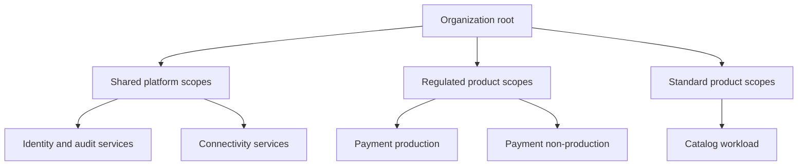
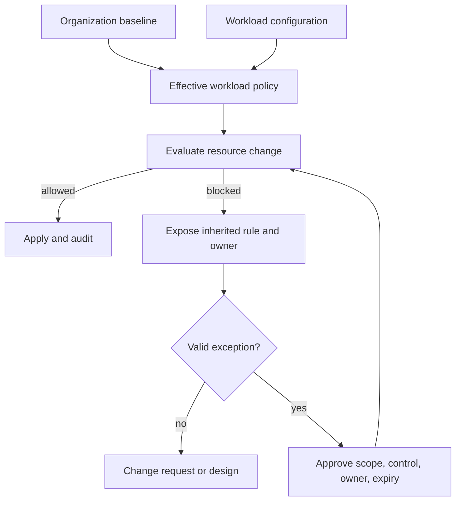
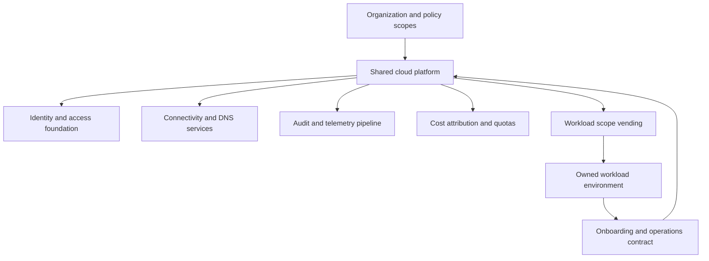
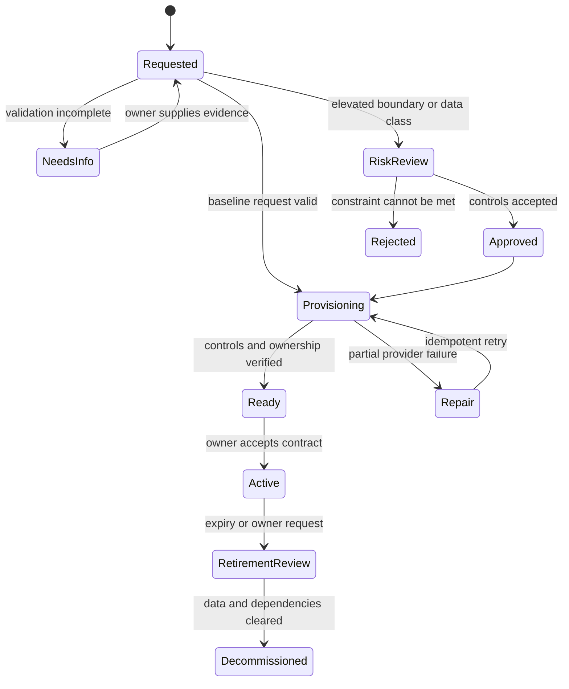

# Organizational Hierarchy, Accounts, and Landing-Zone Architecture

Part: [10 — Cloud Architecture](PART_OVERVIEW.md)

Organizational hierarchy is part of a cloud workload's security and operating architecture. Account, subscription, and project boundaries determine more than where resources appear in a console: they shape who can administer them, which policies apply, where costs are attributed, how quotas are consumed, and how much of the environment can be affected by an error or compromise.

This chapter develops a provider-neutral method for designing those boundaries and the platform that hosts workloads. Part 09 [Landing Zones](../09_Cloud_Computing/CH15_Landing_Zones.md) owns provider-specific foundation components and mechanics. Here, the focus is the architecture that decides where boundaries belong, how teams receive a governed environment, and how the foundation evolves.

## The Boundary Is an Architecture Decision

A cloud organization is a hierarchy of scopes with different control and lifecycle behavior. The provider determines the exact resource types and inheritance rules. The architecture team determines how those scopes correspond to products, teams, environments, data classes, regulatory boundaries, and shared platforms.

The scope should make four things predictable:

- **Authority:** who can create, change, inspect, and delete resources.
- **Policy:** which rules apply by inheritance and where exceptions are allowed.
- **Accounting:** which team or product is responsible for consumption.
- **Lifecycle:** how the scope is created, moved, archived, or decommissioned.

A strong boundary limits accidental coupling. A weak boundary might put production and experimentation under the same administrator roles, quota pool, and policy inheritance. A needlessly fragmented hierarchy creates the opposite problem: duplicated platform services, difficult cross-scope operations, policy drift, and confusing cost allocation.

### Provider scopes are related, not interchangeable

AWS accounts, Azure subscriptions, and Google Cloud projects all organize resources, but their semantics differ. They vary in their relationship to billing, service enablement, identity, quotas, policy inheritance, network attachment, and resource identifiers. Reuse the provider-specific explanations in the Part 09 [AWS](../09_Cloud_Computing/CH01_AWS.md), [Azure](../09_Cloud_Computing/CH02_Azure.md), and [Google Cloud Platform](../09_Cloud_Computing/CH03_GCP.md) chapters; do not assume a one-to-one mapping between providers.

The architecture comparison should instead ask what each provider scope can isolate and what it cannot. For each candidate boundary, document:

| Design question | Architectural implication |
|---|---|
| Can privileged administrators be separated? | Determines whether the scope limits credential compromise and administrative error. |
| Can policy be inherited and exceptions constrained? | Determines how consistently controls apply and how exceptions can be reviewed. |
| Are quotas and service enablement scoped here? | Determines whether one team's growth or experiments can block another workload. |
| Can cost be attributed at this boundary? | Determines whether owners can understand and manage consumption. |
| Can the network and data be isolated to the required level? | Determines whether this is an adequate security or residency boundary. |
| Can the scope be created and retired independently? | Determines whether it matches a product, environment, or lifecycle. |

A scope is not a security boundary merely because it has a distinct name. Verify the provider's actual authorization, network, audit, and control-plane semantics before relying on it.

## Choosing a Hierarchy That Matches Ownership

This is a candidate hierarchy, not a provider resource mapping. It shows possible ownership boundaries; verify provider parent/child behavior before implementation.

### Start from stable accountability

Cloud hierarchies often copy an organization chart. That can be useful when team ownership is stable, but organizational charts change more frequently than some workloads and controls. A better starting point is to identify enduring ownership and separation needs:

- Products or business capabilities with distinct owners and cost accountability.
- Production versus non-production environments with different risk and access requirements.
- Regulatory or data-class boundaries that require separate administration or evidence.
- Shared platform services that have central operators but many consumers.
- Acquisition, partner, or sandbox environments with an independent lifecycle.

Use hierarchy for durable control boundaries and metadata for attributes that change frequently. For example, product name, cost center, data class, and lifecycle state may be resource labels, while production isolation may warrant a separate account or project boundary.

### Separate environments when the risk justifies it

Development, test, staging, and production are not automatically separate accounts or projects. Strong isolation is justified when environment access, data sensitivity, change frequency, blast radius, quotas, or compliance evidence differ materially. Less separation may be reasonable for ephemeral experiments when policy and identity still prevent access to production data and services.

Over-separation has a cost: duplicated dependencies, harder release promotion, more policies, and additional operational surfaces. Under-separation has a different cost: shared administrator credentials, production changes from test automation, noisy-neighbor quota contention, and uncertain cost ownership. The design should make those costs explicit rather than treating either “one account per app” or “one account for everything” as universal practice.

A useful rule is to create a separate scope when independent administration, policy, blast radius, cost ownership, or lifecycle is important enough to justify the resulting platform and integration work. Add a tag or metadata attribute when the distinction is useful for reporting but does not require a stronger control boundary.

### Compare hierarchy archetypes

Several hierarchy shapes recur, but none is universally correct:

| Archetype | Organizing principle | Strength | Failure pressure |
|---|---|---|---|
| Functional platform | Shared networking, security, identity, and workloads are grouped by function | Makes central ownership visible | Workload isolation and cost ownership may be weak if products share broad scopes |
| Environment first | Production and non-production scopes are separated near the top | Makes privileged access and production controls easier to distinguish | Shared services and product ownership can be difficult to represent cleanly |
| Product or business domain | Resources are grouped around a product or business capability | Aligns cost, lifecycle, and operational accountability | Duplicates platform controls or creates inconsistent baselines without inherited governance |
| Regulatory or data-class first | Sensitive or regulated workloads receive distinct policy and administration | Supports focused access, evidence, and residency boundaries | Can overstate isolation if shared identity, network, keys, or support remain broadly shared |
| Disposable environment | Short-lived workloads are grouped under bounded quotas, policy, and expiry | Enables experimentation without permanent scope sprawl | Requires reliable cleanup and prevents experiments from reaching production data |

Real organizations often combine these principles. For example, a provider hierarchy might have a shared platform branch and separate regulated and standard workload branches, with production/non-production separation at the workload level. The chosen tree should answer who owns a change and who bears its consequences. If the same control must be repeated with small differences in many branches, the hierarchy may be expressing a policy problem rather than an organizational need.

To compare candidate designs, write down a few representative changes: revoke an administrator, prohibit a region, onboard a new product, move a workload between teams, or close an environment. Walk each change through the tree. Count which scopes are affected, who approves it, how the result is observed, and what unintended workloads could be blocked. A hierarchy that looks elegant in a static diagram may become expensive when these lifecycle operations are simulated.

### Distinguish a control boundary from a reporting label

A scope boundary is justified when an independent control or lifecycle is required. A label is appropriate when the distinction is useful for reporting or selection but does not need independent administration. These mechanisms are complementary:

- Use a separate scope when teams must have different administrative authority, policy inheritance, quota isolation, or deletion lifecycle.
- Use metadata when costs, ownership, data classification, or environment need to be queried consistently but do not require separate provider-level permissions.
- Use both when the scope creates isolation and metadata enables cost, inventory, and evidence within it.

Metadata cannot prevent a principal from changing a resource, and a scope boundary cannot reliably express every reporting dimension. Treat mandatory metadata as part of the vending contract and continuously detect resources that lack or misuse it. Do not assume that a tag alone enforces data classification or residency.

Boundary decisions also have a migration cost. Moving a workload to a new scope can change identity identifiers, resource policies, network attachments, service quotas, DNS names, audit destinations, and billing ownership. Estimate that change before creating highly granular scopes. Conversely, postponing a necessary separation can make later remediation risky because production data and privileged workflows already depend on the shared environment.

### Policy inheritance and delegated administration

This visual describes governance relationships, not a common provider evaluation algorithm. Workload owners need to see the effective result and identify which parent scope owns a blocking rule.

A hierarchy can place policies at parent scopes and let workload scopes inherit them. This gives platform owners leverage: required audit configuration, approved locations, or security baselines can apply consistently without configuring every resource by hand. But inherited policy also creates hidden coupling. A child team may be blocked by a parent change it cannot see or appeal, while a broad exception can silently weaken many descendants.

The effective policy is the result of multiple inputs, not merely the nearest policy file. Depending on the provider, inheritance can combine grants, impose ceilings, prohibit configurations, or evaluate resource-level policies with different precedence. A design must not invent a common evaluation rule across providers. Part 09 provider chapters and IAM chapter own those exact semantics; the architecture should make them discoverable to workload teams.

For each inherited control, record its intent, scope, enforcement mode, owner, and expected workload effect. A region restriction, for example, needs to explain whether it blocks resource creation, applies to data replication, covers managed services with global scope, and how an approved exception is handled. An audit requirement needs to specify destination, retention, administrative separation, and the signal when delivery stops. “Policy enabled” is not sufficient evidence that the intended control covers the relevant service and data path.

Policy changes should be treated as platform releases. A safe change process identifies descendant scopes, tests representative resources, evaluates existing exceptions, reports impact, and stages enforcement where the provider supports it. A policy that is technically correct but blocks emergency recovery can create more risk than it removes. Rollback should be prepared before broad enforcement, including how to preserve evidence and prevent an emergency bypass from becoming permanent.

Design policy with explicit layers:

1. **Baseline constraints** that must apply to every workload, such as auditability or approved deployment locations.
2. **Workload-level configuration** owned by the application team, such as service sizing or retention within an approved range.
3. **Exceptions** that name the affected scope, business rationale, accountable approver, compensating control, evidence, and expiration.

Delegated administration should match the responsibility model. A platform team can own organization-wide controls and shared services while product teams own their runtime and data configuration. A central security team can review high-risk exceptions without becoming the operator of every workload. These roles need explicit permissions and escalation paths; policy ownership and permission evaluation are provider-specific details covered in Part 09 IAM.

## Landing-Zone Architecture as a Platform Contract

A landing zone is the governed foundation a workload receives before it is expected to operate in the cloud. It is more than a folder structure or an infrastructure template. It combines resource hierarchy, identity, network connectivity, security guardrails, audit and telemetry, shared services, billing, and operating ownership.

The foundation should expose a clear platform contract:

- What capabilities are available by default, such as identity federation, approved network attachment, central audit, logging, and backup integration?
- Which choices can the workload team make independently?
- Which policies are inherited and which are recommendations?
- How are quotas, support, costs, and exceptions handled?
- What evidence must exist before production use?
- How can the workload request changes or exit the platform?

The diagram describes logical responsibilities, not a requirement that every capability occupy a separate account. A shared network service might be centralized for route management, while workload data and application runtime remain isolated. The placement of each shared service should account for its own availability, administrative risk, connectivity, and recovery needs.

### Decompose the platform by responsibility

A landing zone works when each platform capability has a service contract and operator. The following table helps separate the control from the team that consumes it:

| Platform capability | Platform contract should define | Workload team remains responsible for |
|---|---|---|
| Identity | Federation path, baseline roles, workload identity bootstrap, privileged access, and support escalation | Application principals, least-privilege use, identity lifecycle, and application authorization |
| Network | Approved connectivity options, DNS behavior, ingress/egress policy, address allocation, and route ownership | Declared flows, application exposure, service-to-service behavior, and required capacity |
| Guardrails | Mandatory controls, report/enforce mode, effective-policy visibility, exception path, and expiry | Workload configuration within the guardrail and remediation of workload-owned findings |
| Audit and telemetry | Required sources, destinations, retention, access separation, and loss notification | Workload logs, application signals, alert ownership, and incident response |
| Cost and quota | Billing metadata, quota request path, shared-service allocation, and budget ownership | Demand forecasts, resource sizing, cost owner, and response to workload spend |
| Recovery | Shared backup/restore integrations, platform dependencies, and recovery support | Application recovery sequence, data validity, business test, and accepted objectives |

The platform contract should also describe its own service levels and failure modes. If central DNS, logging, or identity becomes unavailable, workload owners need to know whether requests fail closed, continue using cached state, or can operate in a constrained mode. A platform team that publishes only setup instructions has not defined how the service is supported during an incident.

### Workload vending: repeatable setup with a real owner

The workflow makes partial provisioning an explicit state. A request is not production-ready if, for example, network attachment succeeds but audit registration fails.

Vending is the workflow that accepts a workload request and provisions an approved scope. It should validate the request before creating resources and register the new environment with platform operations.

A well-designed request captures at least workload and owner identity, environment, data classification, location requirements, cost owner, network needs, support tier, and expected lifecycle. The workflow can then establish the provider scope, baseline policy, workload identity, network access, audit collection, billing metadata, and initial quotas. A human approval belongs where risk requires judgment, not as a ceremonial gate on every identical low-risk environment.

Model vending as a stateful lifecycle rather than a single infrastructure deployment. A request may be incomplete, awaiting risk approval, provisioning, partially provisioned, ready for owner acceptance, active, suspended, or decommissioned. Each transition needs an actor, validation, evidence, and recovery behavior. If network attachment succeeds but audit registration fails, the system should not report a production-ready environment. It should either safely resume from the incomplete state or roll back the resources it created.

Provisioning should be idempotent: retrying a request after a timeout must not create duplicate scopes, identities, routes, or billing records. Keep a durable request identifier and record the resources associated with it. Reconcile declared intent with observed provider state so that a console-created change does not silently bypass the onboarding contract. A vending workflow also needs a defined manual repair path when provider APIs, quotas, or shared services are unavailable.

Before marking a scope ready, verify that the owner can perform the intended workload tasks and cannot perform prohibited administration. Confirm effective policy, network resolution, audit delivery, cost attribution, quota, backup configuration, and support routing. The acceptance evidence should be stored with the workload inventory so a later review can tell which controls were provisioned and which were merely requested.

Automation improves consistency only when it encodes a reviewed platform contract. An automated vending pipeline with broad permissions can create a large number of noncompliant environments just as quickly as it creates compliant ones. Validate its templates, privilege boundaries, failure behavior, idempotency, and evidence before treating it as a control.

The result should be an owned environment, not merely a successful provisioning job. The platform should know the workload's technical owner, business owner, support route, data class, cost center, and decommissioning condition. Missing ownership is itself a provisioning failure.

An onboarding contract should define both sides of the relationship. The platform commits to maintaining the published foundation and communicating breaking changes; the workload team commits to keeping ownership and metadata current, using approved identities and paths, responding to findings, and notifying the platform before changes that affect shared services. This contract prevents shared responsibility from collapsing into an assumption that the platform team owns every risk in every application.

## Worked Example: A Regulated Product and a Shared Data Platform

A company has a regulated payment product, a customer-support application, and a central analytics platform. The payment team requires separate production administration, tightly controlled data access, and auditable releases. Support users need a limited view of selected payment status but must not administer payment resources. Analytics needs approved, minimized data feeds and has a separate data owner.

Putting all resources in one scope would make cost and policy setup simple but would create a broad administrative blast radius and make access evidence difficult to interpret. Creating a separate scope for every microservice would provide many boundaries but would multiply network, identity, policy, and operational dependencies.

A more balanced design gives payment production and non-production distinct scopes, uses a managed shared platform boundary for organization-wide identity and audit, and gives analytics a separate data environment. Support remains independently administered and receives access through a narrowly defined application/API contract, not direct broad access to payment infrastructure. Shared connectivity is governed centrally, while data publication is explicit and minimized.

The placement is driven by control needs rather than by a claim that every product component needs its own account. Payment production is separated because access and evidence requirements differ materially from development. Support is a separate consumer because it needs a business view but not infrastructure authority. Analytics is separated because its data lifecycle, query pattern, and operator group differ from the transactional workload. Identity and audit remain shared platform capabilities, but their administration is distinct from product administration.

Two alternatives are rejected. A single shared production scope would make cost allocation easy initially but would let one broad administrative grant affect payment and analytics together. A scope per microservice would multiply policy and network administration without creating useful independent ownership; several services still share the same release and recovery lifecycle. The chosen design is revisited if analytics begins storing raw payment data or if the support tool requires a new regulated workflow, because those changes alter the trust boundary.

The design does not decide exact AWS accounts, Azure subscriptions, or Google Cloud projects in the abstract. Those mappings depend on the chosen provider's scope behavior, the regulatory interpretation, network model, and billing needs. The architecture is validated by checking that payment administrators cannot modify analytics policy, support cannot reach raw payment data, audit evidence is complete, and cost can be attributed to accountable owners.

## Lifecycle, Exceptions, and Drift

```mermaid
flowchart LR
    Review[Owner and data review] --> Dependencies[Find callers, jobs, routes, and keys]
    Dependencies --> Freeze[Stop new work and writes]
    Freeze --> Data[Retain, transfer, or delete data]
    Data --> Access[Revoke identities and credentials]
    Access --> Network[Remove routes and DNS]
    Network --> Evidence[Preserve audit and closure evidence]
    Evidence --> Billing[Close cost commitments and resources]
```

The order matters: removing identity or network paths too early can prevent data export or evidence collection. Close only after the owner confirms resource disposition and remaining dependencies.

An organization structure that is correct at launch can decay. Teams reorganize, products are acquired, data classifications change, and shared platforms are replaced. Establish lifecycle mechanisms rather than treating the hierarchy as permanent:

- Review scope ownership, policy inheritance, and contact information on a defined cadence and when ownership changes.
- Detect resources created outside the approved vending path and determine whether to import, remediate, or retire them.
- Require exceptions to have scope, owner, rationale, compensating controls, evidence, and expiry.
- Move or split workloads only with a plan for identity, network, logs, quotas, billing, and service dependencies.
- Decommission scopes only after data retention, credentials, DNS, backups, audit records, and cost commitments are addressed.

Drift is not only a configuration mismatch. It can be organizational: a scope still points to a team that no longer exists, a platform dependency has no operator, or a policy exception has outlived its business justification. Review both resource state and ownership state.

Lifecycle needs explicit signals. Useful measures include scopes without a current owner, policy exceptions near expiry, resources outside the vending inventory, missing billing metadata, audit-delivery gaps, abandoned test environments, and scopes with no deployment or business activity for a defined period. These indicators trigger owner review; they are not all automatic deletion criteria. A quiet archive can still be legally required, and an unused environment can contain the only recoverable copy of important data.

Decommissioning should proceed through an ordered decision: confirm business and data owners, identify scheduled jobs and external callers, stop new writes, export or retain required records, revoke identities, remove network routes and DNS, preserve required audit evidence, close cost commitments, and delete resources after approval. Keep a record of what was deleted, retained, or transferred. This is especially important when the scope boundary also carries a billing, audit, or regulatory purpose.

## Failure Modes and Design Checks

| Failure mode | Why it happens | Architectural response |
|---|---|---|
| Parent policy blocks a critical deployment | Inheritance is opaque or changes lack descendant impact review | Publish effective policy, test changes in representative child scopes, and provide an exception path with an owner. |
| A broad administrator can change every environment | Hierarchy mirrors billing but not risk or privilege boundaries | Separate privileged scopes and use delegated, monitored administration. |
| Shared network becomes a single outage domain | Centralization saves effort but concentrates routing and change risk | Define availability ownership, redundancy, change controls, and workload-level failure behavior for the shared service. |
| Costs cannot be assigned to a team | Metadata is optional or the vending process does not enforce ownership | Require owner and cost metadata before provisioning and reconcile missing values continuously. |
| Abandoned scopes retain credentials and data | Creation is automated but retirement is manual and ownerless | Make expiry, owner review, data disposition, credential cleanup, and billing closure part of lifecycle automation. |
| Exceptions become permanent policy | Approval has no expiry or evidence requirement | Time-limit exceptions, record compensating controls, and alert before expiration. |

Before approving a hierarchy or landing-zone design, ask whether each boundary has a named owner, whether its policy is inspectable, whether shared dependencies are visible, and whether the environment can be onboarded and retired through supported workflows. If an architecture cannot answer those questions, it is not yet a complete platform contract.

## Further Reading

- [Part 09 Landing Zones](../09_Cloud_Computing/CH15_Landing_Zones.md) for provider-specific foundation components, guardrail services, and workload vending mechanics.
- [Part 09 IAM](../09_Cloud_Computing/CH09_IAM.md) for provider policy evaluation and cross-scope trust.
- [Part 10 Cloud Network Architecture](CH03_Cloud_Network_and_Connectivity_Architectures.md) and [Part 10 Cloud Identity Architecture](CH04_Cloud_Identity_and_Access_Architecture.md) for the shared platform dependencies described here.
- [Part 15 Security](../15_Security/PART_OVERVIEW.md) for general governance, threat modeling, and compliance controls.
