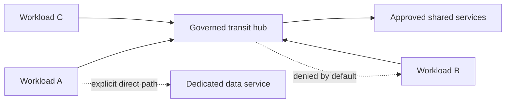
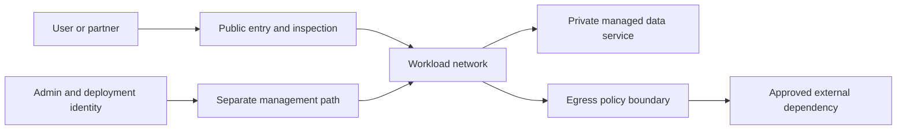
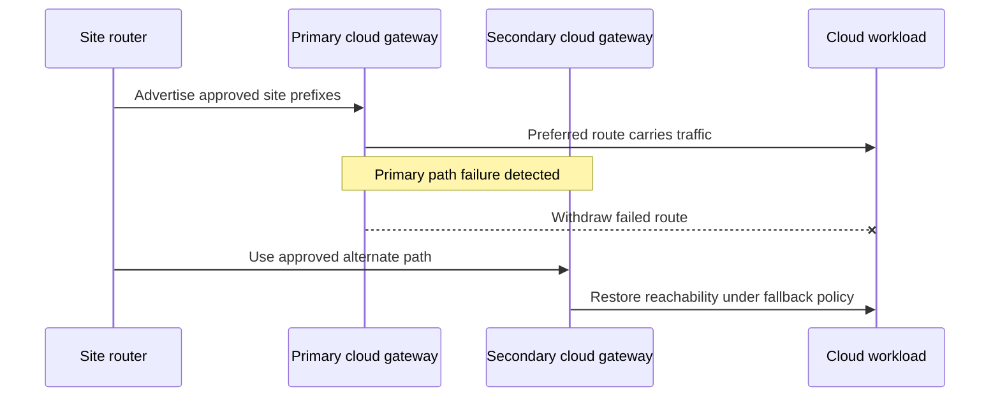
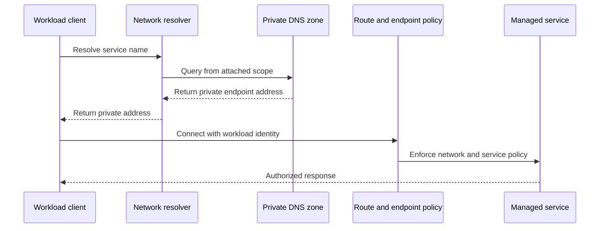
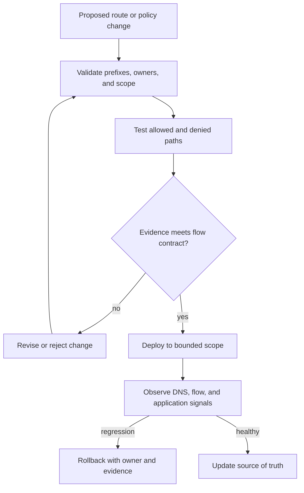

# Cloud Network and Connectivity Architectures

Part: [10 — Cloud Architecture](PART_OVERVIEW.md)

A cloud network architecture is the set of address, routing, trust, connectivity, naming, and ownership decisions that lets workload components communicate while limiting unintended paths. It is not just a diagram of virtual networks and subnets. The design must say which team can change a route, which traffic is permitted, how names resolve, what happens when a link fails, and how production paths are observed.

This chapter composes cloud networking capabilities into workload topologies. Part 09 [Cloud Networking](../09_Cloud_Computing/CH05_Networking.md) owns provider products and their configuration; Part 05 owns the underlying IP, routing, DNS, firewall, NAT, VPN, and load-balancing mechanics. The focus here is the architecture choices across those services.

## Start with Communication Requirements

Before drawing networks, enumerate the communicating actors and flows. Include users, application components, data services, platform services, administrators, deployment systems, partners, devices, and external providers. For every material flow, record:

- Source and destination ownership.
- Protocol and direction, including whether return traffic is expected.
- Trust level and data sensitivity.
- Expected rate, peak, payload, and latency budget.
- Required availability and behavior when the path is unavailable.
- Name-resolution and identity dependencies.
- Whether the path must be private, inspected, logged, or restricted by location.

A diagram that shows “application to database” but omits the deployment agent, backup path, monitoring collector, or operator access path is an incomplete production network model. Administrative and service-management flows have different risk profiles from workload traffic and should not be assumed to share a trust policy.

Translate these flows into explicit allowed paths. A useful principle is to make permitted communication intentional and reviewable, rather than relying on broad network reachability and adding restrictions only after an incident.

## Network Scope, Addressing, and Segmentation

Cloud providers offer different resource scopes for virtual networks, subnets, routes, and attachments. Some virtual networks are regional, others have broader scope with regional subnets, and their cross-account or cross-project attachment options vary. The provider-specific definitions belong to Part 09 and should not be flattened into one fictional common model.

At the architecture level, design around these questions:

1. Which workloads require independent routing and administration?
2. Which address ranges must communicate, and are they guaranteed not to overlap with on-premises, partner, or acquired networks?
3. Where are subnets or equivalent route domains needed for service placement, fault isolation, or policy boundaries?
4. Which network scopes need shared services, and which team governs attachment and route ownership?
5. How can environments be separated without duplicating every shared capability?

Address planning is difficult to reverse once connected networks and partner integrations depend on it. Reserve ranges deliberately, model future acquisitions and expansion, and avoid assigning overlapping ranges just because two environments are currently isolated. Part 05 [IP addressing and routing](../05_Networking_and_OS/PART_OVERVIEW.md) covers address and route mechanics.

Segmentation should correspond to trust, ownership, and failure boundaries. A subnet boundary alone does not imply that traffic is filtered or that different administrators are isolated. Security groups, network access controls, firewalls, service identities, and application authorization each operate at different layers; the design must state how those controls combine. Part 15 Security owns threat modeling and defense-in-depth principles.

### Turn flows into address and route intent

After collecting flows, build an address plan that can grow without renumbering connected environments. Reserve ranges for workload, shared services, management, and future expansion; document which ranges may be summarized and which must remain distinct. Check overlaps against data centers, partner networks, acquisition candidates, remote-user VPN pools, and provider-managed service ranges. An address plan that is unique only within one account is not sufficient once transit or federation is introduced.

For each communication requirement, record the source scope, destination scope, protocol/port, direction, route owner, authorization control, and expected failure response. Then derive route tables and policy from that contract. This prevents a broad route such as “all spokes can reach the hub” from being mistaken for permission to access every service in the hub.

Route propagation needs boundaries. Decide which prefixes a network may advertise, which routes are accepted, how defaults are handled, and what happens when an unexpected route appears. In a hybrid topology, an accidentally advertised default route can redirect internet traffic through a data center or partner network. A missing route may be safer than an unintended route, but the resulting outage still needs detection and an owner.

Address and route design should also anticipate partial failure. For redundant gateways, specify which path is preferred and when routes are withdrawn. If a central transit service is unavailable, determine which direct paths are allowed and which must fail closed. Avoid emergency fallback routes that bypass inspection or data-residency controls without an explicit, time-bounded exception.

## Topology Patterns and Their Costs

### Isolated workload networks

A dedicated network per workload or environment offers clear route ownership and can limit blast radius. It is attractive when workloads have distinct regulatory needs, lifecycle, or administrators. The cost grows with shared service connectivity, route management, IP consumption, and duplicated network appliances or endpoints. Isolation is also incomplete if all networks share a central identity, DNS, deployment, or transit dependency.

### Hub-and-spoke and transit designs

A hub-and-spoke design centralizes shared connectivity, inspection, and route exchange while workload networks attach as spokes. It can simplify shared access and give platform teams a clear network boundary. It also creates a central dependency: a route mistake or capacity failure in the hub can affect many spokes. The hub's availability, scale, change process, and failure containment must be designed as a production workload.

A transit hub can reduce the number of direct connections, but it does not automatically provide segmentation. If every attached spoke can route to every other spoke, the topology has centralized connectivity without meaningful least-connectivity policy. Define route propagation and traffic authorization separately.

### Mesh and direct connectivity

A mesh or set of direct peerings can reduce path length and central bottlenecks for a limited number of networks. As the network count grows, relationships and ownership multiply, route visibility becomes harder, and consistent policy is more difficult. Mesh is appropriate when direct communication is genuinely needed and the management model can keep the graph understandable; it is not a default target for every cloud estate.

| Topology | Strength | Main cost or risk | Useful when |
|---|---|---|---|
| Isolated networks | Clear local ownership and blast-radius boundary | More attachments and repeated platform services | Workload isolation or lifecycle dominates shared access |
| Hub-and-spoke | Central policy and shared connectivity | Hub capacity/change becomes a common dependency | Many spokes need governed common services |
| Transit fabric | Scalable route exchange among many networks | Route propagation and segmentation complexity | A large estate needs controlled network-to-network connectivity |
| Mesh/direct links | Short paths and fewer central hops | Relationship count and policy drift grow | Few networks have specific high-throughput direct flows |

These patterns can be mixed. A regulated workload may use a hub for shared egress while retaining a separate direct path to a low-latency data service. The architecture should explain each exception and who owns the route.

The dashed connections represent policy decisions, not ordinary reachability. A hub topology does not imply that spokes may communicate with each other.

Topology size changes the cost of policy and operations. A full mesh among 12 networks can require 66 pairwise relationships; among 50 networks it can require 1,225. A hub reduces the number of direct attachments, but it concentrates throughput, routing change, inspection, and incident ownership. These counts do not prove that one topology is superior; they expose the growth curve and the number of relationships the team must test and govern.

Choose a topology from the communication graph. If most workloads need only shared identity, DNS, and audit, a central service path with no general spoke-to-spoke routing may be simpler than a transit fabric. If two data-heavy workloads need sustained high-throughput exchange, a direct path may reduce central bottlenecks. If regulatory tenants must not share an inspection failure domain, separate hubs or egress boundaries may be warranted. Document exceptions as named flows with an owner, reason, and review condition rather than creating invisible route-table workarounds.

For each topology option, compare attachment count, routes per scope, failure concentration, change blast radius, maximum expected throughput, and visibility during an incident. A hub that is redundant at the device layer can still be a single administrative failure domain if one automation identity changes every route. A mesh can remain technically reachable while policy drift makes it difficult to prove that only approved pairs communicate.

## Ingress, Egress, and Private Service Access

Ingress describes how users and external systems reach a workload. Egress describes how the workload reaches external destinations and managed services. For each path, decide whether it is public or private, where identity and network policy are evaluated, whether traffic is inspected, how it is logged, and what failure behavior is acceptable.

Public ingress may use a content delivery network, web application firewall, global load balancer, or regional entry point. These are separate responsibilities: edge caching does not equal application authorization, and a load balancer does not provide a complete threat model. Product mechanics and traffic algorithms link to Part 05 and Part 09.

Egress deserves deliberate design. Unrestricted outbound access can enable data exfiltration, unexpected dependency calls, malware callbacks, and uncontrolled cost. Centralized egress can provide consistent inspection and logging, but can add latency, capacity limits, route complexity, and a shared failure domain. Workload-local egress can isolate failures but requires distributed policy and visibility. Choose based on destinations, sensitivity, operational capability, and failure tolerance.

Private service connectivity can avoid exposing a managed service through a public endpoint, but it introduces DNS and routing dependencies. Verify that names resolve to the intended private address from every attached network and that clients fail safely if private resolution is unavailable. Private connectivity is not a substitute for service identity, authorization, or encryption.

Troubleshoot a private service path in layers. First verify the client resolves the expected private name from its actual runtime. Then verify that the address belongs to the intended endpoint and that the route exists from the source network. Confirm that network policy permits the required protocol and that return routing is symmetric where the service requires it. Finally test service identity, resource authorization, and application behavior. This order avoids changing broad firewall rules to compensate for a DNS or identity defect.

Choose egress by destination behavior. Fixed partner endpoints can often use explicit address or service identities and narrower routes. Dynamic SaaS endpoints may require an application-aware proxy or domain policy. Shared hosting and certificate validation then need careful handling. A centralized egress point simplifies inspection and evidence but becomes a throughput and availability dependency; distributed egress can isolate workloads but multiplies rule management and makes consistent monitoring harder.

Decide the failure posture before deploying an egress control. If the inspection service fails, should outbound requests stop, use a constrained alternate path, or continue only for a named low-risk destination set? A broad emergency bypass can turn a network outage into a data-exposure incident. Test both the normal route and the failure route, and ensure audit evidence distinguishes the two.

## Hybrid Connectivity and Route Ownership

A hybrid link connects cloud workloads to data centers, campuses, partner networks, or industrial sites. The network architecture should distinguish connectivity from reachability: a circuit or tunnel can be healthy while routes, DNS, policy, or application dependencies still prevent useful communication.

Choose between encrypted internet connectivity, private circuits, or a combination based on bandwidth, latency, predictable routing, provider reach, redundancy, and cost. A private circuit is not automatically encrypted or independent of shared carrier infrastructure. A VPN is not automatically resilient if both tunnels share the same customer gateway, region, power, or upstream route.

Make route ownership explicit. Identify who advertises prefixes, approves propagation, prevents route leaks, handles overlapping address space, and diagnoses asymmetric paths. Ensure failover has a measurable convergence target and verify the application tolerates the interruption and path change. Part 05 [VPN](../05_Networking_and_OS/CH13_VPN.md) owns protocol and tunnel mechanics; this chapter owns the topology and operational responsibility.

For multi-provider connectivity, avoid ad hoc transitive routing assumptions. Each provider has distinct network scopes and attachment products. Part 10 CH10 [Hybrid Cloud and Multi-Cloud Architecture](CH10_Hybrid_and_Multi_Cloud_Architecture.md) owns the broader cross-provider decision and shared identity/data concerns.

The route transition needs a tested convergence target and a policy check to ensure the alternate path does not bypass required inspection.

## DNS and Service Naming Across Boundaries

This separates name resolution from reachability and authorization. A private answer alone proves none of the later steps.

Name resolution often determines whether a network path works at all. A production design identifies authoritative zones, private zones, forwarding rules, resolver ownership, split-horizon behavior, and the path for names that cross cloud and on-premises boundaries.

A private endpoint that is reachable by address but resolves publicly is a security and availability defect. Conversely, a private name that resolves only in one network can make failover or operator access unreliable. Model resolution paths from each client environment, including containers, serverless runtimes, administrator workstations, and disaster-recovery locations.

DNS time-to-live (TTL), resolver caches, and client retry behavior affect traffic switching and recovery. Do not assume that changing a record instantly redirects all traffic. Part 05 [DNS](../05_Networking_and_OS/CH08_DNS.md) covers DNS mechanics; provider-specific private-zone integrations remain in Part 09.

## Security Boundaries and Trust

Network controls constrain paths, but they do not establish the identity or intent of every caller. A robust design combines:

- Segmentation that limits which components can communicate.
- Workload identity and service authorization for the caller and action.
- Encryption appropriate to the trust boundary and data sensitivity.
- Ingress and egress policy tied to known consumers and destinations.
- Logging sufficient to reconstruct the path and principal during an incident.

Do not treat “inside the virtual network” as equivalent to trusted. Compromised workloads, misrouted traffic, and shared services can cross internal boundaries. Likewise, do not add a complex centralized firewall path without deciding who can change it, how rules are tested, and what happens when it is unavailable.

## Resilience, Capacity, and Operations

Every centralized network service is a dependency. Transit hubs, DNS resolvers, egress gateways, firewalls, and private connectivity endpoints need capacity, redundancy, monitoring, change ownership, and a tested recovery path. Redundancy at the device or zone layer does not help when both paths depend on one route table, operator, identity, or provider control plane.

Test the traffic path end to end, not just the state of individual resources. Useful tests include route reachability from each source scope, DNS answers from each resolver context, allowed and denied flow probes, throughput and latency under representative load, and recovery after a link or route failure. Capture observed path, source identity, destination, and result so that a security policy change can be distinguished from a routing regression.

Operationally, define a network source of truth and avoid unmanaged manual exceptions. Flow logs and route state help answer what happened, but they do not by themselves explain whether the traffic was authorized. Correlate network evidence with workload identity, application logs, deployment changes, and DNS behavior.

## Worked Example: Shared Services for Three Product Networks

A company has three product networks, a central identity service, and a private analytics service. Product A handles regulated payment data; Product B serves public catalog traffic; Product C runs batch analytics. All need central audit collection, but only Product C should send large data volumes to analytics.

A single flat network would simplify routes but would make accidental access between product tiers easy and complicate policy ownership. Fully isolated networks with no shared path would protect boundaries but prevent required identity, audit, and analytics access. A reasonable design attaches each product network to a governed transit layer, exposes central identity and audit through narrowly defined service paths, and permits the analytics path only from the approved batch sources.

The route architecture and security policy are separate artifacts. Routing says where packets can travel; identity and network policy say which flows are allowed. DNS provides the correct private service address; application authorization still determines which records a caller may access. The transit layer is redundant and capacity-tested, and each product owner can see the effective routes and the shared-service outage behavior.

Before launch, the team tests both allowed and forbidden paths, private DNS from each network, transit failure, analytics throughput, and audit evidence. A successful connection test is not enough: the test must confirm that the right principal reached the right service through the intended path and that prohibited flows remain blocked.

The allowed-flow contract is explicit:

| Source | Destination | Allowed behavior | Denied behavior | Owner |
|---|---|---|---|---|
| Product A runtime | Identity and audit services | Authenticated calls and telemetry export | Direct access to other product data stores | Payment platform owner |
| Product B public ingress | Catalog API | HTTPS through approved entry and inspection | Direct route to payment or analytics networks | Catalog team and network platform |
| Product C batch worker | Analytics service | Bounded data transfer using workload identity | Interactive or administrative access to payment records | Analytics owner |
| Operator workstation | Management endpoint | Named, audited administrative path | General access from user subnet to workload ports | Platform operations |

Routes make destinations reachable; network and service policies enforce allowed behavior; workload identity establishes the caller; the application validates the requested operation. These controls are tested separately because a successful TCP connection proves neither authorization nor correct data scope.

The failure exercise removes one transit gateway and confirms that the remaining path meets the analytics batch window without exposing payment data to a fallback route. A separate resolver-failure test confirms private service names do not fall back to public addresses. If central inspection is unavailable, payment egress fails closed while the catalog continues serving cached public content under its approved policy. The runbook identifies which team can restore routing, who approves a temporary exception, and how the exception is removed and audited afterward.

This makes network changes testable as workload changes rather than as isolated route-table edits.

## Architecture Review Questions

- Are all workload, administrative, deployment, backup, and telemetry flows represented?
- Are address ranges unique across current and plausible future attachments?
- Does each network boundary correspond to a clear owner, trust boundary, or failure boundary?
- Is segmentation enforced independently of topology and route visibility?
- Are ingress and egress paths explicit, limited, observable, and capacity-tested?
- Do private endpoints resolve correctly from every intended client context?
- Is route advertisement and propagation owned, reviewed, and tested for failure?
- Have centralized transit, DNS, egress, and inspection services been treated as workloads with recovery needs?
- Does the design specify what happens when a link, resolver, route, or inspection service fails?
- Can an operator prove which principal used which path to reach a sensitive service?

Further reading: [Part 05 Networking and Operating Systems](../05_Networking_and_OS/PART_OVERVIEW.md), [Part 09 Cloud Networking](../09_Cloud_Computing/CH05_Networking.md), [Part 10 Hybrid and Multi-Cloud Architecture](CH10_Hybrid_and_Multi_Cloud_Architecture.md), and [Part 15 Security](../15_Security/PART_OVERVIEW.md).
