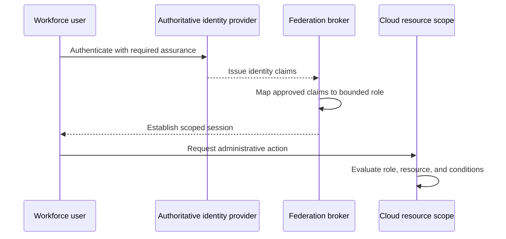
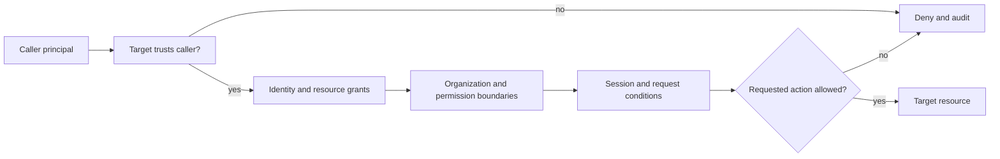
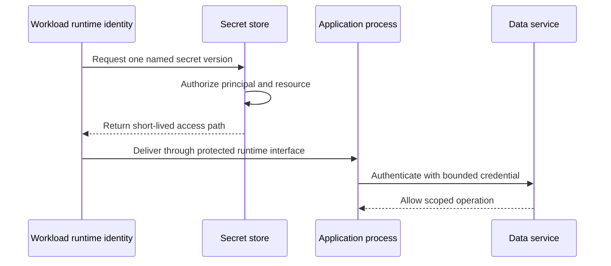
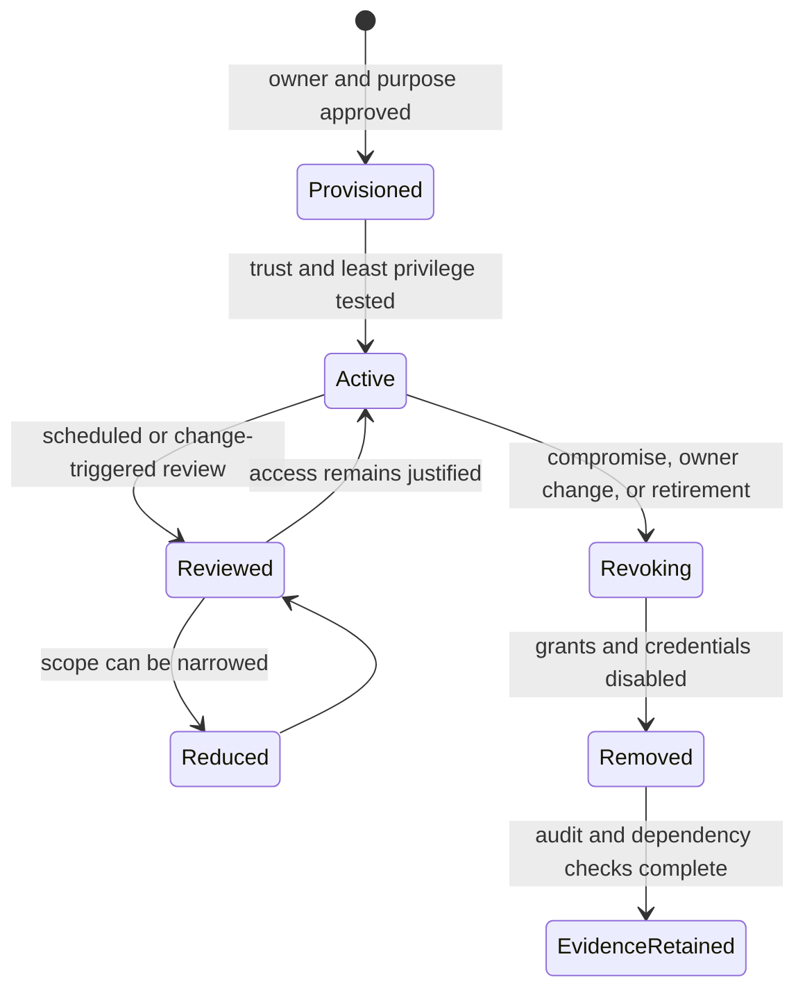

# Cloud Identity and Access Architecture

Part: [10 — Cloud Architecture](PART_OVERVIEW.md)

Cloud identity architecture determines which people and workloads can act, on which resources, under what conditions, and with what evidence. It connects an organization's authoritative identity sources to provider control planes, applications, data services, deployment systems, and incident-response paths.

The goal is not to centralize every identity decision into one directory. It is to make trust explicit, keep privileges bounded, provide credentials through controlled paths, and ensure access can be observed and revoked. Part 09 [IAM](../09_Cloud_Computing/CH09_IAM.md) owns provider policy mechanics; Part 05 owns authentication and federation protocols; Part 15 Security owns threat modeling and security-control depth.

## Identity Architecture Starts with Principals and Actions

An identity design begins by identifying principals, resources, and actions. A principal may be a person, a workload, a deployment pipeline, a managed service, or an external partner. A resource may be a cloud account, API, data store, key, queue, or control-plane object. An action may be administrative, data-plane, deployment, support, or recovery activity.

Do not collapse identity, authentication, and authorization into one label:

- **Identity** states which principal is making a request.
- **Authentication** establishes evidence for that identity.
- **Authorization** decides whether the principal may perform the requested action on the resource in its context.
- **Audit** records enough trustworthy information to reconstruct who acted, what they did, and how the decision was reached.

The identity provider or cloud service can supply primitives, but architecture must compose them. A successful sign-in does not imply broad access, and a policy grant does not prove the caller's identity was established safely.

### Inventory principal classes before designing roles

An identity inventory should distinguish principals by purpose, not merely by whether they are “users” or “service accounts.” Similar-looking credentials can have very different blast radius and lifecycle:

| Principal class | Typical action | Lifecycle owner | Important boundary |
|---|---|---|---|
| Workforce user | Operate, develop, review, or support a workload | Identity and team-management processes | Individual attribution, employment changes, and privileged elevation |
| Runtime workload | Call a data store, queue, key service, or another application | Workload owner and runtime platform | Bound to one service or deployment unit; permissions limited to its function |
| Deployment automation | Build, publish, deploy, or change infrastructure | Platform/release engineering | Separate from runtime permissions and scoped to approved environments |
| Provider or managed service | Perform service-integrated operations on behalf of a workload | Provider contract plus customer configuration | Service identity and customer grant are both required and auditable |
| External partner | Exchange data or invoke an approved integration | Partner owner and contract owner | Trust is restricted to named use, audience, data, and duration |
| Recovery identity | Restore, decrypt, or re-establish service | Resilience and security owners | Protected independently and exercised without becoming routine admin |

For every principal, record its authoritative source, owner, resource scope, allowed actions, credential source, expiry/revocation behavior, and audit destination. This inventory exposes shared principals that hide which application or operator actually made a request.

## Workforce Identity and Privileged Access



The architecture review verifies both claim provenance and the role mapping; successful sign-in alone does not establish least privilege.

Workforce access typically federates employees and contractors from an authoritative identity system into cloud environments. Federation reduces the need for separate long-lived user accounts and enables joiner/mover/leaver processes to affect cloud access. Its architecture still needs to answer:

- Which identity source is authoritative for employment and group membership?
- How do users authenticate, and which conditions are required for privileged activity?
- How are groups mapped to cloud roles without making directory structure the only source of authorization intent?
- How quickly are access changes and terminated identities reflected in cloud resources?
- Who can perform emergency access, how is that access monitored, and how is it removed afterward?

Privileged access should be separated from routine user access. Use distinct administrative roles, time-bounded elevation where available, approval appropriate to risk, and a monitored emergency path. Avoid making a shared administrator account the recovery strategy: it obscures accountability and turns compromise into an organization-wide event.

The authentication protocol, token exchange, and session mechanics belong to Part 05 OAuth, OpenID Connect, Security Assertion Markup Language, and related protocol chapters. The architecture question here is which identity source and trust relationship are appropriate, which cloud scopes accept the identity, and what happens when federation is unavailable.

There are two common workforce patterns. A centrally federated model uses the organization's identity source for sign-in and maps claims or groups to cloud roles. It simplifies joiner/leaver handling but makes the directory, federation endpoint, and group governance critical dependencies. A provider-local identity model may be useful for isolated emergency or service contexts, but creates a second lifecycle and access-review surface. Many organizations use federation for routine users plus a narrowly governed recovery path; the recovery path should not become a shadow administrator directory.

Group-to-role mapping should encode stable job responsibilities rather than mirror every directory group. If hundreds of groups map directly to provider permissions, policy review becomes dependent on directory knowledge and can fail silently when teams rename or reuse groups. Use a small set of reviewed role bundles, name their intended scope and actions, and require an owner to approve membership. When a group is removed, verify that effective cloud sessions, keys, and downstream application access expire within the required window.

Federation configuration is a trust decision. The relying environment accepts identity evidence from an issuer only under defined conditions. Those conditions can include issuer, audience, subject, tenant, group, device posture, repository, deployment environment, or authentication strength. Each condition narrows who can obtain access, but every condition also creates a lifecycle dependency: a renamed group, repository, tenant, or application may unexpectedly break or broaden access.

Prefer stable, narrowly scoped claims over display names or broad group membership. For workforce access, a claim should identify a person or approved role with enough context to evaluate access. For workload federation, constrain trust to the intended repository, branch, build environment, or runtime where the identity provider supports those conditions. Review token audiences and lifetime so evidence intended for one service cannot be replayed as a general credential elsewhere. The exact claim and token rules are protocol-specific and remain with Part 05; the architecture review verifies that trust conditions match the organizational boundary.

| Federation choice | Benefit | Failure or governance cost |
|---|---|---|
| Central identity source | Consistent onboarding, offboarding, and policy evidence | Directory or federation outage can affect many workloads and operators |
| Separate identity domain for a regulated or acquired unit | Clearer administration and evidence boundaries | Cross-domain access and lifecycle synchronization become explicit integration work |
| Workload federation from an external CI system | Avoids storing long-lived deployment keys | Trust can be too broad if repository, branch, or environment claims are weak |
| Local emergency identity | Can preserve recovery access during central federation failure | Requires independent custody, monitoring, rotation, and tightly controlled use |

Choose the smallest number of identity domains that meet actual trust and lifecycle needs. Duplicating directories for every workload creates synchronization burden; centralizing all control without blast-radius limits makes a single identity compromise systemic.

## Workload Identity and Credential Delivery

Workloads need identities to call cloud services and other applications. A secure architecture prefers identities that are bound to the workload's runtime and issue short-lived credentials over static keys copied into source code, images, environment files, or deployment artifacts.

A workload identity design should specify:

1. How the runtime receives or proves its identity.
2. Which audience or target service may accept that identity.
3. Which actions and resource scopes are authorized.
4. How credentials expire, refresh, and are revoked.
5. How the identity is attributed in logs and incident response.

Managed identities and workload federation reduce secret distribution but do not automatically produce least privilege. A compromised workload can still use every permission granted to its runtime identity. Bind identities to narrow workloads, constrain trust conditions, scope resource access, and separate deployment identities from runtime identities.

```mermaid
sequenceDiagram
    participant Workload as Cloud workload
    participant Runtime as Runtime identity service
    participant Token as Token or credential issuer
    participant Service as Target cloud service
    Workload->>Runtime: Request identity evidence
    Runtime->>Token: Exchange evidence for scoped credential
    Token-->>Workload: Short-lived credential
    Workload->>Service: Request action on resource
    Service->>Service: Evaluate identity, policy, resource, and context
    Service-->>Workload: Allow or deny; emit audit event
```

The diagram is conceptual; provider token exchange and policy evaluation differ. See Part 09 IAM for service-specific behavior and Part 05 for the underlying federation and token protocols.

The workload identity path has several independent failure points: the runtime may be unable to attest itself, the issuer may reject the trust condition, the audience may not match the target, the resulting role may lack permission, or the target resource may reject the request. Instrument these stages separately. A generic “access denied” alert does not tell whether to investigate deployment configuration, trust policy, resource policy, network reachability, or application behavior.

Separate identities for build, deploy, and runtime. A build process needs source and artifact access; deployment automation needs narrowly scoped write access to a target environment; the running service needs only its runtime dependencies. Reusing one principal across all stages means a compromised build plugin may inherit production data access, or a runtime compromise may permit arbitrary redeployment. The small additional setup cost buys a more containable incident and clearer audit attribution.

## Authorization Across Organizational Boundaries



Provider evaluation order and deny semantics differ; this is a review model for the relevant policy surfaces, not a replacement for provider-specific evaluation rules.

Cloud authorization commonly combines several policy surfaces: the principal's identity policy, a resource policy, organization-level guardrails, a permission boundary, a session condition, and service-specific controls. Provider semantics differ, and an explicit deny or a restrictive boundary may override an apparent grant. Part 09 IAM is the source for each provider's evaluation rules.

At the architecture level, define a permission model that separates:

- Human administration from application runtime access.
- Control-plane actions, such as creating or changing resources, from data-plane actions, such as reading objects or querying records.
- Deployment authority from production workload authority.
- Organization-wide guardrails from workload-specific grants.
- Routine operations from break-glass access.

Cross-account, cross-subscription, and cross-project access involves both the caller's authority and the target resource's trust. Model both sides. A source identity with permission to request a role is not sufficient if the target scope does not trust the caller; a target trust relationship is not sufficient if the resulting role grants excessive actions.

Use an access matrix to make the intended relationship inspectable before translating it into provider policy:

| Caller | Target | Intended action | Approval/condition | Evidence |
|---|---|---|---|---|
| Deployment pipeline | Production runtime scope | Publish an approved version | Protected release identity and reviewed artifact | Deployment record and provider audit event |
| Runtime identity | One database and one secret | Read application state and retrieve credential | Workload-bound trust and resource-specific grant | Access logs and secret retrieval event |
| Operator | Service health and deployment controls | Diagnose and perform bounded rollback | Named user, time-limited elevation, incident/change reference | Session and change audit |
| Recovery identity | Backup and encryption key | Restore a workload in approved recovery scope | Declared recovery event and dual review where warranted | Restore, key-use, and approval records |

The matrix is not a policy language. It is a design check for whether a proposed role is too broad, whether the target trusts an unintended principal, or whether no one owns a recovery permission. Translate rows into provider-specific policies only after identifying the resource and evaluation scope.

Use resource boundaries to reduce the consequences of a policy mistake, but do not assume that placing two resources in different scopes guarantees they cannot communicate. Network attachment, shared services, delegated roles, and provider support paths can cross those boundaries.

## Secrets, Keys, and Identity Are Separate but Connected



The design identifies the store, runtime, and target as separate authorization boundaries; a secret's existence does not itself authorize its use.

An identity proves who or what is acting; a secret store holds sensitive values; a key-management service performs or controls cryptographic key operations; a certificate authority issues certificates. These are connected services with distinct responsibility and failure behavior.

Prefer runtime retrieval using workload identity instead of distributing a secret to every deployment system. Where static credentials remain unavoidable, assign rotation ownership, propagation behavior, overlap windows, cache lifetime, and revocation response. Part 09 [Secrets Management](../09_Cloud_Computing/CH13_Secrets_Management.md) owns cloud secret-store lifecycle; Part 15 owns broader cryptographic and security controls.

Key access is an identity dependency. A restored database may remain unusable if the recovery identity cannot access the encryption key. A workload may start successfully but fail data access after a key policy change. Include key administrators, workload principals, backup operators, and emergency recovery roles in the access model without making key administrators equivalent to data owners.

Credential delivery also needs overlap behavior. Rotating a secret can temporarily require both old and new credentials to be valid while consumers refresh; revoking the old credential too early creates an outage, while keeping it valid indefinitely weakens containment. Specify maximum cache lifetime, refresh trigger, rollout order, verification, and emergency revocation behavior. A long-lived secret may remain in logs, crash dumps, build artifacts, or local environment snapshots after the source value is rotated, so incident response must consider where copies could persist.

## Identity Lifecycle and Failure Behavior



The lifecycle applies to human and workload principals. Review triggers and expiry behavior differ. Removal includes downstream resource policies and active credentials, not only deleting the directory object.

Identity is a runtime dependency and a control plane. Design for normal lifecycle events and failures:

- New workload onboarding creates an owner, runtime principal, deployment principal, minimal permissions, and audit path.
- Team or service changes update group mappings, ownership, and policy without leaving orphaned roles.
- Compromise triggers credential revocation, token/session expiry, permission reduction, and investigation while preserving evidence.
- Identity-provider or federation outage has a defined impact on new sessions, existing sessions, automation, and emergency access.
- Provider control-plane unavailability may prevent policy changes even while data-plane requests continue under existing grants.
- Disaster recovery ensures restored workloads can obtain identities and reach keys, secrets, and dependent services.

Avoid a single shared identity service with no tested degraded mode. Central identity simplifies policy and auditing, but it can become a common failure dependency across otherwise independent workloads. High-risk operations may need a separately protected recovery path with strict monitoring and explicit use criteria.

An identity recovery plan should state what continues during an outage. Existing sessions may remain valid while new workforce sign-ins fail; an application may continue to use a cached credential while secret rotation is delayed; deployment may stop while the current runtime remains healthy. Decide which of these behaviors is safe for the workload. Avoid broad fail-open authorization as a generic availability measure. If a bounded local credential or emergency role is used, constrain its scope, duration, storage, activation, and post-use review.

| Failure | Likely impact | Architectural preparation |
|---|---|---|
| Federation or directory outage | Users cannot establish new sessions; group updates may pause | Define session lifetime, emergency access, operator communication, and which changes are postponed |
| Workload token exchange fails | New calls fail even though the application process is healthy | Monitor attestation, audience, issuer, and permission stages independently; avoid embedding static keys as an automatic fallback |
| Principal is compromised | Attacker can use granted permissions until containment | Maintain principal-to-workload inventory, rapid revocation steps, narrow grants, and evidence preservation |
| Access removal is delayed | Former team member or retired service retains effective access | Define propagation expectations, check active sessions and resource grants, and alert on orphaned principals |
| Recovery identity lacks key access | Backup exists but restored data cannot be decrypted | Test identity and key permissions as part of restore exercises, not as a separate policy review |

Access review should be evidence-driven rather than a periodic checkbox. Start with privileged roles, external identities, identities without a current owner, credentials that have not been used, and principals whose permission exceeds the task demonstrated in audit records. Use observed activity carefully: infrequent disaster-recovery access may be essential, and lack of recent use is not proof that a permission is unnecessary. The reviewer needs the role's purpose, owner, scope, last meaningful use, and recovery consequence before revoking it.

## Worked Example: Deployment and Runtime Access for a Payment API

A payment API is deployed by a pipeline and serves requests in production. The pipeline needs to publish a new version and update a limited set of runtime resources. The API needs to read one database secret and call a payment authorization service. Operators need to inspect health and perform a controlled rollback; security reviewers need read-only access to policy and audit evidence.

Use distinct principals for pipeline, runtime, operator, and reviewer. The pipeline can deploy but cannot read payment records or assume the runtime identity. The runtime identity can reach only the required secret and service actions. Operators receive time-bounded elevated access through a named identity, while reviewers have read-only evidence access. Organization guardrails prevent disabling audit collection, and the application network path separately restricts destinations.

The access path is tested as both an authorization and an operational workflow: deploy a version, verify it cannot access unrelated secrets, rotate the database credential, confirm the runtime refreshes it within the allowed window, revoke a compromised pipeline credential, and restore the workload into a recovery scope. A design that passes only a policy syntax check has not proved the intended end-to-end access boundary.

The review creates an access test matrix. Positive tests verify that each principal can perform its required task; negative tests verify that the pipeline cannot read payment records, the reviewer cannot deploy, the operator cannot retrieve the database secret, and the runtime cannot change its own authorization policy. A separate recovery test proves that the recovery identity can restore and decrypt a backup without relying on the production deployment principal. These negative and recovery cases often reveal more about architecture quality than the happy-path deployment test.

The review also considers ambiguity and incident behavior. A failed payment authorization call might be a network timeout, an expired credential, a denied service action, or a provider outage. The runtime must not log the secret or token while diagnosing it. The operator role can inspect health and deployment state but cannot query payment records. The recovery identity is stored and activated outside the ordinary pipeline, and its use generates an independent audit signal. These distinctions allow an incident responder to contain a deployment credential without disabling the customer-serving runtime or losing the ability to restore data.

## Architecture Review Questions

- Are human, workload, deployment, support, and recovery principals distinct where their responsibilities differ?
- Is the authoritative source and lifecycle owner for each identity explicit?
- Are trust conditions and authorized actions scoped to the intended workload and resource?
- Are control-plane and data-plane permissions reviewed separately?
- Can access be revoked fast enough for the threat and business requirements?
- What operations continue or fail during an identity-provider or federation outage?
- Are break-glass paths monitored, tested, and independently controlled?
- Can a restored workload access its runtime identity, secrets, keys, and dependencies?
- Do audit records attribute actions to a unique principal and preserve evidence across scopes?
- Do access reviews detect orphaned, unused, privileged, or overbroad identities?

Further reading: [Part 05 Networking and Operating Systems](../05_Networking_and_OS/PART_OVERVIEW.md), [Part 09 IAM](../09_Cloud_Computing/CH09_IAM.md), [Part 09 Secrets Management](../09_Cloud_Computing/CH13_Secrets_Management.md), and [Part 15 Security](../15_Security/PART_OVERVIEW.md).
