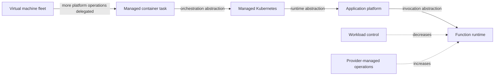
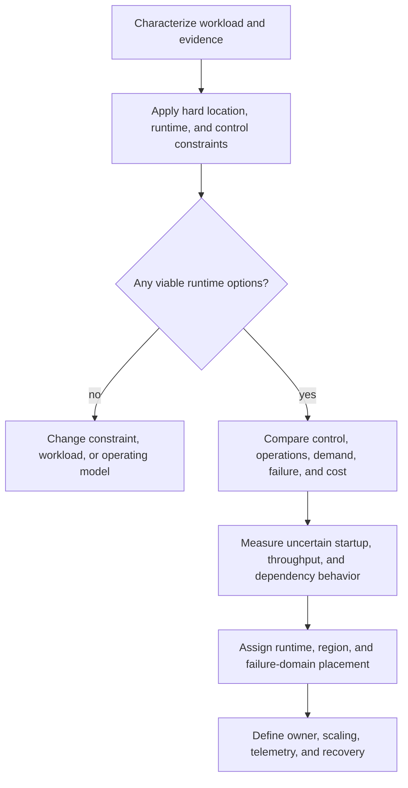
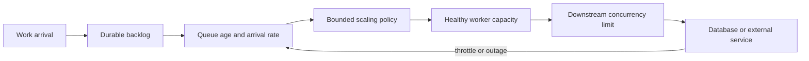
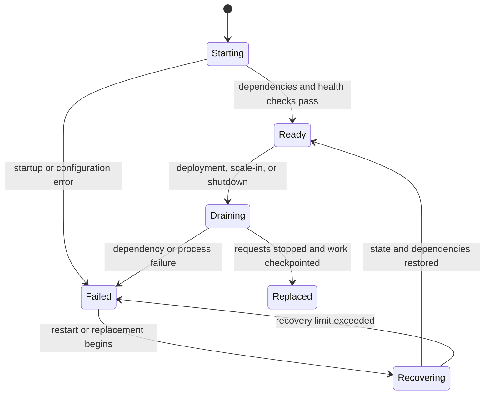
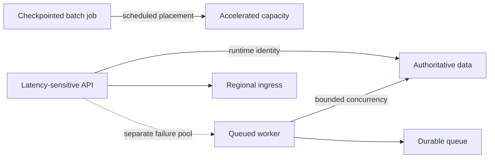

# Compute Placement and Runtime Architecture

Part: [10 — Cloud Architecture](PART_OVERVIEW.md)

Compute placement decides where and how each workload component executes. The choice affects more than processor type: it determines who patches the runtime, how state is handled, how quickly capacity appears, which failure domains are visible, and how tightly the component depends on provider APIs.

This chapter provides a method for selecting runtime and placement from workload evidence. Part 09 [Compute](../09_Cloud_Computing/CH04_Compute.md), [Containers](../09_Cloud_Computing/CH07_Containers.md), [Kubernetes](../09_Cloud_Computing/CH08_Kubernetes.md), and [Serverless](../09_Cloud_Computing/CH11_Serverless.md) own provider service mechanics. Part 05 owns virtualization and container-runtime fundamentals; Part 12 owns Kubernetes internals.

## Describe the Workload Before Choosing a Runtime

A placement decision made from a component name such as “API” or “worker” is underspecified. Record behavior and constraints first:

- CPU, memory, storage I/O, network throughput, accelerator, and operating-system requirements.
- Startup time, job duration, concurrency, peak-to-average demand, burst shape, and idle periods.
- State location, local-disk needs, checkpointing, graceful shutdown, and recovery behavior.
- Latency budget, dependency paths, data location, and expected traffic volume.
- Required control over kernel, runtime, libraries, host networking, and deployment lifecycle.
- Licensing, compliance, isolation, quota, and location constraints.
- Team ability to operate images, clusters, patching, scaling, observability, and incident response.

These inputs can be measured, estimated, or unknown. Record the evidence and confidence. If a runtime decision depends on a peak-demand assumption or package-startup estimate, validate that assumption rather than hiding it behind a provider size recommendation.

## The Runtime Spectrum Is a Responsibility Spectrum

This is a spectrum, not a universal ranking. A workload's runtime constraints can move it to a different point regardless of how much operations the team prefers to delegate.

Cloud compute options form a spectrum from direct infrastructure control to increasingly managed execution:

| Runtime | Main control retained | Work commonly delegated | Architectural costs to evaluate |
|---|---|---|---|
| Virtual machine or instance fleet | Operating system, runtime, process model, host configuration | Physical host and virtualization operations | Patch ownership, image lifecycle, capacity, drain, host failure, and fleet tooling |
| Managed container task/application | Container image and application process | Host lifecycle and some placement/scaling | Startup delay, image registry dependency, execution limits, quotas, and platform-specific networking |
| Managed Kubernetes | Container workload and orchestration APIs | Control-plane operation, sometimes node operations | Cluster lifecycle, add-ons, policy, upgrades, scheduling constraints, and specialist operations |
| Application platform | Application deployment unit and selected runtime settings | OS/runtime patching, deployment infrastructure, and some scaling | Supported language/runtime matrix, platform configuration limits, portability, and diagnostic access |
| Function runtime | Function code, trigger contract, and selected resource settings | Invocation infrastructure and elastic execution | Cold start, timeout, event retry behavior, concurrency, package limits, and vendor integration |
| Specialized/accelerated compute | Workload-specific hardware or performance profile | Often hardware maintenance and base infrastructure | Scarce capacity, driver/runtime compatibility, scheduling, cost, and constrained regional availability |

More managed does not always mean simpler. A managed platform reduces host operations but introduces a stronger service contract and fewer low-level escape hatches. Kubernetes provides a rich orchestration surface but carries ongoing platform and upgrade responsibilities. A function can remove idle server management while exposing strict timeout, concurrency, and event semantics.

The decision should match operational capability to workload needs. Paying for control no one uses creates toil; delegating control the workload requires creates workarounds or infeasibility.

### Interpret the abstraction trade-off

The relevant comparison is not “servers versus serverless.” It is which operating responsibilities the team is prepared to own and which control points the workload actually requires. A workload needing a custom kernel module, persistent local state, or a licensed operating system may rule out a function runtime. A stateless event handler with variable arrivals may gain little from a continuously operated cluster.

| Workload signal | Runtime pressure | Evidence to gather before committing |
|---|---|---|
| Long-running process with host-level dependency | VM or specialized runtime may be necessary | Supported OS/kernel, license terms, patch process, and host recovery behavior |
| Bursty short tasks with independent inputs | Managed task or function can reduce idle operations | Startup time, execution limit, package size, concurrency, and retry behavior |
| Many services need a common orchestration API and platform | Managed Kubernetes may provide useful control | Team skill, add-on lifecycle, upgrade ownership, policy, and network complexity |
| Standard web application with supported runtime | Application platform may remove undifferentiated host work | Runtime/version support, extension needs, diagnostic access, and deployment controls |
| GPU/accelerator-bound batch work | Specialized capacity and scheduling dominate | Regional capacity, driver compatibility, utilization, checkpointing, and job duration |

These signals narrow the candidates; they do not replace testing. A managed platform is a poor choice if its deployment unit cannot meet a required startup or network behavior. Kubernetes is a poor choice when no team can own cluster upgrades and policy, even if its scheduler can express the desired placement. Conversely, avoiding orchestration at all costs can create a bespoke fleet manager that is more complex than the managed platform.

Portability also needs a concrete target. A container image may be portable while relying on a provider-specific identity token, file mount, load-balancer annotation, storage class, or observability agent. If portability is a business requirement, test the image and its dependencies on the alternate runtime and account for the features lost or emulated.

## A Placement Decision Sequence

First apply hard constraints: location, data, licensing, hardware, runtime compatibility, isolation, and latency. Remove options that cannot meet them. Then compare viable choices on control, operations, demand fit, failure behavior, portability, and total cost. Finally test the riskiest assumptions with a representative prototype or measurement.

Do not let a weighted score override a hard constraint. If a score is used to expose preferences, record its inputs, weights, and limits. A small score difference is not evidence that a runtime is objectively superior.

## Placement Across Workload Boundaries

A product does not need one runtime. Separate components when their lifecycle, scaling, state, trust, latency, or support requirements differ enough to justify the network and operational boundary.

For example, an interactive API may require predictable low latency and warm capacity, while a report generator runs in bursts, can wait in a queue, and can checkpoint work. Placing them in the same autoscaling group may cause report generation to consume the headroom required by customer traffic. Separate capacity pools let each component follow its own demand and failure policy, but add deployment, identity, monitoring, and connectivity obligations.

Placement should include more than the compute service:

- **Organizational scope:** Which account, subscription, or project owns the runtime and its cost?
- **Network:** Which users, services, data stores, and control systems can reach it? See [Cloud Network Architecture](CH03_Cloud_Network_and_Connectivity_Architectures.md).
- **Identity:** Which deployment and runtime principals act on its behalf? See [Cloud Identity Architecture](CH04_Cloud_Identity_and_Access_Architecture.md).
- **Data:** Where is authoritative state, and how does the runtime access it? See [Cloud Storage and Data Architecture](CH06_Cloud_Storage_and_Data_Architecture.md).
- **Failure domain:** Which zones, regions, queues, identity services, and deployment controls must survive a failure?
- **Owner:** Who maintains the runtime, configuration, base image, dependency, and support contract?

A component placed close to data may reduce latency and transfer, but can complicate cross-region recovery. A component placed in a highly available region may still depend on a single-zone database. Placement decisions must be reviewed with dependency paths, not in isolation.

## Capacity, Elasticity, and Downstream Protection

The feedback loop must be bounded by the dependency's safe capacity. Scaling workers faster than the downstream service can absorb work increases retries and backlog rather than useful throughput.

Compute capacity should match demand while preserving enough headroom for spikes, deployment overlap, and failure. Autoscaling is useful only when the application can start, warm, and become healthy before the demand surge has passed. It also needs a maximum bound so that scale-out cannot exhaust quota or overwhelm a database, API, or message broker.

Capacity planning should distinguish:

- **Steady-state capacity:** Normal demand and the baseline cost of warm resources.
- **Peak capacity:** Expected maximum concurrent work, including scheduled or seasonal bursts.
- **Failover headroom:** Capacity available after losing a zone, node pool, runtime instance, or region.
- **Deployment overlap:** Temporary additional capacity during rollout, canary, or rollback.
- **Downstream budget:** The maximum rate and concurrency dependencies can safely accept.

Queue-based workloads can absorb bursts by allowing work to wait, but the queue does not increase downstream capacity. A compute scaler that reads queue depth should target a queue-age objective and respect downstream concurrency. Interactive requests may require admission control or graceful degradation instead of unlimited scale-out.

Interruptible capacity can reduce cost for retryable, checkpointed jobs. It is unsuitable for work that cannot tolerate eviction or that performs unprotected side effects. Part 07 owns generic retry and idempotency semantics; Part 09 Compute explains provider capacity contracts.

### Derive a capacity envelope

Capacity planning should begin with demand and a service objective, not a desired instance count. Estimate the amount of work arriving in a representative interval, the work a healthy worker can complete in that interval, and the maximum concurrency allowed by dependencies. Then account for startup delay and the time required for a scaling action to affect healthy capacity.

For an API, load testing can estimate requests per second per instance at the target latency percentile. Divide the expected peak rate by that tested rate to obtain a first capacity estimate, then add the required margin for deployment overlap and failure. This estimate is valid only under the tested request mix and dependency behavior; an endpoint that performs a large database query can have a different capacity curve than a cached read.

For a queue worker, use arrival rate, average and tail processing time, queue-age target, and downstream rate limit. If the producer briefly sends more work than the consumer can process, the queue grows. The design must determine whether the queue can drain before the business deadline and whether scale-out would overload the dependency. A useful policy scales toward queue age while applying a hard concurrency cap to the database or external API.

Test at least three envelopes: expected peak, a burst above forecast, and reduced capacity after a failure. Include the time to warm new instances and the cost of keeping a minimum warm pool. Quotas are part of the capacity envelope: a service may have enough theoretical regional capacity but still be unable to provision the required number of instances in the account. Reserve or request quota before the event that needs it.

Avoid multiplying every peak assumption by every other peak assumption without examining correlation. A seasonal traffic peak may coincide with a batch import, or the two may be intentionally scheduled apart. Capacity pooling can lower cost when peaks are independent, but increases interference and requires admission control. The architecture should state whether it pools or isolates capacity and what signal protects critical work.

### Worked capacity calculation

Suppose load testing shows one API instance sustains 50 requests per second at the required p95 latency for a representative request mix. Forecast peak demand is 240 requests per second. A first estimate is five healthy instances, but that leaves no headroom for a zone loss, deployment overlap, or measurement error. If the design must continue after losing one of three evenly loaded zones, distribute enough capacity so the remaining two zones can handle the peak. One possible initial test is four instances per zone; losing any one zone leaves eight instances, above the five-instance normal-peak estimate. The final count depends on traffic balance, tested performance, rollout overlap, and safety margin.

This calculation is illustrative. A production estimate must account for uneven traffic, autoscaler reaction time, instance startup, request skew, dependency capacity, and whether the measured 50 requests per second holds under a changed request mix. Re-run the test after material changes to runtime version, database query pattern, encryption policy, or payload. Record the tested limit and the signal that triggers scale-out rather than treating the arithmetic result as a guarantee.

For a queue worker, suppose the queue receives 120 jobs per minute during an import and one healthy worker completes 20 jobs per minute on representative input. Six workers match the arrival rate only if the downstream service accepts that concurrency and there is no startup delay. If the downstream limit is four concurrent jobs, adding workers increases throttling rather than useful throughput. The design can cap active workers at four and tolerate a bounded backlog, or change the downstream contract; autoscaling alone cannot solve the mismatch.

## State, Lifecycle, and Failure Behavior

The transitions make process lifecycle and platform replacement assumptions visible; durable state and side effects require their own recovery contract.

Runtime choice changes how the workload handles process replacement. A virtual machine may retain local files that operators mistakenly treat as durable. A container or function may be replaced between requests. A worker may receive a shutdown signal while processing a task. Architecture should define which state is authoritative, what is local cache, how work is drained, and how incomplete work is resumed.

A production runtime contract should cover:

- Startup and readiness: what dependencies must be available before traffic or work is accepted?
- Shutdown and drain: how are new requests stopped and in-flight work completed or checkpointed?
- Replacement: can a new instance start without manual state reconstruction?
- Health: what signal distinguishes a live process from a workload ready to serve?
- Deployment: how is version rollout controlled, and how is rollback affected by schema or data changes?
- Recovery: where does durable state reside, and which identities and routes are required to restore operation?

Failure modes include host or zone loss, capacity shortage, quota exhaustion, a bad image, incompatible runtime libraries, a slow startup, a dependency outage, and a scaling event that overloads a downstream system. Failure design must include what the runtime can do and what the platform cannot promise.

Placement across zones and regions should follow the service's required behavior. A single-instance stateful process may have a low runtime cost but a long recovery path. A multi-zone stateless service can restart elsewhere only if its data, identity, network, and image dependencies are also available. A standby region can exist without enough quota, current configuration, or operator access to serve production.

For each placement, record the primary failure it protects against, the remaining capacity after that failure, and the shared dependencies that remain. Do not describe a fleet as zone-resilient merely because instances were initially spread across zones. Test whether the scheduler maintains placement during replacement, whether a zone outage leaves sufficient headroom, and whether load balancers and data services use compatible failure boundaries. Cross-region recovery topology is covered in [Resilience Architecture](CH09_Resilience_Availability_and_Disaster_Recovery_Architectures.md).

Placement is constrained by service availability and quota. Accelerators, large-memory shapes, and licensed operating systems may be available in fewer regions or zones than general-purpose compute. A workload that depends on a particular accelerator needs a plan for reserved capacity, queueing, a compatible fallback, or a reduced service mode. Confirm that deployment automation can provision the runtime in the recovery location and that required images, model files, drivers, and data are available there.

Dedicated placement may improve isolation or satisfy licensing, but it can reduce elasticity and increase baseline cost. Shared multitenant capacity can improve utilization but introduce noisy-neighbor variation or stricter service limits. State what performance variation is acceptable and how the team detects it. Avoid dedicated capacity by default when workload evidence does not show a need; also avoid promising isolation based only on a runtime label when the service contract does not guarantee it.

The platform and workload teams also need an operational contract. The platform may replace hosts and expose health signals; the workload team owns readiness logic, graceful drain, data correctness, and capacity policy. If an instance fails health checks because a dependency is unavailable, repeatedly replacing it can worsen the incident. Health probes should distinguish process liveness from readiness to accept new work, and operations should know whether the failure requires scaling, dependency recovery, or rollback.

The placement map highlights that each runtime has its own identity, data path, capacity limit, and failure relationship. Separate compute pools do not remove shared data or platform dependencies.

## Worked Example: Three Components, Three Capacity Shapes

A commerce workload contains a customer API, an image-transform worker, and a nightly recommendation batch job. The API is latency-sensitive and has steady traffic with seasonal peaks. The image worker is event-driven and can tolerate several minutes of queue delay. The batch job runs for hours, benefits from accelerators, and can checkpoint between partitions.

The API may use a managed application platform or a warm container/VM fleet depending on runtime compatibility, networking, and latency evidence. Its scale policy needs a minimum warm capacity and a tested zone-failure margin. A function runtime might be a poor fit if cold starts violate its request latency objective, even if it lowers idle cost.

The image worker can scale from queue depth using a managed task or function runtime, provided image size, execution duration, concurrency, and retry behavior fit the service contract. Give it a bounded rate so a large import cannot saturate object storage or the database.

The batch job can use scheduled or interruptible specialized capacity if it checkpoints durable progress and makes repeated partition execution safe. Keep its compute pool isolated from API capacity, and measure accelerator availability in the target region before committing to the schedule.

The important result is not three specific product names. It is three explicit runtime contracts derived from demand, latency, state, operational skill, and failure behavior. Revisit those choices when measured workload behavior or provider contracts change.

Before choosing, the team collects a representative peak trace, measures API capacity at its latency objective, records image-processing time by image size, and confirms accelerator availability in the target region. The API pool is sized for forecast peak with a tested failure-domain margin; the exact count comes from the measured capacity curve. The worker pool scales against oldest-message age but cannot exceed the database and object-store budgets. The batch job is divided into checkpointable partitions so an interruption repeats at most the current partition, not the entire night's work.

The team rejects one shared Kubernetes cluster for all three components because only the platform group currently has cluster-operating capability and the batch team needs a distinct accelerator lifecycle. It also rejects placing the API and worker in one fixed VM group because batch bursts could consume the API's failure headroom. These choices have costs: separate pools need deployment policies, dashboards, identity bindings, and quota forecasts. The architecture accepts that overhead because the components have materially different demand and failure behavior.

The decision records evidence and revisit conditions. If the API remains below forecast peak for several seasonal cycles, the minimum warm capacity may be adjusted. If image-processing time or queue age increases, worker concurrency is reviewed against the database's safe limit before adding capacity. If accelerator capacity is repeatedly unavailable, the batch job may move to a different region only after measuring data transfer and recovery consequences. These triggers keep placement responsive to observed workload behavior without changing runtimes after a single unusual day.

Before choosing, the team collects a representative peak trace, measures API capacity at its latency objective, records image-processing time by image size, and confirms the accelerator's regional availability. The API pool is sized for the forecast peak with one failure-domain margin and a minimum warm baseline; the exact count comes from measured capacity rather than a generic rule. The worker pool scales against oldest-message age but cannot exceed the database and object-store budgets. The batch job is divided into checkpointable partitions so an interruption repeats at most the current partition, not the entire night's work.

The team rejects one shared Kubernetes cluster for all three components because only the platform group currently has cluster-operating capability and the batch team needs a distinct accelerator lifecycle. It also rejects placing the API and worker in one fixed VM group because batch bursts could consume the API's failure headroom. These choices have costs: separate pools need separate deployment policies, dashboards, identity bindings, and quota forecasts. The architecture accepts that overhead because each component has materially different demand and failure behavior.

## Architecture Review Questions

- Does the runtime satisfy hard constraints before weighted preferences are considered?
- Is the workload profile based on measurements or clearly labeled assumptions?
- Does the selected abstraction match the team's patching, scaling, and incident-response capability?
- Is state externalized or recoverable across process and host replacement?
- Can startup, warm-up, deployment overlap, and zone loss fit the capacity plan?
- Are autoscaling bounds and downstream budgets explicit?
- Are runtime, deployment, and recovery identities distinct where appropriate?
- Does each component have an owner for images, base runtime, configuration, and dependencies?
- Are quotas, accelerators, regional availability, and service limits verified for the target placement?
- Are portability requirements tied to a plausible future move and an accepted maintenance cost?

Further reading: [Part 09 Compute](../09_Cloud_Computing/CH04_Compute.md), [Part 09 Containers](../09_Cloud_Computing/CH07_Containers.md), [Part 09 Kubernetes](../09_Cloud_Computing/CH08_Kubernetes.md), [Part 09 Serverless](../09_Cloud_Computing/CH11_Serverless.md), and [Part 12 Kubernetes](../12_Kubernetes/PART_OVERVIEW.md).
