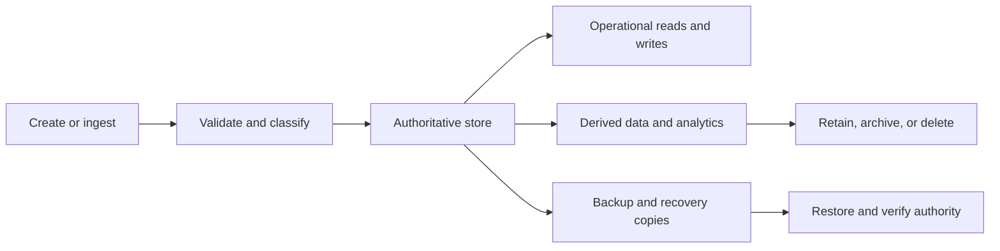
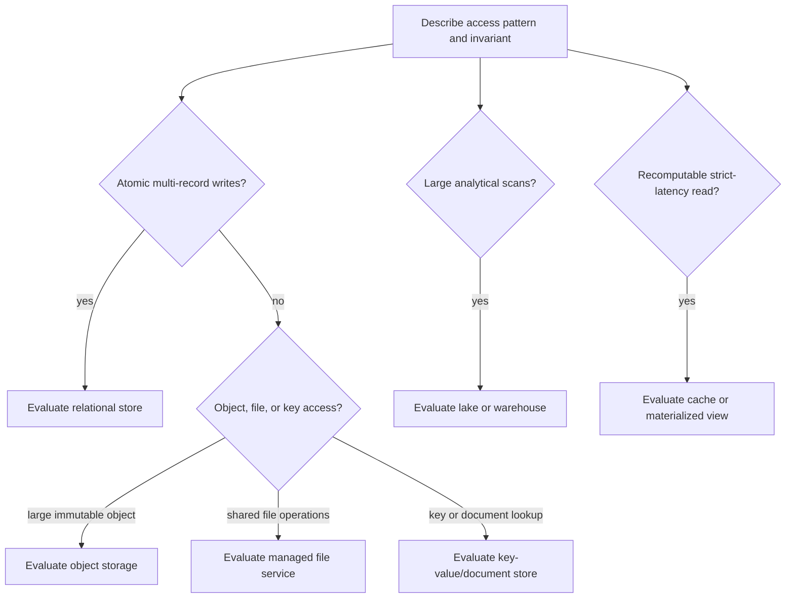
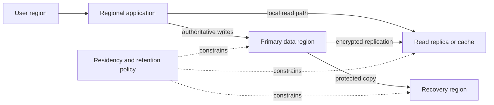
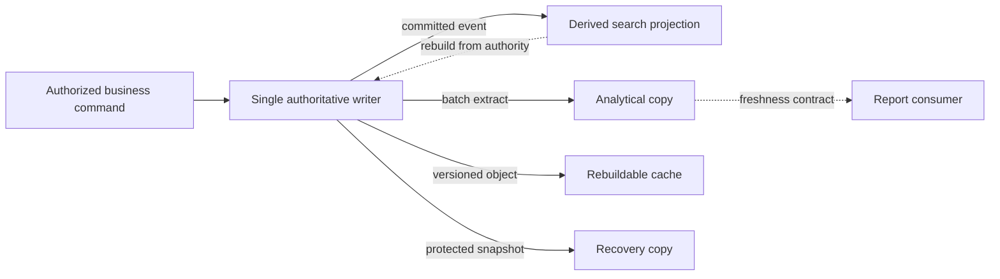
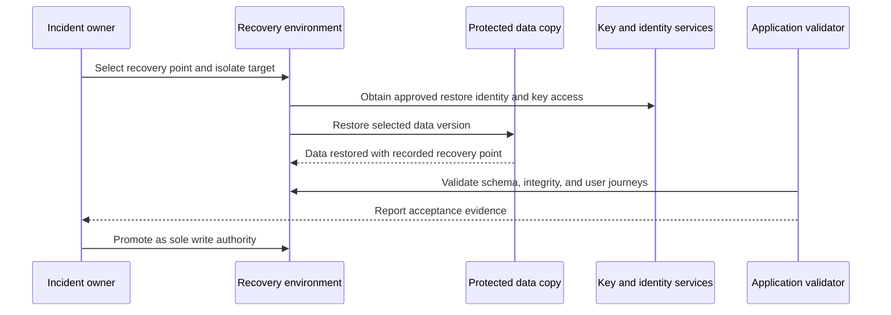

# Cloud Storage and Data Architecture

Part: [10 — Cloud Architecture](PART_OVERVIEW.md)

Cloud data architecture decides where information is authoritative, how components read and change it, which copies exist, and how the data remains useful, protected, and recoverable across its lifecycle. A storage choice is therefore not just a comparison of object, block, file, and database products. It is a decision about data ownership, access patterns, consistency, location, retention, failure, and cost.

Part 09 [Cloud Storage](../09_Cloud_Computing/CH06_Storage.md) owns provider storage classes and service guarantees. Part 06 owns database engines, replication, partitioning, caching, and storage internals. This chapter composes those capabilities around workload and business requirements.

## Begin with Data Domains and Authority

Inventory data by domain and purpose before selecting storage. For each data set, record its owner, sensitivity, authoritative source, size and growth, read/write paths, latency, retention, residency, and recovery needs. Include derived data, logs, caches, indexes, exports, backups, and analytical copies; they may contain the same sensitive information even when teams call them “temporary.”

A data architecture should identify a system of record for each business fact. Multiple copies can improve availability or analytics, but they create questions about freshness, correction, deletion, access control, and reconciliation. If two services can independently accept writes to the same fact, define which value wins and how disagreement is resolved. Do not let a replica, cache, or report quietly become an alternate authority.

Model the full data lifecycle:

The diagram is a reminder that operational serving, analytics, backup, and archive copies have distinct purposes and controls. A successful ingestion does not prove a copy is valid, and a successful backup job does not prove that recovery restores a correct and usable system.

### Model data domains and contracts

Treat a data domain as a set of facts and lifecycle responsibilities rather than simply as a database boundary. One application may own account status while another owns payment settlement; both may retain a customer reference without owning the entire customer record. Document the producer, authority, consumers, and correction path. When a fact is derived, record the transformation and the source version or event needed to rebuild it.

For important domains, define a compact contract with:

- Meaning and owner of each field or event.
- Validity rules, units, identifiers, and schema/version policy.
- Classification, consent, retention, residency, and deletion requirements.
- Which operations are authoritative and which are projections.
- Freshness expectations and how stale values are surfaced.
- Consumer identities and approved access paths.
- Recovery and reconciliation owner.

The contract is valuable even when implementation uses a single database. It prevents an implementation detail, such as a shared table or object prefix, from becoming an undocumented integration API. It also preserves business meaning when the storage technology changes.

### Match transaction boundaries to ownership

A transaction boundary protects a business invariant. If one operation changes account state and emits an event, the architecture must decide how to prevent committed state with no event, or an event for a rolled-back change. Part 06 owns transaction and outbox mechanics; at the architecture level, identify which facts must change atomically and which derived consumers can accept delay.

Cross-store transactions may be unavailable, expensive, or operationally fragile. Instead of assuming two services update “together,” define a sequence with visible intermediate states, compensation where appropriate, and reconciliation. This matters when a transactional database, object store, and event broker all participate in one user workflow.

State consistency should be stated per read path. A customer reading immediately after a change may require read-your-writes behavior, while a monthly analytics report can tolerate a documented delay. For every delayed projection, state how long staleness is acceptable, whether a caller can read from the authority, and what happens when an update does not arrive. A generic label such as “eventual consistency” is insufficient without a user-visible limit.

## Choose Storage by Contract, Not Familiarity

This narrows candidate classes from workload invariants; provider service limits and data contracts still decide between actual services.

Different storage models expose different access and consistency contracts:

| Workload need | Candidate model | Architectural questions |
|---|---|---|
| Large immutable or versioned objects, media, documents, exports | Object storage | How are keys named, access controlled, versions retained, and objects discovered? What is the consistency and lifecycle contract? |
| Low-latency random block I/O for a guest or database | Block storage | How are volumes attached, snapshotted, replicated, resized, and recovered? Which failure domain owns the volume? |
| Shared file semantics for multiple clients | Managed file service | Which protocol semantics, locking, identity mappings, throughput, and client failure behavior are required? |
| Transactional records with relational constraints | Relational database | Which consistency, transaction, schema, query, backup, and scaling properties are needed? |
| Flexible key/document access with high-scale partitioning | Key-value or document database | How do access keys, partition distribution, item shape, consistency, and query requirements constrain the design? |
| Large-scale analytical scans and transformations | Data lake, warehouse, or analytical platform | What are the ingestion, schema, partition, governance, and freshness contracts? |
| Recomputable derived values with strict latency | Cache or materialized view | What is the source of truth, invalidation/freshness rule, and behavior when the copy is stale or absent? |

These are candidate classes, not mutually exclusive products. A workload may use a relational store for transactions, object storage for uploaded files, and an analytical platform for aggregates. That composition creates data movement, access, and consistency paths that must be designed explicitly.

Evaluate each service against the actual read/write pattern, transaction boundary, latency, throughput, data size, consistency needs, recovery, and operator capability. Provider service details belong to Part 09; database algorithm and engine details belong to Part 06.

## Place Data with Its Consumers and Constraints

Each copy creates a distinct access, freshness, residency, and recovery obligation; replication does not automatically make every location an authorized writer.

Data often constrains workload location more strongly than compute does. A service that can run in many regions may still be unable to meet latency or residency requirements if its authoritative database is fixed elsewhere. Moving compute closer to users can increase cross-region data transfer, duplicate state, and complicate write authority.

Map the data path from producer through processing to consumers. Identify where data is created, transformed, cached, replicated, exported, and deleted. For each boundary, ask:

- Which principal can read, write, administer, or export the data?
- Does the path cross a region, account, provider, network, or legal jurisdiction?
- Is data encrypted and who controls the key lifecycle?
- What latency and bandwidth does the transfer require?
- Can a consumer continue safely with stale, partial, or unavailable data?
- How are retention and deletion applied to every copy, including backups and analytics?

Residency is not only a storage-location label. Replicas, logs, support access, backups, telemetry, and derived data can cross boundaries too. The architecture should document the full path and verify provider-specific location behavior with Part 09 services.

Data gravity is the tendency for systems and processing to accumulate around large or frequently accessed data. Moving a modest stateless service may be easy; moving the service plus its high-volume data, integrations, and user access can be expensive and risky. Estimate bytes transferred, transfer duration, egress charges, synchronization lag, and the period of coexistence before treating a move as routine.

### Evaluate regional placement as a whole path

Region choice combines data residency, user latency, service availability, recovery, and transfer. Keeping primary data close to the application can simplify latency and cost but constrain regional recovery or future expansion. Replicating closer to users may improve reads while creating additional copies that must be secured, retained, and reconciled. The appropriate number of replicas follows from the workload contract and recovery design; “more copies” is not automatically safer.

For every cross-region or cross-provider flow, estimate the initial transfer and separately estimate its ongoing change rate. The initial copy may be large but finite; ongoing replication persists and can dominate cost. Include retries, compression, encryption overhead, validation reads, and replay. If the source changes faster than the target can apply updates, adding bandwidth alone may not close the gap: schema conversion, hot keys, or target write capacity may be the bottleneck.

Residency analysis must include service metadata and operational access, not only the database files. Backup catalogs, logs, support access, key material, and analytical derivatives can have different location behavior. Where a provider service has global scope or a managed control plane, verify which customer data and metadata are stored in each location. Record the evidence source and any service limitations; do not infer residency guarantees from a region selector alone.

## Freshness, Replication, and Derived Copies

The copies have different owners and freshness contracts. A projection or cache must not silently become a second write authority.

A replica or cache trades some combination of latency, availability, read scale, cost, and freshness. The application contract must state how stale the data may be and whether users can read their own writes. Part 06 owns the underlying replication and caching mechanisms; Part 07 owns general consistency and recovery concepts.

For every non-authoritative copy, define:

- How it is created and updated.
- Maximum tolerated lag or age.
- How consumers detect staleness or missing data.
- Whether reads can fall back to the authority.
- How invalidation, correction, and replay work.
- What happens when the copy diverges or is corrupted.

A read replica can improve local reads but cannot automatically support writes during a source-region outage. A cache can protect a database during a brief failure but can amplify load if all entries expire together. An analytical copy can be deliberately delayed, but business reports must communicate its freshness. Architecture makes these semantics visible to users and operators.

## Protection, Recovery, and Deletion

The recovery flow separates restoration from promotion. A technically restored copy is not authoritative until data and application behavior pass acceptance and stale writers are fenced.

Data protection needs independent failure thinking. Versioning, snapshots, replication, and backups solve different problems. A replica can faithfully reproduce accidental deletion or logical corruption. A snapshot can share administrative control with the source. A backup can exist but be unusable because its encryption key, metadata, restore permissions, or required dependencies are unavailable.

Design recovery as a sequence:

1. Identify the incident and choose the recovery point.
2. Obtain the required restore identity and encryption keys.
3. Restore the authoritative data into an isolated or controlled environment.
4. Validate integrity, schema, and application compatibility.
5. Re-establish dependent services and permissions.
6. Decide when restored data becomes authoritative and prevent stale writers.
7. Record evidence, reconcile downstream copies, and resume normal operation.

The recovery point objective (RPO) and recovery time objective (RTO) definitions belong to Part 07. The architecture must show how a chosen provider service and its restore workflow can meet those objectives under realistic failure conditions. Test restoration at representative size and verify the result from the application's point of view.

Recovery should distinguish the technical restore point from the business point the organization is willing to accept. A database replica may be only seconds behind but contain an invalid application write; a backup from before the corruption may be older but semantically sound. Record which signals help select the recovery point, who can approve that choice, and which downstream systems must be reconciled afterward.

Restore into a controlled environment before making recovered data authoritative. This permits schema checks, referential validation, malware scanning, and application smoke tests without exposing users to a partial restore. Keep the recovered copy isolated from automated replication that could overwrite the healthy source or from consumers that could trigger external side effects. When the recovered environment is accepted, establish a clear write boundary and fencing rule before routing production traffic.

Measure the full restore chain at representative volume. Infrastructure provisioning, key access, database recovery, index rebuild, identity setup, network attachment, and business validation all contribute to the recovery time. A backup service's restore duration is only one component. If restore time grows with data volume, index count, or retention age, test a large and old recovery point rather than extrapolating from a small recent sample.

Retention and deletion also cross service boundaries. A delete request may need to affect the primary store, replicas, indexes, caches, analytics, exports, and expired backups according to the applicable policy. State exactly which copies are immediately erasable, which age out under retention, and what evidence demonstrates completion.

Separate active-purpose retention from recovery retention and legal hold. An immutable backup may intentionally resist immediate deletion, but its expiry, access restriction, and restoration controls must be explicit. A deletion workflow should inventory copies and report when a copy is not immediately erasable. Silent partial deletion creates false assurance; a named, time-bounded retention exception is auditable and can be reconciled later.

Test deletion through every consumer. A projection may be rebuilt from an event log that still contains the deleted personal field; a cache may rehydrate it from the source after invalidation; a backup may restore the record until its retention deadline. Minimize fields before publishing events and avoid using personal data as an immutable partition key when a pseudonymous identifier can satisfy the workload. Record which system confirms deletion and what evidence is retained without preserving the deleted content itself.

## Worked Example: Customer Events for Operations and Analytics

A subscription service records customer lifecycle events. The customer-facing application needs immediate confirmation and transactional consistency for subscription state. Support needs a searchable view with controlled access. Analytics needs historical events for aggregate usage reports, and the organization has deletion obligations for personal data.

The architecture keeps the transactional database as the authority for current subscription state. A durable event stream or outbox path publishes changes for downstream consumers; the operational search view and analytical store are derived copies with declared freshness targets. Support access is mediated through an application boundary rather than direct broad database credentials.

The event payload is minimized to fields needed by consumers, with a stable customer reference that supports deletion and reconciliation. Analytics data is partitioned and retained according to policy; backup retention and deletion behavior are documented separately. If event delivery is delayed, customer transactions continue, while reports display their freshness time. If the search projection is corrupted, it is rebuilt from the authoritative state or retained event history rather than promoted silently to authority.

The team compares two storage arrangements. Keeping customer, subscription, and invoice facts inside one transactional boundary makes subscription changes straightforward; object storage holds invoices and attachments under immutable references. A separate analytical store receives minimized events, not production table credentials. Moving all facts into a flexible document store might simplify variable payloads, but would require re-establishing cross-record invariants and billing queries. The team rejects that redesign because the current transactional boundary is central to billing correctness and measured demand does not require a different engine.

The design assigns separate identities to transactional writes, event publication, support queries, analytics ingestion, and restore. This prevents an analytics job from changing subscription state or reading fields it does not need. An event includes a schema version, event ID, customer reference, and effective time, but omits payment credentials. A failed projection is replayed from a bounded history; expired events require a controlled rebuild from the authority. The deletion process removes customer-linked projections and reports when retained backups remain under their documented expiry policy.

Recovery tests include restoring the transactional database, replaying events without duplicate business effects, rebuilding projections, confirming key access, and proving the restored service uses one write authority. The design combines multiple storage types because their contracts differ; no single store optimally serves all of these access patterns.

Before launch, the team records elapsed time for provisioning, data restore, index rebuild, access validation, and business acceptance. It separately measures projection lag under normal processing and during replay. These tests show whether the recovery objectives are realistic, whether analytics can drain its backlog without throttling customer transactions, and whether deletion evidence survives projection rebuild. When the observed restore misses the objective, the architecture changes data volume, recovery topology, or the agreed business target instead of declaring an incomplete test successful.

## Architecture Review Questions

- Is there one named authority for each important business fact?
- Are derived copies and caches labeled with freshness, rebuild, and deletion behavior?
- Are data classification, location, retention, and access consistent across primary and secondary copies?
- Does the selected storage contract match access patterns, latency, consistency, and volume?
- Are provider guarantees verified rather than inferred from a service category?
- Are backups independent enough to survive the failure and administrative scope they protect against?
- Has a representative restore been measured and validated by the application?
- Are encryption keys, restore identities, network paths, and dependencies available during recovery?
- Can deletion requests be traced across replicas, logs, analytics, caches, and backups?
- Are transfer volume, egress, data gravity, and synchronization risks included in placement or migration decisions?

Further reading: [Part 06 Databases and Storage](../06_Databases_and_Storage/PART_OVERVIEW.md), [Part 09 Cloud Storage](../09_Cloud_Computing/CH06_Storage.md), [Part 10 Resilience Architecture](CH09_Resilience_Availability_and_Disaster_Recovery_Architectures.md), and [Part 10 Cost, Performance, and Sustainability](CH13_Cloud_Cost_Performance_and_Sustainability_Architecture.md).
