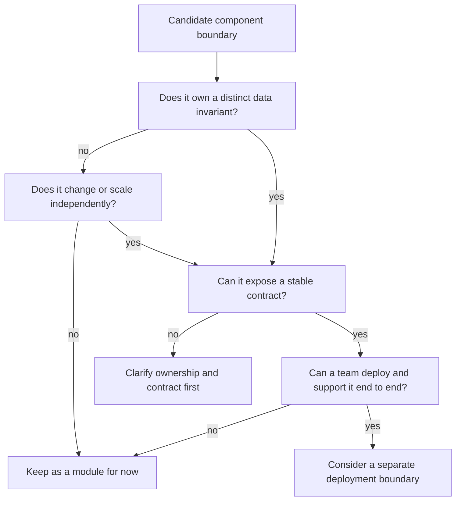
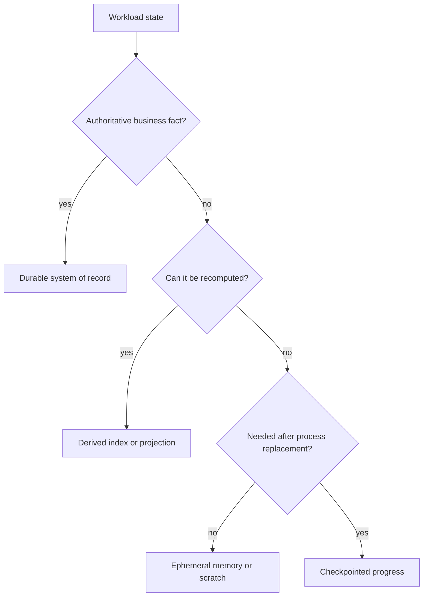
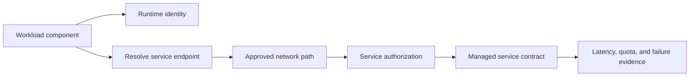
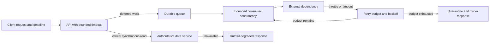
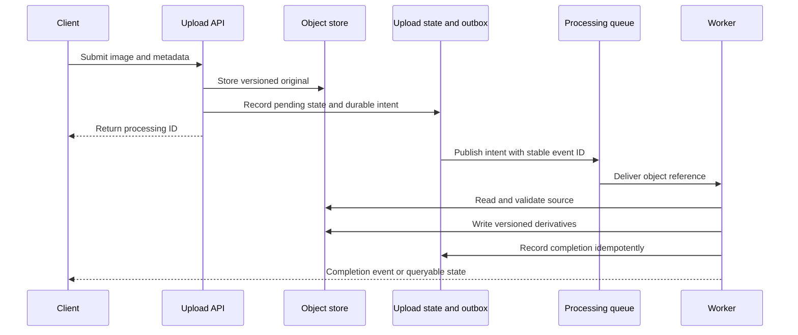

# Cloud-Native Application and Integration Patterns

Part: [10 — Cloud Architecture](PART_OVERVIEW.md)

A cloud-native application is designed to use a cloud operating environment deliberately. It externalizes durable state from replaceable compute where appropriate, binds components to managed services through explicit contracts, and treats deployment, identity, networking, telemetry, and failure behavior as part of the system architecture.

“Cloud-native” is not a synonym for microservices, containers, or serverless. A modular application on a virtual machine can use cloud capabilities effectively; a distributed application can be cloud-hosted and still be fragile. This chapter focuses on composing components and services. Part 20 owns general architecture patterns, Part 07 owns distributed-systems semantics, and Part 09 owns provider service mechanics.

## Define Boundaries Around Change and Responsibility

Start with business capabilities, data ownership, change cadence, and operational responsibility. A deployable component is useful as a separate boundary when it needs an independent lifecycle, scaling policy, security boundary, technology choice, or team ownership. Splitting code into separately deployed services without one of these drivers adds network failure, version compatibility, deployment coordination, and observability costs.

For each proposed component, define:

- Its business responsibility and the data it owns.
- The interface through which other components interact with it.
- The identity, network, and data boundaries around that interface.
- Its deployment, scaling, and recovery owner.
- The failure behavior visible to callers and dependent services.

A component should not claim a database table or event merely because it can access it. Shared ownership creates hidden coupling, conflicting writes, and unclear recovery authority. Use explicit APIs, events, or shared platform contracts where boundaries must interact.

The decision tests independence and operability together. A separate process without a stable data or team boundary can add failure modes without creating useful autonomy.

### Decide whether a boundary should be a deployment boundary

Keep modules in one deployable when they share the same data invariants, change together, and can be operated under one scaling and security policy. Split a component when independent release, scale, fault containment, regulatory boundary, or ownership creates enough value to compensate for remote-call failure and operating overhead.

Before splitting, examine the dependency graph. If two candidate services must make synchronous calls to each other for most user journeys, share tables, and deploy together, separation may create distribution costs without real autonomy. A boundary is stronger when one side can change behind a stable contract and the other side can continue safely through delay or failure. This does not mean every service must be independently deployable; it means that the independence claim should be demonstrated rather than assumed.

| Boundary signal | Evidence that supports a separate component | Warning sign |
|---|---|---|
| Independent change | Releases can be tested and rolled back without coordinated code changes | A schema or endpoint change requires a synchronized release every time |
| Independent scaling | Demand differs enough to warrant separate capacity and limits | Services are split but still share one saturated pool or database bottleneck |
| Data ownership | One component is authoritative and exposes a stable contract | Multiple components write the same tables or repair each other's state |
| Fault containment | Failure can be isolated with a deliberate degraded response | Every request performs a long synchronous chain through all components |
| Team ownership | A team can own build, deploy, support, and recovery end to end | Handoffs cross teams for routine changes and incidents |

If a component is split, carry its observability, identity, deployment, and data contracts with it. A new service without an owner or recovery boundary is not an architecture improvement.

## Keep Compute Replaceable, State Deliberate

Classifying state determines whether process replacement is safe and which data service or recovery mechanism the component needs.

Cloud runtimes can replace instances, tasks, containers, and functions during scaling, rollout, or infrastructure recovery. Durable state should live in a service designed to preserve it, rather than relying on one process or host to remain available.

This does not mean all local state is wrong. Local memory and disk can serve caches, temporary files, or checkpoints when the architecture states what happens after replacement. The design should classify state as:

- **Authoritative:** the system of record for a business fact.
- **Derived:** rebuildable index, projection, or analytical copy.
- **Ephemeral:** safely discarded on process or host replacement.
- **Checkpointed:** progress that allows expensive work to resume.

For every category, define the owner, persistence, freshness, and recovery path. The [Cloud Storage and Data Architecture chapter](CH06_Cloud_Storage_and_Data_Architecture.md) expands authority and copy semantics.

Stateless request handlers simplify horizontal scaling and replacement, but they can still depend on sessions, local caches, idempotency state, or affinity. Identify these dependencies rather than labeling a service stateless because its API is HTTP-based.

## Choose Integration Based on the Contract

A synchronous call can return a result directly and is appropriate when the caller needs an immediate decision and the dependency can satisfy the latency and availability budget. It also couples the caller's completion to dependency latency, capacity, and failure.

An asynchronous interaction lets the producer and consumer progress independently, buffers bursts, and can support replay. It adds delayed completion, duplicate delivery, ordering boundaries, and a need to track work after the original request ends. Part 10 CH08 covers cloud messaging architecture; Part 07 owns generic delivery and idempotency mechanics.

| Need | Synchronous request/response | Asynchronous message or event |
|---|---|---|
| Caller needs immediate result | Strong fit | Requires pending/accepted response or later notification |
| Work can wait or be retried | Can tie up request capacity | Queue can absorb bursts and decouple timing |
| Producer and consumer scale differently | Often requires coordinated limits | Independent consumer scaling is possible within broker and downstream limits |
| Ordering and replay matter | Usually managed by request flow | Must be defined by broker, key, retention, and consumer contract |
| Dependency outage behavior | Caller timeout and degraded response | Durable buffering may extend availability, but introduces backlog and recovery work |

Do not choose asynchronous communication solely to increase throughput. It changes the user contract and operational model. The system must explain how the user learns completion, how failures are surfaced, and who resolves poison or permanently invalid work.

## Bind Managed Dependencies Without Hiding Their Contracts

Each edge is independently testable. A reachable endpoint does not prove the identity or service policy allows the intended operation.

Cloud services provide managed databases, object stores, identity, queues, telemetry, search, and configuration. A workload should treat each as a dependency with a contract:

- Identity and permissions required by the caller.
- Network path and name-resolution behavior.
- Availability, quota, latency, and throughput limits.
- Retry, timeout, ordering, and idempotency behavior.
- Data ownership, freshness, retention, and recovery.
- Telemetry and support responsibility.

A managed service removes some infrastructure operations, not the need to reason about the dependency. A queue may durably accept work while its consumers are failing. An object store may be available while the workload's identity cannot read the object. A database may be healthy while an inefficient query exhausts its connection pool.

Represent each important dependency with a small contract record: service owner, caller identity, network path, region or scope, quota, latency/availability assumption, retry behavior, data classification, recovery dependency, and support route. This need not be a large document; it makes assumptions visible where the application boundary is designed.

Test the dependency where the workload uses it. A successful health check against a database endpoint does not prove that the runtime identity can execute the required query. A successful publish does not prove a consumer processes the event. A private endpoint does not prove that DNS returns the private address from the runtime's network. Test identity, name resolution, network reachability, authorization, and application behavior as separate assertions so failures are diagnosable.

Prefer stable interfaces where doing so protects important business boundaries, but do not add a generic abstraction over every provider API. An adapter has a cost: extra code, testing, failure translation, and a least-common-denominator contract. Introduce one when it enables a real requirement such as multiple backends, independently evolving providers, or domain isolation. Otherwise, a direct managed-service integration with a documented exit path may be simpler and more reliable.

## Service Discovery, Configuration, and Secrets

A component needs to locate dependencies and receive environment-specific configuration without embedding environment assumptions in its artifact. Discovery may use DNS, a registry, a platform endpoint, or a configured service name. The important design questions are who owns the name, how it changes during rollout or recovery, how clients cache it, and what they do when resolution fails.

Separate configuration from code when the same artifact is promoted across environments. Keep non-secret settings versioned and reviewable; deliver credentials through workload identity and an approved secret system rather than copying them into an image or repository. Part 10 CH04 covers identity architecture and Part 09 CH13 owns secret-store mechanics.

Configuration changes can be production deployments. A wrong endpoint, feature flag, or timeout may redirect traffic or alter behavior without changing the binary. Use validation, staged rollout, ownership, audit, and rollback compatible with the data changes already made.

### Evolve service contracts without synchronizing every release

A component boundary is only useful when its contract can evolve safely. For an API, event, or shared configuration format, identify producers and consumers, compatibility direction, version lifetime, and how the system detects clients that have not upgraded. Additive fields can still break strict deserializers; changing a field's meaning can break consumers even when its type is unchanged.

Use an expand-migrate-contract sequence when a data or interface change needs overlap: introduce a backward-compatible form, deploy consumers that understand both forms, move producers, verify old-form usage has stopped, then remove the obsolete form. For events, retain schema version and producer identity, and define whether consumers reject, quarantine, or safely ignore unknown fields. For APIs, define deprecation and support windows that reflect actual consumer release cadence.

Deployment order follows dependency direction. Deploying a consumer that expects a new field before the producer emits it may be safe if the consumer handles absence; deploying a producer that removes an old field first may break lagging consumers. Rollback also depends on compatibility: reverting application code is unsafe if a database migration has already removed a column or transformed data irreversibly. Keep rollback tests tied to the contract and data state, not just the deployment artifact.

Track contract usage with telemetry that avoids logging sensitive payloads. A version identifier, consumer name, or validation error count can show whether the old interface is still in use. Without that evidence, teams often keep obsolete paths forever or remove them based on an assumption that all clients upgraded.

## Compose Resilience Across Components

The deadline and retry budget bound how much work a dependency failure creates; the queue preserves deferred work without claiming immediate completion.

A workload's user journey may traverse several services. Each boundary contributes latency, capacity limits, and failure modes. Architecture should set end-to-end budgets and decide which component owns each timeout, retry, concurrency limit, and degraded response.

Retries can amplify load when many components retry the same failing dependency. Timeouts that exceed the caller's deadline waste capacity; timeouts that are too short create avoidable failures. A queue can buffer work but cannot make an unavailable dependency recover. A cache can reduce load but must define staleness and invalidation. The general distributed-systems mechanisms are owned by Parts 07 and 20.

An end-to-end user deadline must contain the time spent by every synchronous dependency. If a request has a one-second objective and makes three serial calls, assigning a one-second timeout to each permits the full path to exceed the objective several times over. Allocate a budget to each hop, include connection setup and queueing, and propagate the remaining deadline where the protocol supports it.

Retries should be owned at a deliberate layer. If the client, gateway, service, and database driver each retry three times, one user action can multiply into many dependency calls. Retry only failures likely to be transient, bound attempts and total time, use backoff with jitter where appropriate, and stop when the caller's deadline or retry budget is exhausted. For writes, determine whether a timeout leaves the outcome ambiguous and whether an idempotency key or read-back is needed before retrying.

These mechanisms recap Parts 07 and 20. Cloud-specific architecture adds the dependency budget, concurrency ceiling, queue behavior, and degraded response. The result should be a truthful outcome such as accepted, rejected, pending, or unknown with a reconciliation path, not a generic success response when the side effect may not have occurred.

A useful design artifact is a dependency and failure table:

| Dependency | Caller purpose | Failure signal | Caller behavior | Recovery owner |
|---|---|---|---|---|
| Identity service | Authenticate or obtain workload credentials | Token failure, unavailable endpoint | Reject new privileged action; preserve safe in-flight work | Identity/platform team |
| Data store | Read or commit authoritative state | Timeout, throttling, failed transaction | Bound retries; return a truthful result; avoid duplicate effects | Data/workload team |
| Message broker | Accept deferred work | Publish failure, backlog, consumer lag | Apply backpressure or reject admission; alert on age | Messaging/workload team |
| External payment provider | Authorize a transaction | Timeout or ambiguous response | Use idempotency reference and reconcile outcome | Payments team |

The table prevents the vague statement “the platform is resilient” from replacing a component-level recovery contract.

## Worked Example: Image Upload and Asynchronous Processing

The processing ID represents durable acceptance, not completed transformation; that distinction determines the API response and recovery contract.

A catalog service accepts large product images. The request path must acknowledge the upload quickly, while image validation, resizing, malware scanning, and thumbnail generation may take seconds or longer.

The upload service authenticates the caller, validates metadata, and stores the original object under an owner-controlled identifier. It then submits a processing event with an idempotency key and a reference to the object, not an unbounded copy of the file. A worker reads the object, performs bounded transformations, writes versioned outputs, and publishes a result that updates the catalog projection.

The lifecycle has several independent failure points. The service first creates an upload record in a pending state, then stores the object, then records a durable processing intent. The object key is unguessable but not treated as authorization; the worker uses its own identity and verifies that the object belongs to the expected catalog item. The processing event carries a stable upload ID, object version, schema version, and correlation ID. It does not carry a public URL or the file contents.

| Failure point | User-visible state | Recovery behavior |
|---|---|---|
| Object write fails | Upload is rejected or marked incomplete | Expire the pending record and allow a safe retry |
| Object stored, intent not published | Processing remains pending | A reconciler discovers pending records and republishes the intent idempotently |
| Worker crashes during transform | Processing is delayed | Broker redelivery resumes from a safe checkpoint or recomputes into a versioned output |
| Output written, result event not acknowledged | Catalog may remain pending | Retry verifies the deterministic output version before publishing completion again |
| Input is invalid or malicious | Upload enters rejected/quarantined state | Restrict access to evidence, notify an owner, and avoid automatic redrive |

This model avoids requiring one distributed transaction across object storage, the application database, and the broker. It persists intermediate states for reconciliation. The reconciler is part of the architecture, with an owner, lag metric, and alert threshold; it is not an informal repair script.

The boundary has explicit behavior: the API returns a processing state; users can query or receive a completion signal; retries do not create conflicting output; invalid images enter a review or quarantine path; queue age indicates delayed service; and the application retains the original object for a defined period. The storage, identity, and messaging services have independent permissions and network paths. If a worker is replaced mid-task, the message can be retried safely. If processing is delayed, catalog reads remain available with the prior approved image or a clear pending state.

The API's acceptance point is defined carefully. If the service returns “accepted” before both the object and the durable processing intent exist, a lost event can leave the user with a success response for work that is never performed. If it waits for all transformations, it couples request latency to worker capacity and the image-processing service. The chosen contract returns a durable pending identifier only after the original object and intent are recorded; completion is a separate state transition.

This design uses asynchronous processing because the business flow can tolerate deferred completion and the operations team can support backlog monitoring. If image validation were required before accepting an order, the contract and topology would need to change; “queue everything” is not universally appropriate.

## Architecture Review Questions

- Are component boundaries based on data ownership, change, scale, security, or operational needs?
- Is every business fact authoritative in one place, with derived copies identified?
- Does each synchronous dependency fit the end-to-end latency and availability budget?
- Do asynchronous interactions define completion, ordering, replay, duplicates, and backlog ownership?
- Are managed-service limits and failure contracts visible to application teams?
- Are service names and configuration changes versioned, validated, and observable?
- Are identities separated for deployment, runtime, and support tasks?
- Can components be replaced without losing authoritative state or creating duplicate effects?
- Does each dependency have a named recovery owner and a tested degraded behavior?
- Is an abstraction layer justified by a real boundary or portability need?

Further reading: [Part 07 System Design and Distributed Systems](../07_System_Design_and_Distributed_Systems/PART_OVERVIEW.md), [Part 09 Messaging](../09_Cloud_Computing/CH12_Messaging.md), [Part 10 Event, Queue, and Messaging Architecture](CH08_Event_Queue_and_Messaging_Architectures_in_Cloud.md), and [Part 20 Architecture Patterns](../20_Architecture_Patterns/PART_OVERVIEW.md).
