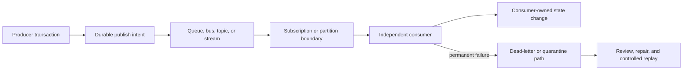
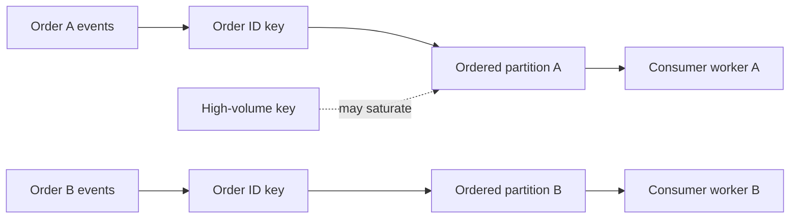
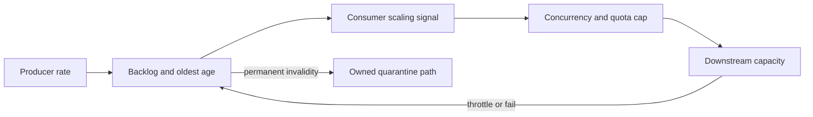
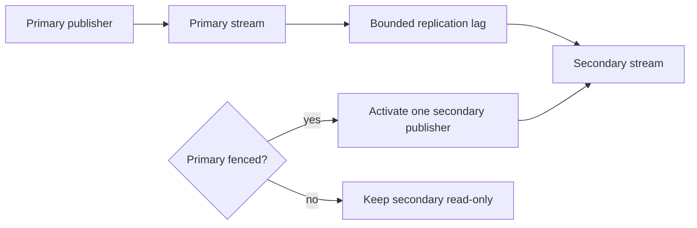
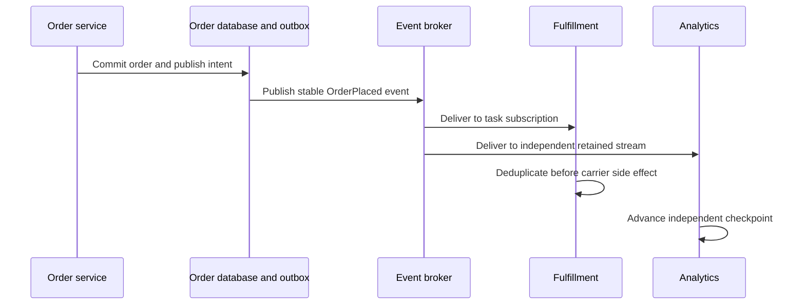

# Event, Queue, and Messaging Architectures in Cloud

Part: [10 — Cloud Architecture](PART_OVERVIEW.md)

Cloud messaging architecture selects and composes managed messaging services around the contract between producers and consumers. The choice affects coupling, ordering, retention, replay, failure recovery, access boundaries, and cost. A queue, event bus, topic, and stream are not interchangeable simply because each can move a payload between components.

Part 09 [Messaging](../09_Cloud_Computing/CH12_Messaging.md) owns provider service mechanics and product behavior. Part 07 owns generic delivery, ordering, idempotency, and stream-processing concepts. This chapter concentrates on workload-level composition and service selection.

## Start with the Message Contract

Before selecting a broker, clarify what the information means and what the consumer is allowed to do with it:

- A **command** asks a specific owner to perform an action.
- An **event** records that something has already happened and can be relevant to one or more consumers.
- A **task** represents work that should be completed, often by one competing worker.
- A **notification** signals a condition or change but may not carry the full authoritative data.
- A **stream** is an ordered or partitioned history from which consumers may track progress and replay.

The distinction shapes ownership and recovery. A command is usually addressed to an owner with a response or completion contract. An event should not imply that every subscriber may mutate the originating domain. A notification may require a follow-up read. A stream needs retention, offset/checkpoint, and replay decisions.

A message schema should identify the producer, business meaning, event or command identity, creation time, version, privacy classification, and any idempotency or correlation key. Do not put secrets or unnecessary personal data into a message merely because the broker is private. Define compatibility and ownership with the domain/API teams.

## Select a Service by Delivery and Consumption Shape

| Service shape | Typical workload contract | Key architecture trade-offs |
|---|---|---|
| Queue | One of several workers processes each task; backlog can absorb bursts | Visibility/lease duration, retries, poison-message handling, task fairness, and completion acknowledgement |
| Pub/sub topic | One published event is delivered to independent subscriptions | Fan-out isolation, per-subscriber retention, duplicate delivery, subscription filtering, and slow-consumer behavior |
| Event bus/router | Producers publish typed events that route to targets using rules | Routing ownership, schema governance, target limits, delivery retries, and cross-account policy |
| Partitioned event stream | Consumers independently process an append-only history, often with replay | Partition key, per-partition ordering, retention, consumer offset, hot partitions, and throughput capacity |
| Workflow/orchestration service | A durable process coordinates steps, waits, and compensation | State-machine limits, execution history, retries, human waits, and coupling to workflow semantics |

These categories overlap in some provider products, but the contracts remain distinct. A stream with retention can support independent consumers and replay; a queue is generally designed to remove a task after successful completion. An event bus can route an event to multiple targets without being a durable analytical log. A workflow service coordinates a process but may still rely on queues or databases for independent buffering and state.

Choose from the workload rather than the product catalog. Ask how many producers and consumers exist, whether every consumer needs the message, what ordering scope matters, how long replay must remain possible, whether consumers can scale independently, and how long work may remain delayed.

Apply those questions in a consistent order. First decide whether the producer is issuing a command, announcing a fact, assigning work, or recording a history. Then determine whether each message has one competing consumer or multiple independent subscribers. Set the completion and retention contract before choosing an implementation: must the producer know that work finished, can it observe a pending state, and how long can a consumer be offline before data expires?

Next, define ordering and replay at the narrowest useful scope. If every message must be globally ordered, explain why that business invariant is necessary and what throughput and availability trade-off it creates. If ordering is needed only per customer or order, choose a key that preserves that relationship while distributing unrelated work. For replay, define which consumer may request it, which side effects it can trigger, and whether old data remains valid under the current schema and privacy policy.

Finally, estimate capacity. Separately, test failure behavior. Estimate arrival rate, payload size, retention, number of independent subscriptions, expected consumer lag, and downstream rate limits. Verify the provider's message size, throughput, retention, delivery, and cross-scope limits in Part 09. A screening matrix narrows products; a representative producer/consumer test establishes whether the selected service contract works for the workload.

| Selection question | Queue pressure | Topic/bus pressure | Stream pressure |
|---|---|---|---|
| Who owns completion? | Worker acknowledges completion of assigned task | Each subscriber completes its own handling | Each consumer advances its own checkpoint |
| Must consumers be independent? | Competing workers share work | Separate subscriptions isolate subscribers | Consumer groups or independent offsets process the history |
| Is replay central? | Replay is task recovery and needs duplicate protection | Retained subscriptions may allow delivery recovery | Retained history supports explicit offset-based replay |
| What is ordered? | Queue/session or service-specific key | Often per subscription or ordered group | Usually within a partition, not across the full stream |

## Compose Producers, Brokers, and Consumers

A complete path includes more than a broker:

The producer's database transaction and the broker publish are usually separate operations. If the application commits business state but fails before publishing, the event can be lost unless the architecture uses an atomic publication strategy, such as an outbox, or another verified transaction boundary. Conversely, a publish timeout may leave the producer uncertain whether the broker accepted the message. Part 07 owns the generic consistency and idempotency mechanisms; this chapter requires the cloud architecture to identify where they apply.

Each consumer should have an explicit contract for acknowledgement, retry, concurrency, side effects, and ownership. A consumer that writes to another database should record a durable idempotency key or otherwise tolerate redelivery. A slow consumer should not silently block unrelated subscribers; use independent subscriptions or partitions where the service supports them and where the cost is justified.

## Ordering, Retention, and Replay

Ordering per business key permits parallel work across keys, but a hot key can still constrain its own throughput.

Ordering is always scoped. A broker may preserve order within one queue, session, key, partition, or subscription while allowing other messages to proceed. Global ordering can constrain throughput and availability. Use the narrowest ordering key that matches the business invariant, and define how the producer assigns it.

The ordering key determines both correctness and parallelism. If every order's events must be applied in sequence, using order ID as the key preserves that sequence while allowing different orders to progress independently. Using one global key serializes the entire workload. Using a customer ID may keep that customer's events ordered but create a hot partition for a large tenant. Partition distribution must therefore be tested against realistic key skew, not only uniform synthetic data.

Define behavior when one item in an ordered group repeatedly fails. The broker may block later events for that key while unrelated keys continue. Skipping the failing event can violate a business invariant; blocking the whole stream can violate availability. The contract should specify quarantine, operator decision, replay sequence, and whether later events can be processed safely. Ordering is a domain requirement, not just a broker toggle.

Retention and replay also interact with schema evolution. An event retained for months may outlive the consumer version that first understood it. Consumers need a compatibility policy, a way to interpret old schema versions, and a test for replaying historical records into current code. If the old payload contains personal data that must be deleted, immutable retention needs a documented legal and technical handling rule.

Retention defines the recovery window available to consumers. Longer retention supports delayed consumers, audit, and replay but increases storage and privacy exposure. A queue's visibility timeout or lease must accommodate processing behavior without allowing two workers to perform the same side effect concurrently. A stream's consumer progress must be checkpointed in a way that matches the side-effect transaction boundary.

Replay is not “send it again” without consequences. Before replay, identify the original effect, whether it is still valid, which consumer version handles it, and whether downstream calls are idempotent. Replaying a year of events into a live payment consumer can repeat external effects even if the broker accurately preserves the history.

## Backpressure, Poison Messages, and Recovery

The scaling signal should reflect both backlog age and the dependency's safe capacity.

Messaging decouples timing but does not erase capacity limits. If producers outpace consumers, the backlog grows until retention, quota, storage, or business deadlines are exceeded. Monitor age of oldest message as well as depth: a large queue may be healthy when workers are fast, while a small but old queue can indicate stalled work.

Backlog recovery requires spare processing capacity after the dependency is healthy again. If a queue has 18,000 jobs, producers continue at 120 jobs per second, and consumers can safely process 150 per second, the net drain rate is 30 jobs per second; the backlog takes about ten minutes to clear, before accounting for job-time variance and retries. If the business deadline is five minutes, this topology cannot meet it even though every message is eventually delivered. The choices are to reduce arrival during recovery, increase safe downstream capacity, accept a longer deadline, or change the work contract.

Retention must cover more than the normal consumer delay. Include the longest expected outage, detection and response time, repair time for incompatible software or credentials, replay duration, and the business retention requirement. If replay requires reprocessing a week of history, measure whether consumers can do so while new traffic continues and whether the target database can handle both loads. Retention is not a substitute for a backup if the broker does not protect against the failure modes relevant to the event record.

The storage and cost model depends on payload size, arrival rate, replication, number of subscriptions, retention duration, and replay/query operations. A topic with many independent subscriptions may create separate storage and delivery work per consumer. A stream retained for audit can be much larger than the active processing queue. Minimize payload and store large immutable content separately when appropriate, but ensure the referenced object remains available and authorized for the consumer's lifetime.

Alert on age and predicted drain time against the business deadline. Queue depth alone cannot distinguish a large healthy backlog from a small, stalled one. Include the rate of new arrivals, successful completions, retries, and oldest-item age in the operational view. During recovery, scale consumers gradually against downstream capacity; an immediate large scale-out can overload a dependency that has just recovered.

Protect downstream services by bounding consumer concurrency and scaling against a target such as oldest-message age. If a downstream dependency is unhealthy, a worker fleet that scales without a cap can convert a dependency outage into a retry storm. The architecture should specify when to pause consumption, reject new work, defer messages, or move work to a safe quarantine path.

A poison message repeatedly fails because of invalid data, incompatible schema, a permanent business rule, or a software defect. Define a maximum retry policy, a dead-letter/quarantine owner, required diagnostic context, redaction rules, and a safe repair/replay process. Do not automatically replay poison messages indefinitely; that hides the fault and consumes resources.

## Cross-Scope and Cross-Region Messaging

Activation requires a single-publisher decision; replication alone does not prevent both regions from accepting writes.

A producer and consumer may live in separate accounts, subscriptions, projects, regions, or providers. Model the identities on both sides, encryption/key access, network path, policy ownership, service limits, and audit evidence. A cross-scope permission is not necessarily granted just because the producer can reach the broker endpoint.

Cross-region replication can support disaster recovery or local consumption, but introduces lag, duplicate windows, ordering boundaries, and questions about the authoritative publisher. Decide whether the secondary region is read-only, can accept new publishes, or is activated only after fencing the primary. Two independent publishers for the same logical stream need an explicit conflict and deduplication model.

For an active/passive regional design, define the activation sequence: detect primary unavailability, fence or otherwise disable its publisher, measure the secondary's replication point, activate one publisher in the recovery region, and reconcile messages that were acknowledged but not replicated. The sequence should prevent both regions from assigning the same logical event identity or independently accepting writes that cannot be merged.

An active/active design needs a stronger contract. Decide whether event IDs are globally unique, whether ordering is local or cross-region, how duplicate delivery is detected, and which region owns each partition or business key. If a partition is reassigned during failover, define how consumers avoid processing the same records concurrently. Test a network partition where each region can reach local producers but cannot see the other region; this exposes split-brain assumptions that a planned failover test may miss.

For inter-provider event delivery, account for egress, schema compatibility, identity federation, delivery guarantees, and the operational party that owns replay. Avoid building an implicit global event mesh unless its routing, governance, failure, and cost contracts are supportable.

## Worked Example: Orders with Independent Fulfillment and Analytics

The consumers have separate identities, retention, progress, and recovery owners because their business effects differ.

An order service commits a new order. Fulfillment must act once on the order, while analytics wants an independent event history that can be replayed after a pipeline change. Notifications need only know that the order status changed.

The order domain records a durable publish intent with the committed order and publishes an `OrderPlaced` event containing an event ID, schema version, timestamp, and minimal order reference. Fulfillment receives a task or subscription with bounded retries and an idempotency key so redelivery does not create a second shipment. Analytics consumes an independently retained stream or event copy with its own checkpoint. Notification routing receives a status event and does not become authoritative for order state.

If fulfillment cannot reach its carrier integration, it pauses or slows consumption according to the business deadline and reports message age. Permanent invalid messages go to a quarantine path with restricted access and an owner. Analytics can replay retained history into a new projection without causing shipment side effects because it uses a separate consumer identity and destination.

The architecture records the ordering key (for example, order ID), the retention period, the event compatibility policy, and the replay approval process. It tests the uncertain publish case, duplicate delivery, consumer outage, poison message, and recovery from a regional interruption.

The order transaction and publish intent share a durable boundary so a committed order cannot silently lose its fulfillment event. A relay may publish the same intent more than once after an ambiguous acknowledgement, so the event ID remains stable across retries. Fulfillment records the processed event ID with its shipment state; if it receives the event again, it returns the known result rather than creating another shipment. The carrier call has its own idempotency reference because the consumer database cannot make an external carrier transaction atomic.

If analytics falls behind, its consumer group can replay without blocking fulfillment because the subscriptions and identities are independent. If fulfillment receives an invalid address, it does not retry forever; it moves the event to restricted quarantine, emits an operator-visible reason without exposing unnecessary personal data, and waits for a corrected order or authorized repair. A controlled replay uses the original event identity and records who approved it. The service owner can estimate backlog drain time before promising when fulfillment returns to normal.

The topology is tested under three failures: the order database commits while the broker is unavailable, the broker delivers twice while the carrier response is ambiguous, and analytics is offline beyond its normal processing window. Each test has a separate expected outcome. The first leaves a durable pending publish intent, the second reconciles by idempotency reference, and the third either replays within retention or invokes a documented rebuild path. This makes “reliable delivery” a workload contract rather than an assumed property of a product label.

## Architecture Review Questions

- Is the payload a command, event, task, notification, or retained stream record, and is that meaning explicit?
- Does each consumer need an independent subscription, retention window, and identity?
- What ordering scope is required, and what throughput or availability cost does it impose?
- How does the producer recover from an ambiguous or failed publish?
- Can each consumer safely tolerate redelivery and partial side effects?
- Is backlog age bounded by business deadlines and monitored with an owner?
- Are retry, quarantine, repair, and replay processes safe and observable?
- Can the message contain unnecessary secrets or personal data?
- What are the identity, encryption, network, and audit boundaries across organizational scopes?
- During regional recovery, which publisher is authoritative and how are duplicates or divergence controlled?

Further reading: [Part 07 System Design and Distributed Systems](../07_System_Design_and_Distributed_Systems/PART_OVERVIEW.md), [Part 09 Messaging](../09_Cloud_Computing/CH12_Messaging.md), [Part 10 Cloud-Native Application Composition](CH07_Cloud_Native_Application_and_Integration_Patterns.md), and [Part 10 Resilience Architecture](CH09_Resilience_Availability_and_Disaster_Recovery_Architectures.md).
