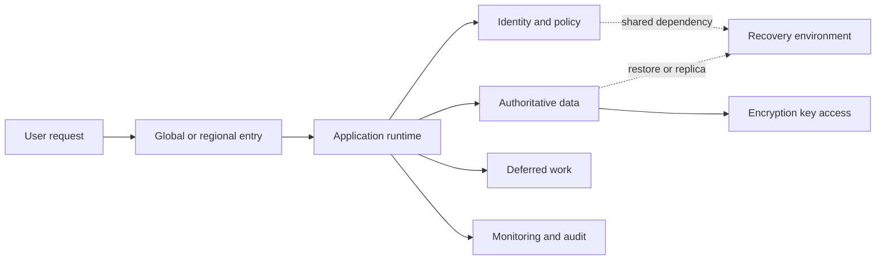
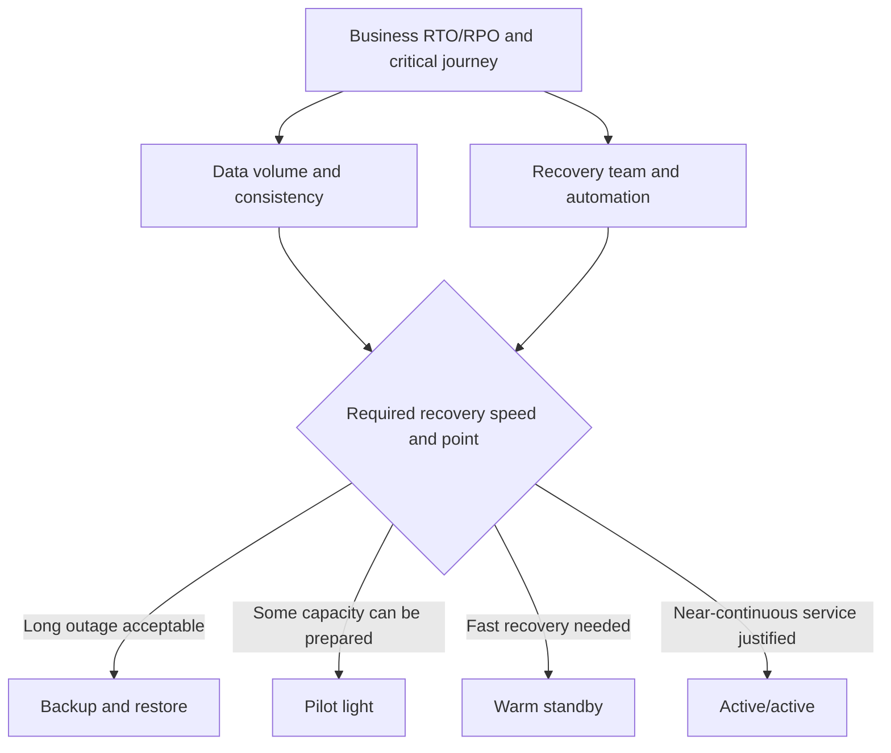
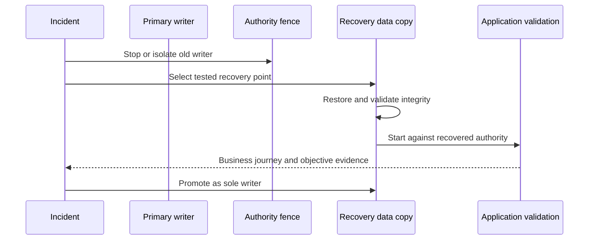
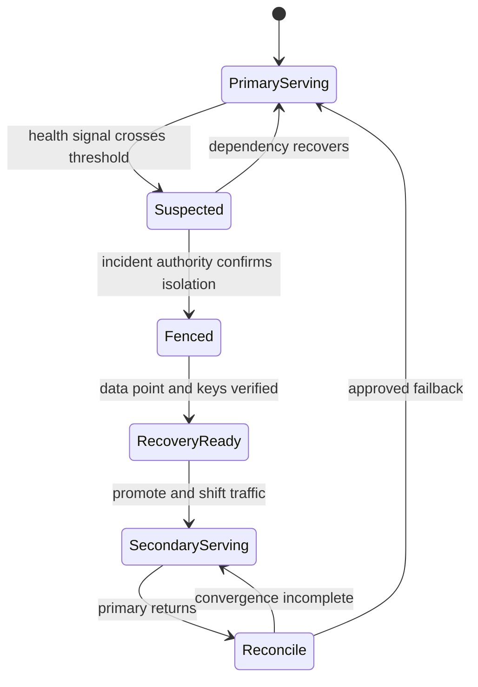

# Resilience, Availability, and Disaster-Recovery Architectures

Part: [10 — Cloud Architecture](PART_OVERVIEW.md)

Resilience is the ability of a workload to continue or recover its important behavior when components, dependencies, locations, or operating processes fail. A cloud provider supplies failure domains and recovery services; the architecture decides which failures matter, what the workload promises during them, and whether the people and dependencies needed for recovery remain available.

Part 07 owns general reliability objectives and distributed-systems failure semantics. Part 09 owns provider-specific backup, replication, and regional service features. This chapter composes them into workload recovery designs.

## Translate Business Impact into Recovery Requirements

Start with the service's critical user journeys and business consequences. A payment authorization path, an internal reporting dashboard, and an overnight data export do not necessarily need the same availability or recovery target. Define which functions are essential, what interruption is tolerable, what data loss is acceptable, and how long degraded operation may continue.

Recovery time objective (RTO) describes the target time to restore service after disruption; recovery point objective (RPO) describes the target for acceptable data loss measured in time. These are business-facing objectives, not provider service settings. A storage service's replication feature does not prove that the application meets its RPO; an automated failover does not prove that the whole user journey meets its RTO.

Translate targets into testable conditions:

- What is the start and end of the recovery clock?
- Which user-visible functions must be restored first?
- Which data state is authoritative after recovery?
- Which dependencies, credentials, people, and approvals are needed?
- What evidence demonstrates recovery rather than just resource startup?

Targets should be derived per capability, not assigned once to an entire product. The order-creation path may have a strict objective because a lost transaction affects revenue, while analytics can be delayed and an administrative report can be restored later. If every component receives the most stringent target, the design may pay for unnecessary redundancy; if every component inherits a relaxed target, critical user journeys may be unprotected.

Include the cost of interruption when prioritizing recovery. Estimate affected users, business hours, transaction value, regulatory notification, manual workarounds, and backlog accumulation. These estimates need not predict exact financial loss, but they should explain why one component receives warm capacity while another uses restore-from-backup. State assumptions and identify business owners who accept the resulting recovery order.

## Map Failure Domains and Shared Dependencies

A failure-domain map includes more than regions and zones. Consider process, host, storage, network path, identity, DNS, control plane, deployment system, operator, provider service, external partner, and data-corruption failures. Determine which components can fail independently and which share power, routing, credentials, configuration, or staff.

A multi-zone design can still have one regional database, one identity dependency, one configuration store, or one deployment pipeline. A multi-region design can still share a global control plane, a single key administrator, or a human approval path that prevents failover. Redundancy only improves resilience when the required workload path and its dependencies remain usable.

Model dependency paths for each critical journey. For a read request, the service may require edge routing, identity, API runtime, a database, a key service, and a DNS resolver. If any is unavailable, the path can fail. Some dependencies may support a safe cache or degraded response; others are hard prerequisites.

Evaluate correlation explicitly. Two replicas in different zones can still depend on one regional router or storage control plane. Two regions can share a global identity service, a deployment pipeline, a DNS authority, or the same administrative credentials. A dependency inventory should mark shared services and identify whether their failure disables normal traffic, recovery, or only optional capability.

One useful review method is to walk each failure through a dependency matrix:

| Failure stimulus | Directly affected component | Dependent paths | Containment or fallback | Evidence needed |
|---|---|---|---|---|
| Zone power/network loss | Runtime instances in that zone | Load balancer, zonal data, local cache | Remaining zones accept bounded traffic | Capacity and user-journey test after zone isolation |
| Identity federation outage | New workforce sessions and deployment | Operators, releases, emergency support | Existing workload identity continues if safe; controlled emergency access | Tabletop plus privileged-access exercise |
| Data corruption | Primary records or derived projection | APIs, analytics, support, reports | Restore trusted point or rebuild projection | Isolated restore and business-level data validation |
| Provider-region outage | Regional compute, network, and services | DNS, data replication, keys, quota, support | Promote recovery region under single-writer control | End-to-end regional exercise |

This prevents a topology from being called redundant without verifying which dependent paths survive.

This is a dependency sketch, not a claim that every path is synchronous. The design must identify which dependencies are required to serve traffic, which are required only to restore, and which can be unavailable temporarily without violating the business contract.

## Choose a Recovery Topology Deliberately

The topology choice follows the objective and evidence; selecting an expensive pattern does not compensate for an untested data or operator dependency.

Recovery patterns differ in readiness, cost, data freshness, and operating complexity:

| Pattern | Prepared state | Typical recovery work | Primary trade-off |
|---|---|---|---|
| Backup and restore | Protected data and infrastructure definitions | Provision environment, restore data, reconnect dependencies, validate | Lower standby cost but longer and more variable recovery time |
| Pilot light | Core data or minimal services running | Scale infrastructure and deploy remaining components | Moderate cost; recovery depends on automation and capacity availability |
| Warm standby | Reduced-capacity environment serving or ready to serve | Scale capacity, redirect traffic, validate | Faster recovery with ongoing duplicate capacity and synchronization cost |
| Active/active | Multiple locations serve live traffic | Isolate failure, shift load, reconcile or continue distributed writes | Low interruption potential but high consistency, routing, and operations complexity |

These names are broad patterns, not provider guarantees. A service advertised as multi-zone or regionally redundant may protect a specific data or control-plane layer without providing end-to-end application recovery. Verify the contract at the service boundary and then test the workload.

Select a pattern per critical workload capability. A product may use warm standby for its transactional API, backup-and-restore for an internal analytics tool, and a separately replicated object archive. The topology should state where authoritative writes occur and what happens to noncritical functions during a regional disruption.

Choose the pattern by comparing the required recovery objective with readiness evidence and operating capability. Backup-and-restore is appropriate only if infrastructure definitions, restore throughput, keys, quotas, and people are ready under the deadline. Pilot light reduces setup work but still depends on deployment and scale-out succeeding during the incident. Warm standby provides evidence that a path is running, but a stale image, expired credential, or undersized database can still invalidate it. Active/active should be selected only when its consistency and conflict model are supportable; keeping two copies live is not inherently more resilient than a tested primary/standby design.

The cost comparison must include more than duplicated compute. Consider data replication, storage, networking, cross-region requests, monitoring, deployment automation, support coverage, testing, and the engineering effort to manage authority. A low-cost pattern that repeatedly misses the objective can cost more through business impact; an expensive pattern may be waste if the business does not need its recovery speed.

## Data Authority and Recovery Sequence

Restore completion precedes writer promotion; fencing prevents the old location from accepting divergent writes.

Recovery depends on restoring a coherent state, not just starting compute. The team needs to know whether it is restoring a backup, promoting a replica, replaying a log, or rebuilding derived data. Each approach has a different recovery point and consistency contract. Part 06 owns database replication and storage internals; Part 09 owns the provider services that implement them.

A recovery sequence commonly includes:

1. Declare the incident and select the recovery path based on evidence.
2. Establish a write boundary or fence the failed location to avoid two authorities.
3. Restore or promote data and verify the chosen recovery point.
4. Restore keys, identities, network paths, and service configuration.
5. Start dependencies in order and validate the critical user journeys.
6. Shift traffic gradually or by a controlled route change.
7. Reconcile delayed writes and derived copies, then decide whether failback is safe.

A replica may be current but unusable if the key, identity, or network needed to access it is unavailable. A backup may be intact but too slow to restore within the objective. A traffic switch can send users to a healthy application that sees stale data. Recovery exercises must cover the entire dependency chain.

Data promotion requires an explicit authority decision. Before promotion, determine the last known-good commit or transaction boundary, the measured replication lag, and whether the former primary can still accept writes. Fence it through a mechanism that does not rely solely on the failed location. After promotion, direct every writer to the new authority and monitor for clients that still use cached endpoints. Reconcile delayed writes or transactions according to business rules; do not assume that replication automatically resolved them.

## Degraded Modes and Capacity After Failure

Resilience does not always mean full functionality. A workload can preserve essential behavior while postponing optional work, limiting expensive operations, serving safe cached reads, or rejecting requests before data becomes inconsistent.

Define degraded behavior for each critical journey:

- Which reads may use stale data, and how is staleness communicated?
- Which writes must be rejected rather than accepted without durable storage?
- Which background tasks can queue, pause, or be discarded?
- Which functions consume limited emergency capacity first?
- Which actions require human confirmation during a recovery state?

Capacity planning must account for load shifting. If one zone fails, remaining zones must have capacity to accept the displaced traffic or the workload must shed load. If a region fails, the standby's quota, database throughput, network, identity, and operator support must match the recovery plan. “Autoscale after failover” is not a sufficient plan when quotas or cold-start times are unknown.

## Failover, Failback, and Authority

The state model prevents a transient health alarm from immediately creating a second writer.

Failover changes which components serve traffic or own data. It may be automatic, operator-approved, or staged. The choice depends on detection confidence, split-brain risk, data consistency, safety, and the consequences of a false positive.

Automatic failover reduces human delay but can promote a replica before it is current or react to a network partition that has not actually isolated the old primary. Manual failover can preserve judgment but creates a human dependency and may miss a tight recovery target. A hybrid approach automates evidence collection and fencing, then requires explicit approval for high-impact authority changes.

Define:

- Health signals and thresholds that trigger investigation or action.
- Fencing or single-writer controls that prevent two active authorities.
- The role authorized to approve failover and the emergency fallback.
- Traffic-switch behavior, DNS caching, client retries, and connection draining.
- Data reconciliation and the condition for failback.
- The point after which returning traffic requires recovery or synchronization rather than a simple route reversal.

Failback is a separate change with its own risk. Do not automatically return to the original location as soon as it is healthy; first verify data convergence, capacity, dependencies, and operational stability.

## Recovery Testing and Operational Readiness

Each exercise level has explicit scope and stop conditions; progress only when evidence from the prior level supports the next risk.

A recovery plan is credible only to the degree it has been exercised. A tabletop tests decisions and ownership; a component restore tests a service operation; a controlled regional exercise tests the integrated workload. The exercise should state what is isolated, what remains live, how customer impact is limited, and who can stop the test.

Use a progression of exercises so an organization gains evidence without beginning with an uncontrolled production outage. Start with a tabletop that walks through detection, authority, communications, and a decision to recover. Then restore data and dependencies in an isolated environment. Next, test traffic movement or a bounded failure of one component. A full regional exercise is appropriate only when isolation, customer impact, and stop conditions are understood.

Every exercise should have a hypothesis and observable success criteria. For example: “After loss of the primary data endpoint, the recovery identity can restore a consistent database, the API resumes order lookup within the objective, and no second writer becomes active.” Capture actual elapsed times, achieved recovery point, failed assumptions, manual steps, and workarounds. A pass means the criteria were demonstrated; a runbook being followed without an error is not sufficient evidence if no business transaction was validated.

Make recovery instructions available outside the failure domain they address. If the runbook lives only in the region that is unavailable, or if its access requires the identity provider that has failed, the procedure is not operationally available. Keep contacts, infrastructure definitions, data restore instructions, and emergency access discoverable through an independent path. Protect those artifacts from unauthorized modification and verify their versions during exercises.

Measure the time to restore the critical function, the recovery point actually achieved, dependency readiness, manual steps, data validation, and operator handoffs. Compare those observations with the objectives and update the architecture, automation, and runbook. Re-test after material changes to identity, network, storage, key management, deployment, or provider services.

Recovery artifacts must be accessible during the incident. Store runbooks, infrastructure definitions, contact paths, and credentials in systems that do not all depend on the failed region or identity boundary. Protect emergency access and audit its use.

## Worked Example: Regional Failure in an Order Platform

An order platform has a public API, a transactional database, a queue for fulfillment, an identity service, and a reporting pipeline. The business requires the order API to return to service within an hour and tolerates no more than a few minutes of confirmed order data loss. Reporting can lag for several hours; fulfillment can queue work but must not create duplicate shipments.

The design uses a warm standby for the API and database in a second region, a tested data replication path, and a queue recovery plan. Before promotion, the incident process fences writes in the affected region and checks replication lag against the accepted recovery point. The standby identity and key access are tested in advance. The API is restored first, while reporting remains delayed and fulfillment consumption is rate-limited until data reconciliation completes.

Traffic moves gradually after health and business checks. The team validates order retrieval, creation, payment status, and queue identity, then monitors error rate and replication state. Failback waits until the primary region is stable, data has converged, and a separate cutback window has been approved. The design trades the cost of a warm environment and replication for a recovery path that can be tested within the business objective.

The incident timeline separates technical recovery from business acceptance. First, monitoring detects regional loss and the incident commander confirms that the primary cannot safely accept writes. The team fences the old writer and checks the latest replicated transaction boundary. The recovery operator verifies key and identity access, promotes the database, and starts the API at constrained capacity. A business representative validates order lookup and a synthetic order, while fulfillment remains throttled until duplicate and delayed events are reconciled. Only then does traffic shift to the standby. This staged approach may take longer than an automatic DNS change, but it prevents a fast route switch from exposing stale or conflicting data.

## Architecture Review Questions

- Are RTO and RPO tied to named business journeys and measurable start/end conditions?
- Does the failure-domain map include identity, DNS, keys, deployment, people, and external services?
- Which components share dependencies despite being in separate zones or regions?
- Does the selected recovery pattern meet the objective under actual restore and quota limits?
- Is data authority explicit before, during, and after promotion?
- Can critical functions operate in a safe degraded mode?
- Are standby capacity, identity, keys, network, and support available when needed?
- Is failover fenced against split brain and controlled by an authorized role?
- Is failback treated as a separate, tested transition?
- Have recovery exercises measured data integrity and business behavior, not only infrastructure status?

Further reading: [Part 07 System Design and Distributed Systems](../07_System_Design_and_Distributed_Systems/PART_OVERVIEW.md), [Part 09 Cloud Storage](../09_Cloud_Computing/CH06_Storage.md), [Part 10 Cloud Storage and Data Architecture](CH06_Cloud_Storage_and_Data_Architecture.md), and [Part 11 AWS Well-Architected Framework](../11_AWS_Well_Architected_Framework/PART_OVERVIEW.md).
