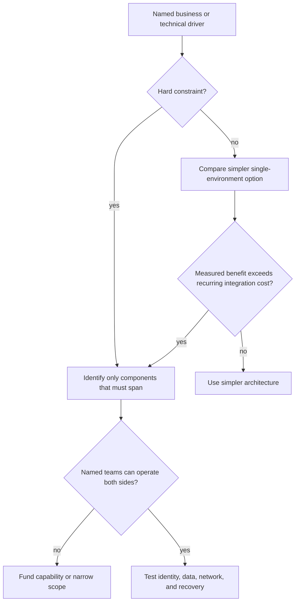
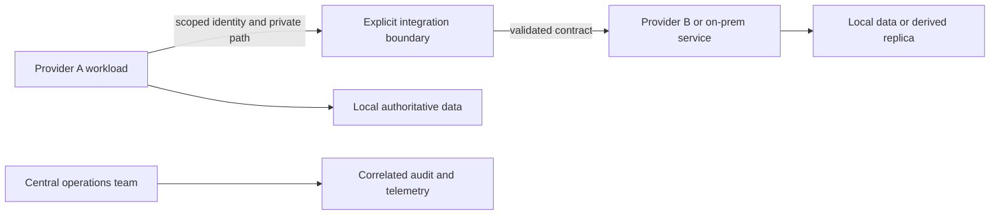
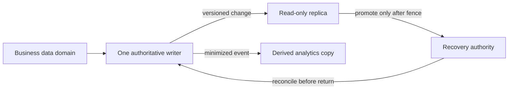
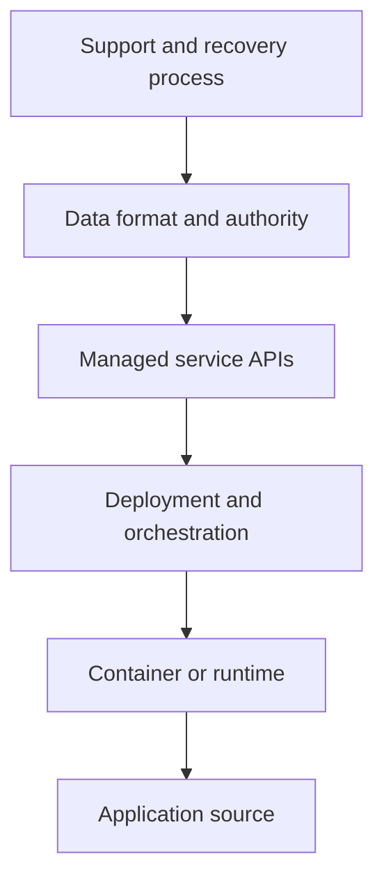
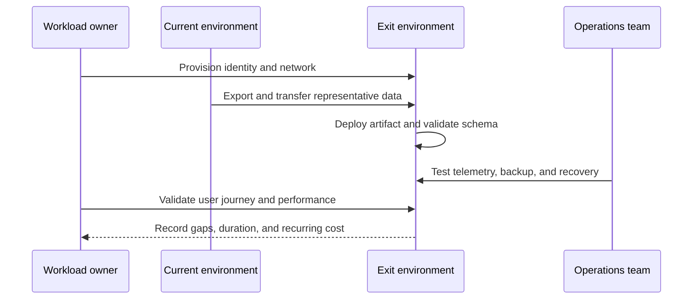

# Hybrid Cloud and Multi-Cloud Architecture

Part: [10 — Cloud Architecture](PART_OVERVIEW.md)

Hybrid cloud and multi-cloud architectures connect workloads across distinct operating environments. Hybrid usually combines a public cloud with retained data-center, campus, or edge systems. Multi-cloud uses more than one public-cloud provider for workload execution or data services. Both can address real constraints, but both create additional identity, network, data, governance, cost, and operational boundaries.

The architecture question is not simply “How can two cloud environments be used?” It is “Which concrete requirement justifies spanning environments, what must cross the boundary, and can the organization operate that boundary safely?” Part 09 owns provider products; this chapter owns the composition and its trade-offs.

## Establish the Driver Before Designing the Connection

The decision is not complete until the spanning boundary has an operating owner and the benefit is supported by workload evidence.

Common drivers include data residency, low-latency access to a site or device, a contractual or regulatory requirement, an acquisition, an existing on-premises dependency, a provider capability that materially improves the workload, or a tested exit requirement. A second provider may also reduce concentration risk, but only if the workload can actually continue there and does not share the same failure dependencies.

Other motivations are weak when stated alone:

- “Avoid lock-in” without a costed exit plan or portability test.
- “Improve resilience” without independent identity, network, data, operations, and recovery paths.
- “Use best of breed” without a workload-level benefit that exceeds duplicated skills and integration.
- “Keep options open” while building deep dependencies on several provider APIs.

A useful decision record names the requirement, the affected components, acceptable alternatives, recurring operating cost, and the evidence that would show the multi-environment design is still worthwhile. If the driver disappears, the architecture should have a way to simplify.

### Apply a go/no-go test

Before selecting connectivity products, compare the multi-environment option with the simplest design that could meet the same requirement:

| Test | Evidence for proceeding | Evidence to reconsider |
|---|---|---|
| Requirement is real | A stakeholder or contract names the boundary, latency, capability, or exit need | The driver is a general preference with no workload consequence |
| Boundary is necessary | Only specified components need to span environments | The design distributes an entire tightly coupled application without a benefit |
| Integration is operable | Named teams can manage identity, routes, data, monitoring, and incidents | One team is expected to master multiple platforms without staffing or support |
| Benefit exceeds recurring cost | Reduced risk, local operation, or capability is measurable | Duplicated services, egress, and support cost consume the expected benefit |
| Exit/recovery is credible | A representative path has been exercised | The alternate exists only in diagrams or infrastructure templates |

Treat a hard legal or physical constraint differently from a preference. A constraint can require hybrid placement even if it costs more; the design then minimizes unnecessary distribution. A preference for provider diversity should be challenged with a failure scenario: identify the provider-specific failure, demonstrate that the alternate is independent, and measure the time and data state at which it can take over. If the scenario still depends on one identity source, one operator, or one data authority, the diversity benefit may be smaller than assumed.

## Choose What Spans the Boundary

Hybrid and multi-cloud do not require every workload component to be distributed. A sound design chooses a placement boundary:

- Keep a legacy system on-premises and move only the new application tier.
- Run stateless services in two clouds while retaining one authoritative data service.
- Use one cloud for production and another for isolated analytics or development.
- Keep device control local while sending summarized data to a regional cloud service.
- Maintain a tested migration destination without active cross-provider operation.

Each choice creates a different data, consistency, and recovery contract. Splitting a tightly coupled application across providers can add network latency and failure modes to every request. Keeping a system of record in one environment may simplify authority but expose it as a critical cross-boundary dependency. Distributing independent components can be effective when interfaces and failure behavior are deliberately designed.

Avoid accidental distribution. A managed identity call, monitoring export, DNS resolver, deployment service, key store, or software repository can create a cross-provider dependency even when the application appears to run in one location.

## Network and Identity Trust Across Environments

A cross-environment network design must address IP-range overlap, routing, name resolution, egress, bandwidth, latency, encryption, path inspection, and failure ownership. A connected network is not necessarily reachable, and reachability does not authorize a caller. Part 10 CH03 covers cloud network architecture; Part 05 owns the network and protocol mechanics.

Choose an explicit connectivity model: private circuit, encrypted tunnel, provider interconnect, internet-facing API, or controlled gateway. Record which environment advertises each prefix, how routes are filtered, who changes the path, and what happens when a link or provider gateway fails. Avoid assuming that one provider's virtual network can act as a transparent transit route into another provider.

Identity architecture is equally important. Workforce federation can provide a common sign-in experience while each environment still has separate resource authorization, workload identities, break-glass paths, and audit records. A token accepted by a workload in one provider should not automatically grant broad access in another. Define trust conditions, audiences, credential lifetime, revocation, and principal attribution on both sides.

The integration boundary should validate identity and request intent, enforce rate and data policy, and produce evidence. A network tunnel alone provides none of those application-level guarantees.

## Data Authority, Gravity, and Residency

Each copy has a purpose and owner. Promotion changes authority; replication by itself does not.

Data movement is frequently the hardest part of a multi-cloud design. Identify one authority per business fact, then define which copies are read-only, derived, cached, analytical, or writable. If two providers can accept writes, specify conflict detection and resolution, ordering, failover, and reconciliation. Avoid dual writes without an explicit consistency model.

Estimate the bytes and frequency crossing the boundary. Include egress charges, transfer throughput, change rate, synchronization lag, retry behavior, data transformation, and the operational time to reconcile. A small API payload can hide a large background replication flow. Data sovereignty and privacy obligations apply to replicas, logs, analytics, backups, support access, and keys as well as the primary database.

Data gravity can make a nominally portable compute service expensive to move. A workload may use portable container images yet depend on a provider-specific database, event system, identity, observability, or network endpoint. Record portability by layer rather than assigning a single “portable/not portable” label.

## Portability Is a Portfolio of Costs

Moving source or a container is only one layer of portability; each higher dependency needs its own exit evidence and cost estimate.

Portability options include source-code portability, runtime portability, container portability, orchestration portability, infrastructure-definition portability, API compatibility, data-format portability, and operational-process portability. These layers are independent. A container image can run in two locations while its managed identity, storage, deployment pipeline, and failure behavior cannot.

Abstraction can reduce migration effort when the supported common contract matches the workload. It also adds code, testing, translation, and limits to service-specific capability. A lowest-common-denominator wrapper may sacrifice a provider feature that materially improves reliability or cost without producing a credible exit path.

A practical portability strategy:

1. Identify the layer where exit or deployment flexibility has business value.
2. Measure the likely cost and time to replace that layer.
3. Abstract only the interface whose alternatives can meet the same contract.
4. Keep provider-specific behavior visible behind explicit adapters or deployment profiles.
5. Test the alternate implementation with real data, identity, network, and operations.
6. Revisit the strategy when the provider mix or business driver changes.

A portability test is stronger evidence than a source-code scan. It includes build, deployment, identity, data export/import, observability, recovery, performance, support, and cost on the destination.

## Operations, Governance, and Failure Boundaries

Every additional environment adds inventories, policy systems, logs, billing models, support routes, quotas, and incident procedures. A single pane of glass can improve coordination but rarely eliminates provider-specific failure diagnosis or access control. Define which team owns each environment and which team owns the integration boundary.

Governance should specify common minimum controls and provider-specific implementation. Do not assume that a policy name or control has identical behavior across platforms. Maintain evidence for the actual control, its owner, and its evaluation. Cost allocation needs a consistent workload identity even when provider billing exports differ.

A workable operating model names owners for both environments and the boundary between them. “Cloud operations” is not enough when one team owns the source network, another owns the destination workload, and a third owns a shared identity provider.

| Operating concern | Accountable owner | Minimum cross-environment evidence |
|---|---|---|
| Provider/platform foundation | Platform team for each environment | Scope inventory, policy baseline, support tier, and escalation path |
| Integration gateway and routes | Named network/platform owner | Route advertisements, endpoint/DNS behavior, allowed flows, and capacity |
| Identity trust | Identity owner with workload approval | Issuer/audience/subject conditions, permissions on both sides, revocation test |
| Data movement and authority | Data-domain owner | Source of truth, replication lag, reconciliation procedure, residency and deletion |
| Incident coordination | Named incident commander or service owner | Shared severity model, contact path, evidence access, and decision authority |
| Cost attribution | Workload and finance/platform owners | Stable workload ID mapped to both provider billing records and shared costs |

Change management needs similar clarity. A route update, identity-claim change, or schema revision in one environment can break a workload owned in another. Establish change notification and compatibility windows for the boundary contract, and provide an integration test that both teams can run. During an incident, preserve one command structure even if technical remediation is split across organizations.

Inventory and telemetry should share correlation identifiers without forcing one provider's control plane to become the only source of truth. Record which environment owns each resource, which workload depends on it, and how an operator can access the relevant audit evidence. A central dashboard is useful only if its ingestion path is itself monitored and the underlying evidence remains accessible during a provider outage.

Analyze shared and correlated failures:

- Common identity federation or directory outage.
- Shared internet carrier, DNS, certificate authority, or private transit.
- A deployment pipeline that can push a defective release everywhere.
- A common data authority or key service located in one provider.
- Shared operators, support vendor, or incident escalation path.
- A global software dependency or SaaS service unavailable to all environments.

Provider diversity is useful against a provider-specific failure only when the alternate workload is ready, its data is usable, traffic can move, identities work, and operators can manage it. Part 10 CH09 covers workload recovery design; a second provider is one possible topology, not a resilience guarantee.

## Exit and Reversibility

The rehearsal proves a workload path, not just source-code or container compatibility.

Exit planning includes data extraction, schema conversion, image and artifact access, identity replacement, DNS and network cutover, licensing, contract terms, support, staff skills, and validation. Estimate both one-time transition effort and the recurring cost of preserving the exit option.

Make reversibility concrete: identify what can be rebuilt, what must be exported, what cannot be moved, what remains provider-specific, how long extraction takes, and what behavior changes at the destination. Test a representative path periodically. An undocumented exit plan that depends on a future team or an untested data export is not an operational capability.

An exit exercise should follow one bounded workload through the actual destination path. Build or retrieve its artifact, provision the target identity and network, export and import representative data, validate schema and integrity, redirect a test client, observe telemetry, and restore from the target's backup path. Record elapsed time, manual intervention, data gaps, and behavior that changed. A successful container start alone proves only that the image can run, not that the workload is portable.

The exercise should also compare the operational and financial cost of preserving the option. If the destination requires a continuously running replica, duplicated support skills, and a second set of policies, those are recurring costs even when no migration occurs. A scheduled export or periodic restore test may provide a cheaper exit capability than continuous active/active operation when the business need is infrequent transition rather than uninterrupted service.

## Worked Example: On-Premises Control System with Cloud Analytics

A manufacturing company operates equipment that must remain locally controllable during network loss. It also needs fleet-wide analytics across sites. Moving the control loop to a remote cloud would violate the latency and disconnected-operation constraints, while keeping all processing local would limit centralized analysis.

The architecture keeps safety and equipment-control decisions at the site. A local gateway authenticates devices, validates commands, buffers permitted telemetry, and applies bounded updates. It sends minimized, timestamped events over an authenticated path to a cloud analytics service. The cloud does not issue safety-critical commands directly; approved configuration changes flow back through a reviewed deployment channel and take effect only after local validation.

The design defines what happens when connectivity is interrupted: control continues locally, telemetry queues within a bounded storage budget, and stale remote configuration is not applied. Data ownership and retention distinguish raw operational signals from derived fleet analytics. Site identity and update credentials can be rotated without a permanent connection, and support procedures preserve audit evidence.

This is a justified hybrid architecture because physical operation and offline control are hard constraints. It avoids distributing the control plane across multiple public clouds merely for hypothetical portability. The company separately tests data export and analytics reconstruction so that its actual provider exit capability is known.

The operational sequence separates telemetry upload from configuration delivery. Each device signs or otherwise authenticates its messages with a device-specific identity. The regional ingestion service validates the identity, checks the device's allowed site and schema version, and stores the event with an idempotency identifier. Analytics consumers read a derived copy and cannot issue control commands. A configuration package has a version, target device class, expiration, and signature; the site stages it, validates compatibility, and applies it only under local policy.

During a network outage, the gateway continues the approved local control loop and records telemetry in a bounded queue. It does not accept commands whose authorization depends on a live central check, and it does not indefinitely extend expired credentials. When storage approaches its limit, it prioritizes safety and summary evidence according to a documented policy and alerts the local operator. When connectivity returns, it uploads records in batches, handles duplicate acknowledgements idempotently, and reports the range of missing or summarized data rather than claiming a complete history.

The cloud side also needs a degraded mode. If analytics ingestion is unavailable, device control remains local and the cloud does not send unverified configuration updates. Operators can inspect the last contact time and queued-volume estimate when it is available, but missing telemetry is not interpreted as a healthy device. Site support has an authenticated local procedure for a prolonged outage, with actions logged for later reconciliation.

The company exercises three distinct events: a short carrier interruption, a long outage that fills most of the local buffer, and a compromised update credential. The short interruption should recover without operator action. The long outage should produce a safe local state and clear operator warning. The credential incident should allow revocation and block new packages without disabling local safety control. These tests validate that the hybrid boundary is intentional and that the site is neither fully dependent on the cloud nor an ungoverned isolated system.

Contrast that case with a company claiming a second cloud is its regional-disaster destination. If the second environment has no current data, the deployment identity exists only in the primary provider, the network routes are untested, and the on-call team cannot operate the target, the second provider does not yet provide recovery. A credible design names the failover trigger, establishes a single-writer boundary, measures replication lag, validates quota and data access, and rehearses traffic movement with the available operators. If those requirements are not funded, a simpler and tested recovery pattern in one provider may deliver more resilience for less operational complexity.

## Architecture Review Questions

- What specific business or technical requirement justifies multiple environments?
- Which components cross the boundary, and which should remain local to their authority or users?
- Are routing, DNS, identity trust, egress, and integration ownership explicit on both sides?
- Is there one authoritative writer for each data domain, or a tested conflict model?
- Are transfer volume, lag, egress, residency, keys, and deletion accounted for?
- Which portability layer has measurable value, and what does preserving it cost?
- Can operations correlate identities, changes, telemetry, incidents, and costs across providers?
- Are common identity, network, carrier, deployment, or SaaS dependencies still single points of failure?
- Has an alternate environment been tested with real data and operational processes?
- Is the exit plan timed, costed, owned, and periodically exercised?

Further reading: [Part 09 Cloud Computing](../09_Cloud_Computing/PART_OVERVIEW.md), [Part 10 Network Architecture](CH03_Cloud_Network_and_Connectivity_Architectures.md), [Part 10 Identity Architecture](CH04_Cloud_Identity_and_Access_Architecture.md), [Part 10 Resilience Architecture](CH09_Resilience_Availability_and_Disaster_Recovery_Architectures.md), and [Part 10 Migration Architecture](CH14_Cloud_Migration_and_Modernization_Architecture.md).
