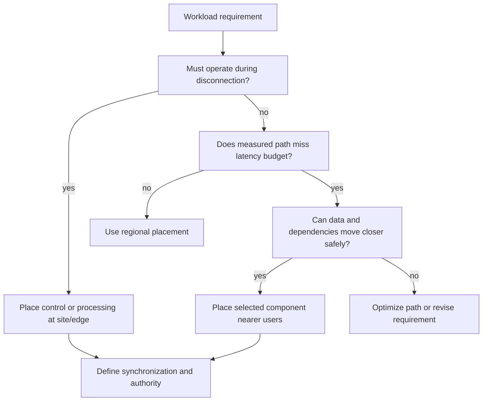
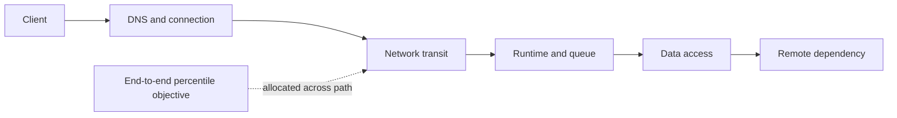
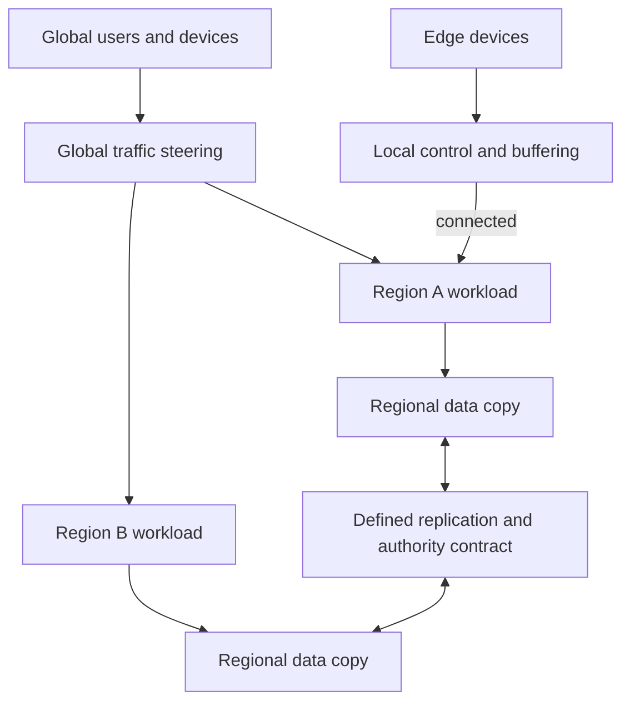
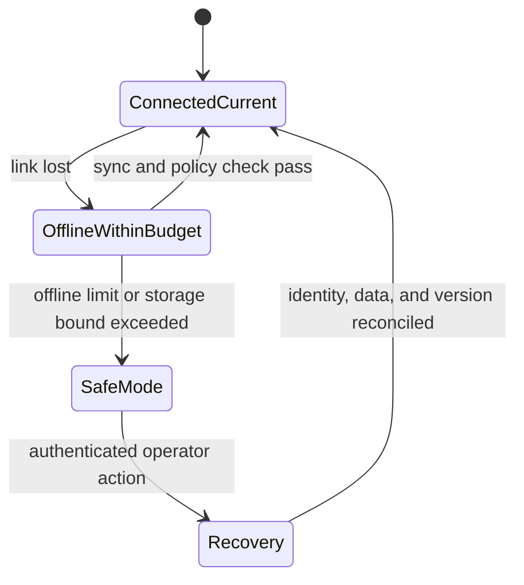
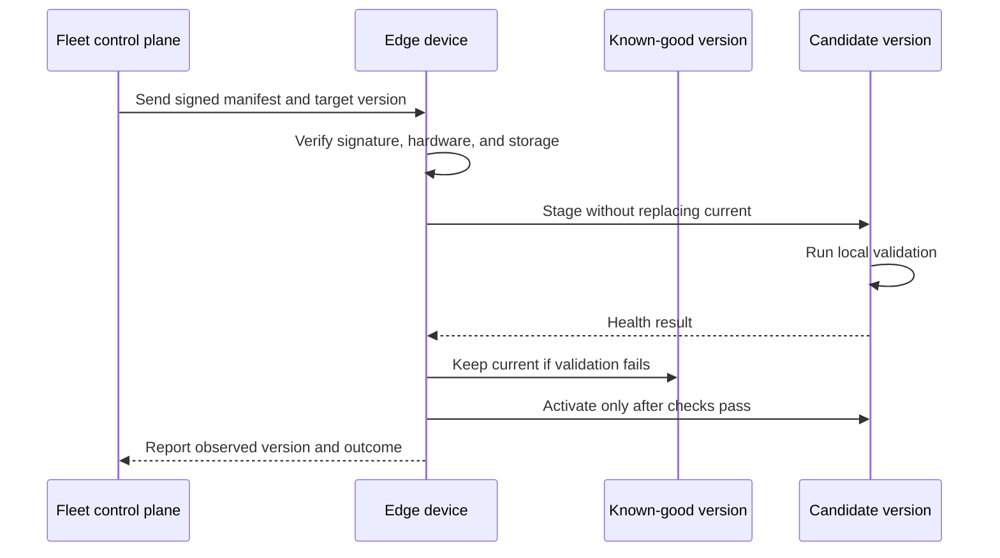

# Edge, Regional, and Global Workload Placement

Part: [10 — Cloud Architecture](PART_OVERVIEW.md)

Placement determines where computation and data sit relative to users, devices, and dependent services. Moving a component closer to a user can reduce network distance, but it also creates more locations to secure, update, observe, and recover. Edge and global architecture is therefore a trade between locality and operational coherence.

Part 09 owns provider edge products and runtime mechanics. Part 05 owns network and protocol details. This chapter focuses on workload placement across regions, edge sites, and disconnected environments.

## Choose Location from the Workload Contract

The location follows a measured requirement and its data/dependency constraints, not a preference for edge placement.

Different locations offer different capabilities and operating conditions:

- **Region:** a provider-defined geographic area containing one or more service locations and data residency implications.
- **Availability Zone:** a provider failure and placement scope within a region, with provider-specific connectivity and independence.
- **Metro or local zone:** a provider extension nearer a population or facility, with a narrower set of services than a major region.
- **Edge location:** infrastructure near users or network access points, often optimized for delivery, caching, or selected compute.
- **Customer site or device:** infrastructure under local physical, power, connectivity, and fleet-management conditions.

These labels do not guarantee a particular latency, service catalog, or failure independence. Verify the provider-specific contract in Part 09 and measure the path from the actual user or device.

Start with the function's requirements: response time, data locality, legal boundary, bandwidth, need for offline operation, user density, and tolerated failure. Place only the components that benefit from locality. Central identity, control planes, analytics, and long-term data may remain in a region even when a device performs local inference or a nearby cache serves content.

## Build a Latency and Data-Locality Budget

Measure each segment under representative load; shortening one hop does not improve the user objective if another dependency dominates the tail.

A user-visible response time includes more than geographic distance. It may include name resolution, connection establishment, transit, queueing, compute, storage access, and calls to downstream services. A workload moved near the user can remain slow if it makes multiple synchronous calls to a distant database or identity provider.

For each critical interaction, allocate a latency budget across the path and identify the components that dominate it. Use measurements from representative clients, including tail latency, not only averages. Check how routing, session affinity, TLS setup, content caching, and provider service endpoints affect the observed path.

For example, a 200 ms user-facing objective might allocate 30 ms to name resolution and connection setup, 40 ms to network transit, 70 ms to application processing, and 60 ms to data and downstream calls. Those allocations are hypotheses, not guarantees. Measure the actual distribution from representative user locations and include the p95 or p99 behavior that drives the experience. If a distant database call consumes most of the budget, moving only the API runtime to an edge location may add another network hop without improving total latency.

Separate fixed propagation delay from variable queueing and processing delay. Geographic distance has a lower bound; queue length, cold start, connection setup, and overloaded dependencies can often be changed. Before distributing a service, measure which component dominates and test an alternative such as connection reuse, read caching, asynchronous work, or data co-location. Those alternatives have different freshness and cost consequences and should be compared against the same user journey.

Data placement is often the limiting factor. A local runtime may require a local read replica, cache, or bounded data subset. Each creates freshness, conflict, privacy, and recovery obligations. When a local copy is stale or unavailable, specify the safe operations and the user-visible response. Part 10 CH06 owns data authority and copy semantics; Part 10 CH09 owns recovery topology.

## Global Traffic and Regional Topologies

Global routing can direct users to a nearby region, a healthy region, or a region with available capacity. DNS-based routing is simple to integrate but depends on resolver caching and client behavior. Anycast or global load-balancing services can provide different convergence and health behavior. A content delivery network can cache suitable content near users but is not a substitute for dynamic application authorization.

Define how the system handles:

- Regional health signals and false positives.
- User/session affinity and connection persistence.
- Capacity when traffic shifts from an unhealthy region.
- Data authority and write routing during regional isolation.
- DNS cache and client retry behavior during changes.
- Gradual recovery and failback after the region returns.

Active/active regional operation can lower interruption and serve locality, but it needs explicit consistency and conflict behavior. Active/passive can simplify data authority but requires standby readiness and a tested traffic transition. Single-region architecture may be appropriate when objectives, cost, and risk allow it; adding regions without an operational objective can make recovery less predictable.

Traffic policy should distinguish health from capacity. A region can pass a shallow health check while lacking enough database connections, accelerator quota, or downstream budget for the load it is about to receive. Use signals that represent the ability to serve the relevant journey, but avoid making a transient dependency error trigger rapid global oscillation. Define a failover threshold, hold-down behavior, and the minimum healthy capacity before steering more traffic.

Session affinity can preserve local state or reduce repeated authentication, but it can pin users to a failed or degraded region. If a session is portable, store or securely encode the necessary state and make the destination understand it. If it is not portable, document the user impact; define a recovery path. Traffic steering cannot repair a session contract or resolve which region owns a write.

The diagram intentionally separates traffic steering from data authority. Routing can redirect requests; it cannot decide whether two regional copies may accept writes or reconcile divergent state.

## Edge Processing and Disconnected Operation

The offline limit bounds local authority as well as storage; reconnect does not automatically authorize stale queued commands.

Edge processing is useful when a workload must respond despite high latency, intermittent connectivity, data-volume constraints, privacy limits, or the need to filter data before transmission. Examples include local control loops, industrial gateways, retail systems, vehicle/field devices, or local inference.

A disconnected-capable design defines its autonomy boundary:

- Which decisions can be made locally, and which require central approval?
- How much data can be buffered and for how long?
- How are time, identity, configuration, and policy validated offline?
- What actions are rejected when local credentials or policy become stale?
- How are conflicts, duplicate events, and delayed synchronization resolved?
- How does an operator diagnose and recover a device that cannot reach central management?

Offline mode must not turn a temporary network outage into unbounded authority. Set limits on queued actions, data retention, local privileges, and configuration age. On reconnection, synchronize with explicit ordering and conflict rules rather than replaying every local command blindly.

The offline contract should also define queue behavior. A device may buffer telemetry but must not buffer safety-critical commands for later blind execution. Every queued action needs an idempotency identifier, a creation time, an expiry, and a policy for revalidation when connectivity returns. If device storage fills, choose which data is preserved, summarized, or dropped and notify the local operator. A queue with no storage bound converts a network outage into a later data-loss or availability incident.

## Device and Edge-Fleet Lifecycle

The control plane records observed state, not merely command delivery; the known-good version remains available until the candidate is proven locally.

A distributed fleet expands the control surface from cloud resources to physical devices, local networks, storage, and software versions. Each device needs enrollment, unique identity, secure bootstrap, update, telemetry, configuration, ownership, and retirement processes. Device identity should remain attributable after replacement or transfer.

Roll out changes in rings: a representative test cohort, limited production cohort, then wider fleet. Verify compatibility with old and new message schemas, interrupted update behavior, local rollback, and insufficient power or storage. A failed update should not leave a device unable to communicate or recover. Preserve an authenticated recovery channel and define when manual site intervention is required.

Observability is constrained by connectivity and resource budgets. Edge agents may buffer telemetry, reduce sampling, or send summaries. The architecture should distinguish missing telemetry due to link loss from evidence that the device is healthy. Device time may drift, so event ordering and certificate validity need an explicit time strategy.

Fleet updates must be treated as distributed deployments. A release package should be authenticated, bound to an intended device class, and checked for compatibility with local hardware, storage, and currently installed version. Use staged cohorts, a rollout pause condition, and a recovery path that does not require the failed update channel to succeed. Track desired version, observed version, last successful contact, and update result separately; “command sent” does not mean “device updated.”

For remote recovery, define what can be diagnosed with local logs, what evidence remains buffered, and which operation requires a human at the site. Preserve a last-known-good model or runtime, but ensure its age and policy remain acceptable. If a device remains disconnected beyond its allowed offline window, reduce its authority or enter a documented safe mode rather than continuing indefinitely with stale credentials and configuration.

## Operational and Economic Trade-offs

Every additional location adds capacity planning, identity policy, patching, inventory, monitoring, support, and incident response. Edge deployments may have physical access delays, heterogeneous hardware, constrained power, and limited local staff. A central cloud operations model may not be sufficient for a device fleet spread across customer sites.

Compare locality benefit against:

- Additional compute and data copies.
- Inter-region and edge-to-cloud network costs.
- Hardware procurement and replacement cycles.
- Fleet update and support labor.
- Data synchronization, retention, and security controls.
- Environmental impact and utilization of distributed equipment.

A cost or latency improvement is meaningful only when measured for the end-to-end user journey. A faster first hop can be offset by cross-region data calls, duplicate data storage, or a larger operational burden. Part 10 CH13 develops cost, performance, and sustainability architecture.

## Worked Example: Remote Inspection with Local Inference

A utility inspects equipment at remote sites with intermittent connectivity. Images are large, and a local operator needs an immediate warning when a safety threshold is exceeded. Central specialists need a fleet-wide history for trend analysis, but loss of a cloud link must not stop the inspection process.

A local gateway performs inference using a versioned model and records the model identity, device identity, timestamp, and result. It stores a bounded encrypted queue of image metadata and selected evidence. When connectivity returns, the gateway sends the batch to a regional ingestion service; the cloud stores the long-term record and updates fleet analytics. The cloud can recommend model updates, but a site applies them through staged rings and keeps a known-good version for local rollback.

The design sets a maximum offline duration, queue capacity, acceptable model age, and local authorization lifetime. When any threshold is exceeded, the device enters a safe mode and signals the operator rather than silently accepting stale policy. Tests include a long outage, power loss during update, full local storage, clock drift, duplicate upload, and rejected model rollback.

Buffer capacity follows the data-generation rate and the longest supported outage. Account for metadata and retry overhead as well. If a site produces 8 gigabytes of relevant evidence per day and must tolerate a three-day outage, the local design needs more than 24 gigabytes available for that evidence; it must also reserve space for the operating system, model, temporary processing, and a safety margin. If the device cannot retain all raw images, it must state which records are sampled, summarized, or dropped and preserve enough metadata to explain the gap.

The model package is treated as a versioned deployment artifact. A site checks the package signature, hardware compatibility, minimum free storage, and policy version before installation. It first loads the candidate beside the known-good model, runs a small local validation set, then switches the active pointer. If validation fails or the device reboots midway, it returns to the previous known-good version and records the outcome for the next connection. The cloud control plane tracks desired and observed model versions separately so an offline device is not reported as updated merely because the command was sent.

On reconnection, synchronization uses event IDs and device sequence numbers so retries do not duplicate analytics records. Timestamps alone are not treated as a total order because site clocks can drift. Conflicting configuration changes are resolved by version and approval policy; local safety controls take precedence over a stale central recommendation. These rules keep the offline period bounded in authority, not just in storage.

This design places only the latency- and connectivity-sensitive decision at the edge. Analytics and fleet governance remain regional because they do not need to execute during every inspection.

The operating contract distinguishes local control, cloud connection, and recovery states:

| State | Local behavior | Cloud interaction | Exit condition |
|---|---|---|---|
| Connected and current | Normal local inference and bounded control | Upload evidence, receive approved configuration, report health | Link loss or policy/model change |
| Connected but stale | Continue only approved local operations | Report stale version; reject commands that require newer policy | Signed compatible update or operator review |
| Disconnected within budget | Preserve local safety function and buffer priority data | No central command path; device records outage start and queue usage | Link returns or offline limit is reached |
| Disconnected beyond budget | Enter defined safe mode and alert locally | No unverified privilege extension or queued command execution | Authenticated recovery and policy refresh |
| Updating | Keep last-known-good version active until candidate validation | Report desired/observed version and staged outcome | Candidate passes health checks or rolls back |

This state model prevents “offline capable” from meaning “unbounded local authority.” The operating team can determine which state each device occupies, which actions it may perform, and what event returns it to normal operation.

An update sequence begins with a signed manifest that identifies target device classes, compatibility range, payload hash, and expiry. The device verifies the manifest and available storage, stages the package without replacing the running image, validates it locally, switches versions, and reports the observed result. If power fails during staging, the known-good version remains bootable. If the device cannot report success, fleet management records it as unknown rather than counting it as upgraded. A later update can be withheld from other rings until the first cohort demonstrates stability.

## Architecture Review Questions

- Which user or device requirement justifies each non-central placement?
- Does measured end-to-end latency meet the budget, including data and identity dependencies?
- Which state is local, cached, replicated, or authoritative at each location?
- What operations remain possible during disconnection, and which are safely denied?
- Are buffer size, offline duration, data age, and local authority bounded?
- Can global routing fail over without exceeding remaining-region capacity?
- Is data authority explicit in active/active or regional failover modes?
- Are device enrollment, identity, staged update, recovery, and retirement designed?
- Can operators tell device failure from missing connectivity or telemetry?
- Do the locality benefits justify the recurring compute, transfer, hardware, and support costs?

Further reading: [Part 09 Compute](../09_Cloud_Computing/CH04_Compute.md), [Part 09 Cloud Networking](../09_Cloud_Computing/CH05_Networking.md), [Part 10 Data Architecture](CH06_Cloud_Storage_and_Data_Architecture.md), [Part 10 Resilience Architecture](CH09_Resilience_Availability_and_Disaster_Recovery_Architectures.md), and [Part 10 Cost, Performance, and Sustainability](CH13_Cloud_Cost_Performance_and_Sustainability_Architecture.md).
