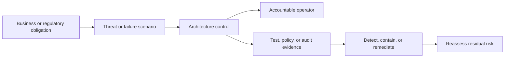
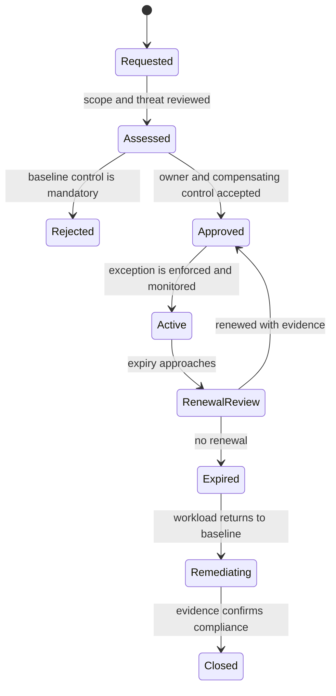
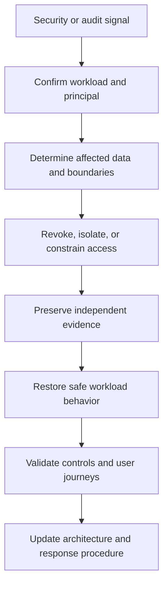
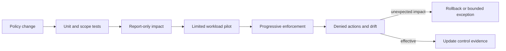

# Cloud Security, Governance, and Compliance Architecture

Part: [10 — Cloud Architecture](PART_OVERVIEW.md)

Cloud security architecture turns obligations and threat assumptions into enforceable boundaries, accountable controls, and evidence that a workload operates as intended. Governance defines how those decisions are established, applied, reviewed, and changed across accounts, networks, identities, services, and teams.

Part 15 Security owns general threat modeling, cryptography, control families, and compliance depth. Part 09 owns provider IAM, secret, network, and security-service mechanics. This chapter composes those mechanisms into workload architecture and keeps accountability visible across the provider/customer boundary.

## From Obligation to Control and Evidence



This chain makes the control testable: an obligation without an owner or evidence path is not yet an operating safeguard.

Begin with the workload, not a checklist. Identify protected assets, data flows, principals, interfaces, business processes, and failure consequences. Record applicable legal and contractual obligations, but do not mistake a compliance mapping for a threat model or an assurance claim.

For each material obligation or threat, define:

1. The asset, behavior, or boundary being protected.
2. The architecture control that changes likelihood or impact.
3. The owner who configures and operates that control.
4. The evidence that indicates the control is effective.
5. The response when the control is absent, bypassed, or unavailable.

Evidence might be an enforced policy, a reviewed access grant, a configuration state, a test result, an audit event, or a restore exercise. A provider certificate is evidence about provider-operated controls within a stated scope and period; it does not show that the customer selected an appropriate region, configured a resource correctly, or protected its application data.

Trace evidence from the risk statement to the workload behavior. “Data must be protected” is too broad to verify. A more useful scenario is: an operator with support privileges attempts to export a regulated document; the application returns only the approved view, the object store denies direct access, and the attempt is recorded in an independently administered audit destination. The evidence then includes the role definition, access test, denied object request, and audit event.

| Threat or obligation | Architectural control | Accountable owner | Evidence and response |
|---|---|---|---|
| Stolen workload credential reads unrelated data | Workload identity scoped to one service and resource set | Workload owner with IAM platform support | Negative access test, grant review, rapid revocation procedure |
| Operator disables audit during an incident | Separate logging administration and protected audit destination | Security/platform operations | Deny test, immutable or protected records, alert on delivery loss |
| Data copy leaves approved location | Organization and service-location guardrails plus inventory of replicas | Platform owner and data owner | Policy evaluation, replication inventory, exception and deletion evidence |
| Recovery cannot decrypt a backup | Recovery identity and key permissions tested together | Data owner and key/security owner | Timed restore exercise and key-use audit |
| Policy update blocks production | Staged enforcement and representative workload tests | Governance/platform owner | Pre-production impact report, staged rollout result, rollback decision |

The mapping is not a checklist to satisfy once. Revisit it when the workload adds a new interface, identity, data copy, region, managed service, or support path. A control's effectiveness depends on its configuration and operation in the actual workload boundary.

## Place Trust and Administrative Boundaries

```mermaid
flowchart LR
User[External user] --> Edge[Public entry boundary]
Edge --> App[Workload application]
App --> Data[Protected data boundary]
Operator[Workforce operator] --> Admin[Privileged management path]
Platform[Platform control plane] --> Workload[Workload account and network]
Provider[AWS service boundary] --> Workload
Audit[Protected evidence scope] <-- App
Audit <-- Admin
```

The view separates public traffic, workload data, administration, provider responsibility, and evidence custody so a reviewer can ask who controls each crossing.

A cloud workload crosses several trust boundaries: provider infrastructure, organization and account scopes, shared platform services, workload networks, runtime identities, application interfaces, data stores, deployment systems, operators, and external dependencies. Map who can administer each boundary and which principals can cross it.

Use organizational scopes, networks, and identity policy for distinct purposes. An account or project may separate administration and billing; a network policy may constrain packet paths; an application policy may restrict access to a record. None automatically replaces the others. Part 10 CH02 covers organizational boundaries, CH03 network architecture, and CH04 identity architecture.

Workload isolation should match threat and operational consequences. Separate production from experimentation when their identities, data, change rates, or administrators differ materially. Separate tenants or regulated data where the threat model, legal obligations, or evidence require stronger isolation. Avoid both extremes: one shared scope with broad administrative reach, and one isolated scope per component without a maintainable platform model.

Managed services change the boundary, not the need to model it. A provider may secure the underlying service while the workload team controls public exposure, identity, encryption, retention, and data access. Document the actual service contract and verify responsibility by control.

### Turn threat assumptions into boundaries

Use a workload data-flow and trust-boundary view to reason about how an attacker or error could reach a protected asset. For each entry point, identify the principal, credential source, network path, authorization decision, data touched, and audit evidence. Then follow plausible paths across components rather than reviewing each resource in isolation.

For example, a public API may accept a valid customer token but still be vulnerable if its runtime identity can read every tenant's document. The network path is correctly private, and authentication is successful, yet the authorization boundary is too broad. Another path may begin with a deployment pipeline: if it can change both application code and organization policy, a source compromise can disable the control meant to constrain the new release. These scenarios show why network, identity, data, and deployment boundaries need to be reviewed together.

For each high-impact path, ask which control prevents the action, which control detects a bypass, and which owner can contain the event. Defense layers are useful only when failure in one layer does not automatically defeat the others. A firewall rule and an application permission that are both changed by the same unrestricted deployment identity do not provide independent protection.

The resulting model should include both intended and denied paths. A diagram that shows how traffic is allowed but not which flows must remain impossible can conceal overbroad roles or fallback routes. Record the negative security properties explicitly, such as “support cannot retrieve raw documents,” and convert them into testable policy or application checks.

## Guardrails, Delegation, and Exceptions



An exception is a time-bounded risk decision, not a permanent alternate policy branch.

Governance controls can prevent, detect, or correct behavior. Preventive controls reduce the chance that an unsafe configuration is created. Detective controls report that a condition exists. Corrective controls remediate a condition or limit its impact. A mature design uses the appropriate combination rather than assuming one policy mechanism is sufficient.

Organizational guardrails should define:

- The mandatory baseline and its scope of inheritance.
- Which choices are delegated to platform or workload teams.
- How policy changes are tested against representative workloads.
- How exceptions are requested, approved, monitored, and expired.
- Which emergency changes are allowed and how they are reviewed afterward.

An exception record should identify the affected resources, business rationale, accountable risk owner, compensating controls, evidence, expiry, and review trigger. Permanent exemptions with no owner become an alternate policy system that is less visible than the baseline.

Delegation should be explicit. Platform teams can own organization-wide configuration and shared security services; workload teams can own application behavior, runtime permissions, and data handling; central security can define minimum controls and review high-risk deviations. Assigning a role to “security” without specifying who operates it obscures the control.

## Protect Data and Keys Across the Lifecycle

Data protection begins with classification, access, and lifecycle. Identify sensitive fields and copies in operational stores, object storage, logs, analytics, backups, exports, caches, and telemetry. Minimize data collection and propagation before relying on encryption to compensate for broad access.

Encryption at rest and in transit protects data under specific threat assumptions. The architecture must also define key ownership, administrative separation, key availability during recovery, rotation compatibility, and audit. If a workload cannot decrypt its backup during a regional incident because the key policy or identity is unavailable, the backup does not satisfy the recovery need.

Secrets, cryptographic keys, and certificates have different lifecycles. Link cloud secret-store behavior to Part 09 CH13 and general key/certificate mechanics to Parts 05 and 15. Avoid embedding credentials in source, images, logs, or event payloads; use workload identity and narrowly scoped retrieval when possible.

Retention, deletion, residency, and backup rules should agree. A deletion process needs to account for derived copies and the retention period of immutable backups. A data-location policy needs to include replication, logs, support access, and exported evidence, not only the primary storage resource.

## Detection, Response, and Evidence Architecture



Containment and evidence preservation can conflict; define the authority and sequence before an incident.

A secure architecture needs enough telemetry to detect and investigate events without collecting unlimited sensitive data. Decide which provider audit sources, workload logs, network flow records, identity events, and application security signals are required; identify where they are stored, who can alter them, how long they are retained, and how evidence survives a regional or account compromise.

Incident response crosses platform and workload ownership. Define who can isolate a workload, revoke credentials, preserve evidence, restore service, notify stakeholders, and authorize an emergency exception. Centralized logging may improve correlation while creating a highly privileged data store that requires its own isolation and recovery design.

Security telemetry should be tested as a pipeline. A control that generates an audit event is ineffective if the event is filtered, delayed, inaccessible to responders, or silently dropped. Correlate control-plane changes with workload identity, deployment version, network path, and application outcome.

Containment authority should be designed before an incident. Identify who can revoke a workload credential, isolate a network path, suspend a deployment, quarantine a data copy, or disable an integration. These actions can interrupt service or destroy evidence, so pair each with an impact estimate, approval threshold, and recovery procedure. During a credential compromise, rapid revocation may be more important than uninterrupted processing; during suspected data corruption, preserving the affected store may be more important than restoring quickly over the evidence.

Test incident transitions as well as alert delivery. A tabletop can confirm that responders know who may isolate a workload. A controlled exercise can verify that the identity owner can revoke a token, the platform can block a network path, and the security team can retrieve an audit record without accessing the protected business data. If isolation depends on a provider control plane, document the alternative when that plane is unavailable.

## Policy as Code and Configuration Drift



The rollout has explicit exit criteria at each stage; report-only mode is not a permanent substitute for the required control.

Policy-as-code makes guardrails reviewable and repeatable, but it also turns policy repositories and deployment credentials into high-impact systems. Test policy syntax, scope, inheritance, deny behavior, exceptions, and remediation in a representative environment before broad enforcement.

Roll out controls progressively when failure could block critical workloads: report-only, limited scope, owner notification, staged enforcement, and continuous drift review. The stages should have exit criteria and dates so “report-only” does not become permanent.

Each stage should answer a different question. In report-only mode, measure which resources would violate the policy and verify that the inventory is complete. In a limited pilot, test whether enforcement blocks unsafe changes without breaking required deployments or recovery. Before broad enforcement, publish the effective rule, affected scope, exception process, support contact, and rollback action. After enforcement, monitor denied operations and drift rather than assuming the initial rollout proves lasting compliance.

Automatic correction needs a higher bar than detection. It is appropriate when the desired value is unambiguous, the change is reversible, and remediation cannot destroy evidence or interrupt a critical workflow. For ambiguous findings, route the issue to an owner with a response deadline. For high-severity exposure, containment may be immediate while preserving forensic evidence. Record when emergency changes bypass normal policy and require post-incident review with a defined expiration.

Drift detection compares intended configuration to observed state. Decide whether a violation triggers automatic correction, an alert and owner response, or a temporary containment. Automatic remediation is appropriate only when the desired state is unambiguous and the correction cannot interrupt a critical workflow or destroy evidence.

## Worked Example: Regulated Claims Processing

A claims platform processes personal information through a public submission API, an internal adjudication service, document storage, analytics, and a support tool. The organization needs regional processing, restricted operator access, immutable audit evidence, and a defined deletion lifecycle.

The architecture places production resources in dedicated organizational scopes with inherited location and audit guardrails. Public traffic enters through a controlled edge boundary; application identity separates submission, adjudication, support, and analytics roles. Document storage and the transactional database have distinct access policies, while analytics receives a minimized event stream instead of broad database credentials.

Audit events are exported to a protected logging scope with separate administration. The support tool reads a constrained API view; it does not receive direct document-store access. A deletion workflow identifies primary records, search indexes, analytics projections, and backups, and records which copies age out under retention. Exceptions to region policy require a named risk owner, a compensating control, evidence, and expiry.

The review tests whether a compromised support identity can access raw claims, whether a deployment role can disable audit collection, whether the recovery team can decrypt and restore the data, and whether a region-policy change is visible before enforcement. Compliance evidence is tied to these controls and tests rather than to the existence of a policy document alone.

The access model has separate principals for submission, adjudication, support, analytics, deployment, and recovery. The submission identity can create a claim and upload its associated document but cannot change adjudication results. The adjudication service can read assigned claim details and write the decision record. Support can query a restricted view that omits raw documents and selected sensitive fields. Analytics receives minimized events and cannot query the transactional database. The deployment principal can publish an approved artifact but cannot assume the runtime identity or alter organization guardrails.

The document store is private and accepts access only from the intended service identities and recovery role. Keys are administered separately from workload data access, and the restore identity's key permission is tested in a recovery exercise. Audit events go to a logging scope with separate administrators; a workload deployment cannot disable the destination or delete evidence. A missing audit heartbeat is treated as a control failure, not as zero security events.

The exception process is tested using a workload that temporarily needs a new region. The request names the affected scope, data owner, reason, compensating controls, approving authority, expiry, and evidence needed before broad enforcement. The policy pipeline first reports impact, then tests an equivalent environment, then enforces the change only in the approved scope. When the exception expires, the platform confirms whether the workload moved or has a renewed decision rather than silently retaining the exemption.

The review exercises concrete attacks and failures: a support user requests a raw document, a compromised deployment credential attempts to disable audit, analytics asks for an unapproved field, a restored backup is accessed without its key, and an audit destination becomes unavailable. Each test has an expected deny, alert, or degraded behavior and a named responder. Results are recorded with the policy version and workload release so a later reviewer can distinguish a control regression from an application change.

## Architecture Review Questions

- Are assets, data flows, trust boundaries, and threat assumptions explicit?
- Does each control have an accountable owner, operating procedure, and evidence source?
- Are provider, platform, and workload responsibilities defined at control level?
- Do organizational, network, identity, and application boundaries serve distinct purposes?
- Are policy inheritance and exceptions visible, tested, time-bounded, and reviewable?
- Are data classification, access, location, retention, deletion, and backup consistent across copies?
- Can workloads and recovery operators access required keys without excessive privilege?
- Are audit and security events protected, retained, correlated, and available during incidents?
- Has policy enforcement been staged and tested for both unsafe access and operational impact?
- Does the architecture distinguish a compliance artifact from demonstrated control effectiveness?

Further reading: [Part 09 IAM](../09_Cloud_Computing/CH09_IAM.md), [Part 09 Secrets Management](../09_Cloud_Computing/CH13_Secrets_Management.md), [Part 10 Organizational Hierarchy](CH02_Organizational_Hierarchy_and_Landing_Zones.md), [Part 10 Identity Architecture](CH04_Cloud_Identity_and_Access_Architecture.md), and [Part 15 Security](../15_Security/PART_OVERVIEW.md).
