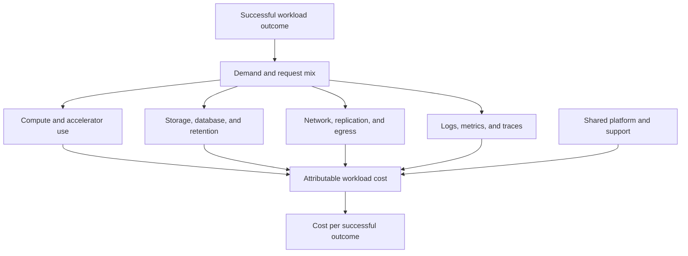
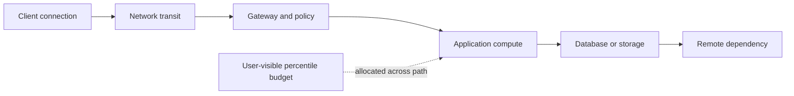
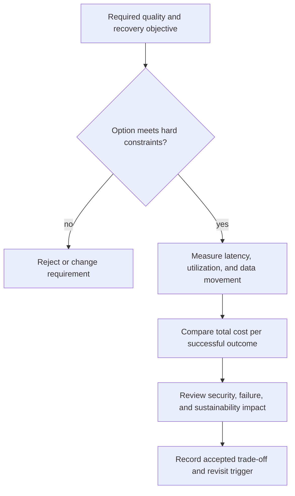
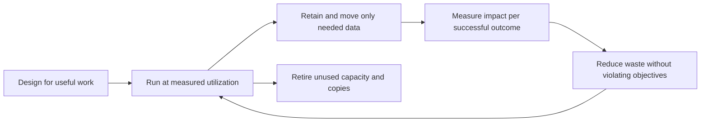
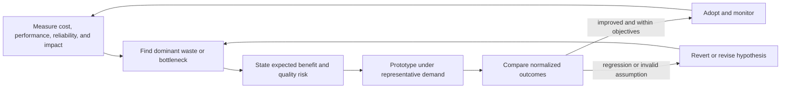

# Cloud Cost, Performance, and Sustainability Architecture

Part: [10 — Cloud Architecture](PART_OVERVIEW.md)

Cloud architecture has economic, performance, and environmental consequences that are shaped by workload behavior and placement. A low unit price can produce a high total bill when utilization is poor or data movement is expensive. A low-latency design can create duplicated capacity and data. A region with a favorable carbon signal can increase user latency or transfer cost. Sound decisions state which outcomes matter and measure the trade-offs together.

Part 09 [Cost Optimization](../09_Cloud_Computing/CH14_Cost_Optimization.md) owns provider billing data and product mechanics. Part 19 owns performance engineering and measurement techniques. Part 07 owns service objectives. This chapter connects those inputs at the architecture level.

## Define the Outcome and Workload Shape

Start with a unit of useful work: a completed order, processed document, successful API transaction, inference result, or retained analytical query. Then define the quality conditions under which that work counts as successful. “Cost per request” is misleading if failed or retried requests are counted as outcomes, or if a system is fast only because it dropped expensive work.

Describe demand over time: baseline, peak, burst, seasonality, growth, and uncertainty. Include concurrency, payload size, data volume, retention, geographic distribution, and dependency calls. Averages hide the peaks that determine capacity and the long-tail traffic that can dominate transfer or storage cost.

Pair workload shape with service objectives. Define latency and throughput boundaries for important user journeys alongside availability and recovery needs. Use percentiles and representative load rather than a single average. Part 07 and Part 19 own the detailed SLI/SLO and performance methods; the architecture must ensure its placement and service choices can satisfy them.

## Build a Cost Model from Architecture Drivers

The model makes shared and secondary costs visible instead of treating compute price as total workload cost.

Cloud consumption costs arise from compute, storage, databases, messaging, network transfer, observability, licenses, support, and idle or temporary resources. The architecture changes how much of each resource is used, where it runs, and how long it remains. Cost estimates should include the complete dependency path, not only the primary runtime.

For a workload, record:

- The useful outcome and expected volume.
- Resource quantities and utilization assumptions.
- Data ingress, replication, backup, export, and egress.
- Request, query, message, log, and metric volume.
- Shared platform and support allocation.
- Environment overhead, deployment overlap, and failover capacity.
- Pricing assumptions, discounts, commitments, and uncertainty.

Show a range for uncertain demand or pricing instead of reporting false precision. Sensitivity analysis reveals the assumptions that dominate cost: request volume, payload size, retention, idle time, or number of redundant regions. Part 09 CH14 owns cost allocation and provider billing mechanics.

### Make the estimate decision-useful

Keep the model small enough to inspect, but include the architecture drivers that can change the decision. Separate fixed baseline from variable consumption. For a request service, model requests, average compute duration, memory/capacity, data read and written, logs emitted, and outbound bytes. For a data platform, model ingestion rate, retained volume, replication, query scans, and the number of backfills. For an active/standby design, include the always-running baseline, replicated data, test exercises, and the additional capacity needed during a regional event.

Use at least three demand scenarios: expected, plausible high growth, and stress/recovery. The scenarios should be internally consistent. A regional-failure scenario may increase traffic in one region while temporarily reducing feature usage; it should not multiply every independent peak unless the business scenario supports that assumption.

Sensitivity analysis helps prioritize measurement. If doubling log volume changes monthly cost by only a small amount but halving database utilization changes it materially, focus optimization effort on the database. If the answer changes when data egress is included, validate cross-region traffic before finalizing the topology. Label estimates as normalized or illustrative when current provider prices are unavailable; do not present modeled units as a quote.

A useful unit-economics measure is total attributable cost divided by successful outcomes during a defined period. The denominator, time window, shared-cost allocation, and treatment of retries should be explicit. Compare like workloads under the same quality and retention obligations.

## Performance Budgets and Architecture Shape

The budget is checked end to end; optimizing a fast segment does not compensate for a slow serial dependency.

A performance budget decomposes a user-visible target across the service path. For example, a request may spend time in DNS, network transit, gateway policy, application compute, a database query, and a remote dependency. Moving compute to a nearer region helps only if it reduces a meaningful portion of that total and does not add a costly cross-region data call.

Build the budget from user-visible journeys and a percentile target. If an interactive journey has a p95 target of 400 ms, assign an initial budget to connection setup, edge/gateway, application processing, database access, and any external dependency. Measure each segment under representative concurrency. The segment budgets are diagnostic allocations, not a guarantee that every component independently meets its percentile; correlated tail latency can make the total worse than the sum of typical values.

When a target is missed, identify whether the limiting factor is propagation, queueing, compute saturation, storage latency, lock contention, or a downstream call. Each suggests a different architectural response. Moving a runtime closer can reduce propagation but not remove a serial dependency. Adding workers can increase throughput but worsen queueing at a saturated database. A cache can reduce reads but requires freshness behavior. Record the measured bottleneck and rejected remedies so later teams do not repeat ineffective tuning.

Performance and cost should be measured together under the same workload. A design with twice the capacity may cut tail latency but double cost; a slower managed service may be acceptable if asynchronous processing hides the delay. Define the quality boundary first, then compare alternatives that meet it. Never trade away data correctness, security, or recovery obligations without an explicit risk decision.

Architecture choices influence performance through:

- Runtime startup and warm capacity.
- Network distance, connection reuse, and payload size.
- Storage I/O, query shape, cache locality, and data placement.
- Queueing, concurrency limits, and downstream saturation.
- Synchronous dependency count and timeout/retry policy.
- Regional routing, session affinity, and failover behavior.

Caching, replication, precomputation, and overprovisioning can improve latency or throughput, but add freshness, consistency, capacity, and operating costs. Measure at representative peak and failure conditions. Part 19 owns load testing, profiling, queueing analysis, and tuning technique; provider-specific behavior remains in Part 09.

## Cost, Performance, and Resilience Trade-offs

Only feasible options enter the economic comparison; a low-cost option that violates a required objective is not a valid candidate.

These objectives interact. Lower capacity reduces idle expense but can increase queueing, cold starts, and recovery time. More regions improve locality and recovery options but multiply baseline infrastructure, data copies, and operational tasks. A managed service may lower staff effort and improve consistency while charging a premium or constraining low-level tuning.

Make each trade explicit:

| Choice | Potential benefit | Cost or risk to measure |
|---|---|---|
| Autoscaling | Match capacity to demand and reduce sustained idle resources | Startup delay, scale oscillation, quota exhaustion, and downstream overload |
| Warm standby | Faster recovery and pre-positioned capacity | Duplicate baseline cost and risk of stale or untested standby configuration |
| Cache or read replica | Lower latency and source load | Staleness, invalidation, data-copy cost, and recovery complexity |
| Commitment or reservation | Lower effective price for predictable demand | Unused capacity, term/scope mismatch, and reduced flexibility |
| Interruptible compute | Lower price for tolerant work | Eviction, checkpointing, retry cost, and completion-time variability |
| Regional data placement | Lower user latency and improve locality | Replication, egress, residency, and multi-region consistency costs |

Optimize for cost per successful outcome subject to service, security, recovery, and compliance constraints. A cheap design that misses the user objective or requires repeated manual recovery is not economically efficient.

## Sustainability as a Workload and Lifecycle Concern

The lifecycle includes compute, stored data, transfer, and retirement; runtime efficiency alone is not the workload's environmental boundary.

Environmental impact depends on workload demand, utilization, hardware, energy mix, facility efficiency, data movement, storage retention, and device lifecycle. Provider carbon estimates can help compare scenarios, but methods, boundaries, and data freshness vary. Avoid presenting an estimate as precise physical measurement when its inputs are modeled or aggregated.

Architecture levers include:

- Reduce unnecessary computation, retries, duplicate processing, and oversized capacity.
- Improve utilization through pooling, scheduling, batching, or scaling when latency and isolation allow.
- Reduce unnecessary data retention, replication, and movement while meeting recovery and legal requirements.
- Select a region or service using user latency, residency, availability, cost, and environmental data together.
- Consider hardware and edge-fleet refresh cycles, embodied impact, and operational lifetime where relevant.
- Measure impact per useful outcome and track changes against a stated boundary.

There is no universal “green region” choice. A location signal is only one input; additional network transfer, duplicated storage, or poor utilization can erase the expected benefit. Security and residency obligations may constrain choices, and should not be weakened to improve a carbon estimate.

Make a regional comparison at the same workload boundary and time window. Record where compute runs, where data is stored, how much is transferred, which replicas and backups exist, and which environmental indicators are measured or modeled. A region comparison that counts runtime energy but omits replicated storage, cross-region transfer, or idle standby capacity can reverse the apparent result.

Utilization changes the interpretation. A highly efficient instance shape that runs mostly idle can consume more resources per successful outcome than a larger pooled service with high utilization. Conversely, aggressive consolidation can increase contention, queueing, retries, and duplicated work. Measure completed useful work and rejected/failed work together so an apparent reduction in compute is not caused by silently dropping demand.

Environmental data has boundaries and uncertainty: provider-reported operational emissions may not include embodied hardware impacts or customer-managed devices, and estimates may be aggregated by region rather than by workload. State which boundary the metric covers, whether renewable-energy claims are hourly or annualized, and how much of the workload is attributable to the estimate. Compare trends under consistent methodology rather than presenting a single score as precise physical truth.

Include sustainability in the same decision record as cost, performance, and resilience. For a multi-region design, compare a single primary region with warm standby and active/active options under the same traffic, retention, and recovery objective. Report which alternative reduces resource consumption per successful outcome, which increases data movement or standby capacity, and which risks a slower user experience. The accepted choice may not minimize every measure; it should make the trade explicit and revisit it when workload distribution or provider data changes.

## Joint Optimization Loop

Optimization is closed-loop only when the change is measured after rollout and regressions have an owner and response path.

Treat optimization as a controlled architecture feedback loop:

1. Establish a baseline for cost, useful outcomes, performance, reliability, and environmental indicators.
2. Identify the dominant driver or bottleneck using evidence, not intuition alone.
3. Propose a change and state which quality attributes it may affect.
4. Estimate cost and risk under normal, peak, and failure scenarios.
5. Test under representative conditions and compare the same workload boundary.
6. Record the decision, owner, accepted trade-off, and rollback condition.
7. Monitor for regression as demand, provider pricing, and service contracts change.

A cost anomaly is not automatically waste: it may reflect a legitimate demand spike or recovery event. Likewise, a performance regression can increase cost through retries and overprovisioning. Correlate metrics and billing evidence at the workload and outcome level.

## Worked Example: Document Processing Service

A document service receives variable daily uploads, performs OCR and classification, stores originals for a regulated retention period, and serves results to customer applications. During business hours, users expect interactive status updates; overnight reprocessing can complete later. The current system runs a fixed fleet sized for import peaks and emits verbose logs.

The team separates upload/API capacity from background processing. The API retains warm capacity for its response objective; a queue buffers batch work and workers scale within a downstream OCR quota. Workers checkpoint document progress so retryable compute can be interrupted without repeating completed side effects. Object storage tiers are selected from measured access and retention rules; deletion and immutable backup policy remain intact.

The cost model includes OCR service calls, worker compute, object requests, retained originals, replicas, queue storage, logs, and egress. Performance measurements include p95 user response, oldest queue age, OCR completion time, and database saturation. Sustainability indicators include compute and storage per successfully processed document, with assumptions about provider emissions data stated explicitly.

A log-volume reduction is tested against audit and incident needs rather than applied blindly. The optimization is accepted only if it lowers cost per valid document without increasing failure rate, violating retention, or hiding security events. This design uses asynchronous work because batch latency is acceptable; it preserves interactive capacity instead of letting a daily import consume all resources.

The team compares three runtime arrangements against the same workload. A continuously warm worker fleet has the lowest startup delay but pays for idle capacity overnight. A scale-to-zero task pool lowers idle compute but adds image startup delay and requires the queue to absorb that delay within the processing deadline. A fully synchronous OCR call from the upload API appears simpler but makes user latency depend on the OCR service and consumes API concurrency during a peak import. The team rejects the synchronous option because measured tail latency exceeds the user objective, not because asynchronous architecture is inherently superior.

The queue design is accepted only after load testing shows that the task pool can drain the expected peak before the business deadline while respecting OCR and database quotas. The cost model compares warm baseline against invocation and startup overhead. Recovery tests verify that a regional outage does not silently create two processing authorities or lose the retained original. This makes the decision traceable: the chosen design meets the stated interaction contract and capacity limits, and its extra messaging operations are an accepted cost.

For a monthly planning scenario, assume one million valid documents. Total processing attempts reach 1.5 million after retries and invalid inputs. The modeled monthly cost might allocate 35,000 normalized units to OCR, 24,000 to worker compute, 18,000 to retained objects and requests, 13,000 to logs/metrics, and 10,000 to network and shared platform services. The total is 100,000 units, or 0.10 units per valid document. These are invented comparison units, not provider prices; their purpose is to make cost allocation and denominator visible.

Suppose the team reduces duplicate OCR attempts and unneeded debug logs, bringing modeled costs to 82,000 units while keeping the same million valid outputs. Cost per valid document becomes 0.082 units. The change is accepted only after the p95 interactive response remains within its target, oldest queue age stays below the batch deadline, required security/audit logs remain available, and restore tests still meet the recovery objective. A design that emits fewer logs but cannot investigate a production incident is not an optimization.

The sustainability comparison uses the same workload boundary: energy or provider-reported emissions per successfully processed document, with region, utilization, and data-transfer assumptions stated. If the revised design sends less duplicate data and uses a higher-utilization worker pool, the per-document indicator may improve. The team records uncertainty in provider carbon data and avoids claiming a precise reduction when only normalized estimates are available. It repeats the measurement after a representative peak because utilization and queueing change both performance and resource consumption.

## Architecture Review Questions

- Is cost measured per successful business outcome with a clear allocation and time boundary?
- Are estimates based on demand shape, transfer, retention, telemetry, failover, and shared-service costs?
- Which assumptions dominate the estimate, and how sensitive is the result to them?
- Does placement satisfy measured latency and throughput budgets under peak and dependency failure?
- Are caching, replication, autoscaling, and commitments evaluated for their secondary costs and risks?
- Does the design preserve required security, data retention, residency, and recovery controls?
- Are sustainability measures normalized to useful work and accompanied by methodology and uncertainty?
- Can observed cost, performance, and environmental changes be attributed to an architecture decision?
- Are optimization changes tested under representative load and failure conditions?
- Are accepted trade-offs, owners, and revisit triggers recorded?

Further reading: [Part 07 System Design and Distributed Systems](../07_System_Design_and_Distributed_Systems/PART_OVERVIEW.md), [Part 09 Cost Optimization](../09_Cloud_Computing/CH14_Cost_Optimization.md), [Part 10 Compute Placement](CH05_Compute_Placement_and_Runtime_Architecture.md), [Part 10 Data Architecture](CH06_Cloud_Storage_and_Data_Architecture.md), and [Part 19 Performance Engineering](../19_Performance_Engineering/PART_OVERVIEW.md).
