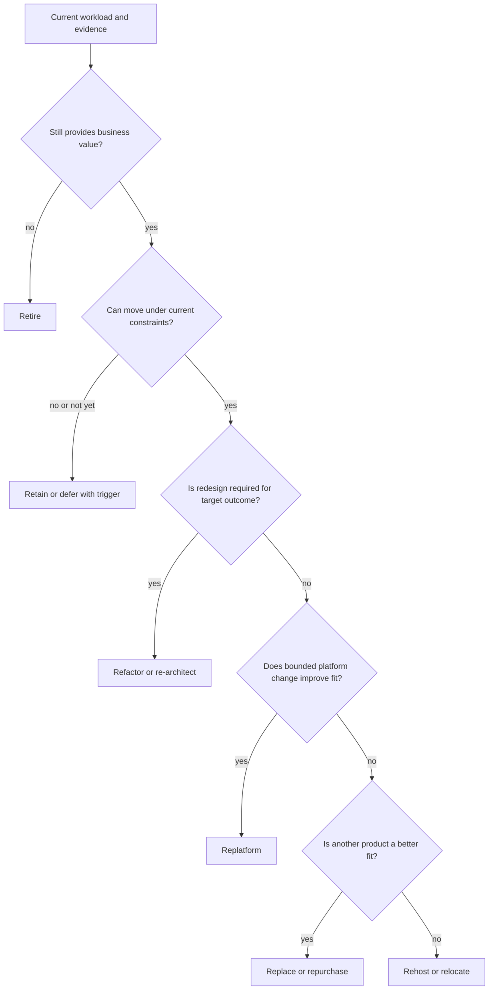
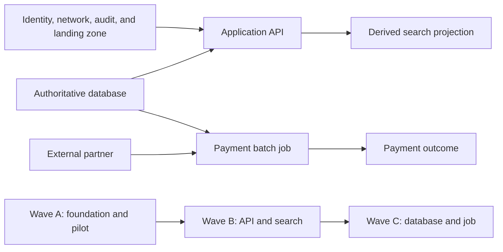
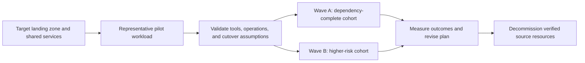
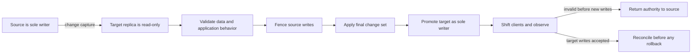
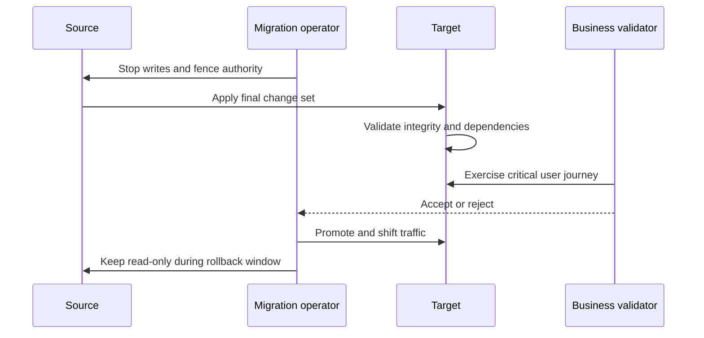

# Cloud Migration and Modernization Architecture

Part: [10 — Cloud Architecture](PART_OVERVIEW.md)

Cloud migration is a controlled transition of workload ownership, runtime, data, and operations from a current environment to a target architecture. Modernization changes the workload's structure or operating model rather than merely moving it. The two activities can happen together, but combining them increases the number of variables and the difficulty of diagnosing failure.

Part 09 [Cloud Migration Execution](../09_Cloud_Computing/CH16_Cloud_Migration.md) owns provider discovery, assessment, replication, transfer, cutover tooling, and service limits. This chapter owns cross-provider strategy, portfolio sequencing, coexistence architecture, migration waves, and target-state decisions.

## Establish the Case and Current-State Evidence

A migration case begins with a business outcome: exit a data center, improve delivery, meet residency needs, reduce operational burden, acquire a capability, or change cost structure. “Move to cloud” is an activity, not a benefit. Define measurable outcomes such as support cost, release lead time, recovery behavior, user latency, data locality, or retirement of a facility.

Build evidence about the current workload before selecting a strategy:

- Business owner, users, critical journeys, lifecycle, and value.
- Technical owner, runtime, dependencies, interfaces, jobs, and support model.
- Data classification, authority, volume, retention, residency, and recovery.
- Demand and performance profile, license terms, end-of-support dates, and capacity.
- Network, identity, operational, compliance, and vendor dependencies.
- Cost baseline including facilities, software, labor, connectivity, support, and risk.

Discovery tools can collect inventory and dependency signals, but they do not establish business criticality or reveal every batch job, manual procedure, or external contract. Validate tool output with application owners and observed traffic. Mark confidence and unknowns rather than treating incomplete inventory as fact.

## Choose a Transition Strategy

The tree narrows candidates; a business case and target architecture review still compare cost, risk, and operating consequences.

Common migration strategy families are often called the “Rs,” but provider and industry taxonomies vary. A useful set is:

- **Retain:** keep the workload in its current environment because of value, timing, constraint, or dependency.
- **Retire:** remove a workload that no longer provides sufficient value.
- **Rehost:** move the existing runtime with minimal architectural change.
- **Relocate:** move a supported virtualization environment with limited application change.
- **Replatform:** make bounded changes to use a managed runtime or service without redesigning the domain.
- **Refactor or re-architect:** change structure or behavior to meet new objectives or use cloud capabilities.
- **Repurchase or replace:** adopt a different product or SaaS service instead of migrating the existing implementation.

A strategy name does not determine whether the destination architecture is sound. Rehosting can be the right near-term move when time and compatibility dominate, but it may preserve expensive operating assumptions. Refactoring can improve fit while extending delivery risk and migration duration. Replatforming is beneficial only when the managed service's support, limits, data behavior, and operating model suit the workload.

Choose based on business value, dependency coupling, time, skills, cost, data gravity, compliance, license portability, target service maturity, and acceptable change risk. Separate hard constraints from preferences. If the target choice does not meet a mandatory requirement, changing the strategy label does not solve the problem.

Use the strategy label as a result of the decision, not as the starting assumption:

| Evidence or constraint | Likely strategy direction | Questions that can change the choice |
|---|---|---|
| Workload has no users, owner, or business value | Retire | Is any downstream report, legal record, or scheduled process still dependent on it? |
| Vendor or physical constraint prevents movement | Retain or defer | Is the constraint permanent, and what event or contract change would reopen it? |
| Runtime is supported and time is the dominant constraint | Rehost or relocate | Is the interim operating cost acceptable, and is the target host model supportable? |
| A managed service removes a costly operational burden with limited code change | Replatform | Are semantics, limits, extensions, and data transition compatible? |
| Current design blocks required business or quality outcomes | Refactor/re-architect | Is the benefit large enough to justify additional delivery and migration risk? |
| Existing product is an undifferentiated capability with an acceptable SaaS option | Repurchase/replace | Can data, identity, integration, retention, and exit be handled under the new contract? |

The matrix is a conversation aid, not a scoring formula. A legal residency constraint can eliminate a destination; a preference for a managed database cannot. Cost is evaluated over a common time horizon and includes double-running, migration labor, licenses, staffing, training, support, and decommissioning. If the business case depends on future modernization savings, name the owner, funding, and time horizon for that follow-up rather than embedding an unowned benefit in the current migration case.

## Sequence a Portfolio into Migration Waves

The wave graph groups dependency-complete work; the actual order changes when compatibility or a tested coexistence contract allows a safe split.

A migration wave is a bounded group of workloads or components moved under shared readiness, communication, cutover, and support conditions. Part 10 owns wave architecture; Part 09 tools may execute tasks inside the wave.

Start from a dependency graph. Nodes can represent applications, data stores, identity, DNS, network, shared platforms, external services, and operational teams. Edges should describe required behavior, not just observed traffic. Group tightly coupled components when they cannot safely operate across a long coexistence boundary. Migrate shared services early only when the target is ready and workloads can tolerate the transition.

Distinguish hard dependencies from observed relationships. A server that exchanges a small heartbeat with another host may not need to move in the same wave; a scheduled job that writes an undocumented table may be a hard dependency even if it runs only once per day. Use owner interviews, logs, deployment definitions, data-flow analysis, and business-process timing to assign confidence to each edge. Mark unknown edges with an owner and a discovery action.

Wave design aims for dependency closure: each group can operate and meet its acceptance criteria without waiting for an unplanned component in a later wave. A cohort may intentionally span source and target when the coexistence contract supports it, but that cross-boundary edge must have a named owner, a validated route and identity path, and a data authority rule. Shared services such as identity, DNS, logging, and deployment should be represented as graph nodes even when they are not application workloads.

Readiness is a gate, not a weighted score that can average away a blocker. A workload with strong application tests but no approved data location is not ready. Define mandatory gates for ownership, target policy, quota, connectivity, data validation, operational access, recovery, and business acceptance. Use a score or risk ranking only to compare work after non-negotiable conditions pass.

Wave selection balances:

- Dependency closure and shared-service readiness.
- Business criticality and the cost of interruption.
- Workload similarity and reusable migration learning.
- Team capacity, test environments, support coverage, and cutover windows.
- Data volume, replication time, rollback feasibility, and target quotas.
- Pilot value and the ability to limit blast radius.

A pilot should test assumptions that affect many later workloads, such as network connectivity, identity federation, data transfer, operational access, and cutover runbooks. Do not choose a trivial pilot that exercises none of the risky platform paths, or a business-critical system whose failure would jeopardize the program before the process is proven.

Pilot success is evidence, not merely a successful move. Compare estimated and actual discovery completeness, setup time, data synchronization rate, outage duration, manual actions, error rate, cost, and support demand. Record where the runbook depended on an individual expert or a one-off exception. The next wave should reuse proven automation, but it should not assume that every workload has the pilot's data size, latency, owner availability, or recovery behavior.

Wave throughput is constrained by more than migration tooling. Account for the number of trained operators, parallel test environments, approved change windows, target quotas, network transfer capacity, business approvers, and post-move support. Increasing concurrency can reduce program duration but also increase the number of simultaneous unknowns and the blast radius of a shared platform defect. Choose a wave size that supports investigation and rollback without exceeding those operational limits.

Waves should have entry and exit gates. Entry requires an accountable owner, complete dependency evidence, a ready target, accepted security posture, tested data movement, and an agreed window. Exit requires business validation, operational handoff, cost attribution, recovery evidence, and an explicit decision to retain or decommission source resources.

## Design Coexistence and Transition Boundaries

The authority boundary changes once; route changes alone do not synchronize data or prevent a former writer from accepting writes.

Large workloads rarely change location at one instant. During coexistence, some components run in the source environment and others in the target. The architecture must define how they communicate and who owns each shared fact.

Coexistence decisions include:

- Identity federation and authorization across environments.
- DNS, routing, certificates, and endpoint naming during transition.
- API compatibility, event routing, batch schedules, and operational support.
- System-of-record ownership and whether the source or target accepts writes.
- Data synchronization, conflict resolution, reconciliation, and deletion.
- Monitoring, incident command, deployment, and change approval across teams.

A single-writer boundary is the simplest way to avoid divergent state when the application cannot reconcile concurrent writes. Dual-write behavior requires an explicit consistency and conflict model, not just two configured endpoints. Temporary compatibility layers should have an owner, removal condition, and expiry so transitional architecture does not become permanent by neglect.

Choose the coexistence pattern from the data and interface contract:

| Pattern | Authority rule | Main risk to manage |
|---|---|---|
| Source remains authoritative | Target reads or receives a replica until cutover | Target writes must be disabled or clearly isolated |
| Target becomes authoritative by domain | Each business domain has one writer during a staged transition | Cross-domain workflows can observe mixed versions and need compatible contracts |
| Change capture to target | Source accepts writes while changes replicate toward a prepared target | Lag, schema conversion, ordering, and final-write freeze must fit the outage budget |
| Dual write | Both environments accept writes | Requires conflict detection, idempotency, reconciliation, and a defined winner; avoid unless the domain supports it |

Compatibility can be more important than a short cutover. If source and target versions exchange messages or API calls during a long wave, they need a versioned contract that both understand. A target service should not emit fields or states that the source cannot safely process. Preserve old and new schema support until all producers and consumers cross the boundary, then remove the compatibility path under change control.

Rollback is constrained by writes after cutover. Before target authority changes, rollback may be a traffic change. After the target accepts writes, rollback requires either reversing the changes safely, reconciling them into the source, or accepting data loss under an explicit business decision. Mark this boundary in the runbook and prevent a route toggle from silently creating two authorities. A migration plan that advertises “zero downtime” should still specify write consistency and a truthful degraded response for ambiguous requests.

Part 07 owns generic idempotency and delivery semantics; Part 06 owns database migration and replication mechanics. Part 09 CH16 owns provider-specific replication and cutover tooling. Part 10 sets the workload-level authority and coexistence design that those mechanisms must support.

## Prepare the Target and Modernize at the Right Pace

The target environment must be ready before workload migration: organization scope, identity, network, policy, observability, backup, cost ownership, support, and quotas. Part 09 CH15 owns provider landing-zone implementation; Part 10 CH02 owns its cross-provider architecture.

Modernization can be sequenced in several ways:

- **Move first, improve later:** reduces simultaneous change but may carry technical debt and cloud mismatch.
- **Modernize before the move:** may simplify target architecture but delays relocation and increases pre-cutover change risk.
- **Modernize incrementally during transition:** can replace high-value boundaries while maintaining compatibility, but requires explicit coexistence and data contracts.

Use separate change streams when they reduce uncertainty. Rehost first only when the interim state is supportable and has a funded follow-up or a clear retirement horizon. Avoid “temporary” lift-and-shift that becomes the permanent architecture because no owner remains for modernization.

## Cutover, Acceptance, and Rollback

Promotion occurs only after the data boundary and business acceptance are verified.

Cutover is a change in traffic, data, or operational authority. Define the exact event that ends source writes, the final synchronization condition, the person authorized to proceed, the test that proves success, and the point at which rollback requires data reconciliation rather than a route reversal.

A workload acceptance plan should include:

- User and business journey checks.
- Data integrity, completeness, and freshness validation.
- Identity, network, security, logging, backup, and alert checks.
- Performance under representative demand and dependency behavior.
- Operational handoff, support contacts, runbooks, and cost ownership.
- Rollback trigger, authority, data boundary, and time window.

A migration tool reporting a successful task is not equivalent to business acceptance. Likewise, reverting DNS after target writes have occurred does not restore the source to the latest state. Part 09 CH16 describes provider execution; Part 10 architecture defines the acceptance and authority contract.

## Program Economics and Learning

A migration program has one-time and recurring costs. Include discovery, foundation work, transfer, duplicated environments, licenses, refactoring, partner support, training, network connectivity, temporary staging, and source decommissioning. Compare these costs with the baseline and the value of the outcome, not with compute price alone.

Track measures that reveal progress and risk: dependency coverage, blocked workloads, target readiness, migration throughput, cutover outcomes, rollback events, post-move incidents, cost variance, performance, and retired source capacity. A count of moved virtual machines can rise while business outcomes remain unchanged.

Use each wave to update assumptions, automation, and target patterns. Preserve exceptions and lessons with owners. Re-estimate remaining waves when a pilot reveals longer synchronization, more application dependencies, or operational gaps than planned.

## Worked Example: Claims Platform Modernization

An insurer runs a claims application on aging virtual machines. It depends on a relational database, document storage, a nightly payment job, an external identity service, and a partner API. The data is regulated, the payment process has a fixed business window, and the web tier can be replaced independently only after session state is externalized.

The program first retires unused reporting components and retains a vendor system that cannot yet be moved. It selects a representative but bounded pilot to validate identity, network, audit, backup, and operational ownership. The initial web tier is rehosted after session state is moved to a supported shared store; the database remains the authoritative source while a target replica is tested. Payment jobs are migrated only after the partner window and idempotency behavior are proven.

A later wave replatforms document storage and introduces an event path for noncritical analytics. The data team validates retention, residency, deletion, and restore behavior before accepting the target. During each cutover, a write freeze and final synchronization establish the authority boundary. Business users verify claim submission and payment status; operations verifies recovery and alerting. Source resources are retired only after a named owner confirms no scheduled job, partner route, or retained data still depends on them.

The wave plan makes the dependency and business gates visible:

| Wave | Scope | Entry evidence | Exit evidence |
|---|---|---|---|
| Foundation | Target organization, identity, network, audit, backup, and support | Ownership and policy baseline approved; test workload can reach required services | Workload team can deploy, observe, restore, and attribute cost |
| Pilot | Web tier plus external identity and partner integration in a bounded environment | Representative data and safe partner test path available | Latency, identity, audit, rollback, and runbook assumptions measured |
| Transactional move | Database and payment job under a controlled authority transition | Replication lag within window; job idempotency and partner approval verified | Claim and payment records reconciled; single writer confirmed; restore test passed |
| Modernization | Document store and noncritical analytics path | Data retention and residency accepted; compatible event contract available | Projection freshness, deletion, replay, and operating ownership accepted |

If the pilot shows the target network path adds more latency than expected, the program revises the placement or data plan before moving the payment job. If the database cannot meet the synchronization window, the team does not hide the gap by shrinking the measurement period; it changes the transfer method, schedules a longer outage, or revisits the target. This is how wave evidence changes architecture rather than merely updating a project status.

At payment cutover, source writes stop at an agreed point, the final change set is applied, and the team validates record counts, checksums or business invariants, payment-job completion, and partner acknowledgements. The target becomes the sole writer only after business acceptance. If validation fails before target writes resume, the source can remain authoritative. If new payments have already been accepted in the target, rollback requires reconciling those transactions before traffic can safely return.

This sequence avoids refactoring every component before the first move while still creating a funded modernization path. It also avoids claiming that the whole application is “migrated” while the database, nightly jobs, and support process remain on the source side.

## Architecture Review Questions

- Is the business outcome measurable and supported by current-state evidence?
- Were retain, retire, rehost, relocate, replatform, refactor, and replace considered where relevant?
- Do wave boundaries include the dependencies required for a coherent transition?
- Has the pilot tested risky platform assumptions rather than only easy workloads?
- Is the target landing zone and operating model ready before cutover?
- Are coexistence identity, network, APIs, events, and data authority explicit?
- Does each modernization step reduce a named risk or create a measurable benefit?
- Are cutover validation, rollback authority, write boundary, and rollback window rehearsed?
- Is source decommissioning gated by data, job, identity, network, and owner verification?
- Are program measures tied to outcomes and updated from wave evidence?

Further reading: [Part 09 Landing Zones](../09_Cloud_Computing/CH15_Landing_Zones.md), [Part 09 Cloud Migration Execution](../09_Cloud_Computing/CH16_Cloud_Migration.md), [Part 10 Organizational Hierarchy](CH02_Organizational_Hierarchy_and_Landing_Zones.md), [Part 10 Hybrid and Multi-Cloud Architecture](CH10_Hybrid_and_Multi_Cloud_Architecture.md), and [Part 07 System Design and Distributed Systems](../07_System_Design_and_Distributed_Systems/PART_OVERVIEW.md).
