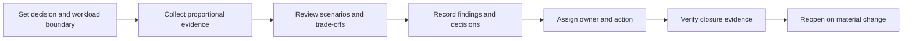
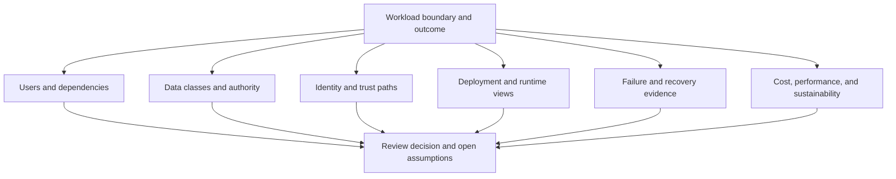
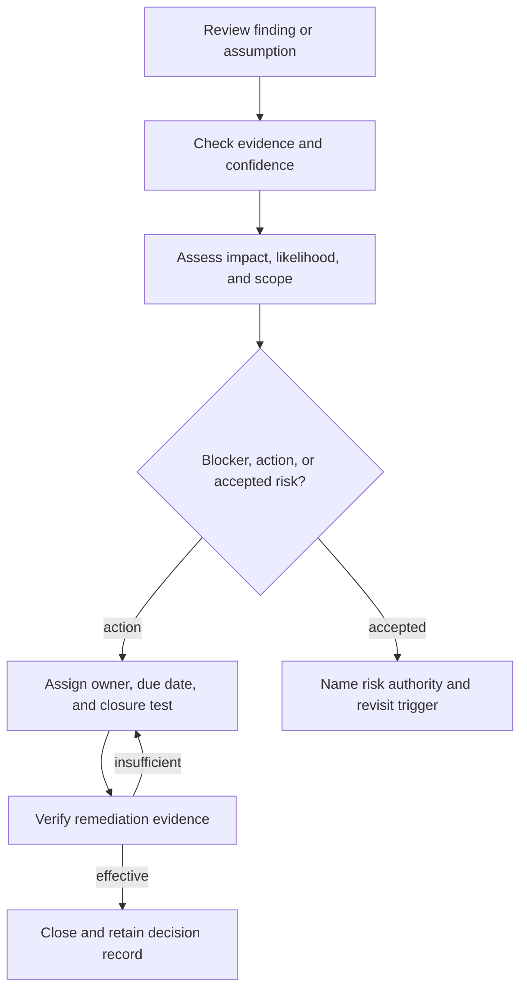
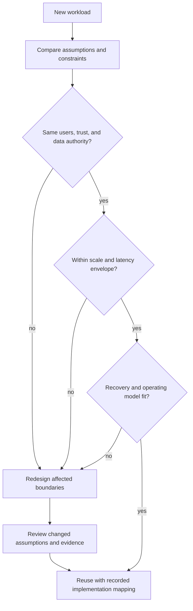
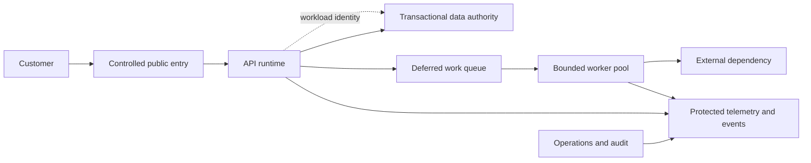

# Cloud Architecture Reviews and Reference Designs

Part: [10 — Cloud Architecture](PART_OVERVIEW.md)

A cloud architecture review tests whether a workload's boundaries, decisions, and operating model fit its requirements and evidence. It is not a ceremony for approving diagrams, nor a search for one universally correct topology. A useful review exposes consequential assumptions, identifies risks with owners, and produces decisions or experiments that improve the workload.

Part 11 owns the AWS Well-Architected Framework (WAF), its six pillars, lenses, tool, and AWS-specific review questions. Part 21 owns architecture documentation methods and notations. This chapter defines a provider-neutral review approach and the qualities of reusable cloud reference designs.

## Define the Review and Its Decision

The review is complete when decisions and actions have owners and evidence, not when the meeting ends.

Before inviting reviewers, state what decision the review must support. Examples include approving a production launch, evaluating a major topology change, accepting a risk, comparing target architectures, or deciding whether a reference design can be reused. A review with no decision or intended outcome becomes an unbounded discussion.

Agree on:

- Workload and lifecycle in scope.
- Review authority and who owns the final decision.
- Required evidence and which gaps are acceptable at this stage.
- Participants: workload, platform, security, data, operations, business, and affected external partners.
- Time horizon and risk posture.
- Possible outcomes: approve, approve with conditions, investigate, accept risk, or redesign.

Do not require every specialist to attend every review. Invite the expertise needed by the workload's risks and assign any unrepresented ownership gap before the review.

## Build a Workload Evidence Set

Evidence is selected to answer the requested decision; missing views are documented as uncertainty, not hidden behind a diagram count.

A review should understand the workload before judging its implementation. Useful evidence includes:

- Users, business outcomes, critical journeys, and service objectives.
- Context, component, deployment, data-flow, and trust-boundary views.
- Data classification, system-of-record decisions, retention, and residency.
- Identity, network, ingress/egress, and administrative paths.
- Runtime and managed-service choices, capacity assumptions, limits, and quotas.
- Failure-domain design, degraded behavior, backup, recovery tests, and runbooks.
- Security controls, threat assumptions, exceptions, evidence, and owners.
- Cost model, performance measurements, utilization, and sustainability assumptions.
- Deployment, incident, support, and lifecycle ownership.

Evidence should match the decision. An early concept review may use explicit estimates and unresolved questions; a production-readiness review should require tested paths, control evidence, and support ownership. Missing evidence is a finding when the uncertainty affects the decision, not an automatic reason to demand every possible artifact.

Prepare a review pack around the decision, not around a document template. Start with the workload outcome, context and boundary diagrams, the current proposal, the most consequential alternatives, known risks, assumptions, and questions for reviewers. Attach evidence where it changes confidence: a measured load result, policy evaluation, recovery exercise, cost sensitivity, or data-flow test. Mark an assumption as an assumption and name how it can be validated.

Different review stages need different evidence. A concept review can decide whether a target topology is plausible and which assumptions need experiments. A pre-production review should verify deployment, access, failure, monitoring, support, and restore behavior. A production change review should focus on the changed boundary and regressions rather than re-review every stable component. The review authority should state the threshold for acceptance at each stage.

Separate finding types so teams do not treat every issue as an architectural defect:

| Finding type | Example | Appropriate disposition |
|---|---|---|
| Requirement conflict | Data location violates a contractual boundary | Reject or redesign before implementation |
| Material risk | Recovery path depends on an untested identity service | Test, mitigate, or accept through named authority |
| Evidence gap | Cost estimate omits replication and egress | Gather evidence or record an assumption with expiry |
| Improvement opportunity | Managed runtime could reduce host maintenance | Compare value with migration and operating cost |
| Documentation gap | Route ownership is unclear but implementation is correct | Record owner and update the architecture evidence |

This classification helps the review distinguish a blocker from a question or optimization. It also makes action tracking proportional: a material exposure needs containment and accountable acceptance; an improvement idea can be prioritized against other work.

## Use Cross-Provider Architecture Lenses

A balanced review considers the workload as a system across organizational, technical, and operational boundaries:

| Lens | Questions to investigate |
|---|---|
| Organization and platform | Are scope, owners, policy inheritance, onboarding, and shared services clear? |
| Network and connectivity | Are traffic paths, trust boundaries, private access, DNS, egress, and failure ownership explicit? |
| Identity and access | Are workforce, runtime, deployment, support, and recovery identities separated and bounded? |
| Compute and application | Does runtime placement fit demand, state, control, team skill, and service limits? |
| Data | Is authority clear? Are copies, freshness, protection, retention, locality, and recovery addressed? |
| Integration | Are API, event, queue, workflow, and external-service contracts compatible with failure and replay behavior? |
| Resilience and operations | Are failure domains, degraded modes, runbooks, monitoring, support, and recovery tested? |
| Security and compliance | Do controls match threats and obligations, and is evidence owned and available? |
| Cost and performance | Are estimates, measurements, scale assumptions, and quality budgets tied to workload outcomes? |
| Sustainability and placement | Are utilization, location, data movement, hardware, and environmental assumptions understood? |
| Change and migration | Are deployment, coexistence, migration, rollback, and decommissioning paths explicit? |

These lenses are not mandatory chapters in a review document. Focus on the areas that can change the decision or create material risk. Avoid reviewing the same concept twice under different labels; link to specialist owners for detailed methods.

## Reason from Scenarios and Trade-offs

Architecture claims become testable when expressed as scenarios: under a stated stimulus, what response should occur, within what time, and with what measurable result? Examples include a zone failure during peak load, identity-provider unavailability during deployment, a data deletion request across replicas, or a twofold rise in event backlog.

A useful scenario includes:

- **Stimulus:** failure, load change, attack, policy change, user action, or business event.
- **Environment:** normal, peak, recovery, deployment, disconnected, or degraded operation.
- **Response:** system behavior and user-visible result.
- **Measure:** latency, data loss, availability, containment, cost, or recovery evidence.

For example, “the workload is highly available” is not testable. A scenario can state: during the loss of one zone at forecast peak, order creation continues through remaining capacity with p95 response below its objective and no acknowledged order is lost. The review then asks which component fails, how load shifts, whether remaining quotas suffice, which data authority remains active, and which test demonstrates the result. If the evidence is only a deployment diagram, record the capacity and data questions as open rather than inferring success.

Use the same scenario for each alternative. Compare a single-region, multi-zone design with a warm second region against an active/active design: both are assessed for restoration time, data consistency, remaining capacity, cost, and operator action. This prevents one option from being evaluated under normal conditions while another is challenged with a worst-case incident.

Compare alternatives against the same scenarios. State what each option optimizes, what it sacrifices, the assumptions that affect the result, and which risks are accepted. Architecture trade-off and decision-record fundamentals belong to Part 01; quality-attribute and reliability foundations belong to Part 07.

## Facilitate the Review and Close Decisions

The finding is closed by evidence or an explicit risk decision, not by editing its status field alone.

Send a focused pre-read that includes the decision request, diagrams, assumptions, open risks, and areas needing specialist input. In the session, distinguish facts, assumptions, and preferences. Ask what evidence would change a position; do not treat seniority or provider familiarity as evidence.

Close with a decision and action record:

| Field | Purpose |
|---|---|
| Finding or decision | State the risk, choice, or unresolved question precisely |
| Evidence and confidence | Show what supports the claim and what remains uncertain |
| Impact and likelihood | Describe consequence and conditions, without false numeric precision |
| Owner | Name the person or team accountable for action or accepted risk |
| Action and due date | Define a measurable mitigation, experiment, or follow-up |
| Acceptance authority | Identify who can accept residual risk and at what scope |
| Closure evidence | State how the reviewer knows the action worked |
| Revisit trigger | Record changes that reopen the decision |

A list of comments without owners and closure conditions does not create risk reduction. A review can approve a design with accepted risks, but the owner, rationale, scope, expiry or review trigger, and evidence must be explicit.

## Reference Designs That Can Be Reused Safely

Reuse is conditional: differences create an explicit adaptation rather than a silent copy.

A reference design is a reusable starting point, not a universal prescription. It should state its context and assumptions, intended workload class, expected scale, data and trust boundaries, availability posture, operating model, known limits, and conditions that invalidate reuse.

A useful reference design contains:

- The problem and constraints it addresses.
- Logical topology and key interfaces.
- Decision rationale and rejected alternatives.
- Identity, network, data, and operational ownership.
- Failure and recovery behavior.
- Security, cost, performance, and sustainability assumptions.
- Provider-specific mappings clearly distinguished from provider-neutral intent.
- Validation and deployment requirements.
- Version, owner, review date, and change history.

Define applicability boundaries explicitly. A reference design can state a scale range, data class, latency envelope, expected failure posture, supported team model, and required provider capabilities. It should identify conditions that invalidate reuse, such as multi-writer data, offline device operation, strict residency, or a recovery objective it was not designed to meet.

Keep intent separate from implementation mapping. The logical design may require a private service path, bounded identity, independent audit evidence, and a recoverable data store. Provider-specific services, policy syntax, quotas, and failure guarantees implement that intent but can change over time. Version the mapping and record which provider contract was verified so a renamed service or new default does not silently change the reference design.

Reference designs should also record alternatives and an adaptation checklist. Reuse begins by comparing the new workload's users, trust boundaries, data authority, demand, recovery, and owners with the stated assumptions. Differences are reviewed explicitly; copying the diagram and changing product labels is not architecture reuse.

Treat a reference design as a maintained product. Assign an owner for the logical intent and separate owners for provider-specific implementations. Record the provider/service version or contract that was validated, the last successful deployment or test, and known deviations. Trigger review when a provider changes a service contract, a security baseline changes, a major incident reveals a missing failure mode, or the workload archetype's demand and data profile changes.

Provide variants only when they represent meaningful architecture choices. For example, a web workload might have a single-region baseline, a warm-recovery variant, and a strict data-residency variant. Explain the conditions that justify each one and the capabilities it gives up. Do not create a variant for every possible provider product; product selection belongs to Part 09 and should be mapped to the reference intent by a separate implementation guide.

Validate a reference design through a small set of executable or observable checks: deploy the baseline, verify its identity and network boundaries, exercise one important failure, measure cost/performance assumptions, and demonstrate data restore or rebuild. A diagram that has never been deployed may still communicate intent, but it should be labeled conceptual and must not imply production readiness. Record failed tests and known limitations alongside the design so reuse does not erase inconvenient evidence.

Retirement is also part of lifecycle. When the provider service is deprecated, the security assumption expires, or the design is superseded, mark it as withdrawn, identify dependent workloads, and document a migration or replacement path. Obsolete diagrams left in an active catalog can lead teams to adopt unsupported controls or service behavior.

Do not publish a diagram without the contracts needed to operate it. Two diagrams may look alike while differing in data authority, identity, support, and failure behavior. Reuse requires checking assumptions against the new workload.

## Reference Workload: Public Web and API Service

The reference view calls out trust, deferred work, and evidence boundaries; each target workload still needs its own data, failure, and operating contracts.

A public-facing product serves a latency-sensitive API, a static web client, and a relational database. The design places public entry and application runtimes behind controlled ingress, stores authoritative transaction data in a managed database, and uses a queue for noncritical work. It separates application and database identities, constrains egress, centralizes audit evidence, and defines a recovery path for the database and critical APIs.

Review questions include whether the chosen availability zones and database topology meet the business objective, whether deployment can roll back safely after schema change, and whether queue backlogs remain bounded when an external dependency slows. Cost review includes traffic transfer, database minimum capacity, logging, and standby resources. A reference design may fit a new product only after checking its data locality, peak demand, recovery need, and team support model.

One alternative is to place the web runtime and database in separate regions for user locality. The review rejects that option if each request then crosses regions for authoritative reads and the added path violates the latency target. Another alternative is a warm standby region; it is accepted only after the team demonstrates database promotion, key access, quota, traffic movement, and a rollback boundary. The design includes a queue-age objective for noncritical jobs so the team can degrade background processing before sacrificing interactive capacity.

The review scenarios include a zone loss at forecast peak, a slow payment dependency, and a schema deployment followed by rollback. For each, reviewers inspect measured capacity, user-visible behavior, data authority, and operator steps. A diagram that shows two zones is not enough evidence if the load test ran at half the expected demand or if the database remained single-zone.

## Reference Workload: Analytical Ingestion Pipeline

A data pipeline ingests events from multiple products, validates schemas, stores raw records, transforms them, and serves aggregates to analysts. The reference design separates ingestion identity from analyst access, preserves a replayable raw history under a defined retention policy, and makes freshness visible to consumers. Processing capacity can scale independently from the producer, while quotas and downstream storage capacity bound concurrency.

The review tests duplicate delivery, schema evolution, poison records, delayed partitions, regional interruption, and deletion obligations. It checks whether analytics data can be rebuilt without modifying the system of record and whether sensitive fields are minimized before broad analytical access. Costs include event retention, replicated storage, query scans, telemetry, and repeated backfills. A provider's managed stream or warehouse product may change configuration and limit details, but the workload contract remains explicit.

The design gives each consumer an independent identity and progress marker. A new analytics projection can replay retained records into a separate destination without re-triggering business side effects. If a schema field is removed, the producer and consumer owners agree on a compatibility window and verify that old versions are no longer used before deletion. If a personal field must be deleted, the review traces it through raw storage, derived tables, search indexes, exports, and backups, documenting which copy is immediately removable and which follows retention expiry.

The key review question is whether the raw history is truly required for replay or whether a smaller set of normalized facts can meet recovery needs. Keeping every payload forever increases cost and privacy exposure; retaining too little may make projections impossible to reconstruct. The selected policy is validated with a bounded backfill, measured query cost, freshness report, and a deletion test before the pattern is published as reusable.

## AWS Well-Architected Relationship

For an AWS workload, Part 11 owns the Well-Architected Framework's purpose, six pillars, lenses, review questions, and AWS Well-Architected Tool workflows. Use that framework when the review specifically needs AWS's structured question set and remediation process. This chapter remains provider-neutral and should not reproduce pillar content as if it were a separate generic taxonomy.

The same separation applies to specialist material: security control depth belongs to Part 15, performance methods to Part 19, observability operations to Part 14, and general distributed-system objectives to Part 07. A cross-provider review can link those owners while evaluating whether the workload architecture applies them coherently.

## Architecture Review Questions

- Is the review decision, scope, authority, and expected outcome explicit?
- Does the evidence set match the maturity and risk of the decision?
- Are assumptions and unknowns separated from verified behavior?
- Have relevant organizational, network, identity, runtime, data, resilience, security, cost, and operations lenses been considered?
- Are scenarios concrete enough to test latency, failure, recovery, and user-visible behavior?
- Were alternatives compared using the same requirements and assumptions?
- Does every finding have an owner, action, acceptance authority, and closure evidence?
- Does the reference design state when it does not apply?
- Are provider-specific mechanisms distinguished from provider-neutral architecture intent?
- Are Part 11 and specialist chapter owners used rather than duplicated?

Further reading: [Part 01 Architecture Thinking](../01_Architecture_Mindset/CH03_Architecture_Thinking.md), [Part 11 AWS Well-Architected Framework](../11_AWS_Well_Architected_Framework/PART_OVERVIEW.md), [Part 15 Security](../15_Security/PART_OVERVIEW.md), [Part 19 Performance Engineering](../19_Performance_Engineering/PART_OVERVIEW.md), and [Part 21 Architecture Documentation](../21_Architecture_Documentation/PART_OVERVIEW.md).
