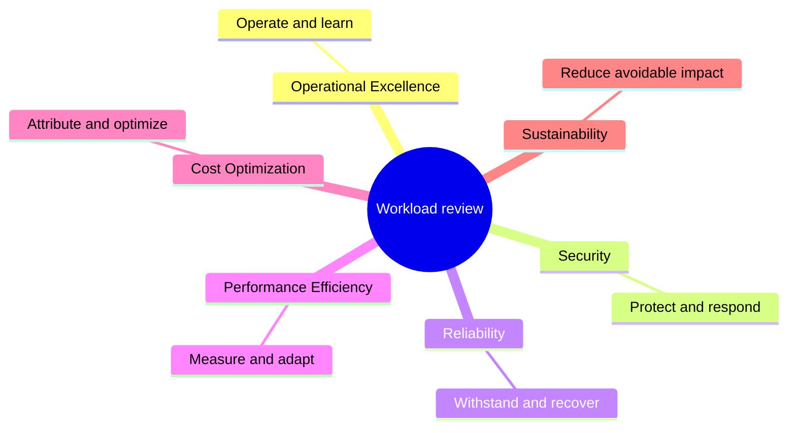
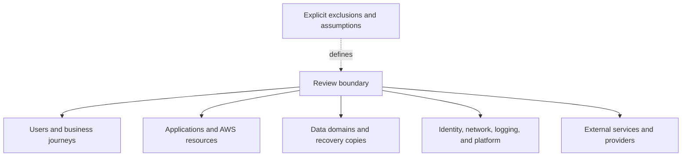
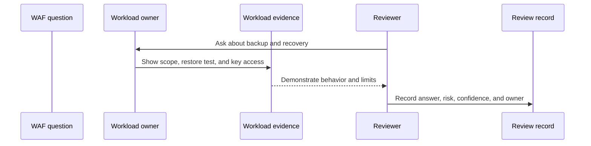
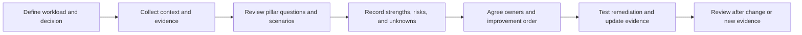
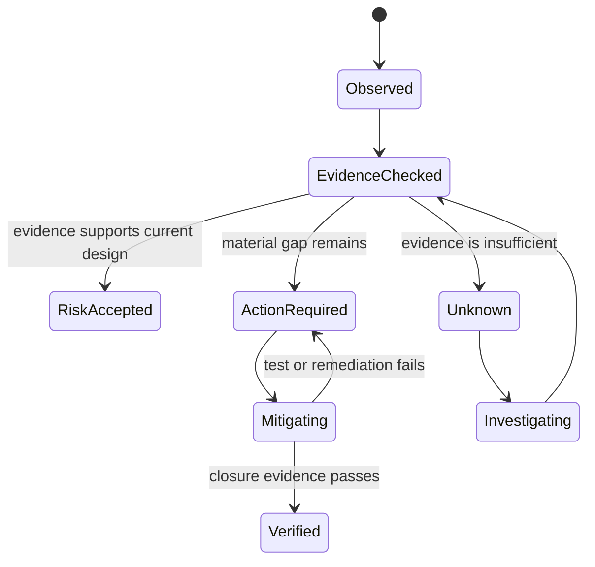

# AWS Well-Architected Framework Foundations and Review Method

Part: [11 — AWS Well-Architected Framework](PART_OVERVIEW.md)

The Amazon Web Services (AWS) Well-Architected Framework (WAF) is a structured way to examine workload design choices, understand their trade-offs, identify risks, and plan improvements. It provides a common set of principles and questions for reviewing workloads built on AWS. It is most useful when treated as a recurring engineering conversation supported by evidence, not as a badge, compliance certificate, or one-time approval gate.

Part 09 owns AWS service mechanics; Part 10 owns provider-neutral workload architecture. Part 11 applies the AWS framework to a bounded workload and its lifecycle. The framework's question set and service recommendations evolve, so a review must identify the version or source revision it uses and confirm current guidance against AWS documentation.

## What the Framework Is For

The pillars are related lenses on one workload, not six separate systems, independent reviews, or scores to sum.

The framework helps workload teams reason consistently about architectural qualities that often compete: reliability, security, performance, cost, operational excellence, and sustainability. Its six pillars provide organizing perspectives for questions and improvement opportunities. A pillar is not a separate subsystem. The same decision can affect several pillars: adding a second region may improve some recovery scenarios while increasing cost, data complexity, operational burden, and security exposure.

The framework is useful for several purposes:

- Exposing assumptions that are hidden in architecture diagrams or implementation details.
- Comparing design options against a workload's stated requirements.
- Identifying high-risk decisions and weaknesses before or after production launch.
- Structuring discussion among architects, developers, operators, security, finance, and business owners.
- Creating a prioritized improvement plan and revisiting it as the workload changes.

It does not guarantee that a workload is secure, resilient, compliant, performant, low-cost, or sustainable. Those qualities depend on workload behavior, implementation, configuration, operations, and evidence. A completed questionnaire proves only that someone recorded answers; it does not prove those answers are true.

### The six pillars as review lenses

| Pillar | Central question | Example evidence |
|---|---|---|
| Operational Excellence | Can the team operate, change, and learn from the workload safely? | Deployment history, runbook exercise, incident learning, ownership, and operational metrics |
| Security | Are identities, data, infrastructure, detection, and response appropriate to the threats? | Access tests, audit evidence, threat boundaries, recovery roles, and control validation |
| Reliability | Does the workload meet its objectives through component and dependency failures? | Failure-domain map, restore test, failover exercise, and measured RTO/RPO |
| Performance Efficiency | Does the workload use appropriate resources and adapt to changing demand? | Load tests, latency distributions, capacity data, and scaling response |
| Cost Optimization | Does consumption support business outcomes with accountable cost ownership? | Unit economics, allocation completeness, forecasts, utilization, and verified improvements |
| Sustainability | Does the workload meet its needs while avoiding unnecessary resource and data consumption? | Utilization and retention trends, workload-normalized impact, and stated measurement boundaries |

The pillar labels do not create six independent review passes in every case. Organize a review around the workload's decision and risks; use the pillars to check for neglected concerns and cross-pillar trade-offs.

## Define the Workload Under Review

The review boundary includes dependencies that can change the conclusion, even when another team owns them.

A review is only meaningful if its boundary is clear. A “workload” can be a customer-facing application, a data pipeline, a platform service, or a bounded business capability that includes multiple services and teams. If the boundary is too broad, answers become generic and risks have no owner. If it is too narrow, critical dependencies disappear from view.

Define:

- Business purpose, users, critical journeys, and business owner.
- Technical scope: applications, data stores, queues, accounts, regions, and external dependencies.
- Environments included, such as production, recovery, development, or shared platform.
- Team and service ownership, including provider, platform, workload, and partner responsibilities.
- Important quality objectives and regulatory or contractual constraints.
- Explicit exclusions and the reason for excluding them.

Use a system context or equivalent view to expose interactions beyond the selected boundary. If identity, networking, logging, deployment, or a shared data service is excluded from the workload scope, record whether it is reviewed elsewhere and what assumption the workload makes about it.

The review should align scope with the decision. A production-readiness review may focus on the launch boundary and recovery operation; an incident follow-up may focus on one dependency and the systemic failures it revealed; a portfolio review may sample common patterns while tracking shared platform risks separately.

## Framework Questions Are Prompts for Evidence

WAF questions are intentionally broad enough to apply to many workload classes. A question does not always have one correct yes/no answer. The reviewer must interpret it against the workload's purpose, risk, and lifecycle.

For each important question:

1. Determine which workload behavior or architecture decision it concerns.
2. Identify the current design and who owns it.
3. Request evidence: configuration, test, measure, incident record, policy, or operational procedure.
4. Ask which assumptions and failure conditions the evidence covers.
5. Compare the design with relevant alternatives and their trade-offs.
6. Record the conclusion, risk, and any improvement or accepted exception.

For example, a question about backup is not answered by “backup is enabled.” A useful answer states which data is protected, the recovery point, who can restore it, where the copy resides, whether keys and identities are available during a regional event, when the last representative restore was completed, and which application behavior was validated.

The answer is only as strong as the evidence and the boundary it covers.

Likewise, “the system scales” is incomplete without demand profile, scaling signal, startup time, quota, downstream limits, scale-in safety, and evidence under representative load. WAF questions are a doorway into workload-specific reasoning, not substitutes for it.

## Review Lifecycle

A disciplined review proceeds from purpose to evidence to action:

### Prepare

Choose the review participants based on workload risks: workload architect and team, operations, security, data, platform, business, and finance as needed. Gather architecture views, workload objectives, key decisions, test evidence, incidents, cost and performance data, and outstanding risks. Send a short pre-read containing the review scope and decisions requested.

Preparation should not become an artifact hunt. Request evidence that can affect the decision. For a small internal tool, a focused diagram and restore exercise may be adequate. For a regulated payment workload, data flows, privileged access, recovery and key handling, and response ownership need stronger evidence.

### Discuss

Use questions to invite explanations. Ask how the design behaves, what evidence supports the answer, which conditions were not tested, and what alternative was considered. Distinguish “not applicable” from “not implemented,” “unknown,” and “accepted risk.” A question marked not applicable should include the reason; otherwise it can hide an unexamined dependency.

Keep the discussion constructive. The aim is not to catch an individual making a mistake. It is to improve the workload and the system of engineering practices that produced it. When reviewers disagree, record the competing assumptions and the evidence that would resolve the disagreement.

### Record and improve

Capture strengths as well as risks. A strength may be a tested recovery path, a clear owner, or an effective automated control worth reusing. For each finding, record its workload scope, evidence, impact, owner, action, due date or revisit trigger, and closure criteria. Part 11 CH09 covers detailed risk prioritization and remediation planning.

A finding is not closed because a ticket is marked done. Closure requires evidence that the control or design changed and that the intended behavior is now present. Depending on the issue, evidence may be a new test result, measured latency, updated access policy, restored data, or a verified cost report.

## Interpret Risk Without Turning Scores into Truth

This lifecycle distinguishes an accepted risk from an unresolved question and from a verified remediation.

The framework and review tooling can help highlight areas for attention, but scores are not a substitute for judgment. A high-risk answer can be material for one workload and irrelevant to another; a low-risk result can hide a shared platform dependency that affects hundreds of workloads.

Prioritize findings using:

- Business impact if the condition occurs.
- Likelihood and exposure, given the actual architecture and threat environment.
- Confidence in the evidence and assumptions.
- Scope and blast radius, including shared services.
- Cost, feasibility, dependencies, and time to mitigate.
- The risk of the proposed remediation itself.

Avoid adding pillar scores together as if they were cardinal measurements. A strong score in one pillar cannot mathematically cancel a severe data-loss risk in another. If the organization uses the AWS Well-Architected Tool or another assessment to categorize answers, preserve the underlying workload context and evidence alongside the resulting risk list.

## Common Review Errors

**Treating the review as certification.** WAF participation or a completed tool assessment does not certify compliance or guarantee workload quality.

**Reviewing service names instead of workload behavior.** A team can select recommended AWS services and still configure them incorrectly or compose them into an unreliable system.

**Forcing every question into yes/no.** Some questions are conditional or involve trade-offs. Record the rationale and boundary rather than distorting the answer.

**Confusing documentation with evidence.** A diagram or policy states intent; a test, observation, or configuration inspection provides evidence about behavior.

**Prioritizing by score alone.** Scores can help navigate a question set but do not express business impact, confidence, or dependencies by themselves.

**Leaving risks without owners.** An unowned finding is not an improvement plan, regardless of how many review items were recorded.

**Requiring all evidence at every lifecycle stage.** Evidence depth should be proportionate to the decision. An early design needs explicit assumptions and experiments; production operation needs tested behavior and ownership.

## Worked Example: Review an Order Workload

An order workload includes a public API, a transactional database, asynchronous fulfillment, a payment provider, and a warm recovery region. The review goal is to decide whether it is ready for a seasonal traffic peak and whether its recovery claim is credible.

The team supplies a context diagram, measured peak traffic, database load test, identity matrix, queue-age dashboard, restore exercise, and cost forecast. The review traces an order from request through persistence, payment authorization, event publication, and shipment. It asks what happens if the payment call times out after the provider accepted the request, if the queue consumer is offline for thirty minutes, and if the primary region fails after a recent order commit.

The review finds two strengths: order writes are idempotent across retries, and fulfillment can lag without blocking order acknowledgement. It also finds a recovery gap: the warm region's runtime is deployed, but the payment-provider allowlist and database key access have not been tested there. The risk is not closed by adding a second region in a diagram. The team assigns owners for the allowlist and key exercise, sets a deadline before peak traffic, and records that orders remain in a controlled degraded state if the recovery region cannot authorize payment.

After remediation, the team runs the regional exercise, validates order records and payment outcomes, and measures recovery time. The review record retains the test result, remaining limitations, and a trigger to revisit capacity after the seasonal event. The WAF questions structure the conversation; the workload evidence determines the conclusion.

## Version and Continuous Improvement

The AWS WAF question set, lenses, and tool can change. Record the date and source revision used in a review. When an update changes question wording or risk categorization, compare the old and new interpretation before treating scores as a trend. Preserve prior answers and evidence for auditability, but reassess decisions whose underlying guidance or workload has changed.

Revisit the workload after significant events: architecture or data-flow changes, new regions or services, security incidents, major growth, recovery test failure, acquisition, cost anomaly, or a new regulatory boundary. A review cadence is useful, but event-triggered review catches changes that a calendar cannot anticipate.

Further reading: [AWS Well-Architected Framework](https://docs.aws.amazon.com/wellarchitected/latest/framework/welcome.html), [Part 09 AWS](../09_Cloud_Computing/CH01_AWS.md), [Part 10 Cloud Architecture Reviews](../10_Cloud_Architecture/CH15_Cloud_Architecture_Reviews_and_Reference_Designs.md), and [Part 10 Cloud Architecture](../10_Cloud_Architecture/PART_OVERVIEW.md).
