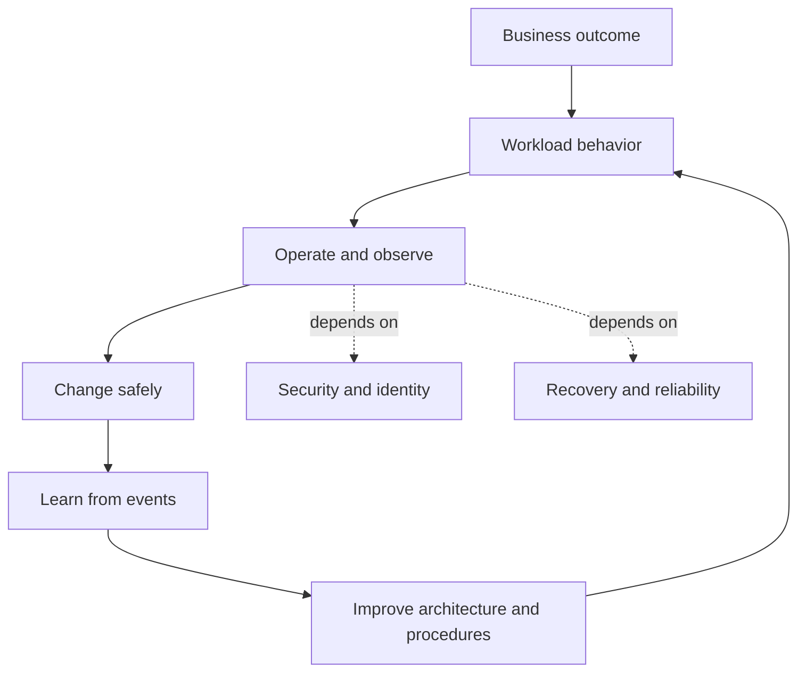
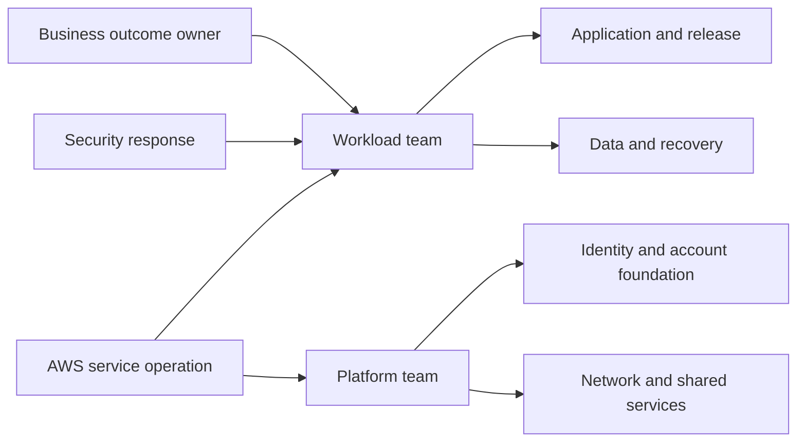
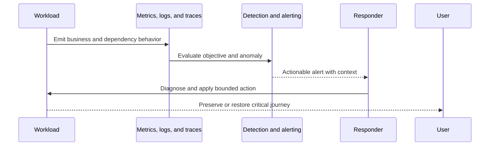
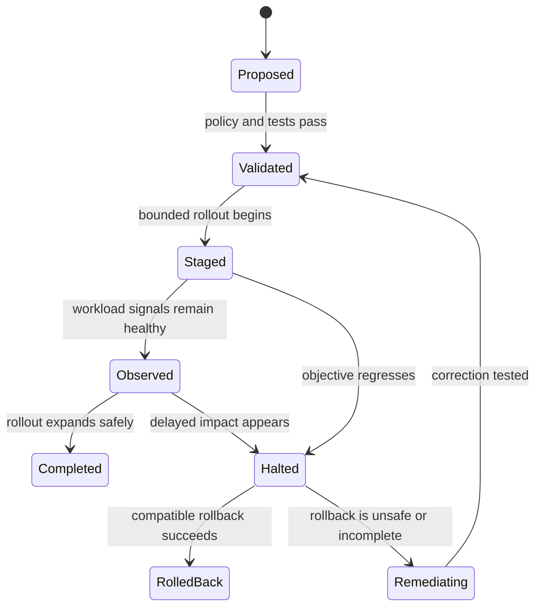
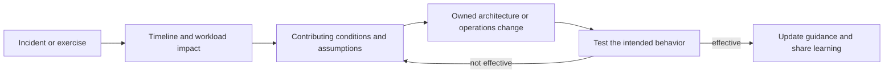

# Operational Excellence Pillar

Part: [11 — AWS Well-Architected Framework](PART_OVERVIEW.md)

The Operational Excellence pillar reviews whether a workload can be operated, changed, and improved in support of its business outcomes. It treats operations as a property of the workload architecture and team system, not as a separate group that receives a finished design at launch.

This chapter applies the AWS Well-Architected Framework (WAF) pillar to AWS workloads. It focuses on review questions, evidence, and trade-offs. Part 13 DevOps owns general delivery practices; Part 14 owns observability methods; Part 07 owns reliability and distributed-system foundations; Part 09 owns AWS service mechanics. Verify current AWS WAF question and design-principle wording against the framework revision used for a review.

## Operational Excellence as a Workload Property

The loop makes operations part of workload design; the dependencies show that operational success also relies on security and reliability boundaries.

A workload is operationally excellent when its owners can understand its state, make safe changes, respond effectively to events, and learn from operation while continuing to deliver business value. This is broader than uptime or deployment frequency. A system can be highly available yet difficult to change safely, poorly understood during incidents, or disconnected from the outcomes it exists to support.

The pillar's review lens commonly examines whether the team:

- Understands the workload, stakeholders, critical journeys, and desired outcomes.
- Organizes ownership and operational responsibility around those outcomes.
- Observes workload behavior and receives actionable signals.
- Automates repeatable work with appropriate controls and evidence.
- Makes small, reversible changes and evaluates their impact.
- Anticipates failures and rehearses response.
- Learns from incidents, experiments, and production behavior.

These are prompts for workload-specific reasoning, not a requirement to adopt one organization chart or a particular AWS product. The framework provides recommendations and questions; the workload team supplies evidence that a practice fits its context and works in operation.

### Operations and business outcomes

Start with the outcome the workload supports and the events that threaten it. An order service may need accurate order acceptance and bounded fulfillment delay; a report may need trustworthy data by a scheduled time; a control system may need safe local behavior when remote services are unreachable. Generic uptime does not explain which behavior matters to the business.

Connect operational objectives to observable workload behavior. Define how the team knows that the service is useful, degraded, or unsafe. A green infrastructure health check is not enough if users cannot complete the critical journey or if the system silently drops work. Part 07 owns service-level objectives and reliability measurement; Part 14 owns observability concepts and practice. The WAF review asks whether the AWS workload's operational signals actually represent its required outcomes.

## Organize Teams Around Workload Ownership

The ownership map is workload-specific. It exposes where a shared boundary needs an escalation contract rather than implying one team operates every layer.

The pillar examines whether teams can operate the workload across design, delivery, runtime, and improvement. A review should identify who owns application code, cloud configuration, platform dependencies, data, deployment, security response, and recovery. Shared responsibility between AWS, a central platform group, and a workload team must be explicit at the control and incident level.

A useful ownership model names:

| Responsibility | Review evidence |
|---|---|
| Business outcome and priority | Product/service owner, critical journeys, and decision authority |
| Application runtime and release | Team accountable for code, deployment, rollback, and compatibility |
| AWS foundation and shared services | Platform owners for accounts, identity, network, policy, and common tooling |
| Data and recovery | Data owner, restore responsibility, key access, and validation authority |
| Security and incident response | Roles for containment, evidence, communication, and escalation |
| Continuous improvement | Owner of operational findings, due dates, funding, and closure evidence |

The review should look for gaps at handoffs. If a central platform team owns the network but cannot respond to an application incident, and the workload team cannot change routes, the architecture needs an escalation contract. If a workload team is expected to patch or recover an AWS service abstraction it does not control, the responsibility assignment is inaccurate.

Conway's Law and team-topology mechanics belong to their established owners. In this pillar, the question is narrower: do current ownership boundaries enable clear operation, and what workload risks arise from shared or ambiguous responsibilities?

## Observe Workload State and Business Impact

The signal must represent the user outcome and include enough context for the responder to choose an action.

Operational visibility should help a team answer what is happening, why it is happening, and which action is appropriate. The WAF review can examine whether workload telemetry is connected to business outcomes, dependencies, deployment changes, and response procedures. Part 14 remains the owner of detailed observability design, instrumentation, alerting, and tracing.

Evidence may include:

- User-journey success and latency rather than only infrastructure availability.
- Queue age, failed work, retry volume, and backlog drain time for asynchronous workflows.
- Dependency health, throttling, saturation, and quota consumption.
- Change and deployment markers correlated with incidents and performance.
- Security and audit events available to responders.
- Clear alert ownership, runbooks, escalation, and signals for degraded operation.

A metric without an owner or response is not actionable. An alert that pages on expected noise can train responders to ignore it. Conversely, missing telemetry can make an incident appear to be a provider problem when the failure is in application configuration or a downstream service.

Ask whether the workload distinguishes symptom from cause. A high error rate is a symptom; the team may need to correlate it with a deployment, identity failure, dependency timeout, or exhausted connection pool. The review should not prescribe a particular dashboard layout, but should expect the operator to reconstruct a critical failure path from available evidence.

## Automate Safely and Make Changes Reversible

Rollback is a state transition with compatibility and data assumptions, not merely a button in the deployment tool.

Automation reduces manual variation and can make repeated operations faster. It also magnifies mistakes when its permissions are too broad, its inputs are unvalidated, or partial failure leaves resources in an unknown state. A WAF review should examine automation as a workload capability with its own identity, failure behavior, change controls, and audit trail.

For provisioning and deployment automation, ask:

- Is the source of truth versioned and reviewed?
- Are permissions separated for build, deploy, and runtime activity?
- Are inputs validated before changes are applied?
- Can a partial run resume safely or be rolled back?
- Is the resulting configuration verified rather than inferred from a successful command?
- Are destructive actions protected by appropriate approval and recovery evidence?

Automation is not automatically safer than a manual procedure. A manual emergency change may be appropriate when a predefined automated action could worsen an incident, but its scope, authority, logging, and post-event review must be explicit. Repeated manual fixes signal either an automation opportunity or a deeper design problem.

Small, reversible changes reduce the amount of uncertainty introduced at once. A canary or staged deployment can reveal a defect before all traffic is affected, but it requires representative health signals and a safe rollback path. A code rollback is not sufficient when a database migration, event schema, secret rotation, or external contract has already changed. The review should test reversibility across state and dependencies, not just the application binary.

## Prepare for Operations and Learn from Events

Operational readiness begins during design. Runbooks, support schedules, access, escalation, and recovery procedures should be available before production. A runbook should state trigger, owner, diagnostics, safe actions, stop conditions, validation, and communication. It should be tested by someone other than its author where practical.

Anticipate failure through realistic exercises. These can include dependency unavailability, quota exhaustion, a bad deployment, queue backlog, credential expiry, or loss of an AWS Availability Zone (AZ) or Region. The exercise should specify expected customer behavior, not only which alarm fires. Part 10 owns provider-neutral resilience architecture; Part 09 owns AWS service failure mechanics; this pillar evaluates the operational readiness and evidence for the chosen AWS workload.

After an incident or exercise, learning should change the system. Record contributing conditions, detectability, recovery delay, customer impact, and which assumption proved false. Actions may change architecture, automation, alerting, runbooks, ownership, or training. A post-incident document without funded owners and verified closure is not continuous improvement.

## Review the Pillar Through Evidence

The loop closes only when the change is verified against the failure or operational condition that motivated it.

Use current WAF questions as a structured interview guide. For each applicable question, map it to a workload behavior, evidence, owner, and risk. The claim “infrastructure as code is used” is not a complete answer to an automation question; the reviewer can inspect change approvals, permissions, partial-failure handling, drift, and recovery. The existence of monitoring does not establish that responders can detect a stalled business workflow.

A review record might look like:

| Topic | Workload claim | Evidence | Gap or risk |
|---|---|---|---|
| Release safety | Changes are canaried and automatically halted on user-journey regression | Recent deployment and rollback result; health signal definition | Schema changes still require a manual compatibility check |
| Operational ownership | Application and platform teams share support | On-call schedule and escalation record | Route changes have no after-hours owner |
| Learning | Incidents create tracked improvements | Post-incident actions and closure evidence | Two recurring dependency failures remain without funded remediation |

Do not convert this table into a universal checklist. The important questions depend on workload criticality, AWS service choices, team model, and business risk. Use explicit assumptions when evidence is unavailable and decide whether to gather evidence before production or accept a bounded risk.

## Worked Example: Order Service During a Supplier Import

An order workload exposes a customer API, stores transactional orders, and queues fulfillment. A supplier import can create a burst of catalog updates. The team claims that the workload is operationally ready because compute scales automatically and the database has multi-AZ configuration.

The review asks how the business outcome is observed. The team shows API availability but no measure for order acceptance, oldest fulfillment message, or duplicate shipment rate. It also shows an autoscaling policy but no evidence that the database or carrier API can tolerate the resulting concurrency. The deployment process can revert application code, but a recently expanded event schema has no backward-compatibility test.

The findings become specific actions: add a business-level signal for accepted orders and fulfillment age; cap worker concurrency to the carrier and database budgets; test duplicate delivery and replay; and document the schema rollout/rollback boundary. The route team also receives an escalation owner for the private carrier path. The team runs a peak import exercise, confirms that API capacity remains available while fulfillment queues, and records the time needed to drain the backlog after recovery.

The review does not demand a new queue product or a second Region merely because the pillar asks about operations. It asks whether the actual workload can be understood, changed, and recovered safely. Decisions may call for configuration changes, new evidence, or funded architecture work. Each action has an owner and a closure condition.

## Trade-offs and Limits of the Pillar

Operational practices have cost. More telemetry creates storage and analysis work; more deployment gates can slow delivery; multiple approval layers can obscure accountability; extensive automation can become difficult to debug. The review should weigh the practice against the workload's criticality, risk, and operating capacity rather than assuming maximum process is optimal.

Do not use Operational Excellence to relabel every operations issue as a tooling problem. Some findings belong primarily to security, reliability, performance, cost, or organizational design. The pillar is most useful when it asks whether the workload's owners can recognize and act on those issues in support of the business outcome.

## Review Questions

- Is there a named owner for the workload outcome and each critical operational boundary?
- Can the team observe user-visible success, degraded behavior, dependencies, and change impact?
- Are operational signals actionable and tied to a response owner?
- Can provisioning and deployment automation fail partially without leaving unknown state?
- Are build, deployment, runtime, and emergency permissions appropriately separated?
- Are changes small enough to assess, and is rollback valid across data and interfaces?
- Have runbooks and recovery procedures been exercised by the people expected to use them?
- Do incidents and exercises produce funded, owned improvements with closure evidence?
- Are shared platform dependencies and after-hours escalation paths explicit?
- Does the workload meet its stated operational outcome under a representative peak and failure scenario?

Further reading: [AWS Operational Excellence Pillar](https://docs.aws.amazon.com/wellarchitected/latest/operational-excellence-pillar/welcome.html), [Part 09 AWS](../09_Cloud_Computing/CH01_AWS.md), [Part 13 DevOps](../13_DevOps/PART_OVERVIEW.md), and [Part 14 Observability](../14_Observability/PART_OVERVIEW.md).
