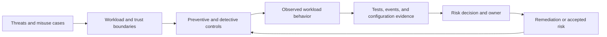
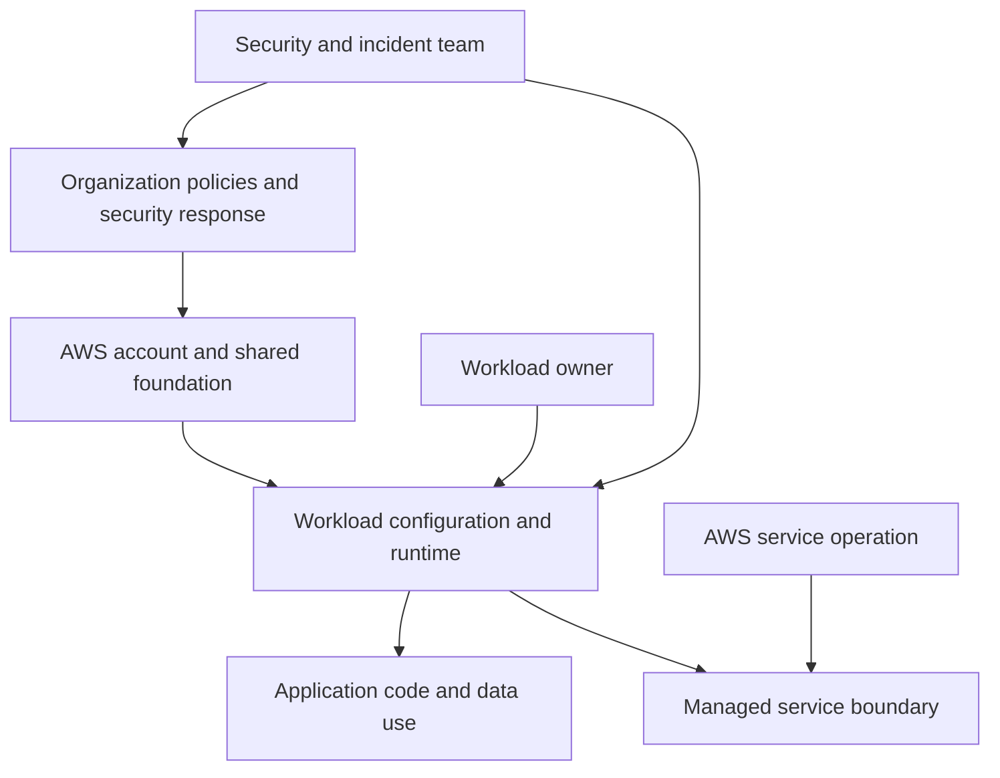
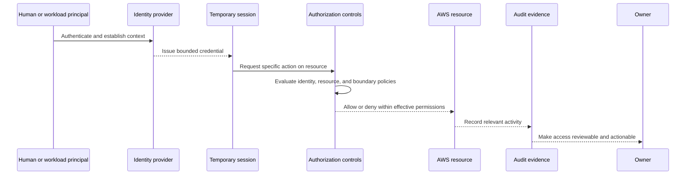
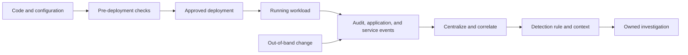
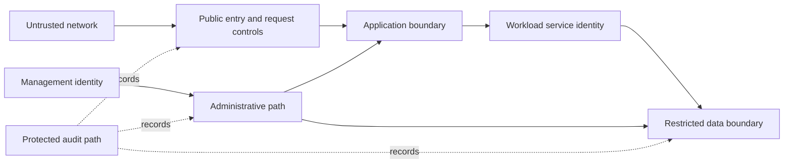
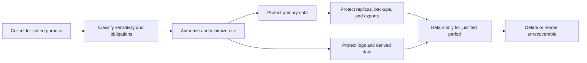
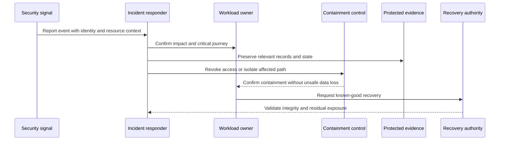
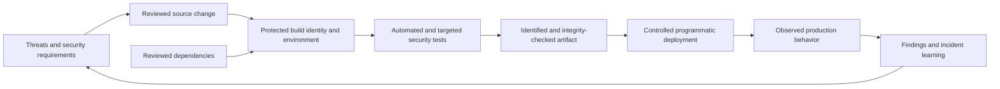
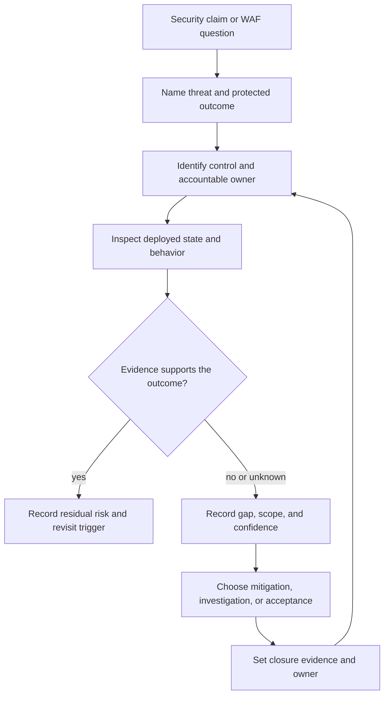

# Security Pillar

Part: [11 — AWS Well-Architected Framework](PART_OVERVIEW.md)

The Security pillar reviews whether an Amazon Web Services (AWS) workload protects its data, systems, and assets against the threats and failure conditions that matter to its business. It asks whether the workload has a strong identity foundation, traceable activity, defense in depth, automated security practices, protected data, reduced dependence on direct human data access, and prepared incident response. These are design principles for review, not a promise that adopting named services produces a secure system.

This chapter applies the AWS Well-Architected Framework (WAF) Security pillar to workload decisions and evidence. Part 15 owns general security concepts, threat modeling, and control reasoning; Part 09 owns AWS identity, networking, key, logging, and security-service mechanics. Here, the reviewer connects a workload's threats and outcomes to the controls, owners, and evidence that support its security claims. The AWS Security Pillar revision history identified November 6, 2024 as its latest listed update when consulted. Framework guidance changes; verify the linked AWS document and question set before each review, and record the revision used.

## Security Is a Workload Property

This model keeps the review grounded in the workload. A control matters because it changes a threat path or limits impact, and a security claim remains provisional until evidence supports it.

Security is not a property established solely by network isolation, encryption, a completed threat model, a cloud provider's certification, or a green dashboard. It emerges from interactions among identity, software, data, infrastructure, people, dependencies, and response. A workload can have strong preventive controls and still be unable to detect credential misuse; it can detect an event but lack the authority or procedure to contain it; it can encrypt a database while leaving sensitive exports, snapshots, or logs exposed.

The review therefore starts with a bounded workload and material security outcomes. Identify the users and business actions that must remain trustworthy, the information whose disclosure or alteration would cause harm, the administrative paths that can change the system, and the dependencies whose compromise would change the conclusion. Then examine the paths between them. The purpose is not to enumerate every imaginable threat, but to expose plausible misuse and failure scenarios with meaningful impact.

A useful security scenario is concrete: *if a workload credential is stolen from a compromised build runner, the attacker must not be able to alter production data or suppress audit evidence; the team detects the use outside its expected context, revokes the credential, and preserves a usable investigation record.* The scenario identifies a stimulus, protected outcome, expected control behavior, and evidence to request. Part 15 owns the full threat-modeling method; this chapter applies the result to AWS workload review.

The AWS Security Pillar describes seven areas: Security foundations; Identity and access management; Detection; Infrastructure protection; Data protection; Incident response; and Application security. Its current design principles are to implement a strong identity foundation, maintain traceability, apply security at all layers, automate security best practices, protect data in transit and at rest, keep people away from data, and prepare for security events. Verify this wording against the AWS revision selected for a review.

| Design principle | Workload-review interpretation |
|---|---|
| Implement a strong identity foundation | Establish justified identities and effective, bounded permissions for people and workloads; test lifecycle and revocation. |
| Maintain traceability | Preserve trustworthy records of security-relevant actions and make them usable by owners and responders. |
| Apply security at all layers | Place controls along material attack paths, and verify that shared dependencies do not make the layers fail together. |
| Automate security best practices | Repeatedly validate desired security state through reviewed, observable automation with bounded authority and safe failure behavior. |
| Protect data in transit and at rest | Classify information and apply transport, storage, key, access, and copy-lifecycle controls appropriate to its sensitivity. |
| Keep people away from data | Minimize direct human handling of sensitive data through scoped workflows, masking, and automation where suitable. |
| Prepare for security events | Exercise roles, access, containment, evidence preservation, communication, and recovery before an incident. |

These principles are related views, not independent checklists. A cross-account deployment role, for example, affects identity, traceability, infrastructure protection, and incident containment at once.

## Establish Responsibility and Review Boundaries

The boundaries show where to ask for evidence and an accountable owner; they do not assert that responsibility is always exclusive to one party. The exact division depends on the AWS service model, organization, and workload design.

Shared responsibility must be interpreted at the control level. AWS operates aspects of the underlying cloud infrastructure, while customers retain responsibility for choices and configurations within their control. The boundary varies by service: a managed service may reduce operating-system maintenance while leaving customer identity, network exposure, data permissions, encryption choices, and application behavior unchanged. A review should not accept “AWS manages security” or “the customer manages security” as a complete assignment. Name who configures, monitors, responds, and provides evidence for each material control.

For a workload boundary, record:

- Accounts, environments, regions, applications, data stores, build and deployment systems, and external dependencies in scope.
- Identity providers and trust relationships, including workforce, workload, partner, and emergency access.
- Security capabilities operated by a central platform or security team, and the service expectations the workload relies on.
- AWS-managed responsibilities relevant to the selected services, verified against current service documentation.
- Exclusions, assumptions, evidence owners, and the person authorized to accept residual risk.

An excluded shared service is still a dependency. If centralized identity or audit collection is outside the workload review, the workload team must state the assumption it makes about availability, configuration, retention, and response. An assumption without an owner or validation path is an unresolved risk, not a boundary that makes the concern disappear.

The reviewer should distinguish four things that are often collapsed: a policy's intended design, the deployed configuration, the behavior observed under a relevant condition, and the organizational decision to accept remaining risk. A document can describe a least-privilege role while production grants broader access; a configuration scan can find a setting but not prove that incident responders can use the evidence; an approved exception can authorize risk without making the underlying control effective.

## Review Identity and Access as End-to-End Paths

The path makes authentication, authorization, resource behavior, and traceability separate review questions. A successful login does not establish that the resulting permission is appropriate or that its use can be investigated.

Identity review begins with actors and actions, not a list of roles. Enumerate workforce users, application workloads, automation, third parties, and emergency operators. For each, ask what it can do, to which resources, under what conditions, for how long, and how access is granted, reviewed, and revoked. Part 09 owns AWS Identity and Access Management (IAM) policy syntax and service behavior; the WAF review examines whether the resulting workload access model matches need and can be evidenced.

A strong identity foundation commonly favors federated workforce access and short-lived credentials over embedded or long-lived static secrets. That reduces the time a copied credential remains usable, but it does not eliminate compromise: a live session can still be abused, a workload role can be overprivileged, or an identity provider can be misconfigured. Evaluate identity lifecycle, authentication strength, session duration, credential rotation or revocation, and the recovery path when the identity service itself is unavailable.

Permissions should be narrow in principal, action, resource, and context. Review effective access across identity policies, resource policies, organization-level guardrails, permission boundaries, and any service-specific controls rather than inspecting one policy in isolation. Pay particular attention to privilege escalation paths: permission to change a role, pass a role to a service, alter a trust policy, modify the deployment pipeline, or suppress logging may be more consequential than a broad-looking read permission. Cross-account access needs a named purpose, constrained trust, an accountable external owner, and a tested revocation path.

Separate duties where a single principal could otherwise both make and conceal a consequential change. Avoid turning separation of duties into a brittle approval maze: define the actions that require independent control, the emergency bypass, its logging, and retrospective review. For runtime access, prefer workload identity with a bounded role to a shared secret copied into configuration. For people who need sensitive data, first determine whether the task can be achieved with a query, masked view, or approved workflow that avoids direct raw-data access.

Evidence can include representative effective-access analysis, access reviews, authentication and session configuration, privilege-boundary tests, credential revocation exercises, and audit events for sensitive actions. A role inventory alone does not show whether permissions compose into an escalation path or whether removed users and obsolete automation lose access in practice.

## Trace Activity and Detect Security-Relevant Change

Detection includes unexpected configuration changes and unexpected behavior. Configuration evidence can be checked before deployment, during release, and in a running environment; behavioral evidence can reveal unusual access, application programming interface (API) usage, data movement, or application activity. These signals answer different questions and need different owners.

A useful detection path preserves both the expected-change record and the observed state. Without that comparison, a team may see a changed resource but be unable to tell whether it came from a reviewed deployment, an emergency action, or unauthorized activity.

Traceability asks whether the organization can reconstruct who or what performed a security-relevant action, against which resource, at what time, through which identity path, and with what result. Logs are not automatically useful evidence: they may omit required events, lack stable identity context, be delayed, be mutable by the actor under investigation, or expire before an investigation begins. The review should ask which events matter to the threat scenarios, where they are collected, who can alter or delete them, how retention matches investigation and legal needs, and whether responders can query them during a service disruption.

Detection must cover both control drift and workload behavior. Examples include a public exposure change, an unexpected privilege grant, use of an administrative API from an unusual principal, an anomalous data export, disabled logging, a build artifact that differs from the approved release, or a sudden pattern of failed authorization. A control that alerts on every expected deployment can create noise; a control that trusts the deployment identity without checking the resulting state can miss a compromised pipeline. Define expected behavior, deliberate exceptions, severity, and the owner who investigates.

Correlate security signals with workload context: release identity, account and resource ownership, data sensitivity, dependency map, business journey, and recent operational events. That context helps distinguish a legitimate scaling event from suspicious activity and helps responders assess blast radius. Part 14 owns observability architecture and instrumentation; the Security pillar asks whether the security-relevant events are available, protected, actionable, and connected to response.

Test the detection path end to end. Generate a safe representative event, verify that it is captured and enriched, confirm that the intended team receives an actionable notification, and measure how long investigation takes. Also test that a suspected actor cannot silently disable the evidence channel. A security dashboard with no exercised alert path demonstrates visualization, not detection readiness.

## Protect Infrastructure in Layers

Infrastructure protection reviews the trust boundaries, exposure, system configuration, and maintenance assumptions that reduce unauthorized access and vulnerability. The goal is not to make every component private or to add controls at every possible layer regardless of cost. It is to place appropriate, independent controls along material attack paths and verify their failure behavior.

This view separates customer traffic from administrative access and makes the audit path visible. Network placement is one layer; identity, application authorization, system integrity, and evidence remain necessary even when traffic crosses a private boundary.

Review public and private entry points, network boundaries, administrative access, service-to-service trust, and the controls that constrain lateral movement. A private subnet does not make an application safe from a compromised workload identity; a web application firewall does not replace authorization; encryption in transit does not stop a trusted endpoint from returning another customer's record. For each boundary, identify the threat it addresses, the layer enforcing it, the permitted flow, the owner, and the evidence that the flow is constrained as intended.

System integrity includes secure configuration, supported software, patch responsibility, hardened images, and control over changes. Managed services change the maintenance boundary but do not remove the need to understand configuration, runtime permissions, exposed interfaces, and application dependencies. Where teams use golden images or infrastructure templates, inspect how they are reviewed, tested, promoted, and checked for drift. A template is a repeatable source of configuration, not proof that every deployed resource conforms.

Defense in depth is useful when layers fail independently enough to contain impact. Duplicating the same brittle control in several places may create complexity without meaningful independence. Conversely, two layers that share the same administrator, credentials, or deployment pipeline may fail together. Review common-mode dependencies: can one compromised account disable the network boundary, modify workload policy, and erase the logs that would reveal the action? Can operators still reach and isolate a workload if the primary control plane or identity path is impaired?

Make protection proportional to exposed attack surface and consequence. Minimize unnecessary ports, services, software, and administrative endpoints; separate environments and privilege domains when that meaningfully limits blast radius; constrain management access; and validate the deployed state. For workloads with external partners, include partner paths and ownership rather than treating the application boundary as ending at the cloud account.

## Protect Data Across Its Lifecycle

Data protection begins with knowing what data exists, why the workload needs it, who can use it, and what must happen to each copy. Classification is useful only when it changes handling: access, encryption, logging, retention, backup, replication, deletion, and incident response. Part 09 owns AWS storage and key-service mechanics; Part 11 assesses whether those choices implement the workload's obligations and threats.

The lifecycle includes copies and derived records, not only the primary database. Export files, analytics tables, support bundles, traces, snapshots, and backups can preserve sensitive data after the application path has been corrected.

For sensitive data, ask whether the workload can avoid collecting it, reduce precision, tokenize it, or use a derived representation. Minimization reduces the number of systems and people that must be trusted. If data is necessary, trace where it moves and identify the authority for creation, change, replication, retention, and deletion. Include data sent to third parties, observability systems, test environments, and recovery locations.

Encryption at rest and in transit can reduce exposure under particular threat conditions, but encryption alone does not establish confidentiality. Review who can request decryption, who administers keys, how application identities are authorized, how key access is audited, and what happens when a key is disabled or unavailable. A separation between data administration and key administration can reduce some risks, but recovery procedures must ensure legitimate operators can restore service. Test key access during restore and incident isolation rather than treating successful encryption configuration as end-to-end evidence.

Secrets have a lifecycle too: creation, distribution, use, rotation, revocation, and detection of exposure. A secret stored in a managed service may still be copied into logs, build output, environment dumps, or support tickets. Determine which workloads can use short-lived identity instead of a secret, and test revocation across caches and active sessions. Avoid putting credentials or sensitive payloads in telemetry merely to improve debugging.

Residency, retention, deletion, and legal hold requirements can conflict with replication and backup design. A deletion request may need to reach replicas, search indexes, exports, and derived datasets; backups may expire on a defined schedule rather than support selective erasure. State the policy and exception explicitly, retain evidence of deletion where required, and ensure the design does not promise immediate erasure if recoverable copies remain. For cross-region or cross-account copies, record why they exist, which controls protect them, and when they are retired.

## Prepare for Security Incidents

Preventive controls reduce likelihood and detective controls reduce time to discovery, but neither removes the need to respond. Incident response is an architectural capability: responders need authority, access, evidence, safe containment actions, communication paths, and a way to return to a known-good state. A plan that assumes the compromised identity provider, deployment pipeline, or workload account remains trustworthy may fail exactly when it is needed.

The response sequence must be adapted to the workload. Isolation can protect customers but may also interrupt a critical service or destroy volatile evidence; the authority, safe limits, and validation conditions should be agreed before an incident.

Preparation includes clear severity and escalation criteria, named decision-makers, contact paths, access to relevant accounts and evidence, tested containment procedures, communication plans, and practiced recovery. Determine who can revoke a workload credential, disable a deployment path, isolate a resource, preserve volatile data, or make a customer-impacting decision. Use scoped emergency access with logging and review rather than undocumented shared credentials.

Exercises should test realistic scenarios such as compromised build credentials, unauthorized data access, malicious resource changes, exposed secrets, or an unavailable central logging path. Include dependencies between security response and business continuity: who can approve isolation, what customer behavior is acceptable, how data integrity is checked, and when traffic can return. A tabletop can reveal missing ownership; a technical simulation can reveal whether access and controls actually work. Choose the exercise method based on the claim being tested.

After an event or exercise, preserve a timeline, identify contributing system conditions, and convert learning into owned improvements. Avoid treating human error as the complete root cause when permissions, defaults, feedback, or procedures made the error easy or hard to detect. Verify closure against the scenario: demonstrate that the revised control detects or contains the behavior and that responders can still recover. Part 07 owns general recovery objectives; this pillar asks whether security response can reach a trustworthy recovery state without reintroducing the attacker or corrupted data.

## Include Application and Delivery Security

Application security covers how teams design, build, test, deploy, and operate the security properties of the workload. The review asks whether security ownership is embedded in delivery, the build and release infrastructure is protected, testing produces useful feedback, and dependencies are managed deliberately. It does not replace Part 15's secure-design concepts or the handbook's application/API security owners.

The chain connects source and dependency trust to the deployed artifact. A successful test run is not enough if an untrusted actor can replace the artifact or change the deployment target after the test.

Threat modeling early in design can expose authorization flaws, unsafe trust assumptions, or data flows before they become expensive to correct. The review should ask whether the team knows which security properties matter, how code review and automated testing cover them, how findings are prioritized, and how exceptions are tracked. Testing may include static and dynamic analysis, dependency checks, secret detection, infrastructure configuration checks, penetration testing, and manual review, but no single scanner proves application security. Choose tests based on attack surface and risk, and ensure findings reach builders in time to affect the change.

Protect the pipeline as a production security boundary. Build identities should have only the access needed for their stage; untrusted pull requests should not receive production credentials; artifacts should be traceable to reviewed source and build inputs; and deployment should verify what it promotes. Separate the ability to alter source, approve a release, and modify production where the threat warrants it. Evaluate pipeline changes and dependencies as part of the attack surface, including package sources, build plugins, runners, and signing or provenance mechanisms.

Dependency management includes knowing which components are used, tracking supported versions and vulnerabilities, obtaining packages from controlled sources, and having a response path when a critical dependency is compromised. A software bill of materials (SBOM) can help identify affected workloads, but its value depends on coverage, accuracy, artifact linkage, and a process that can act on the result. A vulnerability count without exploitability context or remediation ownership is weak risk evidence; a clean scan does not establish that the scanner covered the deployed artifact or relevant threat.

Application security is not a final approval stage assigned to a separate security team. Product and platform teams need clear ownership, training, review support, and actionable paved paths; security specialists provide threat expertise, escalation, and independent challenge where needed. The review should inspect how this model works under delivery pressure and during an active vulnerability response, not only how it is documented.

## Turn Pillar Findings into Evidence-Based Decisions

The trace prevents a framework answer from becoming an unsupported assertion. It also distinguishes a control-design gap from missing evidence and from an explicitly accepted residual risk.

For each material question, record the workload behavior, the applicable threat, control owner, evidence inspected, evidence limitations, conclusion, and follow-up. Evidence may be configuration, access tests, release provenance, audit records, restore exercises, detection simulations, incident timelines, or data lifecycle results. State whether evidence is current and representative; a test in a development account does not necessarily prove production isolation.

| Review area | Evidence that can support a conclusion | Common gap to investigate |
|---|---|---|
| Security foundations | Workload threat scenarios, trust boundaries, responsibility map, and risk decisions | Generic policy statements without workload paths or accountable owners |
| Identity and access management | Effective-access review, temporary-credential behavior, revocation test, and sensitive-action audit | Role inventory without privilege composition or lifecycle evidence |
| Detection | Configuration-drift test, representative event, alert routing, protected retention, and investigation result | Logs exist but cannot be correlated, queried, or trusted during an incident |
| Infrastructure protection | Exposure inventory, boundary tests, configuration baseline, patch ownership, and drift response | Private network treated as a substitute for authorization and application controls |
| Data protection | Classification, data-flow and copy inventory, key-access test, retention/deletion evidence | Primary store protected while exports, telemetry, and backups are overlooked |
| Incident response | Exercised roles, scoped containment, evidence preservation, and recovery validation | Runbook assumes credentials, logging, or control plane are unaffected |
| Application security | Threat review, pipeline permissions, artifact linkage, test coverage, and dependency response | Scanner status detached from the artifact that reached production |

The table is a prompt for evidence selection, not a universal checklist. The quality of evidence depends on the claim: configuration inspection can show a policy exists, while an adversarial test or exercise may be needed to show that a control actually constrains behavior.

### Worked scenario: compromised deployment identity

A payment workload accepts requests through an API, stores payment state, and uses a delivery pipeline to deploy application changes. The team reports that production access is restricted and that audit logging is enabled. A review traces the deployment identity from source change through build and release. The role can update the application and modify a security group; the build runner can obtain a long-lived secret; and the same production account can alter the audit destination.

The threat scenario is that a compromised runner uses its credential to change the application, expose a management endpoint, and remove evidence. The reviewer does not conclude that the workload is insecure merely because one role has broad access; the review tests the path and its business impact. It asks whether an untrusted change can reach the privileged runner, whether production deployment requires independent review, whether the role can change the audit boundary, how quickly the credential can be revoked, and whether security events are retained outside the actor's control.

The team demonstrates that protected branches require review but cannot show that the runner rejects untrusted jobs. It also finds the audit destination is writable by the deployment role. The resulting actions are to separate build and deployment identities, remove long-lived credentials, constrain the production role to approved resources, protect audit retention under a distinct authority, and exercise credential revocation and deployment isolation. Closure requires a test proving an untrusted job cannot obtain production authority, an effective-access review, and an incident exercise showing responders can preserve evidence and return to a verified artifact. The team records any temporary risk, its business scope, compensating monitoring, approving authority, expiry, and revisit trigger.

This example crosses identity, detection, infrastructure, data, incident response, and application security. That is expected: a realistic attack path rarely respects pillar boundaries. The reviewer should keep one coherent scenario and assign actions to their actual owners rather than creating disconnected findings for each chapter heading.

## Avoid Security Theater and Unbounded Controls

A framework review can become theater when teams optimize for completed questions, service adoption, or a favorable score rather than reduced workload risk. A certification can establish that an organization or service was assessed against a defined scope and criteria; it does not prove that this workload's permissions, data flows, or response paths are correct. A control statement is intent, a policy document is design evidence, and an operational test is evidence about behavior under the tested conditions. Keep those distinctions visible.

The opposite failure is to respond to uncertainty by adding controls without considering their operation. More approvals can delay urgent containment; broader logging can create sensitive data exposure; shorter credential lifetimes can disrupt recovery if renewal paths are fragile; aggressive isolation can violate a business safety constraint. Explain why each control reduces a specific risk, what it costs, how it can fail, and how exceptions are governed. A compensating control should have an owner, defined scope, evidence, expiry or review trigger, and a plan to reassess as the workload changes.

Security and usability are not always opposing ends of one scale. A well-designed identity workflow can reduce both friction and credential exposure; a data-minimization change can reduce breach impact and simplify retention. Where a real trade-off remains, state the affected stakeholder concern, the measurable security outcome, operational impact, alternatives, and accepted residual risk. Do not use “defense in depth” to justify layers that no team can operate or verify.

## Review Questions

- Which workload outcomes, identities, data classes, and trust boundaries define the security review scope?
- Which threats or misuse scenarios could materially affect those outcomes, and what evidence supports the assumed likelihood and impact?
- Is every important control assigned to a team that can configure, observe, and respond to it?
- Can workforce, workload, partner, and emergency identities obtain only justified access, and can that access be reviewed and revoked in practice?
- Can the team detect security-relevant behavior and configuration drift, preserve trustworthy evidence, and route alerts to an owner?
- Do infrastructure controls constrain the actual attack paths, including administrative and cross-account paths?
- Are sensitive data and all meaningful copies classified, minimized, protected, retained, and deleted according to explicit obligations?
- Can responders contain an incident without relying on the potentially compromised identity, logging, or deployment path?
- Does the delivery system protect source, build, dependencies, artifacts, deployment authority, and production feedback?
- Are findings prioritized by workload impact and confidence rather than score alone, with accepted risk bounded and remediation closure verified?

Further reading: [AWS Security Pillar](https://docs.aws.amazon.com/wellarchitected/latest/security-pillar/welcome.html), [AWS Security Pillar document revisions](https://docs.aws.amazon.com/wellarchitected/latest/security-pillar/document-revisions.html), [Part 09 AWS](../09_Cloud_Computing/CH01_AWS.md), and [Part 15 Security](../15_Security/PART_OVERVIEW.md).
