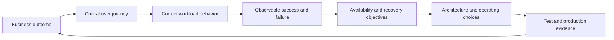
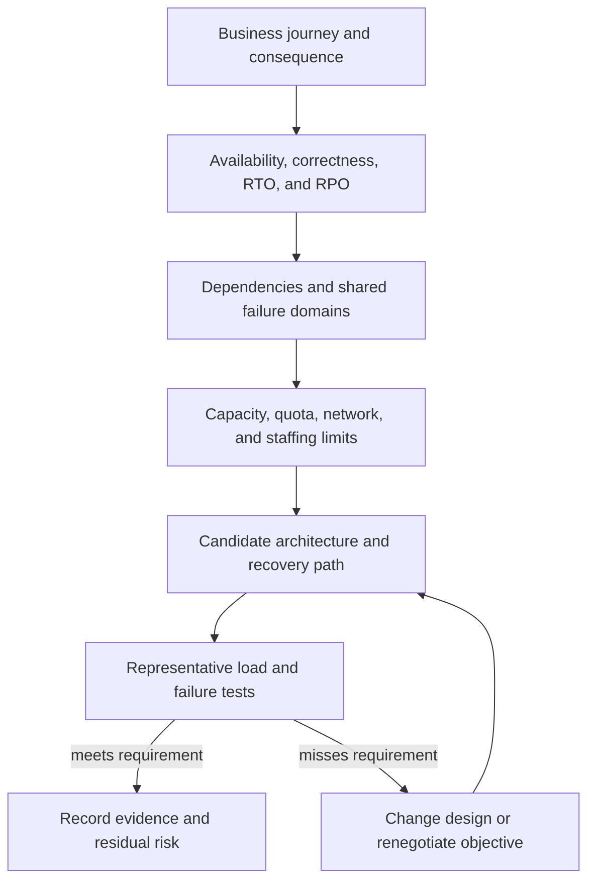
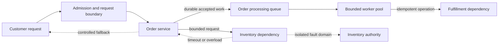
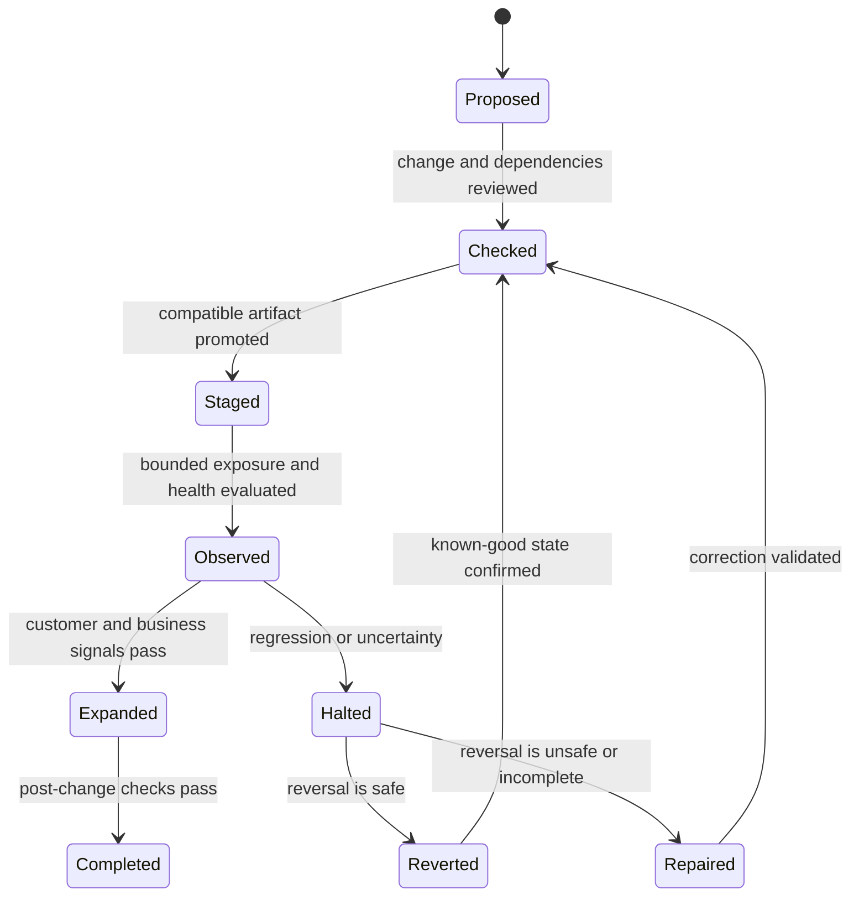
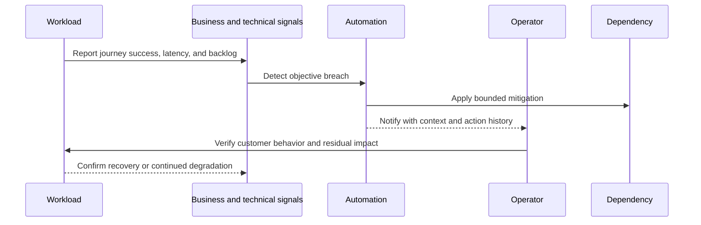
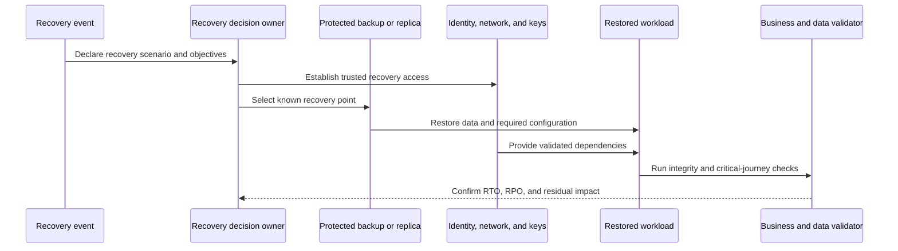
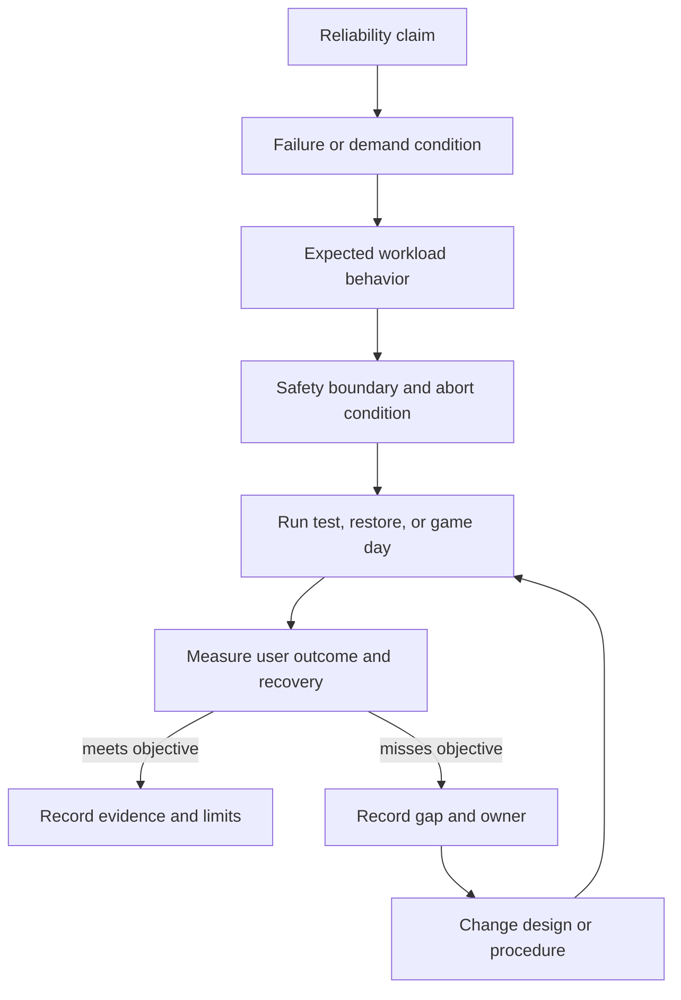

# Reliability Pillar

Part: [11 — AWS Well-Architected Framework](PART_OVERVIEW.md)

The Reliability pillar reviews whether an AWS workload can perform its intended function correctly and consistently when required, and whether its owners can operate, test, and recover it throughout its lifecycle. A reliable design is not simply one with redundant infrastructure. It has explicit business outcomes, realistic dependency assumptions, bounded failure propagation, safe change, and recovery procedures proven with representative evidence.

This chapter applies the AWS Well-Architected Framework (WAF) Reliability pillar to workload decisions. Part 07 owns reliability engineering foundations and distributed-systems concepts; Part 09 owns AWS service behavior, limits, and provider-specific recovery mechanics; Part 10 owns provider-neutral workload and disaster-recovery architecture. This chapter focuses on the AWS review lens: the questions to ask, evidence to inspect, and trade-offs to expose. The AWS Reliability Pillar revision history identified November 6, 2024 as its latest listed update when consulted. Confirm the current paper, question set, and service guidance before each review and record the revision used.

## Reliability Starts with the Intended Function

The chain prevents infrastructure health from becoming a proxy for business success. A component can report healthy while the workload returns incorrect results, loses accepted work, or misses the time at which the result is useful.

Reliability concerns both correctness and continuity. A payment service that accepts a request twice, a report delivered after its decision deadline, or a booking workflow that confirms inventory it cannot fulfill may be technically available while failing its intended function. Define the critical journey, what counts as a valid result, which failures matter, and how quickly service must recover. Part 07 owns formal availability and service-level objective (SLO) methods; the WAF review checks that AWS workload decisions and evidence support the stated objectives.

A useful reliability scenario identifies the workload and user action, stimulus, operating condition, expected response, and measurable outcome. For example: *during the loss of one Availability Zone (AZ), the order API continues accepting eligible requests with no duplicate committed orders, and capacity remains within its latency objective; after a regional event, the business can restore order authority within four hours with no more than fifteen minutes of accepted-order loss.* These numbers are workload requirements, not AWS defaults. They force a design to state which journey is protected and what “recovered” means.

Distinguish availability, durability, correctness, and recoverability. A service may be reachable but return stale data; data may be durable but inaccessible because its keys or identity dependencies are unavailable; a replicated write may survive infrastructure loss yet replicate corruption or deletion; a restored database may be consistent while the application cannot process the recovered queue. The review should follow the workload outcome across components and state transitions rather than infer it from one service-level availability number.

The pillar organizes recommendations into Reliability foundations, Workload architecture, Change management, and Failure management. Its design principles are to automatically recover from failure, test recovery procedures, scale horizontally to increase aggregate workload availability, stop guessing capacity, and manage change through automation. These principles complement one another: automation can accelerate recovery and change, but without tests, bounded authority, and capacity evidence it can also increase blast radius.

| Design principle | Review implication |
|---|---|
| Automatically recover from failure | Connect business-relevant signals to safe recovery actions, and validate that automation does not worsen the condition. |
| Test recovery procedures | Exercise the actual restore, failover, or rebuild path and measure the resulting workload behavior. |
| Scale horizontally to increase aggregate workload availability | Distribute demand across failure-independent units where the workload and state model support it. |
| Stop guessing capacity | Measure demand, scaling response, dependencies, quotas, and remaining headroom under expected and stressed conditions. |
| Manage change through automation | Make workload and infrastructure changes repeatable, reviewed, observable, and recoverable, including changes to the automation itself. |

## Establish Objectives and Foundational Readiness

Reliability objectives need an owner and a business reason. An SLO without an accountable product or service owner can become a dashboard target; an objective without a user journey can optimize the wrong behavior. Identify acceptable interruption, data loss, degradation, and recovery for each critical function. An online checkout may need a different interruption budget from a monthly analytics export, even when both use the same shared platform.

Recovery time objective (RTO) is the target time to restore a defined service after disruption. Recovery point objective (RPO) is the maximum acceptable loss of data measured in time, relative to the recovery point. These are not labels to copy from a business-impact template. State the service boundary, start and stop events, data authority, and conditions for declaring recovery. If a business process can tolerate delayed fulfillment but not duplicate orders, an RTO alone is incomplete; correctness and backlog-drain behavior are also required.

Objectives become useful when a measurable requirement leads to a design and a test. A gap can require architecture work, a changed operating model, or an explicit business decision to accept a different service outcome.

Foundational readiness extends beyond one application. Review network topology and bandwidth, name resolution, identity and control-plane dependencies, account and region boundaries, service quotas, deployment access, and the operational capacity to respond. A workload can have redundant compute while depending on a single network path, a shared deployment role, an exhausted quota, or an unavailable central configuration service. These dependencies may be owned outside the workload, but the workload needs a verified service contract and escalation route.

Capacity is a reliability concern whenever demand can exceed any limiting stage. Model the full path: ingress, compute, connection pools, queues, storage, downstream services, and recovery operations. Autoscaling is not instantaneous and does not remove quotas, cold-start delays, partition hot spots, database write limits, or a constrained third-party API. Test scale-out time and scale-in safety with representative traffic. Maintain explicit headroom or admission control where there is no time to scale before a limit is reached.

A capacity review should include expected growth, peak and burst patterns, deployment overhead, failover concentration, and recovery load. When a failure shifts traffic to surviving resources, those resources may face higher demand exactly when replacement capacity is unavailable. Verify quotas and service limits for the failure scenario, not only the normal state. Part 09 owns how AWS quotas are inspected and changed; the WAF review asks whether the workload has enough tested capacity and a credible path when a limit is approached.

The review should examine shared dependencies and common-mode failure. Two application instances do not provide independent capacity if both depend on one saturated database connection pool. Two AZ deployments may still share a regional control-plane dependency or a single external provider. Redundancy is valuable only relative to the failure model and the workload's ability to use the surviving path.

## Design the Workload to Contain Failure

A reliable architecture expects components and dependencies to fail, slow down, return partial results, and recover at different times. The review asks how those conditions affect the critical journey. It should inspect service boundaries, data authority, synchronous and asynchronous interactions, failure isolation, and the degraded behavior the business has agreed to tolerate.

This architecture view distinguishes a user-facing synchronous dependency from deferred processing. A timeout can preserve a request thread, but only a defined business fallback and durable ownership of accepted work preserve the transaction's meaning.

For each important dependency, state its role, owner, timeout or response expectation, failure signal, and fallback. A critical synchronous call can propagate latency and resource exhaustion upstream. Retry can improve success for transient faults, but synchronized retries may amplify load and duplicate side effects. Apply bounded attempts, backoff with jitter, deadlines, and an overall retry budget; retry only when the operation and failure state make retry safe. Part 07 owns the general mechanics of retries, idempotency, and distributed interaction; this review tests whether the selected behavior protects the workload's objectives.

Separate resources and concurrency so a failing dependency does not consume all capacity needed by unrelated work. Bulkheads, queues, rate limits, circuit-breaking behavior, and admission control can bound propagation, but each creates decisions about rejected or delayed work. A circuit breaker that opens should have an understood recovery probe; a queue needs a retention and overflow policy; rate limiting needs a priority or rejection contract. Review the customer-visible result, not just the control's configuration.

Choose a data authority for each business fact. Replicas, caches, and event streams may improve availability or read scale, but stale reads, concurrent writes, and conflict resolution can violate correctness. During a partition or failover, specify which side may accept writes, how a promoted replica is validated, and how the former authority is fenced. Never treat “eventually consistent” as a complete business policy. The system must define which actions are safe with stale data and which require authoritative confirmation.

Degraded operation should be explicit. If a recommendation service fails, can checkout proceed without recommendations? If fraud screening is unavailable, should a transaction stop, queue for review, or use a bounded alternative? If an analytics dependency is unavailable, should the customer path remain independent? These are product and risk decisions expressed in architecture. A fallback that silently relaxes a safety, authorization, or financial invariant is not resilience.

Fault isolation is not the same as eliminating all shared components. Isolation boundaries add operational and consistency costs; separate accounts, queues, data stores, or cell-like workload units can contain failures but may complicate routing and recovery. Choose boundaries based on blast radius, independent scaling or change needs, data ownership, and ability to operate the units independently. Check whether supposedly isolated cells still share identity, configuration, deployment pipelines, DNS, encryption keys, or a central database.

## Manage Change as a Reliability Event

A workload changes through code, infrastructure, configuration, data schemas, dependency versions, policies, and demand. Changes can fail before deployment, during rollout, or after a delayed interaction. Reliable change management is therefore more than a deployment approval: it needs compatibility, controlled exposure, representative signals, and a safe response when assumptions fail.

A rollback is a workload state transition. It can be unsafe after a data migration, externally visible side effect, or incompatible message has crossed the boundary. The recovery plan must account for schema, state, and downstream contracts, not only the application artifact.

Use small changes to reduce the amount of uncertainty introduced at one time, but do not assume that small means reversible. A feature flag can reduce exposure while leaving a migration or permission change active. A deployment pipeline can automatically stop a rollout on technical health while missing a delayed business error. The review should ask which signal governs progression, how long the observation window lasts, what conditions halt the change, who can override, and what evidence validates the post-change state.

Test compatibility across producers and consumers before changing interfaces, schemas, or event formats. A rolling deployment may run old and new versions simultaneously; both must behave safely against shared data and messages. If backward compatibility cannot be maintained, define a coordinated cutover with a tested recovery boundary. Deployments that modify persistent state need a plan for partial completion, retry, and reconciliation.

Infrastructure as code can make changes reviewable and reproducible, but the pipeline and its providers become part of the reliability boundary. Validate inputs and policy, constrain execution identity, detect drift, and verify deployed state. A successful pipeline run does not prove that the workload achieved its intended behavior. Keep a controlled emergency path when routine automation is unavailable, and test that path without turning it into the normal untracked change mechanism.

Measure change outcomes: deployment frequency is not reliability by itself. Relevant evidence includes failed changes, time to detect and recover, affected journeys, rollback or repair success, configuration drift, and regressions that appear after the observation window. Use these measures to improve architecture and delivery rather than to reward teams for suppressing incident reports.

## Detect, Contain, and Recover from Failure

Failure management begins with signals tied to required behavior. A host health check can remain green while a customer journey fails, a message backlog grows without bound, or a data replication delay violates the RPO. Identify signals for correctness, success rate, latency, saturation, dependency health, queue age, and data freshness where relevant. Part 14 owns observability methods; this pillar asks whether the AWS workload's signals let operators detect and manage its reliability risks.

Automatic recovery is appropriate when the condition and response are understood, the action is bounded, and success can be verified. Automation should not repeatedly restart a stateful component while hiding data corruption or retrying against a saturated dependency.

Containment should limit blast radius while preserving safe service. A failure can trigger load shedding, isolation, queueing, failover, or degraded features; each action has customer and data consequences. Define stop conditions for automation and ensure the on-call operator can see what it changed. If the control plane or identity path is part of the failure, verify a documented route to operate safely rather than assuming the same tools remain available.

Recovery can mean restoring a component, rebuilding a workload, failing over to another site, or reconciling data after an inconsistency. Define the service boundary and validation criteria before the event. Recovery is not complete merely because compute is running: verify data integrity, identity access, network reachability, dependencies, queue processing, customer journeys, and monitoring. The business owner or delegated authority should know when service can be declared restored and what residual impact remains.

## Prove Backup, Restore, and Disaster Recovery

Backups are useful only if they can be found, accessed, restored, and validated within the required time. Review coverage of data and configuration, backup identity and key availability, isolation from destructive production access, retention, recovery location, and the procedures for application-consistent restore. Replication is not a substitute for backup when corruption or deletion can propagate to the replica.

The procedure includes the prerequisites around the data copy. A backup that requires an unavailable key, identity, network path, quota, or undocumented operator is not a complete recovery capability.

The restore test should cover application startup and business validation of critical outcomes. Measure elapsed time and recovered data point, record manual steps and failure conditions, and compare results with RTO and RPO. A database restore that finishes in twenty minutes may still miss a four-hour objective if access provisioning, network setup, schema compatibility, and backlog replay require another six hours. Include the people and approvals needed during an actual event.

Disaster recovery (DR) strategies range from backup and restore through pilot-light or warm standby to active-active designs. More continuously running capacity can reduce some recovery time, but increases cost, operational complexity, synchronization concerns, and the chance of propagating an error to multiple locations. The correct choice follows workload-specific objectives, data consistency, dependency availability, and the team's ability to operate the topology. Part 10 owns the general comparison of DR patterns; Part 09 owns the AWS service mechanics.

A regional recovery claim must include more than a second region. Trace identity, networking, keys, configuration, images, quotas, observability, external integrations, DNS or traffic control, data replication, and decision authority. Determine whether the recovery location can accept workload load and how write authority is transferred and fenced. After failover, define failback conditions and reconciliation; returning to the former primary is another data and authority transition, not merely a routing change.

## Test Reliability Claims Under Realistic Conditions

A reliability test should distinguish the claim being tested from the mechanism used. A component test can show that a process restarts; it does not show that user traffic remains correct. A load test can measure throughput under one dependency profile; it does not demonstrate survival of an AZ failure. A tabletop can expose decision gaps but cannot prove that a restore script works. Use layered tests with an observable hypothesis and a safe boundary for each.

The test is informative when its scope, expected behavior, safeguards, and measured result are explicit. A passing result without the assumptions and limits can create false confidence.

Tests may include controlled dependency failure, instance or AZ interruption, quota pressure, queue buildup, backup restoration, deployment rollback, regional recovery, or sudden demand. Choose the least risky method that can falsify the claim, then increase realism as confidence and safeguards improve. Define abort authority, customer-impact limit, data protection, and observability before production experiments. AWS Fault Injection Service (AWS FIS) and other tools can support controlled experiments, but tool use does not replace experiment design or approval.

Test normal and recovery capacity. During failover, surviving systems may receive redistributed traffic while also replaying backlog and serving recovery operations. Verify that retries, replication, and queue consumers do not overwhelm a recovering dependency. Validate recovery after a bad deployment and after data corruption; these are different failure modes and may require different evidence.

Record what was tested, the workload version and environment, the stimulus, expected outcome, actual user impact, measured recovery time and data point, deviations, and follow-up owner. Tests expire as architecture, traffic, dependencies, and operations change. Re-run after material modifications and when incident evidence invalidates a prior assumption.

## Worked Scenario: Orders During Inventory Failure

An online retailer accepts orders through an application programming interface (API), checks inventory, persists accepted orders, and submits fulfillment work to a downstream partner. The business objective is to continue accepting eligible orders during a brief inventory-service outage without overselling stock or creating duplicate orders. During a regional outage, the recovery target is four hours with no more than fifteen minutes of accepted-order loss. These are example requirements chosen by the business, not properties implied by a particular AWS service.

The first review finds that checkout synchronously calls inventory and retries every timeout three times. When inventory slows, API threads and database connections remain occupied; the retries amplify load. The proposed fallback is to accept all orders and reconcile inventory later, but the business owner has not approved overselling or cancellation behavior. The review identifies this as a correctness and capacity decision, not simply an availability improvement.

The team separates “can reserve now” from “can accept for delayed confirmation.” It bounds synchronous wait and concurrency, permits queued confirmation only for products with an explicit inventory policy, and uses a durable order identifier to make replay safe. A per-product policy determines whether checkout rejects, queues, or accepts with a clear pending state. The inventory authority remains the source of truth; the design does not infer available stock from a stale cache during an outage. The partner path has a bounded queue and an owner for sustained backlog.

The recovery review traces order data and queue state to the backup and regional recovery design. It finds that the database backup can be restored but the identity and encryption-key access path has never been tested from the recovery account. The team conducts a restore exercise, validates order counts and invariants, starts the application, replays a bounded queue segment, and measures the full critical journey. The first run exceeds the RTO because service quota and network setup were omitted from the runbook.

The resulting actions have different closure evidence: load and dependency-failure tests show the order API remains within its latency and correctness objective; a replay test proves duplicate deliveries do not create duplicate fulfillment; an exercised restore demonstrates the full RTO/RPO boundary; and the business owner approves the pending-order policy. The review records residual inventory risk for explicitly eligible products and sets a trigger to revisit the decision if supplier latency or order volume changes.

This example links workload architecture, change, capacity, failure handling, and recovery. A reliability score cannot communicate those assumptions. The review record must state which user journey is protected, where the design degrades, who accepts the behavior, and what evidence was observed.

## Balance Reliability with Other Workload Concerns

Reliability improvements consume resources and create operational obligations. Multi-location recovery can increase data-transfer cost and consistency complexity; aggressive replication can spread corruption; spare capacity reduces saturation risk but may sit idle; health checks and automated remediation can trigger oscillation when their signals are noisy. Compare the expected business impact of failure with implementation and ongoing operating cost.

Do not equate redundancy with independence. Multiple resources may share a control plane, credentials, network, deployment pipeline, region, data authority, or operator. Conversely, not every workload needs multi-region active-active design. A bounded recovery objective and a tested restore process can be more reliable in practice than a complex topology the team cannot safely operate.

When an objective cannot be met, make the gap visible. Options include changing architecture, removing a dependency, increasing capacity, altering the business process, accepting a bounded service interruption, or changing the objective through an authorized business decision. Do not silently weaken correctness or data-loss guarantees to preserve an availability number.

## Review Questions

- Which business journeys define correct operation, and who owns their availability and recovery objectives?
- Are RTO, RPO, acceptable degradation, data authority, and recovery completion criteria measurable and workload-specific?
- Which quotas, network paths, identity services, shared platforms, and external dependencies can invalidate the reliability claim?
- Does the architecture isolate failure and constrain retries, concurrency, and overload propagation?
- What is the source of truth, and how are stale data, duplicate work, split authority, and failback handled?
- Can deployed changes be observed and stopped safely, including schema, state, and dependency changes?
- Are recovery and containment actions automatic only where their conditions, limits, and outcomes can be verified?
- Have representative backup restores, dependency failures, capacity limits, and recovery paths been exercised by the expected operators?
- Do measured recovery time and data loss meet objectives end to end, including identity, keys, quotas, networking, and backlog replay?
- Are test scope, assumptions, limitations, residual risks, owners, and revalidation triggers recorded?

Further reading: [AWS Reliability Pillar](https://docs.aws.amazon.com/wellarchitected/latest/reliability-pillar/welcome.html), [AWS Reliability Pillar document revisions](https://docs.aws.amazon.com/wellarchitected/latest/reliability-pillar/document-revisions.html), [Part 07 Reliability](../07_System_Design_and_Distributed_Systems/PART_OVERVIEW.md), [Part 09 AWS](../09_Cloud_Computing/CH01_AWS.md), and [Part 10 Cloud Architecture](../10_Cloud_Architecture/PART_OVERVIEW.md).
