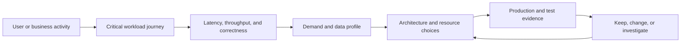
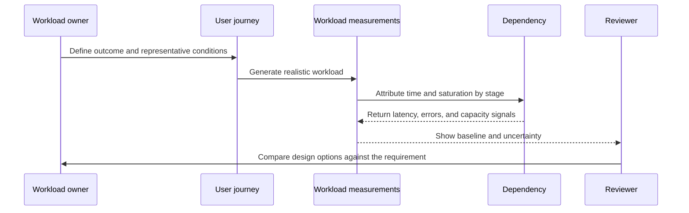
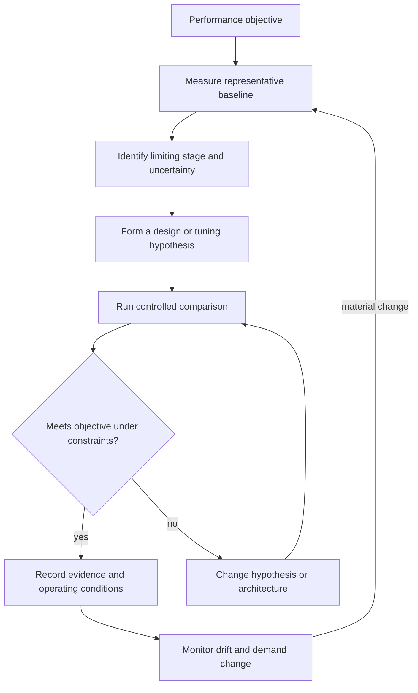
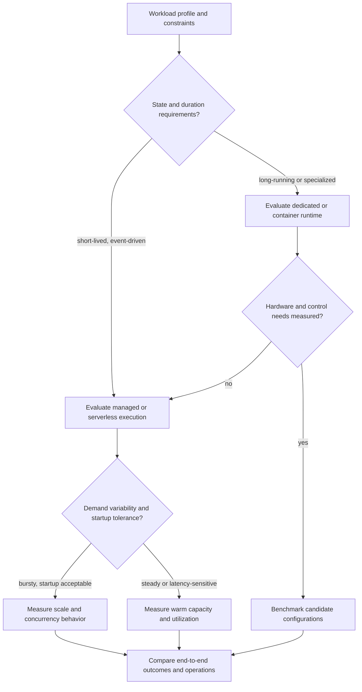

# Performance Efficiency Pillar

Part: [11 — AWS Well-Architected Framework](PART_OVERVIEW.md)

The Performance Efficiency pillar reviews whether an AWS workload uses appropriate resources to meet its performance requirements and can maintain that efficiency as demand and technology change. It is not an exercise in selecting the newest instance type or maximizing utilization. It connects user outcomes and workload characteristics to architecture choices, measurements, operating practices, and evidence that the design remains fit for purpose.

This chapter applies the AWS Well-Architected Framework (WAF) Performance Efficiency pillar. Part 19 owns performance engineering, measurement methods, and optimization fundamentals; Part 09 owns AWS service behavior and implementation mechanics; Part 10 owns provider-neutral placement and workload composition. This chapter teaches how to review those choices in AWS context without duplicating those owners. The AWS document revision history identified November 6, 2024 as its latest listed update when consulted. Record the current framework and question-set revision used in a review.

## Define Performance in Workload Terms



The review begins with a required outcome, not an infrastructure metric. A resource can be highly utilized while meeting every user objective, or lightly utilized while a downstream bottleneck makes the service unusable.

Performance requirements should describe the behavior that matters: response-time distribution, throughput, concurrency, freshness, processing completion time, or another workload-specific measure. Identify which user journey and operating condition each measure represents. An interactive search API might require a ninety-fifth-percentile response time below 250 milliseconds during a stated peak; a nightly analytics pipeline may instead need to process a defined volume before a business deadline. These are example targets, not universal thresholds.

A service-level objective (SLO) may include performance alongside availability and correctness. Define the measurement boundary, request population, excluded conditions, and observation interval. A mean can hide a severe tail; a throughput target can hide growing queue age; a low response time can result from rejecting expensive requests. Measure successful completion and quality, not only speed. Part 07 owns general reliability objectives, and Part 19 owns measurement methodology; this chapter asks whether the selected AWS design and evidence serve the workload requirement.

Characterize demand rather than relying on a single average. Include arrival patterns, burstiness, concurrency, request mix, payload size, read/write mix, data growth, geographic distribution, and dependency behavior. Identify cold and warm paths, cache hit patterns, batch windows, and scheduled jobs that compete for capacity. Demand can change by product launch, season, customer growth, new data, or new features; capture the assumptions that would trigger a review.

Performance is constrained by the slowest or most contended stage on a journey, but bottlenecks move as the system changes. A front-end latency regression may originate in connection setup, an application lock, a database query, network transfer, or a partner service. Review the end-to-end path and its resource budgets. Part 19 covers detailed profiling and experiment design; the WAF review checks that workload owners can identify the limiting stage and justify their architecture choices with representative evidence.

## Apply the Pillar's Design Principles

AWS organizes current Performance Efficiency guidance into five areas: Architecture selection; Compute and hardware; Data management; Networking and content delivery; and Process and culture. The design principles guide decisions across those areas:

| Design principle | Review interpretation |
|---|---|
| Democratize advanced technologies | Consider managed capabilities when they reduce undifferentiated operation without violating workload requirements or obscuring essential control. |
| Go global in minutes | Evaluate global placement where user geography and latency justify it, while accounting for data authority, residency, and operations. |
| Use serverless architectures | Consider consumption-based and managed execution when the workload's event, duration, state, and latency profile fit. |
| Experiment more often | Use controlled comparisons to replace assumptions with measured workload evidence. |
| Consider mechanical sympathy | Align technology and configuration with access patterns, concurrency, data shape, and hardware behavior. |

These are decision prompts, not mandates. Managed or serverless choices can reduce capacity administration but introduce service limits, cold-start behavior, concurrency controls, or less visibility into lower layers. Global deployment can improve user latency but add replication, consistency, residency, and support complexity. Evaluate a principle against the workload rather than adopting its label as a design goal.

## Measure Before Selecting or Tuning



Measurement connects a choice to a workload profile and outcome. A benchmark without representative data, dependencies, and success criteria can produce precise numbers for the wrong system.

Establish a baseline under controlled conditions and relate it to production behavior. State the software version, configuration, data volume, region, request mix, concurrency, warm-up state, and dependency profile. Compare multiple runs and report variation, not just a single best result. Production signals reveal real demand and long-tail behavior; tests provide controlled conditions for causal comparisons. Neither replaces the other.

Use distributed traces, application measurements, service metrics, and workload-level outcomes to localize latency and saturation. Correlate performance changes with deployment, configuration, demand, data growth, and dependency changes. Avoid treating a utilization number as a diagnosis: high processor use can be efficient if throughput and latency remain within bounds; low use can coexist with lock contention, network waits, or a serial bottleneck.

A useful experiment changes one important factor at a time where practical, holds other conditions stable, and defines a stopping condition. Compare candidate resource types, data layouts, caching policies, concurrency settings, or managed services against the same representative workload. Record setup cost, ongoing operation, quota and scaling behavior, and failure-mode performance. If the result depends on a narrow benchmark or on traffic remaining unchanged in production, record the uncertainty. Set an explicit trigger for remeasurement.



The loop makes performance a continuing workload property. A one-time benchmark does not remain valid after data volume, request mix, dependency behavior, or service limits change.

## Select Architecture for the Workload Profile

Architecture selection includes compute, storage, database, networking, caching, and managed services. Begin with the workload's constraints: response-time and throughput requirements, state and consistency needs, data size and growth, request duration, burst shape, geographic reach, operating model, and integration contracts. Compare candidates with the same evidence and identify where a service abstraction helps or limits the design.

A suitable managed service can delegate patching, capacity mechanisms, and specialized operation to AWS, allowing the team to focus on its product. It is not automatically faster or simpler: startup delays, concurrency ceilings, request limits, data access patterns, and service-specific pricing can alter the result. A self-managed component may permit specialized tuning or portability but creates responsibility for provisioning, maintenance, scaling, and capacity evidence. The review should ask whether the team has measured a material reason to own those operations.



The decision tree narrows experiments; it does not select a service by itself. Final choice depends on measured performance, workload constraints, reliability, security, operational ownership, and cost.

Compute selection should match execution behavior. Consider processor demand, memory footprint, storage and network throughput, accelerator needs, startup time, concurrency, and workload duration. A graphics processing unit (GPU) may accelerate a suitable model or parallel workload but waste cost and power when the software cannot use it efficiently. A memory-optimized configuration may help an in-memory workload but does not resolve a serial algorithm or chatty data access pattern. Benchmark the application and dependencies, not a synthetic metric alone.

Scaling strategy must include the entire path. Horizontal scaling can increase aggregate capacity when requests can be distributed and state is externalized or partitioned appropriately. Vertical scaling can be simpler for some stateful or tightly coupled components but has finite bounds and may increase the impact of a single resource failure. Autoscaling needs a signal that reflects demand before saturation, a known provisioning delay, adequate quota, safe scale-in, and downstream capacity. Increasing application concurrency can overload a database or partner service; model backpressure and admission control as part of the design.

## Optimize Data Management and Access Paths

Data layout and access pattern often dominate performance. Review query shape, index use, partitioning, scan volume, serialization, compression, object size, caching, and data locality in relation to actual workload behavior. A key-value access pattern may not fit a relational join-heavy workload; a large analytical scan may be more efficient in a column-oriented system than in an operational store. Part 09 owns AWS database and storage service behavior; Part 10 owns general data placement architecture.

```mermaid
flowchart LR
    Client[User request] --> Edge[Nearby content or response cache]
    Edge --> API[Application programming interface (API)]
    API --> AppCache[Application cache]
    AppCache -->|miss| Service[Application service]
    Service --> Query[Bounded data access]
    Query --> Store[Authoritative data store]
    Store -->|result| Query
    Query --> Service
    Service --> AppCache
    AppCache --> API
    API --> Edge
    Edge --> Client
```

Caches reduce repeated work and distance for suitable data, but add freshness, invalidation, memory, and consistency concerns. The architecture needs a clear authority and a policy for stale or missing values; a cache hit-rate target alone is not a correctness contract.

Caching is effective when repeated requests can safely reuse results and the cache sits at a useful boundary. Identify key cardinality, expiration, invalidation, stampede behavior, privacy, and what happens when the cache is cold or unavailable. A Content Delivery Network (CDN) can serve eligible content closer to users, but dynamic authorization and personalized responses require careful cache keys and policy. Caches can hide inefficient queries during a warm benchmark and create a severe cold-start penalty; test both paths.

Data locality can reduce latency and transfer, but copies introduce consistency and lifecycle obligations. Read replicas, precomputed views, local caches, and regional copies trade freshness and write complexity for read performance. Record acceptable staleness for each journey, when data is refreshed, and how the design behaves during replication lag. Do not create a replica because it sounds like a performance feature without evidence of a relevant bottleneck.

Measure the cost and effect of data movement, including serialization, compression, cross-region transfer, query scans, and repeated transformations. A faster response can consume more storage or network bandwidth; lower storage cost can increase retrieval latency. Choose a design against the user's objective and total workload constraints rather than optimizing one isolated stage.

## Review Networking and Content Delivery

Network performance depends on topology, distance, protocol behavior, connection reuse, payload size, encryption, congestion, and service boundaries. Trace the user journey across client, edge, application, data, and external dependencies. Separate time spent in network setup and transfer from application processing and downstream waits. Part 09 owns AWS networking mechanics; this chapter asks whether the selected path and delivery choices meet the workload's measured latency and throughput requirements.

Global placement can reduce distance for users, but it can also move compute closer to a data store only by introducing a new copy or a longer data path. Compare the complete journey: edge-to-compute, compute-to-data, identity, control, and partner calls. A globally distributed front end that synchronously calls a distant authoritative database may not improve end-to-end latency. Regional placement should account for data residency and reliability constraints as well as performance.

Content delivery, connection reuse, protocol selection, payload shaping, and compression can reduce transfer time where appropriate. Validate behavior for real clients, network conditions, and payload distributions. Excessive compression can increase processor cost; a larger cache can reduce origin work while introducing stale content; connection pooling can reduce setup cost but exhaust sockets or retain unhealthy connections if limits are wrong.

For partner and service-to-service paths, agree on timeout, payload, concurrency, and throughput expectations. An externally imposed limit can become the workload's capacity ceiling. Measure dependency latency and error behavior, and define how the application degrades when the partner is slow. A local microbenchmark cannot establish performance when the critical dependency is outside its measurement boundary.

## Make Performance Improvement an Operating Practice

AWS's Process and culture area emphasizes ongoing improvement, experimentation, and the organizational conditions needed to apply performance practices. Establish ownership for objectives, dashboards, capacity assumptions, and design decisions. Make it straightforward for teams to run representative tests and compare configurations without bypassing security, reliability, or cost controls.

The review should inspect whether performance feedback reaches the team that can act. A dashboard without thresholds or ownership may not expose a regression; a load test that is too expensive or difficult to run may be skipped; a procurement or quota process may be slower than the product's growth. Capture what can be tuned automatically, what needs human review, and which architecture assumptions should trigger a new experiment.

Performance regressions often follow code or data changes. Include relevant performance evidence in delivery practices: representative test suites, production canaries, comparison against a baseline, and alerts on user outcomes. Do not turn every minor variance into a release blocker; define thresholds based on workload impact, measurement confidence, and risk. For a shared platform, distinguish a workload-specific bottleneck from a common service limit and route the finding to the responsible owner.

## Worked Scenario: Search During a Product Launch

A retail search workload serves a customer-facing API, reads product and inventory data, and displays images. A campaign is expected to multiply request volume. The team proposes a larger application instance type because processor utilization rose during the previous event. The review asks for end-to-end latency and success by journey, cache hit and miss behavior, data query volume, concurrency, and dependency response under the actual request mix.

The baseline shows that warm cached requests meet the target, but cache misses trigger several serial data queries and a synchronous inventory lookup. The application processor is moderately utilized; the database connection pool saturates during bursts, and the inventory dependency has a fixed concurrency limit. A larger application instance could increase request concurrency and worsen both constraints.

The team compares three options: right-size and partition the data query; cache a bounded product view with an explicit freshness policy; or add application capacity while limiting inventory concurrency. It tests each with representative product distribution, cache-cold and cache-warm conditions, and a simulated inventory slowdown. The chosen design reduces repeated data reads, caps partner concurrency, and returns a clearly defined stale inventory indication for browse results while requiring an authoritative check before purchase. Checkout remains governed by its own correctness and latency objectives.

The decision record includes the test conditions, data freshness bound, quota and scaling assumptions, cost, and rollback trigger. A production canary measures ninety-fifth-percentile search latency, successful result rate, inventory errors, and database saturation. The team schedules remeasurement before the next campaign because expected catalog size and demand mix are changing. Performance efficiency here is a measured system choice, not an instance-size preference.

## Trade-offs and Review Questions

Performance competes and interacts with reliability, security, cost, and sustainability. More replicas may improve read latency but increase synchronization and storage; a larger warm fleet may reduce startup delay but consume more resources; aggressive caching may expose stale or cross-user data; global placement may reduce network distance while increasing data movement. Make the relevant stakeholder concern and constraints explicit, compare alternatives, and show how evidence addresses them.

- Which user journeys and business deadlines define the performance requirement?
- Are latency, throughput, concurrency, data freshness, and success measured under representative demand and dependencies?
- Which stage currently limits the critical journey, and how confident is the evidence?
- Why were the compute, storage, database, and network choices selected over plausible alternatives?
- Does scaling respond before saturation, and are quotas and downstream capacity included?
- Do cache, replica, and content-delivery choices have explicit freshness, privacy, and failure behavior?
- Are experiments repeatable and tied to the production workload profile, including cold and failure conditions?
- Can teams detect and act on regression after deployments, data growth, or demand changes?
- What trade-offs affect reliability, security, cost, operations, and environmental impact?
- Which workload changes or thresholds trigger a new measurement or architecture review?

Further reading: [AWS Performance Efficiency Pillar](https://docs.aws.amazon.com/wellarchitected/latest/performance-efficiency-pillar/welcome.html), [AWS Performance Efficiency Pillar document revisions](https://docs.aws.amazon.com/wellarchitected/latest/performance-efficiency-pillar/document-revisions.html), [Part 19 Performance Engineering](../19_Performance_Engineering/PART_OVERVIEW.md), [Part 09 AWS](../09_Cloud_Computing/CH01_AWS.md), and [Part 10 Cloud Architecture](../10_Cloud_Architecture/PART_OVERVIEW.md).
