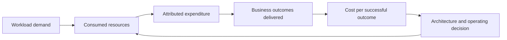
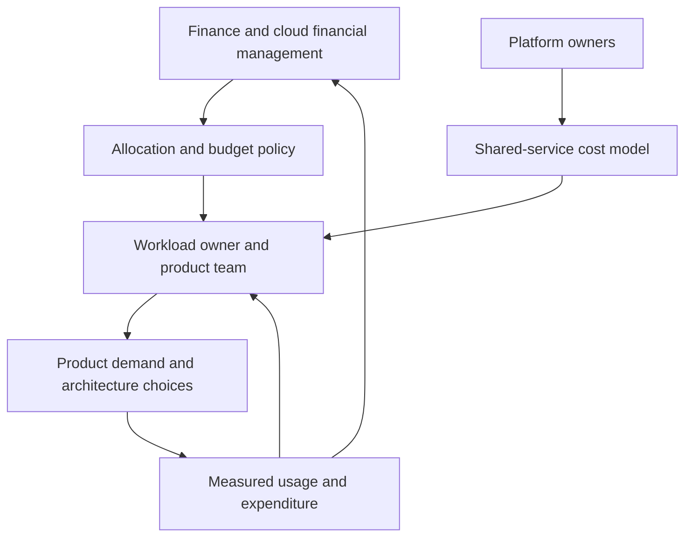
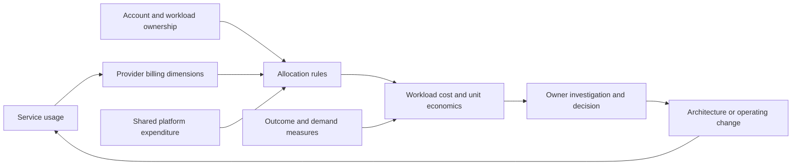
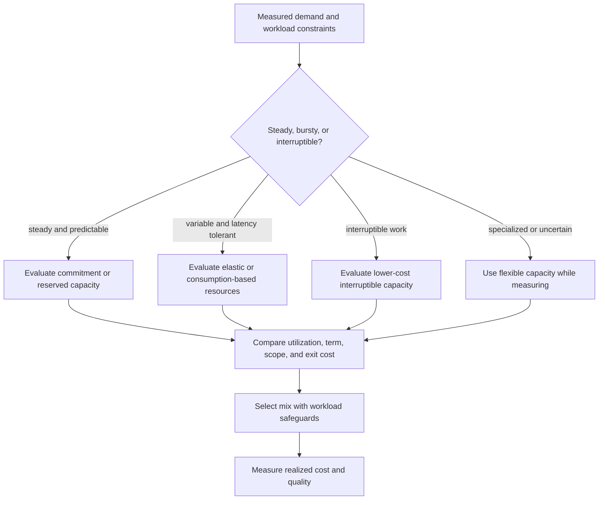
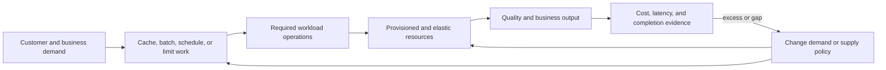
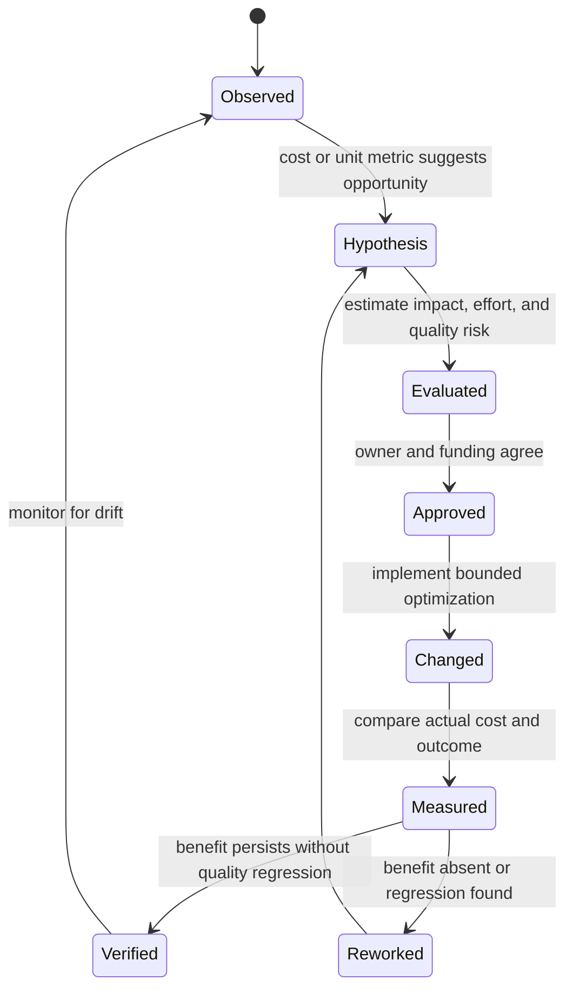

# Cost Optimization Pillar

Part: [11 — AWS Well-Architected Framework](PART_OVERVIEW.md)

The Cost Optimization pillar reviews whether an AWS workload has clear financial ownership, useful cost and usage visibility, appropriately selected resources and pricing models, and a continuing process for improving value. Cost optimization is not simply a lower bill. A workload should achieve its required business outcome while minimizing avoidable expenditure and preserving the security, reliability, performance, and operating conditions that make that outcome valuable.

This chapter applies the AWS Well-Architected Framework (WAF) Cost Optimization pillar. Part 09 owns AWS billing tools, service pricing, and provider mechanics; Part 10 owns provider-neutral cost architecture; Part 13 owns general engineering delivery methods. This chapter focuses on how to review financial ownership, workload economics, evidence, and optimization choices using AWS WAF. The AWS Cost Optimization paper identifies June 27, 2024 as its publication and latest listed revision at the time consulted; verify the current document and question set before a review.

## Optimize Cost in Relation to Business Value

The model ties expenditure to work actually completed. Lower resource cost is not an improvement if it increases failed transactions, delays a business deadline, or shifts greater operating burden to another team.

A cost review starts with the workload's purpose, critical outcomes, quality requirements, and owner. Define what success means in a unit that matters: successful orders, processed claims, active customers served, reports delivered on time, or another measurable result. Then identify the costs included in delivering that outcome, the allocation boundary, and the time period. A cost per request that counts rejected or retried requests as successful can improve while the customer experience gets worse.

The pillar's review is a financial and architecture conversation, not a procurement exercise. It asks whether teams understand consumption, can explain major drivers, and can act on waste or misalignment. Some expenditure buys necessary resilience, data protection, performance, or compliance. The goal is not to eliminate every idle resource: a recovery reserve may be deliberately available for a failure, and a low-utilization buffer may protect latency during a burst. Record the rationale and measure whether the reserve still matches current risk and demand.

AWS organizes its current Cost Optimization guidance around five goals: Practice Cloud Financial Management; Expenditure and usage awareness; Cost-effective resources; Manage demand and supply resources; and Optimize over time. The current design principles reinforce these areas:

| Design principle | Review interpretation |
|---|---|
| Implement cloud financial management | Fund the skills, ownership, governance, and feedback loops needed to understand and act on cloud usage. |
| Adopt a consumption model | Match resource commitment and running time to workload demand, while accounting for startup, availability, and interruption constraints. |
| Measure overall efficiency | Relate workload output and quality to the expenditure used to deliver them. |
| Stop spending money on undifferentiated heavy lifting | Consider managed capabilities when their price and operating model improve total workload value. |
| Analyze and attribute expenditure | Connect spend to owners and workload decisions well enough to explain and improve it. |

These are decision prompts, not blanket service mandates. Moving to a managed service can reduce maintenance work and improve cost at scale, but it may introduce minimum charges, request-based cost, data transfer, or a different performance and reliability profile. Evaluate total value and responsibility, not one hourly rate.

## Establish Financial Ownership and Allocation

The ownership model should make shared cost visible without assigning false precision. Finance, platform, and product teams need a common method for interpreting usage and deciding who can change the workload.

Cloud Financial Management (CFM) is the organizational capability to plan, understand, govern, and improve cloud expenditure while relating it to business value. It requires collaboration among engineering, product, finance, procurement, and platform teams. A central team can provide allocation standards, forecasts, and analysis, but workload owners need enough visibility and decision authority to act on their own usage.

For each material workload, name the business owner, technical owner, budget or forecast owner, and escalation path for unexpected spend. Establish which shared services are allocated directly, apportioned by an agreed driver, or reported as central overhead. A chargeback or showback model is useful only if teams understand its rules and can influence the consumption it assigns to them. Avoid incentives that encourage teams to move cost to another account, suppress useful telemetry, or choose an unreliable design to meet a local budget.

Allocation uses resource metadata, account boundaries, service usage, and business context. Tags and account structures can aid grouping, but missing, stale, inconsistent, or user-controlled metadata can distort reports. Shared network, logging, support, data transfer, and platform costs may not map cleanly to one workload. State allocation coverage and uncertainty instead of treating an incomplete report as exact unit cost.

Governance should define budgets, forecasts, anomaly handling, purchasing authority, and exception approval in a way that preserves safe operation. A budget alert is an early signal, not necessarily a reason to stop a production service automatically. Define who investigates, what evidence is checked, what changes are safe, and when a workload owner must approve scaling or shutdown. Development environments may be stopped on a schedule; a recovery environment or forensic copy may have a deliberate retention requirement.

## Make Cost and Usage Visible

Cost data is useful when it arrives at the right granularity and time, can be reconciled with workload activity, and reaches someone able to interpret it. Review which cost dimensions are available, how quickly they update, how shared expenditure is handled, and what is omitted from estimates. Credits, discounts, commitments, taxes, support, transfer, and amortization can alter the apparent relationship between usage and bill. Part 09 CH14 owns provider cost tools and detailed billing mechanics.

The path shows why workload allocation and business output must be interpreted together. A cost dashboard can be accurate about a bill while remaining insufficient to explain which product decision or outcome caused it.

Distinguish actual usage from allocated expenditure and from forecasts. Usage can identify the service or operation consuming resources; allocation assigns that consumption to a team or workload; a forecast estimates future expense under assumptions. Each has different latency and uncertainty. A monthly invoice may confirm a trend too late for rapid anomaly response, while a near-real-time estimate may omit adjustments or shared charges.

Track the drivers that explain the bill: request and event volume, runtime duration, storage size and retrieval, database capacity, data transfer, observability volume, backup retention, licenses, and idle environments. Relate changes in those drivers to product releases, traffic, data growth, and architecture decisions. If spend rises while successful output is flat, investigate resource utilization; reassess the unit economics. If spend rises with a new customer workload and better outcomes, the increase may be expected and economically sound.

Unit economics should include quality. Cost per successful transaction can expose inefficient retries or overprovisioning; latency and failure rate prevent a low-cost design from hiding degraded service. Normalize by a meaningful workload measure and keep the denominator stable enough to compare periods. For shared services, allocate or report cost separately when precision is low, and avoid presenting an arbitrary split as causal evidence.

An anomaly process should identify the owner, expected response time, and evidence required to explain a spike. Investigate changes in price, demand, configuration, resource count, data movement, and failure behavior. Some apparent anomalies are delayed usage records, credits, or a legitimate burst. Do not automatically scale down or terminate resources until the workload's reliability and security constraints are understood.

## Select Resources and Pricing for the Demand Pattern

Resource selection affects unit cost, performance, resiliency, and operator time. Review whether resource capacity matches observed workload behavior, whether idle or oversized resources have an owner and purpose, and whether managed services reduce undifferentiated work at acceptable cost. Evaluate request-based, provisioned, and fixed-capacity choices using the same demand profile, including burst, quiet periods, startup delay, and dependency limits.

Pricing models are choices about demand uncertainty and commitment, not discounts to collect in isolation. A commitment is beneficial only when matching eligible usage persists and the organization can manage its scope and term.

The review should distinguish right-sizing from reducing capacity indiscriminately. Compare utilization and performance under normal and peak conditions, and account for redundancy and failover. A low average may conceal short saturation; a high average may represent efficient use when headroom and latency remain healthy. Measure the whole service path because reducing application capacity can move cost or bottlenecks to a database, queue, or partner.

Pricing options may include on-demand usage, commitments or reserved capacity, and interruptible capacity where the work can tolerate interruption. Evaluate utilization, eligibility, term, flexibility, payment commitment, failure behavior, and the cost of unused coverage. Commitments can lower rates but create financial exposure if demand falls or the workload moves. Interruptible capacity can suit replayable batch work but needs checkpointing, alternate capacity, and a deadline margin. Part 09 owns current AWS pricing definitions and terms; a WAF review documents why the model matches the workload rather than repeating a price table.

Resource lifecycle is a cost control. Review development and test schedules, abandoned environments, unattached storage, snapshots, logs, backups, and data retention. Deletion can destroy evidence or recovery capability, so require ownership, retention policy, and safe cleanup conditions. Automation should report what it changes and protect resources with explicit operational or legal requirements.

Architecture cost drivers extend beyond compute rates. Data transfer, cross-region replication, request volume, managed-service minimums, observability ingestion, support, licenses, backup copies, resilience, and engineering effort all contribute. A lower-priced service may increase integration or operating labor; a global architecture may improve latency but increase transfer and replication. Compare at workload scale and over a period that includes peaks, maintenance, and recovery conditions.

## Manage Demand and Supply Together

Cost and demand are coupled. The workload can shape demand through caching, batching, admission control, scheduling, retention, and product behavior; supply choices determine how resources respond to that demand. Optimization should preserve required outcomes while removing wasteful work. Avoid reducing cost by dropping security events, shortening required retention, or delaying a critical transaction beyond its business deadline.

The review evaluates both sides of the loop. Demand reduction is valuable when it removes unnecessary work; supply adjustment is useful when capacity follows real demand without violating quality constraints.

Elasticity can reduce idle spend and meet changing demand, but it depends on accurate signals, provisioning speed, quotas, startup costs, and downstream capacity. Scaling to zero can reduce quiet-period cost but may cause startup latency or make a dependency unavailable for a critical path. Scheduled shutdown can save money for predictable nonproduction use, but the schedule should not capture production recovery or security response resources.

Storage lifecycle can move infrequently accessed data to lower-cost tiers, but retrieval latency, minimum duration, access charges, and restore time affect the workload. Retention decisions should account for legal, security, and recovery obligations. Reduce unnecessary logs or duplicate data through deliberate policy rather than deleting records solely because storage appears expensive.

Demand can also be reduced by improving software efficiency: eliminate duplicate processing, excessive polling, unbounded retries, avoidable serialization, and unnecessary data movement. Batch work when latency permits; cache when freshness and privacy allow; use event-driven execution where it matches the workload. Measure cost per successful output before and after so reduced activity is not mistaken for efficiency when the system is serving fewer users or failing more often.

## Optimize Over Time and Verify Savings

Optimization is a lifecycle capability, not a cleanup sprint. Demand, prices, services, architecture, and business value change. Establish a recurring review cadence proportionate to spend and risk, plus triggers for material changes such as a launch, incident, workload migration, major data growth, or new service capability. Keep a backlog with an owner, expected impact, dependencies, quality risks, effort, and a method to verify the result.

Savings are not verified when a change is merged or an estimate is approved. Compare realized expenditure and business output over an appropriate period, accounting for demand, price, seasonality, and shared costs.

Prioritize opportunities by expected value and confidence, not by the largest nominal bill alone. A high-cost service may be essential and well utilized; a modest line item can reveal broad waste replicated across hundreds of workloads. Estimate engineering and migration cost, risk, time to savings, ongoing maintenance, and reversibility. Record the assumptions behind an estimate and revisit them when measured results differ.

A verified change should state the baseline and comparison period, workload output and quality, actual or allocated cost, relevant demand changes, and residual risk. If savings come from a lower request count, prove that customer demand and success were not reduced. If a commitment lowers unit price, check coverage and utilization after the demand profile changes. If an optimization transfers work to a shared platform, report the total effect rather than celebrating a local bill decrease.

## Worked Scenario: Cost per Completed Claim

An insurance workload receives claims, validates documents, and produces a completed decision. The monthly bill is rising, and a team proposes moving all document processing to a lower-priced compute option. The review defines a unit as cost per successfully completed claim within the service deadline. It tracks result quality and retry rate alongside cost and sets the analysis boundary to include compute, document storage, data transfer, message processing, observability, and support needed to operate the change.

Allocation data shows that the largest cost increase comes from repeated document transformation and a growing retention copy, not the primary runtime. The engineering team traces duplicate transformations to retry behavior after a downstream timeout. A simple reduction in compute capacity would increase queue age and retries, making unit cost worse. Finance and the data owner confirm that some retained copies exceed the approved business period, while legal hold cases need explicit protection.

The team makes two bounded changes: deduplicate the transformation by claim and document version, and apply a reviewed retention policy that preserves legal holds. It separately benchmarks interruptible capacity for replayable nonurgent jobs, with checkpointing and an on-demand fallback before the deadline. The decision record states which workloads can be interrupted, the maximum recovery time, and the responsible owner.

After the next representative cycle, the team compares cost per completed claim, total claims completed, deadline compliance, failure and retry rates, storage volume, and allocated shared costs. It verifies a lower unit cost with stable output and quality, then keeps monitoring for a changing claim mix. The review avoids attributing all savings to the compute option and retains evidence for the data-lifecycle change.

## Trade-offs and Review Questions

Cost optimization interacts with every other pillar. Spare capacity can be an intentional reliability investment; longer audit retention can support security and legal needs; a managed service can lower operating burden while increasing direct usage charges; a low-cost interruptible fleet can require more resilient job design. Explain the stakeholder need and consequence rather than labeling one option “cheap” or “wasteful.”

- Is there an accountable business and technical owner for the workload's expenditure and unit economics?
- Can teams attribute major costs and shared services with known coverage and uncertainty?
- Does the unit metric include successful output and the quality conditions that make it valuable?
- Which demand, utilization, data movement, retention, and service choices explain cost changes?
- Are budget and anomaly responses owned and safe for production and recovery resources?
- Does resource capacity match measured demand, including peaks, failover, startup, and downstream limits?
- Do pricing commitments and interruptible options fit the workload's duration, predictability, and recovery needs?
- Are lifecycle and deletion policies consistent with security, legal, and reliability obligations?
- Are proposed savings measured against engineering effort, migration risk, and quality impact?
- Does verification show persistent realized benefit without reduced output or shifted unallocated cost?

Further reading: [AWS Cost Optimization Pillar](https://docs.aws.amazon.com/wellarchitected/latest/cost-optimization-pillar/welcome.html), [AWS Cost Optimization Pillar document revisions](https://docs.aws.amazon.com/wellarchitected/latest/cost-optimization-pillar/document-revisions.html), [Part 09 Cost Optimization](../09_Cloud_Computing/CH14_Cost_Optimization.md), and [Part 10 Cost, Performance, and Sustainability Architecture](../10_Cloud_Architecture/CH13_Cloud_Cost_Performance_and_Sustainability_Architecture.md).
