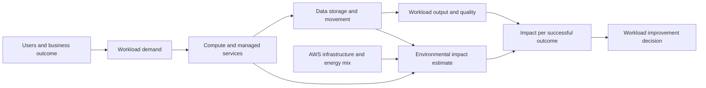
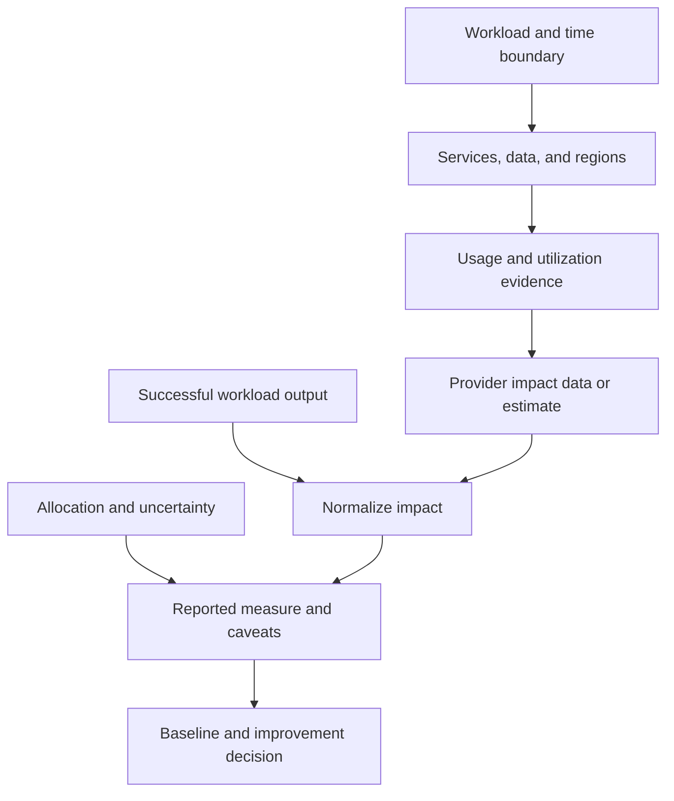
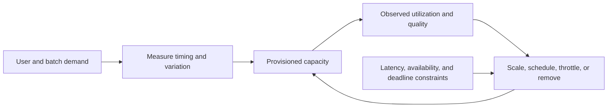
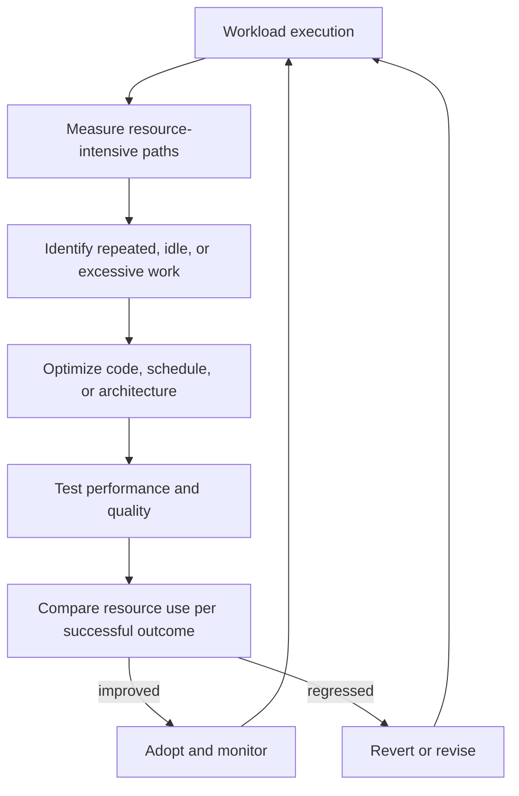
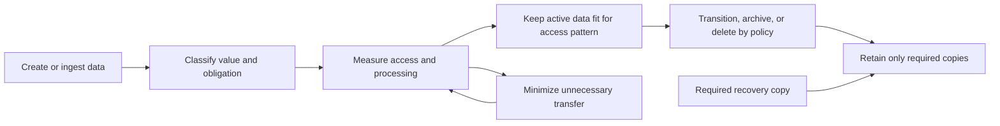
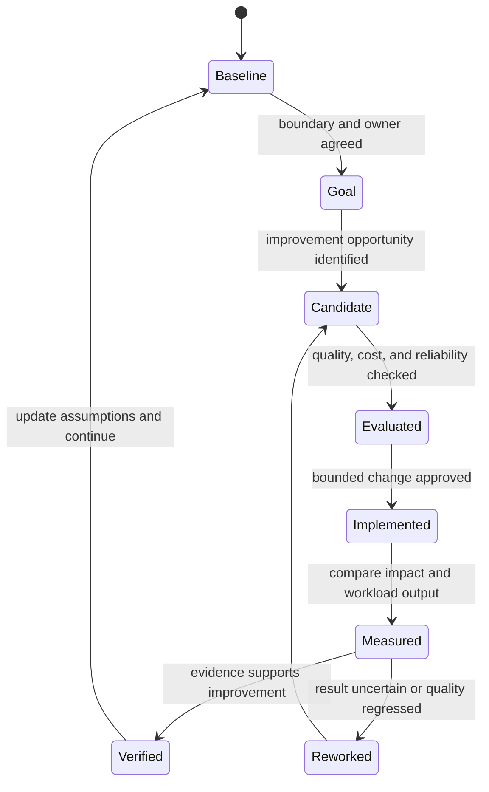

# Sustainability Pillar

Part: [11 — AWS Well-Architected Framework](PART_OVERVIEW.md)

The Sustainability pillar reviews whether an AWS workload meets its business and quality requirements while reducing avoidable environmental impact across the workload lifecycle. It asks how workload demand, software, data, hardware, service selection, geography, and team decisions affect resource consumption. The review should state what is measured, what is estimated, what lies outside the boundary, and how uncertainty affects a claimed improvement.

This chapter applies the AWS Well-Architected Framework (WAF) Sustainability pillar. Part 10 owns provider-neutral sustainability architecture and cross-provider trade-offs; Part 09 owns AWS service behavior and provider measurement tools. This chapter focuses on workload-specific review questions and evidence rather than repeating general environmental accounting methods. The AWS Sustainability Pillar revision history identified November 6, 2024 as its latest listed update when consulted. Verify the current guidance and measurement tools before each review, and record the revision used.

## Define the Workload Boundary and Intended Outcome

The model connects workload choices to outcomes while making the provider boundary visible. A workload team can influence demand, utilization, data, software, and resource selection; provider-level measurements and estimates have their own scope and uncertainty.

Start with a workload boundary that includes the customer journey, application components, data stores and copies, build and test activity, shared platform dependencies, and relevant external services. State exclusions and whether costs or impacts are measured, allocated, estimated, or unavailable. A provider-level estimate is not automatically attributable to one application, and a workload-level utilization metric does not directly equal energy or emissions.

Define the sustainability outcome alongside service requirements. Examples include reducing estimated carbon dioxide equivalent (CO2e) per successfully completed transaction, reducing unnecessary data retention, removing unused environments, or aligning idle capacity with demand. Select an outcome the team can influence and relate it to useful workload output. A total-emissions reduction that results only from reduced business activity is different from improved efficiency at stable output; report both total and normalized measures where possible.

The review should acknowledge that environmental impact includes more than operational carbon. Hardware production, facility energy and cooling, water, equipment lifecycles, and end-user devices may matter to the organization's objectives, but data availability and measurement boundaries differ. Avoid combining unlike indicators into an unsupported single score. State whether evidence is measured, modeled, provider-reported, or inferred from workload behavior and preserve the assumptions.

AWS currently organizes sustainability guidance into six areas: Region selection; Alignment to demand; Software and architecture; Data management; Hardware and services; and Process and culture. Its design principles include understanding impact, establishing goals, maximizing utilization, adopting more efficient hardware and software, using managed services where suitable, and reducing downstream impact. Confirm exact wording in the revision used for a review.

## Measure Impact with Explicit Boundaries

A useful measure states its boundary, period, output denominator, allocation method, and uncertainty. Without these, a before-and-after comparison can be driven by changed scope or demand rather than a better design.

Build a baseline from the best evidence available: workload utilization, service usage, data volume and transfer, environment schedules, and provider sustainability estimates where applicable. Record the period and workload version. If an estimate is not available at workload granularity, use a transparent proxy, such as resource-hours or data moved, and label it as a proxy. Do not present a proxy as direct energy or emissions measurement.

Normalize impact by a successful business outcome when that outcome is stable and meaningful. A batch workload might report estimated impact per record processed within the required quality and deadline; a customer service might report per completed journey. Keep total impact visible too: efficiency per transaction can improve while total impact grows because usage expands. Explain whether an apparent improvement came from architecture changes, lower demand, changed provider factors, or a different accounting boundary.

Sustainability comparisons have uncertainty. Region energy mixes change over time; workload allocation can be approximate; provider methods and data granularity may differ; workload demand and output vary. Compare like periods and boundaries, identify meaningful uncertainty, and avoid false precision. Where the evidence cannot distinguish two options, describe the range and the decision criteria rather than inventing a confident ranking.

A useful review asks which decision the measurement informs. If a dashboard metric has no owner, target, or action, it is not yet an improvement mechanism. Part 09 owns AWS sustainability reporting tools and their service-specific limitations; the WAF review evaluates whether the chosen evidence is suitable for the workload claim.

## Align Resource Use with Demand

Demand alignment is not simply minimizing resources. The control must preserve agreed service levels while removing capacity and work that provide no corresponding value.

Measure utilization across time and load, not only as an average. Distinguish useful headroom from idle capacity with no owner or expected recovery role. Dynamic scaling, scheduled operation, scale-to-zero, buffering, and throttling can reduce unnecessary resource use when workload behavior permits. Their suitability depends on startup time, state, minimum availability, queueing tolerance, quota, and downstream capacity.

Align service-level agreements and internal objectives with actual customer needs. A stricter latency or availability target may require more capacity or a different placement; a relaxed requirement can enable batching, scheduling, or lower-cost resources. Do not reduce a target without the business owner's agreement and an explicit understanding of user impact. The sustainability review evaluates this trade-off but does not unilaterally redefine the service contract.

Stop creating and maintaining unused assets. Review dormant environments, unattached volumes, abandoned snapshots, duplicate deployments, unused data copies, and low-use components. Cleanup must respect retention, legal hold, recovery, security investigation, and development needs. A resource should be retired only after its owner, dependents, and safe deletion conditions are known.

Geographic placement affects latency, data movement, service availability, regulatory constraints, and potential environmental impact. Consider where users, compute, and authoritative data are located, and whether cross-region calls or replication create unnecessary traffic. A region with a favorable sustainability estimate may be unsuitable if it violates residency, latency, reliability, or service availability requirements. Document the alternatives and why the chosen location satisfies the workload's full constraints.

Buffering and throttling can flatten demand and improve utilization, especially for noninteractive work. A queue can allow a batch or worker fleet to run steadily rather than provision for a brief peak, but it adds delay, storage, and recovery behavior. Define maximum queue age, priority, and behavior under sustained overload. For interactive journeys, reject or shed work deliberately rather than letting unbounded queues consume resources while missing the customer objective.

## Improve Software and Architecture Efficiency

Software and architecture choices determine how many operations, resources, and data movements are needed for a useful outcome. Review the components that consume the most resources and the portions of code or architecture that dominate work. Optimize based on measured contribution rather than rewriting low-impact components because they are easy to change.

The optimization loop protects against reducing resource use by reducing correctness, quality, or completed output. Measure both the changed component and the workload outcome.

Asynchronous and scheduled processing can smooth demand and consolidate work when the business tolerates delay. Remove redundant polling, repeated transformations, excessive retries, and duplicate storage. Optimize hot paths, data access, and serialization when measurements show they materially affect resource consumption. Use caching or batching only with explicit freshness, privacy, and latency behavior.

Retire components with low or no use, or consolidate underutilized components when isolation and availability requirements permit. Consolidation can raise utilization and reduce duplicated infrastructure, but may increase blast radius, contention, and operational coupling. Compare the resource savings with the reliability and security effects; a dedicated component may be justified by a meaningful boundary or predictable workload requirement.

Consider how architecture affects customer devices and downstream systems. A heavy client can force device upgrades or increase energy and data use; unnecessary polling can consume both client and server resources. Use efficient protocols and avoid repeated work where it does not diminish functionality. The review should describe the user-facing consequence and avoid unsupported claims about an individual device's environmental impact.

## Manage Data and Its Lifecycle

Data has an environmental cost through storage, replication, retrieval, processing, and movement. The workload should know what data it holds, why it exists, how often it is accessed, and when it can be deleted or moved to a more efficient storage class. Classification and retention controls should balance business value, security, legal obligations, and recovery needs.

The lifecycle includes replicas, backups, logs, exports, and derived datasets. Deleting primary data while retaining duplicate copies indefinitely does not deliver the intended lifecycle improvement.

Use storage technologies and configurations that fit the access pattern and business value. Less frequently accessed data may be moved to a lower-cost or lower-performance tier if retrieval latency and charges remain acceptable. Lifecycle automation should be tested and observable; accidental deletion or a missed legal hold can cause greater harm than the resource savings justify.

Remove data that is redundant or no longer required, and minimize data movement across networks. Shared storage or common datasets can avoid duplicated copies where access control and failure boundaries remain sound. Back up data in proportion to recovery need and difficulty of recreation; a backup that is essential to business continuity remains a justified resource even when it is rarely read. Review backup scope, retention, and restore evidence together.

Elastic block or file storage can expand with demand, but automatic expansion without lifecycle control can create permanent growth. Monitor the data set, free capacity, retention, and access pattern; define safe thresholds for expansion and cleanup. Include observability data and temporary processing artifacts because they often accumulate outside the primary data model.

## Select Hardware and Services Deliberately

The pillar encourages minimizing hardware required to meet workload needs, choosing efficient hardware and services, using managed services when suitable, and optimizing hardware-based accelerators. For a workload review, ask what resource characteristics the software can use, what operation is delegated, and what evidence demonstrates a meaningful impact improvement.

Managed services can improve utilization across many customers and reduce the workload team's need to provision and operate infrastructure. They can also introduce minimum charges, service-specific data movement, less direct control, or additional dependencies. Compare their operational and environmental implications with a self-managed alternative without assuming either is always superior.

Newer hardware or specialized processors may provide more useful work per unit of resource for a compatible workload. Verify software support, actual throughput, memory and network constraints, data movement, utilization, and lifecycle assumptions. An accelerator that spends most of its time idle or requires costly conversion is not an efficiency gain. Avoid claiming a lifecycle advantage unless evidence includes the relevant boundary and assumptions.

Hardware choices also interact with demand and reliability. A smaller footprint can lower resource use but reduce failover headroom; consolidating workloads can improve utilization but increase contention and blast radius. The review should record why reserved capacity exists, what conditions trigger its use, and how regularly the assumption is validated.

## Establish Goals and Improve Over Time

Sustainability goals need an owner, a measurement boundary, and a connection to product and engineering decisions. Cascade organizational goals to workload teams in a way they can influence; avoid assigning a precise target when the available measurement cannot support it. Establish a baseline, select a feasible action, measure total impact and useful output, then revise the plan as demand and services evolve.

The loop requires measured outcome, not just completion of an optimization task. Revisit the baseline when provider data, workload demand, or accounting assumptions change materially.

Prioritize actions by impact potential, evidence confidence, engineering effort, and risk. Removing unused resources may be low risk and immediate; changing region or storage architecture can require data movement and availability work; reducing retention can require legal and security review. Track dependencies and assign owners who can deliver and validate the change.

Share results in language that distinguishes provider-reported estimates, workload measurements, and modeled assumptions. Communicate limitations and avoid environmental claims that exceed the evidence. A cost reduction may indicate lower consumption, but expenditure alone does not quantify emissions or total environmental impact. Report the mechanism and boundary, such as less compute time, less data retained, or reduced cross-region transfer, then state what is known and unknown about the resulting environmental effect.

## Worked Scenario: A Data Pipeline with Growing Storage

A data platform ingests events from several products, stores raw records, transforms them into analytical tables, and serves business reports. Storage and processing have grown faster than report volume. The team proposes deleting old raw data and reducing worker capacity to meet a sustainability target.

The review first clarifies which records support audit, replay, legal hold, and product analytics, and which derived tables are reproducible. It finds that the pipeline retains duplicate transformed data and reprocesses the same raw partitions after transient failures. Some records are required for a defined retention period; others have no owner or access history. The team maps access frequency, recovery value, retention requirement, and data movement for each class instead of applying one deletion date to every dataset.

The architecture changes remove duplicate intermediate tables, make transformations idempotent at the partition boundary, and transition infrequently accessed retained records according to an approved lifecycle. Workers scale with queue depth but retain enough capacity to meet the report deadline. The team schedules nonurgent backfills during a lower-demand window and limits concurrency to protect shared dependencies. It preserves the required recovery copy and tests replay from the retained raw data.

The validation compares total data stored and transferred, processor time, report completion, data quality, and estimated impact per report for equivalent output. It reports the changed workload boundary and notes that the provider estimate cannot isolate every component. The result is a defensible improvement: less duplicate work and storage with unchanged report correctness and deadline, while legally required records remain protected.

## Trade-offs and Review Questions

Sustainability decisions interact with reliability, security, performance, cost, and user needs. Reducing replicas can reduce storage and transfer but increase recovery risk; moving data to a slower tier can reduce resource demand but delay a critical query; buffering can smooth compute demand but violate an interactive deadline. A review should make the affected quality requirement and authorized decision owner explicit.

- What workload boundary and lifecycle stages are included in the sustainability claim?
- Which measures are direct workload observations, provider estimates, or proxies, and what uncertainty remains?
- Is impact normalized by a useful successful outcome while total impact and demand are also visible?
- Does capacity follow demand without violating latency, reliability, and recovery requirements?
- Which software paths perform repeated, idle, or disproportionately resource-intensive work?
- Are data copies, retention, storage tiers, backups, and transfers justified by business and recovery needs?
- Do managed services or newer hardware improve useful work per resource for this workload, based on evidence?
- Are region and geographic placement choices compatible with users, data authority, latency, and residency constraints?
- Are improvement goals owned, feasible to measure, and connected to product and engineering decisions?
- Does post-change evidence show reduced impact without lower output, quality, or required service levels?

Further reading: [AWS Sustainability Pillar](https://docs.aws.amazon.com/wellarchitected/latest/sustainability-pillar/welcome.html), [AWS Sustainability Pillar document revisions](https://docs.aws.amazon.com/wellarchitected/latest/sustainability-pillar/document-revisions.html), [Part 10 Cost, Performance, and Sustainability Architecture](../10_Cloud_Architecture/CH13_Cloud_Cost_Performance_and_Sustainability_Architecture.md), and [Part 09 AWS](../09_Cloud_Computing/CH01_AWS.md).
