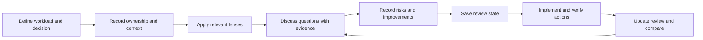
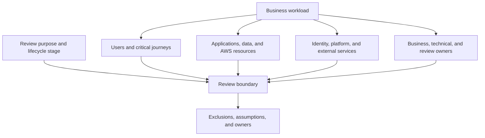
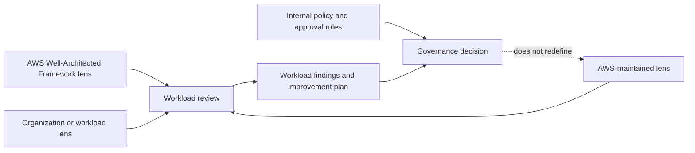
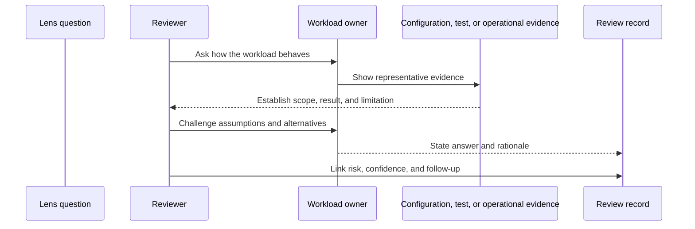
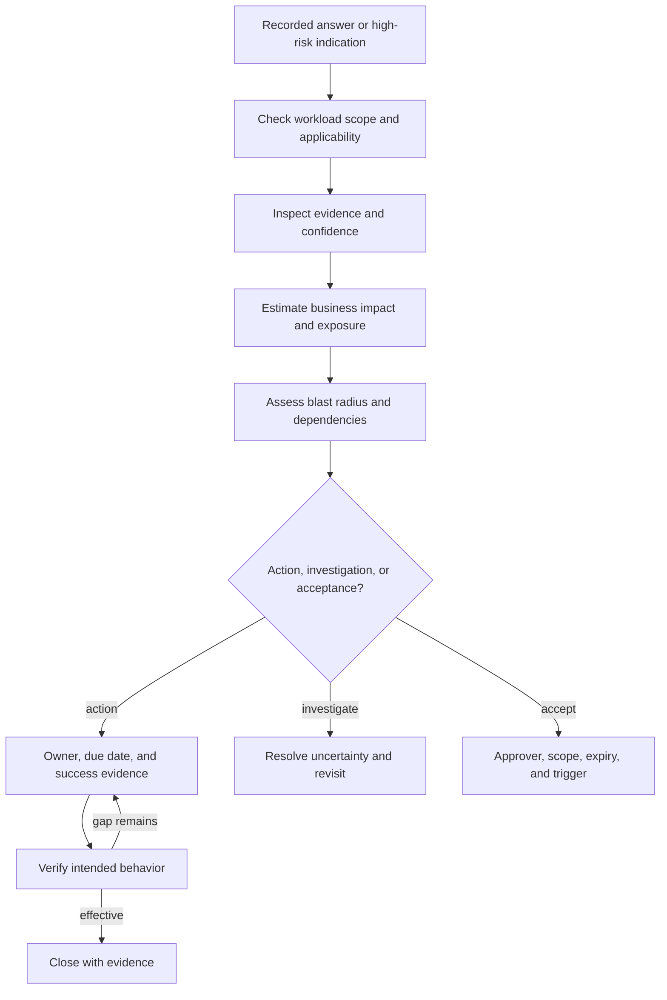

# AWS Well-Architected Tool, Lenses, and Workload Evidence

Part: [11 — AWS Well-Architected Framework](PART_OVERVIEW.md)

The AWS Well-Architected Tool (AWS WA Tool) helps teams organize workload reviews, apply lenses, record answers and notes, identify improvement items, and revisit progress through milestones. It is a review workspace, not an architecture authority. Its value depends on workload scope, question interpretation, evidence quality, access governance, and the team's willingness to act on findings.

This chapter explains how to use the tool and its lens model as part of an AWS Well-Architected Framework (WAF) review. Part 01 owns general architecture review and decision methods; Part 10 CH15 owns provider-neutral workload review and reference design practice; Part 09 owns AWS service mechanics. This chapter covers AWS WA Tool workflow, lens governance, workload evidence, and interpretation limits. Tool features and interface details evolve; verify current AWS user-guide behavior before relying on limits, integrations, or workflow steps.

## Treat the Tool as a Review Record

The tool supports the review lifecycle; it cannot supply workload context or prove that recorded answers reflect deployed behavior.

A workload is a set of components that deliver business value. Define it to match the decision being reviewed: a customer-facing service may include its application, data, deployment path, identity dependencies, shared network, and external providers; a platform workload may include its tenants, control plane, and support model. A boundary that is too broad produces generic answers and findings without owners. A boundary that is too narrow hides dependencies that can invalidate the conclusion.

The AWS user guide supports defining workload attributes such as owner, environment, regions, accounts, business context, architectural design reference, and applicable lenses. Use those fields to make the record identifiable and reviewable, not as a substitute for an architecture description. State exclusions, assumptions, stakeholder concerns, quality objectives, and dependencies in the tool's available fields or linked evidence location. If the tool cannot express an important constraint clearly, preserve it in the review record outside the tool and link or reference it consistently.

Before entering sensitive material, determine what the review record contains, who can access it, how it is shared, and which organization policies govern architecture and workload data. Keep secrets, personal data, and raw production evidence out of notes unless explicitly approved and necessary. Prefer a controlled reference to a governed repository or test result over copying sensitive content into a broad-access assessment.

Define the review's intended outcome. Examples include evaluating a proposed architecture, assessing production readiness, reviewing a material change, following up an incident, or planning a portfolio improvement. The outcome determines participants and evidence. An early design review may record unresolved decisions and assumptions; a production review should inspect deployed behavior and operational evidence.

## Set Scope, Context, and Review Ownership

A useful scope record makes dependencies visible even when they are owned by another team. Exclusions need an explicit assumption or a separate review path.

The review owner coordinates context, participants, evidence, and follow-up. Workload ownership remains with the team accountable for the service; a central architecture or cloud team may facilitate, but should not answer on behalf of an owner who understands the implementation. Identify reviewers for business outcomes, operations, security, data, platform, finance, and compliance according to workload risk.

Record workload profile information only when it improves question applicability or the decision. A profile can summarize architecture and usage characteristics that help frame review questions, but an incomplete or stale profile can mislead. Revisit it after material changes to users, data sensitivity, regions, traffic, dependency, or operating model. Do not interpret a profile as a workload test or evidence of compliance.

Use a milestone to preserve a meaningful review state, such as a design baseline, production readiness review, or post-remediation reassessment. Name milestones with purpose, date, and relevant version or environment. Comparisons are useful only when the workload boundary and question set are sufficiently understood. A changed lens or framework question can make a direct score comparison misleading; record the change and explain what is comparable.

Review cadence should follow risk and change, not merely a calendar. Trigger reassessment after major architectural change, a significant incident, new data or regulatory obligations, a new AWS service, changed demand, ownership transition, or revised framework guidance. Periodic reviews remain useful for stable workloads, but should not replace event-driven reassessment.

## Apply Official and Custom Lenses Deliberately

The diagram separates official framework content, AWS-provided lenses, custom review guidance, and organizational approval. A custom lens can extend a review, but it does not become an AWS recommendation merely because it is stored in the tool.

AWS WA Tool applies the AWS Well-Architected Framework lens to a workload and supports additional lenses. AWS-maintained lenses provide focused guidance for workload types or domains; custom lenses let an organization encode additional questions, best practices, and improvement plans. The AWS user guide describes separate catalog and custom-lens sources and a lifecycle for creating, publishing, sharing, and updating custom lenses. Confirm the current catalog and feature limits in the guide, because available content and interface behavior can change.

Select lenses that address the workload's actual concerns. Applying every available lens can increase review effort and produce irrelevant findings. Conversely, a narrow lens set may omit a material domain such as machine learning, serverless workloads, or regulated data. State why each selected lens applies and which stakeholder concern it covers. Distinguish:

- The official AWS Well-Architected Framework and AWS-maintained lens content.
- Organization-specific standards, policies, or risk appetite expressed in a custom lens.
- A workload's own requirements, architecture decisions, and approval authority.

A custom lens needs governance. Assign an owner, intended audience, source and version, approval path, publication and sharing rules, update cadence, and deprecation plan. Review terminology, question applicability, evidence expectations, and duplication with official content. If organization policy is stricter than AWS guidance, label it as policy and identify the authority that approves an exception. If the custom lens changes, preserve enough history to explain why prior answers or milestones differ.

Lenses organize questions and improvement guidance; they do not make a workload secure, compliant, or ready for production. A lens can be incomplete, stale, or inapplicable. A reviewer should identify where a question does not fit the workload and record why, rather than forcing a convenient answer. Custom content shared across accounts also needs a clear maintainer and a process to handle downstream changes.

## Answer Questions with Evidence and Rationale

A strong answer relates the question to actual workload behavior and evidence. A selected response without scope, assumptions, or supporting observation is a claim, not proof.

Treat each question as an invitation to reason, not a command to deploy a named service. The reviewer should ask which workload outcome is affected, which condition or threat matters, who owns the control, what alternative was considered, and what evidence supports the answer. Avoid grading teams on whether they use a specific technology when the question is about an outcome that can be achieved in different ways.

For an important answer, preserve:

- The workload component, user journey, or dependency in scope.
- The design or operating behavior and the accountable owner.
- Evidence source, date, environment, and tested conditions.
- Assumptions, limits, confidence, and relevant alternatives.
- Risk, improvement action, accepted exception, or reason the question does not apply.

Evidence can include architecture views, effective configuration, test reports, incident records, operational exercises, cost and performance measures, access reviews, and policy references. Link evidence to its owner and source of truth. A diagram communicates intended structure; configuration and tests help establish deployed behavior. A questionnaire answer can point to either, but should not collapse the difference.

Use question status carefully. Not applicable, unknown, partially implemented, and accepted risk are not interchangeable. If a question does not apply, record the workload facts that make it irrelevant. If evidence is missing, state the uncertainty and whether the team must investigate before a decision. If a control is planned but not deployed, do not present it as implemented. If the tool's answer choices do not express the actual state, add a note and reference linked records; preserve the nuance in both.

Confidence is useful alongside risk. A high-impact condition with weak evidence may deserve investigation before a lower-impact finding with a known, bounded gap. Record the evidence limitation rather than using a favorable answer to hide uncertainty. Questions can overlap across pillars; one coherent finding may affect several lenses. Link related records instead of duplicating contradictory actions.

## Interpret High-Risk Findings and Improvement Plans

Tool-generated high-risk indications help reviewers navigate a large question set, but they are not a universal workload ranking. Risk depends on business impact, exposure, likelihood, scope, confidence, and dependency. A question marked high risk may not apply to a bounded workload; a moderate-looking issue in a shared identity or recovery dependency can affect many workloads.

The workflow keeps the tool's prioritization signal separate from the organization's risk decision. The owner must understand the finding and accept or remediate it through the appropriate authority.

An improvement plan should be actionable: describe the risk or opportunity, accountable owner, action, dependency, target date or review trigger, expected outcome, and closure evidence. “Enable monitoring” is not a useful action unless it names the behavior to detect, alert owner, response, and test. “Improve recovery” is incomplete without the objective, scenario, and evidence required to establish successful recovery.

Prioritize work by expected risk reduction, business value, confidence, cost, feasibility, and dependencies. Sequence prerequisites first. A platform change may reduce a recurring systemic risk across many workloads; a local configuration fix may close one urgent exposure quickly. Avoid using a pillar score as an ordinal measure across unrelated workloads or as a substitute for risk approval.

Accepted risk needs an authorized owner, precise scope, rationale, compensating controls, expiration or review trigger, and evidence that the risk remains bounded. An improvement plan does not itself approve risk. Keep the decision record in the system of authority for exceptions and architecture decisions, and link it from the review tool where appropriate.

Closure requires evidence that the intended behavior changed. A ticket marked complete, a policy document updated, or a service enabled does not prove effectiveness. Depending on the finding, closure might require an access test, restore exercise, configuration inspection, measured performance result, incident simulation, or verified cost allocation. The reviewer should confirm the test covers the same workload boundary and scenario as the finding.

## Govern Review Data, Access, and Integrations

AWS WA Tool permissions and workload access should follow organizational data governance. Decide who may define workloads, edit answers, create milestones, manage lenses, share review data, and view reports. Review owner and workload owner may differ; both roles need clear responsibility. Avoid broad access to sensitive architecture details when the review includes account mappings, security gaps, dependency diagrams, or operational risks.

Use account and organization structures consistently with the review operating model. Central reviewers can improve consistency and detect systemic issues, while workload teams retain responsibility for factual answers and remediation. Cross-account collaboration should define data access and ownership explicitly. Confirm current AWS Identity and Access Management (IAM) policies, trusted integrations, and data handling behavior from current documentation before enabling a feature.

The tool's integrations can connect review work to other systems, but integration status is not action closure. If issue tracking is used, define which system owns action state, how updates synchronize, how duplicates are avoided, and what happens when a workload or lens is renamed. For cost, inventory, or security signals imported from other services, record source, freshness, scope, and limitations. A connector may be unavailable or misconfigured; the architecture review should remain interpretable without assuming every integration succeeded.

Reports are useful for communicating review state, but summary scores and high-risk counts can lose context. Include workload boundary, milestone, question-set revision, evidence limitations, accepted risks, systemic dependencies, and owner actions. Preserve narrative for decisions that a chart cannot express. Portfolio reporting should not reward teams for favorable answers or penalize them for honest uncertainty.

## Worked Example: Production Readiness with a Custom Lens

A team is preparing a payment workload for production. It defines the workload boundary to include the customer API, payment orchestration, transaction store, deployment pipeline, identity foundation, audit path, and payment provider. A central review owner coordinates a production-readiness milestone with the product, security, operations, and finance stakeholders. The team applies the AWS framework lens and an organization-maintained payment lens.

One question asks whether the workload can recover from a regional disruption. The team records that backups exist and selects a favorable answer. The reviewer asks for the exact recovery boundary and evidence. The restore test covers the transaction store but not identity access, payment-provider configuration, queue replay, or customer reconciliation. The answer is revised to reflect partial evidence; the missing path becomes an investigation and recovery-plan action rather than a generic high-risk label.

A custom-lens question requires dual approval for a defined class of emergency change. The team shows an approved policy but cannot demonstrate its emergency path or after-hours authority. The organization confirms the requirement is policy, not an AWS recommendation, and names the exception authority. The review links to the policy source, records the control gap, and assigns an exercise that verifies both approval and incident response.

The team saves a milestone with the question-set revision and references to the restore report and access procedure. The team then updates evidence and improvement actions based on the exercise. The tool preserves review history, but assurance comes from tested recovery behavior, the policy decision, and accountable follow-up; a milestone or lens score alone provides none.

## Review Questions

- Does the workload boundary match the review decision and include dependencies that could change the conclusion?
- Are owner, environment, regions, profile, exclusions, and milestone information current and useful?
- Is each lens relevant, versioned, and clearly distinguished as AWS guidance or organizational policy?
- Are answers tied to representative evidence, workload behavior, owner, date, and limitations?
- Are not-applicable, unknown, planned, implemented, and accepted-risk states clearly distinguished?
- Are high-risk signals interpreted in context rather than treated as a workload-wide ranking?
- Do improvement actions have owners, dates or triggers, dependencies, and measurable closure evidence?
- Are risk acceptance and exception decisions made by the correct authority and recorded in the source of truth?
- Are review data, workload access, lens sharing, and integrations governed according to sensitivity?
- Can another reviewer understand milestone differences, framework revisions, and the evidence behind the reported result?

Further reading: [AWS Well-Architected Tool User Guide](https://docs.aws.amazon.com/wellarchitected/latest/userguide/intro.html), [Defining a workload](https://docs.aws.amazon.com/wellarchitected/latest/userguide/define-workload.html), [Using lenses](https://docs.aws.amazon.com/wellarchitected/latest/userguide/lenses.html), [Custom lenses](https://docs.aws.amazon.com/wellarchitected/latest/userguide/lenses-custom.html), and [Part 10 Architecture Reviews](../10_Cloud_Architecture/CH15_Cloud_Architecture_Reviews_and_Reference_Designs.md).
