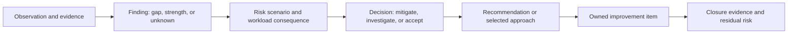
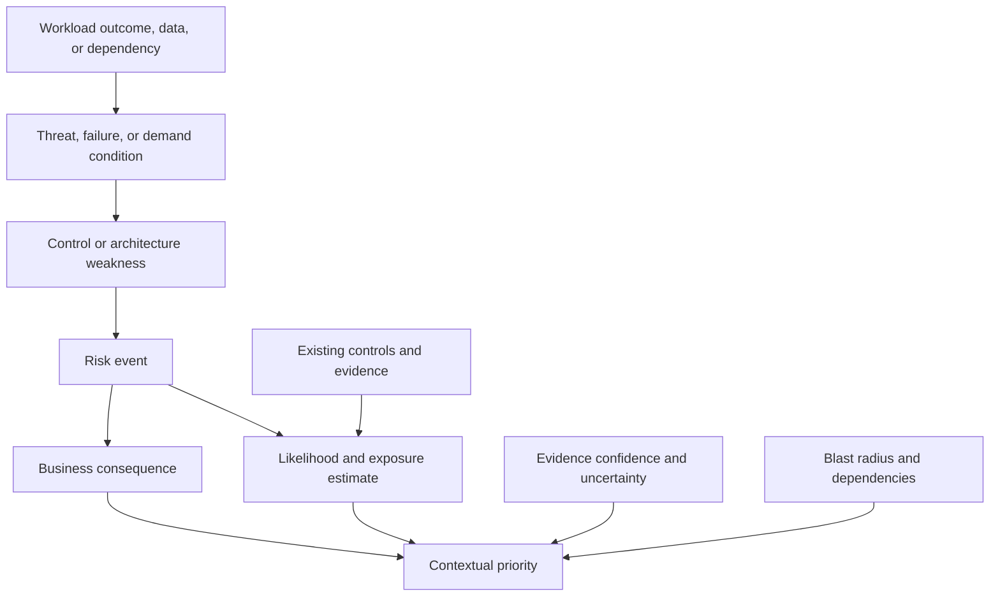
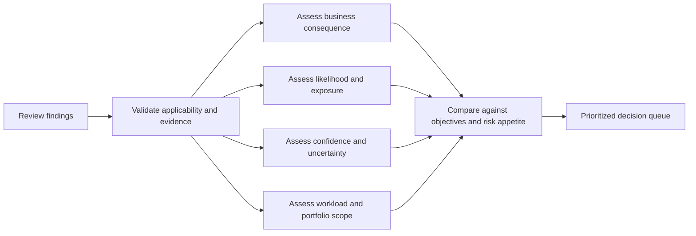
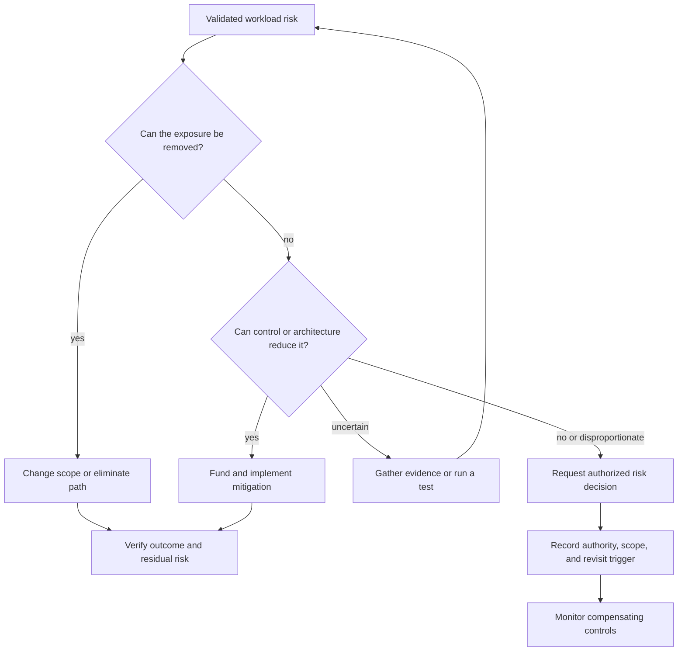
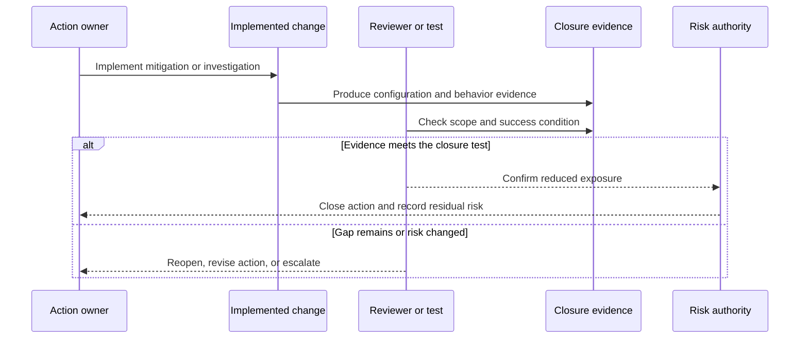
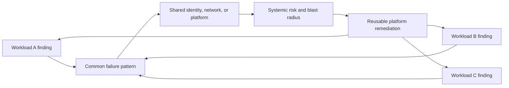

# Risk Prioritization and Remediation Planning

Part: [11 — AWS Well-Architected Framework](PART_OVERVIEW.md)

A Well-Architected review creates value when its findings lead to decisions and verified improvement. AWS Well-Architected Tool risk indications can help reviewers navigate questions, but they do not determine business priority, organizational risk acceptance, or the funding sequence. This chapter provides a workload-centered method for turning observations into risk decisions, accountable actions, and closure evidence.

The AWS Well-Architected Framework (WAF) review method is the context for this chapter. Part 01 owns general architecture risk, trade-off, and decision-record methods; Part 15 owns security risk and threat methods; Part 11 applies prioritization and remediation to WAF findings. Use existing organizational risk authorities and escalation paths rather than creating a parallel approval system in the review tool.

## Separate Findings, Risks, Recommendations, and Actions

These are related but not interchangeable records. Keeping them distinct prevents a tool recommendation from being mistaken for a risk decision or a completed task from being mistaken for verified risk reduction.

An observation describes what the reviewer saw: for example, a restore test excludes identity provisioning. A finding interprets that observation against a workload requirement: the tested recovery path does not establish the declared recovery time objective (RTO). A risk scenario describes the consequence under a condition: a regional event may leave the service unavailable beyond the business recovery target. A recommendation suggests a possible direction; an action assigns a selected change to an owner with a closure test. An accepted risk is an authorized decision to proceed under stated conditions, not a remediation status.

Record strengths as well as gaps. A tested failover path, well-understood data authority, or reliable shared platform may reduce risk and provide a reusable pattern. Strengths need scope and evidence too: an exercise in one environment may not demonstrate readiness in production or a different region.

Avoid turning every question into a finding. A question may be not applicable, already supported by evidence, unresolved, or associated with an accepted risk. Preserve the rationale and confidence. Duplicate findings across lenses should be linked or consolidated when they represent the same underlying condition; separate them when owners, consequences, or remediation differ.

## Describe Risk in Workload Context

The model provides context for judgment without pretending that uncertain inputs produce an objective numeric score. Impact, likelihood, confidence, and scope should remain inspectable as separate considerations.

A useful risk statement names the affected workload outcome or asset, the condition or threat, the weakness or dependency, and the consequence. “Logging is incomplete” is an observation. “If an administrative identity is compromised, the workload team may be unable to reconstruct which payment records were accessed because relevant events are not retained outside the workload account” describes a scenario that can be evaluated.

Assess impact in business terms: affected users, financial or safety consequence, data exposure or loss, service interruption, legal obligation, recovery time, and reputational effect. Consider the duration and reversibility of harm. A low-frequency event can still be high priority when impact is severe; a frequent event may be bounded by a safe fallback and effective detection.

Likelihood and exposure depend on actual architecture and conditions, not only generic labels. Consider reachable attack paths, dependency behavior, change frequency, workload exposure, existing controls, and demonstrated test results. Distinguish the chance of an event from the confidence that the evidence describes the deployed workload. Weak evidence should be visible; it can justify investigation even when the underlying likelihood is unknown.

Scope includes blast radius and shared dependencies. A local configuration defect may affect one workload; a shared identity, network, deployment, or logging weakness may affect many. Dependencies can also amplify impact when multiple workloads rely on the same provider service or central team. Identify whether the risk is local, systemic, or both, and whether the remediation belongs in a workload, platform, policy, or provider-service boundary.

Consider the risk introduced by remediation. A rushed credential rotation can lock out recovery operators; a regional migration can create data inconsistency; a broad permission change can disrupt production. Compare current risk, transition risk, and residual risk after the change. Sequence mitigations so they reduce exposure without creating a larger uncontrolled failure mode.

## Prioritize Without Treating Scores as Truth

This is a comparison process, not a formula. Keep the underlying dimensions visible so stakeholders can challenge assumptions and understand why one item is ahead of another.

Use the AWS tool's risk designation as a navigation signal: inspect the question, workload applicability, and evidence before assigning priority. A pillar score does not express business consequence, time sensitivity, confidence, dependency, or remediation cost. Do not add pillar scores together or compare them as cardinal measurements across unrelated workloads. A favorable result in one pillar cannot mathematically cancel a severe data-loss or identity risk in another.

Prioritization should be explicit about constraints. A workload with an imminent external deadline may need a temporary containment action before a long-term redesign. A systemic platform remediation may deliver greater portfolio risk reduction but require coordination and funding. A small evidence-gathering task may be the highest-value next step when uncertainty is blocking a decision.

A practical comparison asks:

- What business outcome or obligation is threatened, and how severe is the consequence?
- How exposed is the workload to the condition, and what controls have been demonstrated?
- How complete, current, and representative is the evidence?
- What is the blast radius, including shared dependencies and correlated workload risk?
- How quickly could harm occur, and how long would detection or recovery take?
- What dependencies, effort, funding, and transition risk affect the response?
- What risk reduction does the proposed action achieve, and what evidence verifies it?

Organizations may use a risk matrix or other prioritization mechanism, but should define its scales, owner, and intended use. A numeric value is useful only if its inputs and uncertainty are understandable. Avoid false precision when likelihood cannot be estimated reliably; use qualitative ranges and state what evidence would change the ordering.

## Choose a Response and Make It Accountable

Response options include mitigating a risk, avoiding the exposure, transferring a defined consequence, accepting residual risk, or investigating uncertainty before choosing. “Transfer” does not remove accountability for workload architecture; a contract or insurance arrangement may shift some financial consequence while leaving service, data, and regulatory responsibilities. Avoidance may mean removing a feature, dependency, or workload path, not merely postponing a decision.

The response is a decision with consequences, not a label. Mitigation needs a test; acceptance needs an authorized owner and conditions; investigation needs a question and a decision point.

For each improvement item, define:

- A concise risk or opportunity and the workload boundary affected.
- One accountable owner with authority to coordinate the work.
- The chosen action, rationale, and alternatives rejected.
- Dependencies, funding or capacity needs, target date, and interim controls.
- A measurable success condition and the evidence needed to close.
- Residual risk, external decision authority, and a revisit trigger.

Prefer an action that changes behavior or produces decision-quality evidence. “Review IAM” is vague; “remove the deployment role's ability to change audit retention, then verify the effective policy and test that a deployment cannot alter the protected log destination” is observable. Keep the action sized so an owner can report progress and blockers without splitting one underlying risk into misleading fragments.

Sequence work by prerequisites and risk reduction. A recovery test may require an isolated account and key access before it can validate the restore. A permission redesign may depend on mapping workloads that use the role. Track cross-team dependencies and escalation explicitly; otherwise a high-priority item can remain blocked without a decision-maker.

An improvement plan is not automatically a funded commitment. Identify who can authorize engineering time, platform changes, or service interruption. When remediation competes with roadmap work, present the risk reduction, opportunity cost, and interim exposure to the correct business authority. Avoid manipulating severity or accepting risk by default simply because capacity is unavailable.

## Govern Accepted Risk and Exceptions

Risk acceptance is a time-bounded business or organizational decision made by an authorized role. It should identify the risk scenario, workload scope, rationale, evidence, residual impact, compensating controls, approver, expiry or review date, and conditions that trigger escalation or reconsideration. The authority may depend on data class, customer impact, regulatory obligation, or shared-platform scope.

An exception is not proof that the control is effective. It records permission to operate outside a stated requirement under defined conditions. Link the exception to the workload review, architecture decision, and any compliance or security record that is authoritative. If a compensating control is part of acceptance, assign an owner and test it; otherwise the acceptance rests on an unverified assumption.

Temporary acceptance should have a sunset path. Revisit when the expiry arrives, the workload changes, an incident occurs, the threat changes, a dependency is modified, or new evidence changes likelihood or impact. A renewal requires fresh review and approval, not automatic extension. Track overdue acceptances separately from open remediation so that time-limited risk does not become invisible permanent architecture.

Escalate systemic findings to the platform or enterprise owner. If many workloads accept the same exception because a shared service lacks a capability, the risk is no longer a set of isolated workload choices. Portfolio leadership may need to fund a shared control, change a standard, or explicitly accept common exposure with a bounded population and monitoring.

## Verify Closure and Residual Risk

Closure is a claim about workload behavior supported by evidence. It is not the act of changing an issue status or attaching an unrelated report.

Choose evidence proportional to the finding. Configuration inspection can show policy state. A targeted test can establish whether it blocks an action. An operational exercise can show whether responders can use it during failure. Verify a cost change with realized expenditure and output, a reliability change with measured service and data recovery, and a security change with an exercised identity or detection path.

Check that evidence matches the original boundary and scenario. A test in a development account may not prove production policy inheritance. A successful restore of one table may not prove recovery of the full workload. A new alert may not establish that the right team can investigate it. Record environment, version, date, method, limitations, and remaining assumptions.

After mitigation, reassess likelihood, impact, exposure, and confidence rather than assuming risk disappeared. Residual risk may remain because a control is partial, an external dependency is unchanged, or the business objective allows some bounded exposure. Link the residual risk to its owner and monitoring; update the accepted-risk decision if the previous scope or assumptions changed.

## Manage Risk Across a Workload Portfolio

Portfolio aggregation can reveal shared causes and multiply the value of a remediation. It must retain workload-level context so a common label does not conceal different consequences or evidence.

Normalize findings only enough to identify recurring patterns. Preserve workload, account or organization scope, owner, source milestone, evidence, and status. A shared dependency finding should identify the affected population and how that population was determined. Sampling can miss workloads with unusual architecture; state coverage and sampling limits.

Useful portfolio indicators include review coverage by risk tier, high-impact open findings, age and overdue status, accepted risk by expiry, recurrence, remediation lead time, closure evidence quality, and shared-platform issues. Trend them with workload criticality and exposure; raw counts can rise because coverage improved rather than because architecture worsened. Avoid ranking teams by score or raw findings, which can encourage underreporting and premature closure.

Systemic remediation can include a platform capability, a secure or resilient paved path, shared observability, policy improvement, training, or a revised standard. Assign a central owner and link local workload items to the common change. Verify the platform change at representative consumers, and retain residual exceptions for workloads that cannot adopt it.

## Worked Example: Conflicting Findings in a Payment Workload

A payment workload review produces two findings. First, the recovery test reaches the service recovery time objective but does not validate payment reconciliation. This leaves uncertainty about duplicate or missing settlement records. Second, a deployment role has more permissions than its routine release requires, but access is temporary and the policy change has a tested emergency process.

A tool risk designation places the identity finding above the recovery finding. The review team does not simply follow that order. It verifies scope and exposure: the role can modify a production resource, while audit evidence and temporary session duration limit but do not eliminate misuse. It also finds that the settlement data gap can affect all transactions after a regional recovery and that no end-to-end reconciliation exercise exists. The impact and confidence dimensions change the discussion even though the tool labels remain useful signals.

The team chooses two actions with different timing. It immediately narrows the routine deployment role and tests that release still succeeds while the emergency path remains usable. In parallel, it designs a reconciliation test using a representative transaction set and defines the business authority that can declare settlement restored. The recovery action depends on access to a protected copy and an operations exercise, so those prerequisites are recorded.

The security owner accepts a short residual risk for the emergency role under restricted duration, alerting, named approvers, and an expiry date. The business owner does not accept the settlement uncertainty for production readiness; the workload release decision is blocked until the test demonstrates the required correctness boundary. After the test, the team records measured differences, remediation, residual risk, and the milestone change.

This example shows why priority is contextual. Risk labels guide investigation; workload consequence, evidence confidence, and decision authority determine response. The closure record preserves why one item required immediate mitigation while the other constrained launch until evidence existed.

## Review Questions

- Does each finding distinguish observed evidence, workload risk, recommendation, action, and acceptance decision?
- Are impact, likelihood, exposure, confidence, and scope explicit enough to explain priority?
- Have shared dependencies and portfolio blast radius been considered?
- Are tool-generated risk signals used as inputs rather than treated as business decisions?
- Does each action have an owner, rationale, dependencies, date or trigger, and measurable closure evidence?
- Is remediation transition risk considered alongside the current exposure?
- Are exceptions and accepted risks approved by the correct authority with scope, controls, expiry, and revisit triggers?
- Does closure evidence test the original workload boundary and scenario?
- Is residual risk reassessed rather than assumed to be zero after a change?
- Do portfolio trends distinguish improved coverage from worsening architecture and expose systemic causes?

Further reading: [AWS Well-Architected Tool User Guide](https://docs.aws.amazon.com/wellarchitected/latest/userguide/intro.html), [Part 01 Architecture Mindset](../01_Architecture_Mindset/PART_OVERVIEW.md), [Part 15 Security](../15_Security/PART_OVERVIEW.md), and [Part 11 Framework Foundations](CH01_Framework_Foundations_and_Review_Method.md).
