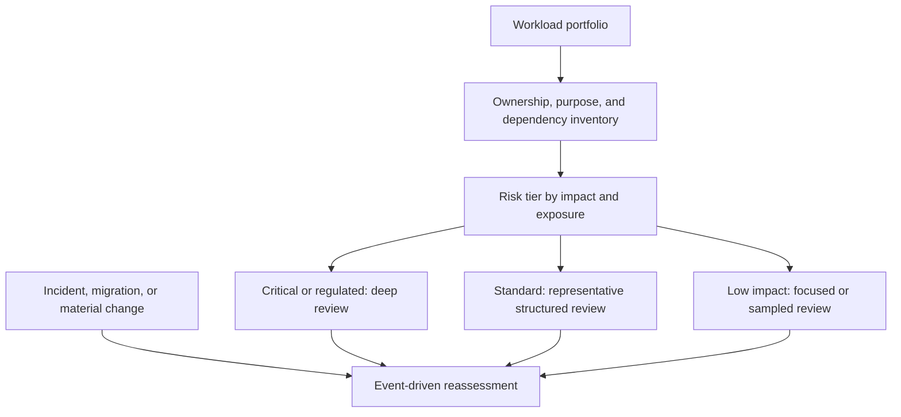
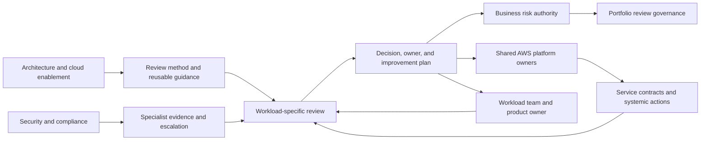
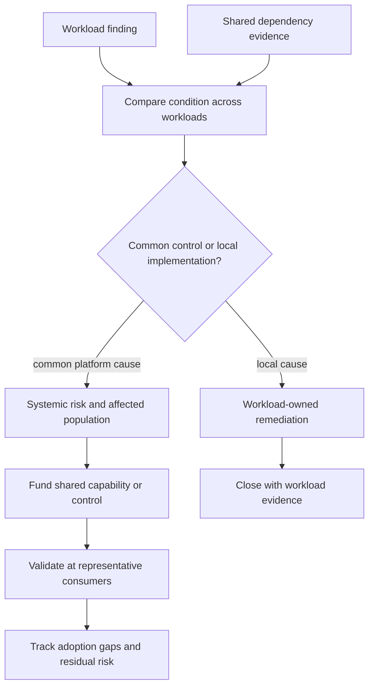
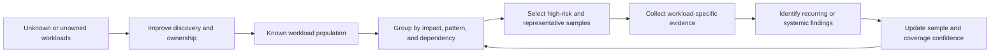
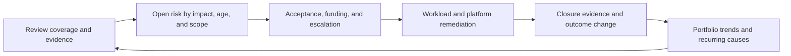

# Enterprise-Scale Reviews and Case Studies

Part: [11 — AWS Well-Architected Framework](PART_OVERVIEW.md)

Enterprise use of the AWS Well-Architected Framework (WAF) must preserve workload-specific reasoning while making shared and recurring risks visible across a portfolio. A program that scales only by multiplying questionnaires can increase completion counts without improving architecture. A useful operating model selects review depth by risk, assigns decision authority, identifies systemic dependencies, funds remediation, and measures outcomes without rewarding favorable answers over honest evidence.

This chapter applies AWS WAF at portfolio and shared-platform scale. Part 10 CH15 owns provider-neutral architecture-review practice; Part 11 owns AWS-specific pillar use, tooling, risk interpretation, and remediation. Part 09 owns AWS service mechanics. The examples are hypothetical and illustrate review reasoning rather than asserting results from a particular organization.

## Segment the Portfolio by Risk and Decision Need

Use business consequence and change to set review depth. Workload count and organization hierarchy alone are insufficient. Event-driven triggers complement scheduled cadence.

Start with an inventory that can identify each workload, its business owner, technical owner, purpose, criticality, data sensitivity, operating state, AWS accounts and regions, major dependencies, and last meaningful review. An inventory assembled only from billing accounts can omit externally operated components or overcount environments that belong to one workload. Define the workload identity and boundary consistently enough to compare records, while preserving architecture-specific detail.

Segment reviews by consequence and exposure. A customer payment, safety-relevant control, regulated data platform, internal analytics tool, and temporary development environment do not require identical evidence or cadence. Relevant factors include business impact, data obligations, internet exposure, dependency concentration, recovery objectives, architecture novelty, operational maturity, and recent incidents. Use transparent criteria and permit a workload owner to challenge an incorrect tier with evidence.

A risk tier determines review depth, participant set, evidence expectations, and revisit triggers; it should not dictate a binary pass/fail status. High-impact workloads may need full pillar coverage, detailed failure and recovery exercises, and accountable business acceptance. Lower-impact workloads may receive a focused review of material changes and shared dependencies, with representative sampling across common patterns. Sampling creates uncertainty: record coverage, selection criteria, and known omissions, then adjust when findings reveal an unrepresented workload class.

Schedule reviews at useful lifecycle points: architecture proposal, production readiness, significant change, post-incident learning, periodic reassessment, and portfolio planning. Avoid a cadence that becomes a paperwork deadline detached from decisions. A recent architecture change, acquisition, workload migration, new data use, or new shared platform may justify an earlier review even if the annual date is distant.

## Establish an Enterprise Review Operating Model

Central functions provide consistent methods and surface systemic risk; workload teams remain accountable for factual workload evidence and local remediation.

Define roles before scaling the program. A portfolio sponsor funds the review and improvement capacity. A review facilitator organizes scope, evidence, participants, and follow-up. The workload product and technical owners explain behavior and make design decisions. Platform, security, reliability, finance, and data specialists contribute where the workload depends on their domain. Risk acceptance belongs to the authority established by organizational policy. It does not automatically belong to the reviewer or tool administrator.

Central review teams can improve consistency, train reviewers, maintain templates and custom lenses, and identify repeated failure patterns. They should not become a substitute owner for every workload or approve architectural details they cannot observe. Workload teams are closest to code and operation but may lack visibility into shared account controls or portfolio exposure. The operating model needs an explicit handoff: who supplies shared-service evidence, who owns an exception, who funds remediation, and who resolves disagreement.

For multi-account environments, align the review boundary with actual workload and shared-platform ownership rather than assuming each account equals one workload. Organizational Units (OUs), shared services, and delegated administration can create useful policy boundaries, but one workload may span accounts and one account may host several workloads. Record account and region scope, central controls, and the service contract the workload relies on. Part 09 owns organization and account mechanics; enterprise WAF review evaluates whether those boundaries and owners support workload outcomes.

Set reviewer competency and independence expectations. A reviewer should understand the question set and evidence standards, recognize when a specialist is needed, and distinguish observation from conclusion. Independent challenge is valuable for high-consequence decisions, but review should remain constructive and avoid turning into a compliance inspection that rewards concealment. Train reviewers to ask for behavior, assumptions, alternatives, and tests rather than service names.

## Separate Systemic Risk from Local Findings

The distinction prevents a portfolio program from treating repeated symptoms as unrelated tickets or assuming every similar finding has one cause.

Normalize recurring findings by the underlying condition, not only by the wording of a question. Multiple workloads may show different consequences from a common identity, network, deployment, logging, cost-allocation, or recovery dependency. Conversely, identical answer text can conceal distinct local architectures and different remediation owners. Retain the workload-specific scenario and evidence when grouping findings.

For a systemic finding, identify the shared component, affected workload population, exposure path, control owner, and evidence used to establish scope. Estimate blast radius with explicit inventory coverage. Decide whether remediation belongs in a platform capability, a central policy, a team process, or a workload-specific design. A platform fix can reduce repeated effort, but adoption and configuration still need validation at representative consumers.

Portfolio risks can correlate. Several workloads may depend on one identity provider, shared network route, deployment pipeline, key-management boundary, or operations team. A regional outage or compromised administrator can affect all of them together. Review common-mode failure rather than summing independent workload scores. Identify which shared dependency could invalidate several recovery or security claims at once.

Create a feedback path from workload reviews into platform and architecture backlogs. A repeated finding may justify a paved path, safer default, documented service-level expectation, or change in ownership. Track which workloads adopted the capability and what exceptions remain. A central remediation is not complete because a platform feature launched; it is complete when the intended workloads use it correctly or remaining gaps have authorized decisions.

## Choose Portfolio Coverage and Sampling Carefully

Sampling is a way to learn about a population, not evidence that every unreviewed workload is safe. Findings should update the sampling strategy and expose inventory gaps.

Choose samples from meaningful architecture classes, data obligations, account patterns, external exposure, and shared dependencies. Include workloads with recent incidents or material changes. Random sampling can help reveal unexpected conditions, while risk-based sampling focuses effort where consequence is highest; combining both can reduce blind spots. Record why a workload was selected and what the sample does not represent.

Measure coverage by a denominator the organization can explain: workloads in a known inventory, workloads by risk tier, critical dependencies, or workloads with a current review after material change. Report unknown ownership and unclassified workloads as a risk, not as zero findings. If inventory is incomplete, avoid declaring portfolio-wide coverage from the subset that is easy to assess.

Evidence depth should scale with the claim. A portfolio pattern review can identify likely shared control gaps; a workload review verifies local configuration and behavior; an operational exercise tests recovery and response. Do not extrapolate the result of one canary workload to a population with different architecture or data sensitivity without a clear argument.

## Report Outcomes Without Creating Score Incentives

Portfolio metrics should help leaders allocate attention and investment. Useful measures include review coverage by tier, unresolved high-impact risk, age and overdue status, accepted risk nearing expiry, systemic finding population, remediation lead time, repeated findings, closure evidence quality, and changes in business outcomes. Interpret trends with context: more findings can indicate better discovery; fewer findings can mean reduced exposure or reduced reporting.

The reporting loop connects measurement to decisions and verified outcomes. A single score cannot represent risk, confidence, scope, or remediation effectiveness.

Avoid using the average WAF score as a proxy for architecture quality, team performance, or regulatory status. Scores reflect answers under a particular question set and workload boundary. Incentivizing higher scores can encourage narrow scope, optimistic answers, or premature closure. Preserve the findings, evidence, accepted risks, and assumptions behind any summary.

Present material risk with a clear audience and decision request. Executives may need business exposure, affected population, funding, and decision deadline; workload teams need the scenario, evidence, owner, and concrete action; platform teams need common cause and consumer scope. Tailor the view without changing the underlying risk record. Keep accepted risks distinct from open actions and distinguish evidence gaps from confirmed control failures.

Measure remediation effectiveness, not just throughput. Closure counts and time-to-close are useful only alongside recurrence, residual risk, test results, and workload outcome. A fast ticket closure that does not change deployed behavior is not progress. A longer systemic remediation may provide more risk reduction than many local configuration fixes; show dependency and benefit transparently.

## Case Study: Public Retail Workloads and a Shared Identity Boundary

A retailer operates several customer-facing workloads across AWS accounts. The portfolio review finds inconsistent recovery and security evidence, but the initial reports describe separate issues: one team cannot revoke a deployment credential quickly, another cannot restore from backup without central identity access, and a third has audit records in an account that workload administrators can modify.

The enterprise facilitator groups these as potentially related, then verifies the shared identity and audit architecture. A central pipeline role can deploy into multiple workloads, while the audit destination is managed by the same administrative boundary. The common cause is not simply that every team has weak permissions; the platform design permits one authority to change production and evidence retention across workloads.

The review identifies the affected population through account and role inventory, while noting several legacy accounts are unclassified. The platform and security teams define a separation between deployment authority and audit retention, add a bounded credential-revocation path, and publish a standard deployment identity pattern. Workload teams test adoption against their release and recovery workflows. One acquired workload cannot adopt the standard before a contract migration; its business owner accepts a bounded exception with an expiry and compensating monitoring.

Portfolio closure requires proof that the shared role can no longer alter protected audit retention, a credential-revocation exercise, representative consumer tests, and an updated population inventory. Each workload retains its own evidence and remaining risks. The organization reports the exception and unknown accounts instead of claiming complete coverage from the workloads already onboarded.

This case shows how portfolio review can discover a systemic architectural dependency while preserving local ownership. The shared change reduces common exposure, but workload-specific recovery and access assumptions still require validation.

## Case Study: Regulated Analytics Platform

A regulated analytics platform processes sensitive claims data from several business units. It has separate data pipelines and reporting workspaces, but central identity, encryption-key administration, network connectivity, and audit collection are shared. A WAF review program initially samples one mature pipeline and reports strong control evidence.

A second sample reveals that a newer pipeline copies data into a development workspace for performance testing. The data is retained beyond the approved period, and access logs are collected centrally but not connected to the pipeline owner. The issue is local in how the dataset is copied, but the enabling condition is systemic: the shared development path does not enforce data classification and lifecycle controls consistently.

The portfolio review expands sampling to pipelines with similar data movement and account patterns. The data governance team clarifies which datasets may be used for nonproduction testing and defines a de-identification path; the platform team adds discoverable storage ownership and retention defaults; each workload owner validates its copies and deletion behavior. Legal and security owners confirm the exception process for records under hold.

The portfolio reports sampled coverage, affected workload count, unknown copy locations, remediation owners, and verification status. It does not claim the entire data estate is clean because one mature pipeline passed. Closure evidence includes inventory comparison, a representative deletion test, access review, and confirmation that required audit records remain available.

The review demonstrates why shared platforms and local workload practices must be examined together. A standard can reduce variation, but data authority, access, and retention still need to be verified at the consumer boundary.

## Review Questions

- Is the workload inventory complete enough to explain coverage, ownership, criticality, and dependencies?
- Are review cadence and evidence depth proportional to business impact, exposure, and change?
- Do workload, platform, specialist, executive, and risk-acceptance roles have explicit decision rights?
- Are shared AWS and organizational dependencies visible across account and workload boundaries?
- Can recurring findings be traced to common causes without erasing workload-specific context?
- Are sampling criteria, coverage denominator, unknown populations, and limitations reported?
- Do portfolio metrics show evidence quality, risk age, systemic scope, and verified outcomes rather than scores alone?
- Are platform remediations validated at representative consumers, with exceptions tracked?
- Are accepted risks, funding decisions, and escalations assigned to authorized owners?
- Do case studies distinguish hypothetical examples from observed organizational outcomes and preserve evidence-to-decision traceability?

Further reading: [AWS Well-Architected Framework](https://docs.aws.amazon.com/wellarchitected/latest/framework/welcome.html), [AWS Well-Architected Tool User Guide](https://docs.aws.amazon.com/wellarchitected/latest/userguide/intro.html), [Part 10 Architecture Reviews](../10_Cloud_Architecture/CH15_Cloud_Architecture_Reviews_and_Reference_Designs.md), and [Part 09 AWS](../09_Cloud_Computing/CH01_AWS.md).
