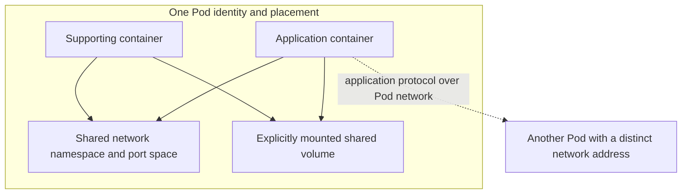
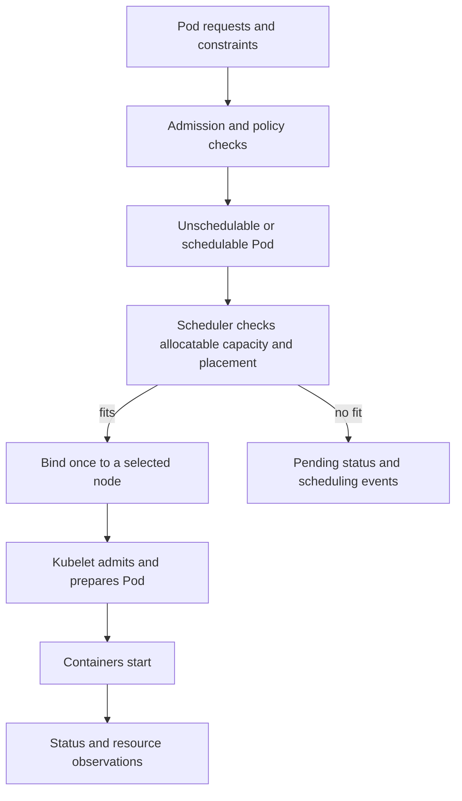
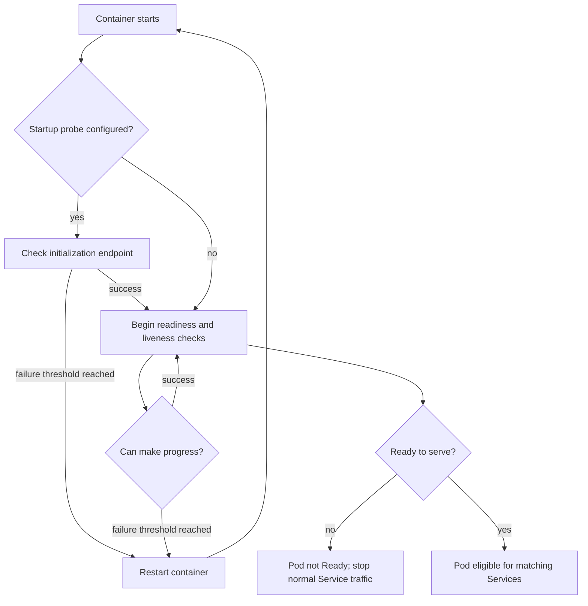
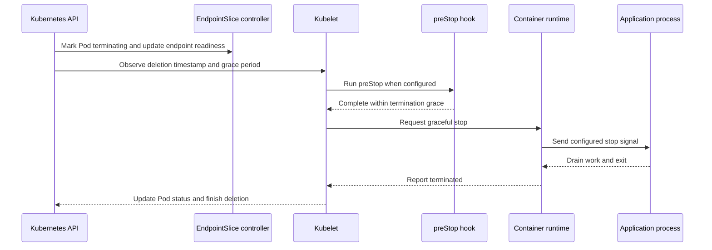

# Pods

Part: [12 — Kubernetes](PART_OVERVIEW.md)

A Pod is Kubernetes' smallest deployable workload object: a specification for one or more tightly related containers that must be co-located and share selected resources. Kubernetes schedules and manages Pods, not standalone containers. This wrapper gives a workload a common network identity, optional shared volumes, lifecycle coordination, resource requirements, and health conditions. Those conveniences also create coupling: every container in a Pod shares placement, disruption, and rollout fate.

This chapter focuses on the upstream Kubernetes Pod model and behavior. Part 09 CH08 owns cloud-managed Kubernetes control planes, node pools, and provider integrations; Part 09 CH07 owns cloud container-execution alternatives. Part 05 CH28 owns Linux namespaces and control groups (cgroups), while Part 05 CH25 owns kernel memory management. Part 12 CH02 owns Deployment rollout behavior; CH07 and CH08 own storage provisioning and Pod volume usage; CH13 owns Kubernetes security; CH14 owns observability. Here, the concern is how the Pod's own application programming interface (API) contract behaves and how to decide what belongs inside it.

The upstream documentation consulted for this chapter describes Kubernetes v1.37. The examples use long-standing Pod fields unless noted; defaults and feature maturity can change, so validate manifests against the target cluster version and admission policy.

## The Pod as a Logical Host

```mermaid
flowchart LR
    API[Kubernetes application programming interface (API) object] --> Spec[Pod specification]
    Spec --> Scheduler[Scheduler selects one node]
    Scheduler --> Kubelet[Kubelet prepares Pod sandbox]
    Kubelet --> Network[Shared network identity and port space]
    Kubelet --> Containers[One or more co-located containers]
    Kubelet --> Volumes[Declared shared volumes]
    Kubelet --> Status[Pod conditions and container status]
    Status --> API
```

The Pod API object is desired state; the runtime sandbox and containers are node-local realization. A Pod object can exist before any container is running, and its status is a report of observed progress rather than a guarantee of application usefulness.

A single-container Pod is the common case. The Pod still matters: Kubernetes attaches labels, scheduling constraints, identity, resource requests, probes, volumes, and restart behavior to the Pod or its containers. The scheduler places the Pod as a unit, and higher-level workload controllers create Pods from templates. The container image is only one part of that contract.

A multi-container Pod is appropriate when processes have a strong runtime relationship. They may need a loopback connection, a shared file, coordinated startup, or tightly coupled scaling and lifecycle. An auxiliary log shipper reading a shared file, a proxy whose lifetime is tied to one application instance, or an init container preparing a volume can justify co-location. The coupling is intentional: the containers use the same Pod address and port space, are scheduled together, and are replaced together when the Pod is replaced.

Use separate Pods when components need independent scaling, placement, upgrades, resource budgets, failure handling, or ownership. A sidecar that can be shared across many application instances may belong in a DaemonSet or separate service instead. A helper that must always restart with one process may fit a native sidecar. The decision is about lifecycle and resource coupling, not a rule that a Pod must contain one or several containers.

Kubernetes documentation describes a Pod as an application-specific logical host. On Linux, the underlying isolation uses namespaces and cgroups, but Pod semantics are not identical to "a set of containers sharing all host resources." The Pod shares selected networking and declared volumes; containers still have distinct filesystems and processes, and security context can further constrain them. Part 05 owns the kernel mechanisms.

## Shared Network and Storage Contracts



Containers in one Pod can communicate through `localhost`, but must avoid binding the same port. Across Pods, communication uses the cluster network model, not shared interprocess communication (IPC). Shared files exist only when the Pod specification declares and mounts a common volume.

Each Pod has a network identity with an Internet Protocol (IP) address in each configured address family. Containers in a Pod share the network namespace, including that IP address and port space; a listener bound by one container can conflict with another container using the same port. The containers can communicate over loopback and coordinate ports explicitly. Pod-to-Pod communication crosses the cluster network implementation. Part 12 CH06 owns CNI and data-plane mechanics; Part 12 CH04 owns the stable Service abstraction.

Storage sharing is explicit. A Pod can declare a volume and mount it in one or more containers. An `emptyDir` survives a container restart within the same Pod but does not survive deletion and replacement of that Pod. A persistent volume can outlive an individual Pod depending on its storage lifecycle and claim policy; CH07 and CH08 explain those boundaries. Do not treat a shared filesystem path as durable merely because two containers can see it.

Sharing a network namespace also shares port collisions, localhost trust, and traffic visibility. A sidecar that can connect to an application's local administrative endpoint may have meaningful authority even if network policy blocks other Pods. Shared volumes can expose credentials, temporary files, or writable application state. Co-location simplifies communication but does not remove the need for access control, resource requests, or threat analysis.

## Pod Identity, Specification, and Status

A Pod object has metadata, a specification, and status. Metadata gives the object a namespace-scoped name, unique identifier (UID), labels, annotations, and ownership references. The specification describes containers, restart behavior, volumes, scheduling constraints, resource requirements, probes, and security settings. The kubelet and control-plane components update status and conditions to report observed state.

Names are not durable identity. If a Pod is deleted and a replacement is created with the same name, the replacement has a different UID. A controller-created Pod also gets a new UID when replaced. Systems that track work, storage, or telemetry by Pod name alone can confuse two different runtime instances. Use the appropriate workload identity and labels for grouping; use the UID when distinguishing object incarnations.

Labels are selectors used by controllers and Services. A Pod label change can affect which higher-level resources select it, so labels are part of workload behavior, not decorative metadata. Annotations can hold non-selector metadata for tools and controllers, but should not be used as an unbounded storage field. CH02 and CH04 explain how Deployments and Services use selectors.

A Pod's phase is a coarse lifecycle summary, not a comprehensive health state machine. Common phases are Pending, Running, Succeeded, Failed, and Unknown. `CrashLoopBackOff` is commonly displayed by command-line tools as a container waiting reason during repeated restarts; it is not itself a Pod phase. Readiness, scheduling, initialization, and container state are represented through conditions and per-container status. Diagnose those fields rather than inferring application health from a single display word.

## Scheduling and Resource Requests



The scheduler primarily reasons about declared requests and node allocatable capacity, not just current utilization. A Pod can remain Pending even when dashboards show low average cluster usage if its requests, affinity, taints, topology, storage, or extended resources have no matching node.

A Pod is scheduled once in its lifetime. Binding selects a node; if the Pod later fails in a way the cluster cannot recover from, Kubernetes does not move that same Pod object to another node. A controller may create a replacement Pod with a new UID, and the scheduler may place it elsewhere. This distinction is central to failure recovery: container restart is node-local repair, while Pod replacement is a new scheduling event.

For the central processing unit (CPU) and memory, container requests influence scheduling. The scheduler accounts for the effective requests of the Pod, including the different execution shape of init containers; sidecars also contribute to the Pod's resource needs. A container's request is a scheduling reservation, not a runtime ceiling. Spare capacity can allow usage above the request; resource limits and node conditions still apply.

Limits have different behavior by resource. On Linux, a CPU limit is enforced through throttling; a memory limit is enforced reactively when memory pressure triggers out-of-memory (OOM) handling. A process may exceed a memory limit briefly before being terminated. Part 05 CH25 owns the kernel-level mechanism. At the Kubernetes layer, the reviewer should reason about request accuracy, limit-induced latency or restarts, node pressure, and the evidence used to tune them.

Pod Quality of Service (QoS) class summarizes resource configuration for eviction behavior; it does not guarantee performance or application priority. `Guaranteed`, `Burstable`, and `BestEffort` classes depend on the configured requests and limits across containers. Priority and preemption are separate scheduling controls. A high-priority Pod can still be unschedulable if constraints cannot be met, and preemption can disrupt lower-priority work. CH09 develops autoscaling and capacity loops.

Scheduling also considers selectors, affinity and anti-affinity, taints and tolerations, topology spread, priority, and volume topology. These constraints can conflict. A Pod may request more capacity than any single node has, require a zone with no available volume, or be pinned by affinity to an overloaded node. Inspect scheduler events and the effective constraints before increasing cluster size.

## Container Roles and Restart Behavior

```mermaid
stateDiagram-v2
    [*] --> Init
    Init --> SidecarReady: regular init completes; restartable sidecar starts
    SidecarReady --> NextInit: sidecar started condition is met
    NextInit --> AppStarting: all regular init containers complete
    AppStarting --> Running: application containers start
    Running --> ContainerRestart: one container exits and policy applies
    ContainerRestart --> Running: replacement container in same Pod
    Running --> PodTerminating: Pod deletion or eviction
    PodTerminating --> [*]: Pod object and sandbox removed
```



A container restart does not imply a Pod replacement. The same Pod UID, network namespace, IP address, and attached volumes can remain while the kubelet restarts a container. Conversely, node loss or an unrecoverable Pod failure requires a higher-level controller to create a new Pod instance.

The Pod-level `restartPolicy` values are `Always`, `OnFailure`, and `Never`; ordinary long-running workload controllers generally use `Always`, while batch controllers select policies appropriate to job completion. Restart behavior applies to containers in the Pod and interacts with the owning workload type. The kubelet can restart a failed container on the same node with backoff, but it does not create additional replicas. That distinction belongs to the controller. See CH02 and CH03 for Deployment and ReplicaSet reconciliation.

Regular init containers run to completion in order before application containers start. They perform bounded setup steps such as configuration validation and file preparation. They should not become a hidden, unbounded dependency that blocks every Pod start. A failed init container can prevent the application from starting; inspect its logs and status independently.

Kubernetes native sidecars are restartable init containers: they are declared under `initContainers` with container-level `restartPolicy: Always`. The feature is stable in current upstream documentation. They start in init-container order, continue running alongside application containers, and are terminated after the main application containers, in reverse declaration order. This lets the sidecar support the application through startup and shutdown. Older clusters or distributions may differ; verify the target version before relying on this behavior.

The following illustrative JSON manifest groups one API process, a configuration check, and a log forwarder. The regular init container completes before application startup; the native sidecar remains for the Pod's lifetime and shares a bounded log volume with the application.

```json
{
        "apiVersion": "v1",
        "kind": "Pod",
        "metadata": {
                "name": "receipts-api",
                "labels": { "app": "receipts-api" }
        },
        "spec": {
                "restartPolicy": "Always",
                "terminationGracePeriodSeconds": 45,
                "initContainers": [
                        {
                                "name": "verify-config",
                                "image": "busybox:1.36.1",
                                "command": ["sh", "-c", "test -r /etc/receipts/config"],
                                "volumeMounts": [
                                        { "name": "config", "mountPath": "/etc/receipts", "readOnly": true }
                                ]
                        },
                        {
                                "name": "log-forwarder",
                                "image": "busybox:1.36.1",
                                "restartPolicy": "Always",
                                "command": ["sh", "-c", "touch /var/log/receipts/events.log; tail -F /var/log/receipts/events.log"],
                                "resources": {
                                        "requests": { "cpu": "50m", "memory": "64Mi" },
                                        "limits": { "memory": "128Mi" }
                                },
                                "volumeMounts": [
                                        { "name": "logs", "mountPath": "/var/log/receipts" }
                                ]
                        }
                ],
                "containers": [
                        {
                                "name": "api",
                                "image": "registry.example.com/receipts/api:1.4.2",
                                "ports": [ { "name": "http", "containerPort": 8080 } ],
                                "resources": {
                                        "requests": { "cpu": "100m", "memory": "128Mi" },
                                        "limits": { "memory": "256Mi" }
                                },
                                "startupProbe": {
                                        "httpGet": { "path": "/startup", "port": "http" },
                                        "periodSeconds": 5,
                                        "failureThreshold": 24
                                },
                                "readinessProbe": {
                                        "httpGet": { "path": "/ready", "port": "http" },
                                        "periodSeconds": 5
                                },
                                "livenessProbe": {
                                        "httpGet": { "path": "/healthz", "port": "http" },
                                        "periodSeconds": 10,
                                        "failureThreshold": 3
                                },
                                "volumeMounts": [
                                        { "name": "config", "mountPath": "/etc/receipts", "readOnly": true },
                                        { "name": "logs", "mountPath": "/var/log/receipts" }
                                ]
                        }
                ],
                "volumes": [
                        { "name": "config", "configMap": { "name": "receipts-config" } },
                        { "name": "logs", "emptyDir": { "sizeLimit": "32Mi" } }
                ]
        }
}
```

The values are examples, not production sizing. Notice that the sidecar has its own resource request, the readiness signal controls service eligibility, and liveness checks local progress rather than database availability. The `emptyDir` preserves files across a container restart but not Pod replacement. This bare Pod also has no replica owner: if the Pod itself disappears, another component must create a replacement.

Use a sidecar when the helper's placement, network access, volume access, and lifecycle genuinely belong to one application instance. Consider resource overhead, shared trust, independent scaling needs, startup dependencies, and termination time. A logging or proxy sidecar can improve separation of concerns, but every replica duplicates its resource use and may add a local failure point. A shared cluster-level agent or separate service may be a better fit when per-Pod coupling is unnecessary.

A Pod is not a process. A container can terminate and be restarted while its Pod persists. A Pod that is deleted, evicted, or lost with its node is not "restarted" onto another node; it is replaced by a controller or remains absent if no controller owns it. For resilient applications, keep durable state outside ephemeral container filesystems and use an appropriate workload resource rather than directly managing production Pods.

## Probes Are Different Control Signals



Startup, readiness, and liveness probes drive different actions. Treating all three as a generic "health check" can turn transient dependency pressure into restart storms or send requests to an uninitialized process.

A startup probe gives a slow-starting application time to initialize. While it has not succeeded, Kubernetes does not run the liveness or readiness probes for that container. If the startup probe fails enough times, the kubelet restarts the container. Use it when initialization time varies enough that a short liveness threshold would otherwise kill a healthy startup.

A liveness probe answers whether the process can make progress or should be restarted. It should detect a local unrecoverable state, such as a deadlock, not every dependency outage. If every replica fails liveness because a shared database is unavailable, restarting all replicas can amplify load and extend recovery. Let the application recover naturally when possible, and set thresholds based on observed failure behavior.

A readiness probe answers whether the container should receive normal service traffic. A failed readiness check marks the Pod unready and removes it from the ready endpoints for matching Services; it does not restart the container. Readiness can reflect initialization, overload, or a required dependency if returning errors to users is worse than temporarily removing capacity. If every replica becomes unready on a shared dependency failure, traffic may have no destination, so define degraded behavior at the workload level.

Probe mechanisms include Hypertext Transfer Protocol (HTTP), Transmission Control Protocol (TCP), Google Remote Procedure Call (gRPC), and exec checks, with version-dependent support and constraints. Choose a low-cost check that tests the intended condition. An HTTP endpoint that performs deep dependency calls can make liveness sensitive to unrelated faults; an exec probe can add process overhead when run frequently. Keep responses small and deterministic, set timeouts and thresholds from measured startup and recovery, and verify the probe itself does not create the incident.

## Graceful Termination and Disruption



Termination must fit within the Pod grace period and coordinate with endpoint removal and application draining. The precise timing of endpoint updates and container shutdown is asynchronous; do not assume all traffic stops before the application receives its signal.

The API records the Pod's deletion intent and grace period. The kubelet runs a configured `preStop` hook, then asks the runtime to stop containers gracefully. The default grace period is commonly 30 seconds. If the application does not exit before the deadline, the runtime eventually force-stops it. Hooks consume the grace budget; they do not add unlimited time for draining.

The application should stop accepting new work, finish or safely abandon in-flight requests, flush required state, and exit within the budget. For long-running connections or queue consumers, define a drain protocol and ensure the endpoint or consumer becomes unavailable at the correct time. Native sidecars have ordered shutdown behavior; ordinary containers do not have a general start/stop ordering guarantee just because they appear in a list.

A PodDisruptionBudget can constrain some voluntary disruptions, such as an administrative eviction, but it is not a guarantee against node failure, node-pressure eviction, force deletion, or every controller-driven replacement. CH02 covers rollout behavior; CH07 covers persistent data recovery. A disruption budget is one input to availability, not a substitute for sufficient replicas and capacity.

Force deletion removes the API object without waiting for confirmation that the process has stopped on the node. If the node is unreachable, the old process may continue running while a replacement is created elsewhere. This can create duplicate work or split authority for stateful systems. Use force deletion only with an understanding of fencing and data ownership, not as a routine way to clear a stuck status.

## Configuration, Security, and Debugging Boundaries

Pod fields can inject environment variables, ConfigMaps, Secrets, downward API values, service account tokens, and volumes. These mechanisms have different update and exposure behavior. A changed configuration object does not guarantee an application reload; a mounted file or environment variable may have distinct refresh semantics. Design a clear restart or reload procedure. CH08 owns volume details, CH13 owns secret and workload-identity security, and Part 09 owns cloud secret services.

A Pod security context can set user and group identity, filesystem ownership, capabilities, privilege settings, and other constraints. It is a security boundary to review, not proof of isolation. Apply the Pod Security Standards and threat-modeling methods from Part 15; Part 05 owns kernel-level isolation mechanics. Consider that sidecars share network and mounted data with the application and can therefore inherit meaningful access even with a separate container image.

When a Pod is stuck, diagnose by lifecycle layer:

- **Admission or creation:** inspect API rejection, policy denial, quota, and events.
- **Scheduling:** inspect `PodScheduled`, scheduler events, requests, selectors, taints, affinity, topology, and storage constraints.
- **Sandbox preparation:** inspect node condition, network setup, volume mount, and runtime events.
- **Image or container startup:** inspect pull credentials, image reference, init-container status, command, and previous logs.
- **Readiness or probe failure:** inspect probe endpoint, timeout, dependencies, and whether the signal matches the intended action.
- **Runtime pressure:** inspect restarts, termination reason, CPU throttling, memory pressure, ephemeral storage, and node events.
- **Traffic path:** inspect Pod readiness, Service selection and endpoints, network policy, and the client path.

Use `kubectl describe pod`, events, current and previous container logs, and the workload controller's status. An ephemeral debug container can help inspect a running Pod without rebuilding its image, but it changes the Pod's container set and may require elevated access. Treat production debugging as an auditable operation. Part 14 develops telemetry practices; this chapter links Pod evidence to the debugging sequence.

## Worked Scenario: A Sidecar Turns a Healthy Rollout into a Scheduling Failure

A service has one application container and one logging sidecar in every Pod. The application request is based on observed steady-state use, but the sidecar has no request. The scheduler therefore sees less requested capacity than the Pod can consume. A log burst increases sidecar memory use and can create node pressure. Some Pods are evicted or restarted, application readiness falls, and the Deployment creates replacements that initially fit by request but repeat the same runtime pattern.

The team first distinguishes Pod replacement from container restart. Events show memory pressure and eviction on the node, while the application logs show no direct crash. The sidecar's memory use correlates with a burst in log volume. The team adds measured sidecar requests and limits, reviews whether buffering can be bounded, and checks node allocatable capacity with the revised effective Pod request. The application team separately verifies that readiness removes a Pod from normal traffic during local recovery without using liveness to restart every replica.

A controlled node drain then tests termination. The application stops receiving new requests, drains in-flight work within the grace period, and the logging sidecar remains available long enough to flush the final records. A rollout is tested with surge capacity sufficient for the higher Pod request. The change is considered successful only when the workload maintains its service objective, logs remain complete enough for incident response, and the cluster has enough capacity to replace a Pod under the tested disruption.

The scenario shows why a Pod's resource and lifecycle boundary includes every container. A sidecar is not free auxiliary work; it participates in scheduling, resource pressure, readiness, security, and termination.

## Review Questions

- Is each multi-container Pod cohesive enough to justify shared placement, network identity, volumes, and lifecycle?
- Are container restart, Pod replacement, and controller replica recovery distinguished in the design and runbooks?
- Do labels, ownership references, and UIDs support correct grouping and diagnosis?
- Are resource requests based on all containers and initialization behavior, with limits chosen for a reason?
- Do startup, readiness, and liveness probes express distinct conditions and avoid cascading failure?
- Can the workload start, drain, and terminate within its grace period under a real request or queue load?
- Are sidecar startup and shutdown dependencies explicit, and is the sidecar's resource and trust impact measured?
- Are ephemeral and persistent data expectations clear across container restart, Pod deletion, eviction, and rescheduling?
- Can operators diagnose the current lifecycle stage from status, conditions, events, logs, and node evidence?
- Are version-sensitive Pod features verified against the target Kubernetes API and implementation?

Further reading: [Kubernetes Pods](https://kubernetes.io/docs/concepts/workloads/pods/), [Pod Lifecycle](https://kubernetes.io/docs/concepts/workloads/pods/pod-lifecycle/), [Sidecar Containers](https://kubernetes.io/docs/concepts/workloads/pods/sidecar-containers/), [Liveness, Readiness, and Startup Probes](https://kubernetes.io/docs/concepts/workloads/pods/probes/), [Resource Management for Pods and Containers](https://kubernetes.io/docs/concepts/configuration/manage-resources-containers/), [Part 09 Managed Kubernetes](../09_Cloud_Computing/CH08_Kubernetes.md), and [Part 05 Container Fundamentals](../05_Networking_and_OS/CH28_Virtualization_and_Container_Fundamentals.md).
