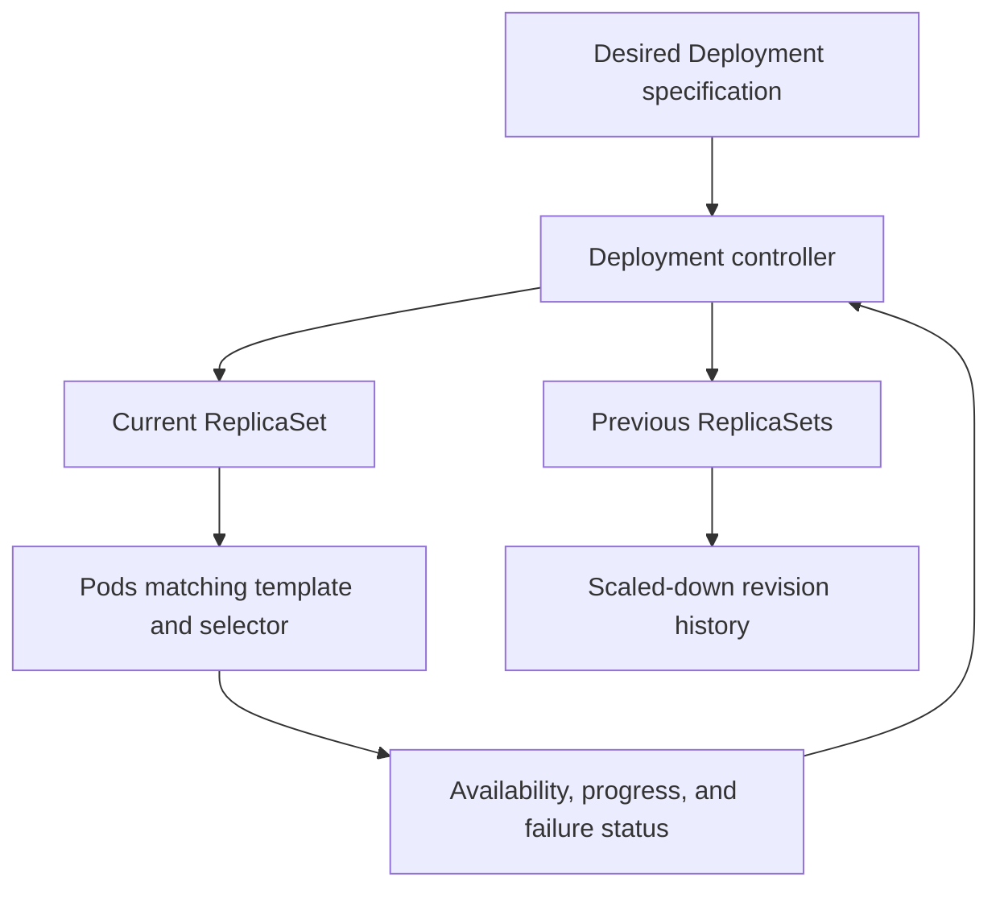
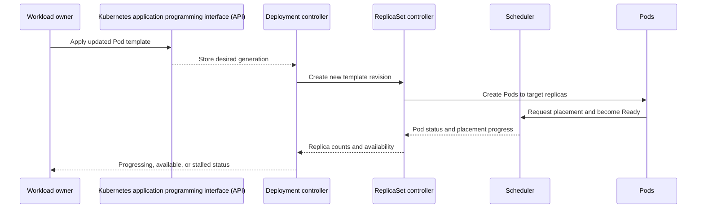
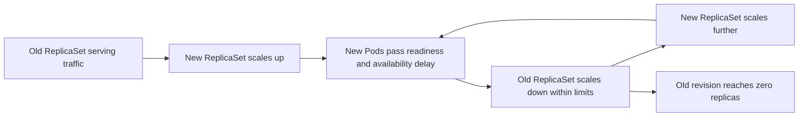
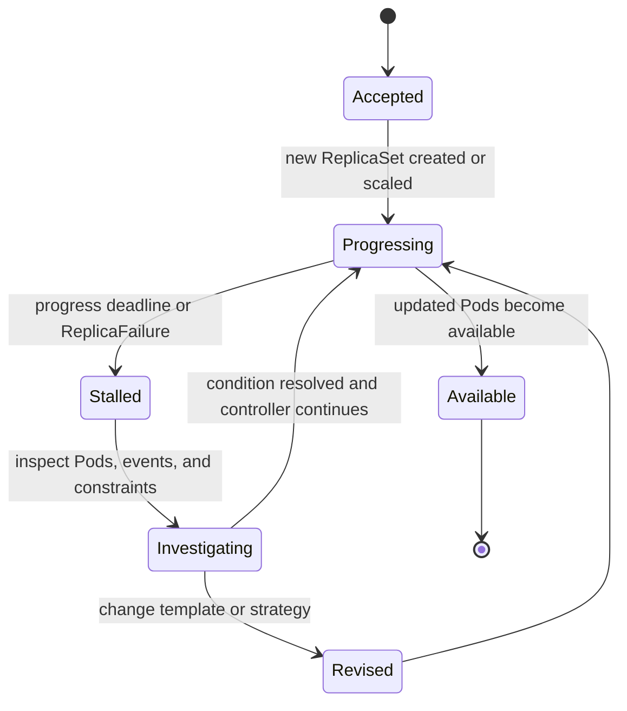
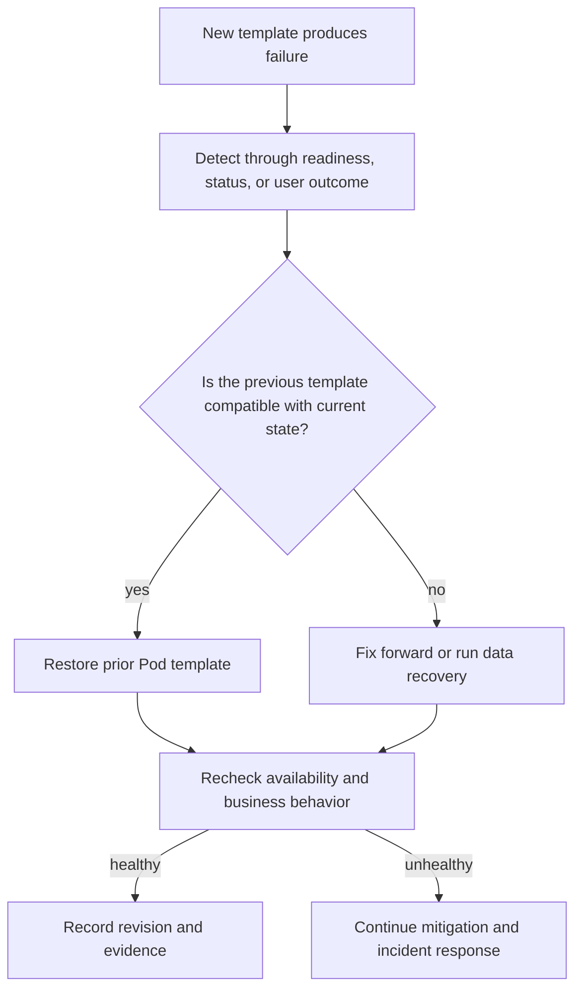

# Deployments

Part: [12 — Kubernetes](PART_OVERVIEW.md)

A Deployment manages a replicated, usually stateless Pod workload and provides declarative updates to its Pod template. It coordinates ReplicaSets, which in turn maintain matching Pods, so an operator changes desired state rather than issuing a sequence of imperative create/delete commands. The Deployment controller changes actual state toward the new intent at a controlled rate, subject to readiness, capacity, and rollout policy.

This chapter focuses on upstream Deployment behavior: object ownership, template revisions, rolling updates, progress and failure, rollback limits, and disruption. Part 12 CH01 owns Pod semantics; CH03 owns ReplicaSet reconciliation. Part 13 owns general release engineering, while Part 07 owns distributed-system and compatibility principles. The Deployment is a Kubernetes controller, not a complete application release system: it does not prove business correctness, reverse database migrations, or automatically roll back every stalled update.

The upstream documentation consulted for this chapter describes Kubernetes v1.37. The examples emphasize stable `apps/v1` Deployment behavior; confirm defaults, feature maturity, and policy constraints against the cluster version in use.

## Deployment, ReplicaSet, and Pod Ownership

The Deployment represents user intent and rollout policy. ReplicaSets hold replica counts for particular Pod templates; Pods are the actual scheduled instances. Each level has different state and responsibility, which makes status inspection more useful when the ownership chain is understood.

A Deployment specification contains a selector, a Pod template, desired replica count, strategy, and rollout-related settings. The selector must match labels in the Pod template and is immutable after creation for the `apps/v1` API. Selectors must not overlap with unrelated controllers. If two controllers match the same Pods, they can fight over ownership and replica count; Kubernetes does not generally prevent every such conflict.

The Deployment controller creates a ReplicaSet for the template and sets its desired replicas. A ReplicaSet controller creates or removes Pods until its observed matching count approaches that target. When a Pod template changes, the Deployment creates a new ReplicaSet and scales it relative to old ReplicaSets. The Deployment adds a `pod-template-hash` label to keep its child ReplicaSets' selectors from overlapping; workload authors should not change that generated label.

This hierarchy separates concerns. The Deployment decides which template is current and how revisions transition; a ReplicaSet maintains cardinality for one template; the scheduler places Pods; the kubelet starts containers. A Deployment can report successful rollout while an application-level invariant is broken if its readiness signal is inadequate. The rollout is only as meaningful as the Pod readiness contract and the evidence the team monitors.

Use a Deployment for interchangeable replicas of a stateless application. Stateful identity, ordered startup, or stable per-replica storage may call for a StatefulSet; node-level agents may call for a DaemonSet; finite tasks may call for a Job. These workload types are not just alternative syntax: they express different identity, scheduling, and lifecycle expectations.

## Reconciliation and Template Revisions

The controllers observe API state and reconcile asynchronously. A successful request to update the object means the desired state was accepted; it does not mean the new Pods are running or available.

A Deployment's rollout revision changes when its Pod template changes, such as a container image, environment, or Pod label change. Scaling the Deployment alone does not create a new template revision. Revision history is represented by retained ReplicaSets, which preserve template state and support rollback until garbage-collected according to `revisionHistoryLimit`.

The controller's reconciliation loop tolerates missed observations and retries. If a rollout is interrupted by another template update, the Deployment can create a newer ReplicaSet and scale down the earlier in-progress revision rather than waiting for it to finish. This rollover behavior avoids spending time completing a version that is already obsolete, but means multiple versions may be present concurrently. Applications and data contracts need to tolerate the versions that can coexist during the transition.

The pod-template hash ties a ReplicaSet and its Pods to a template revision. The hash is a controller implementation detail; it is useful for diagnosis but not a stable release identifier. Record image digests or other build provenance in the delivery system when artifact identity matters. A human-readable Deployment annotation can explain a change, but it is not proof that the artifact is trusted or the behavior was tested.

A Deployment's desired replica count is owned by one authority. If a Horizontal Pod Autoscaler (HPA) manages scale, avoid having a separate declarative source continuously overwrite `.spec.replicas`; otherwise, the scaling controller and deployment workflow can fight. Treat the replica count as a shared field with explicit ownership, or delegate it to the autoscaler.

## Rolling Update Mechanics

Rolling update is a coordination of two ReplicaSets. It trades temporary resource usage and release time against the number of replicas that may be unavailable while the new template is being proven.

The `maxSurge` setting caps additional desired Pods above the Deployment's replica target during the update. The `maxUnavailable` setting caps how many replicas may be unavailable relative to the desired count. Both can be absolute counts or percentages. Percentages round differently: surge rounds up; unavailable rounds down. By default, each is 25 percent. They cannot both be zero, because the controller would have no permitted move to create a replacement while preserving the old set.

For ten desired replicas, `maxSurge: 2` and `maxUnavailable: 1` allow the controller to target up to twelve Pods and to proceed while at least nine are available. These are desired/availability constraints, not exact instantaneous process counts. Terminating Pods may continue consuming resources during their grace period, so actual resource use can temporarily exceed the nominal surge ceiling. Quota, node capacity, and application startup time therefore affect whether a mathematically valid strategy can progress.

`maxSurge` creates room to start new Pods before removing old ones. It can preserve availability but requires spare capacity and may temporarily increase cost. `maxUnavailable` permits the controller to remove old capacity earlier, reducing surge demand while accepting more temporary unavailability. For a single replica, percentage rounding and available capacity matter: a positive surge may be needed to avoid a zero-capacity transition. Select values from the workload's availability objective, startup time, and cluster headroom, not by copying a default.

The `minReadySeconds` setting requires a newly ready Pod to remain ready for a duration before it counts as available for Deployment progress. It can filter brief readiness flaps, but increases rollout duration and does not test correctness beyond the readiness condition. Readiness should represent ability to serve the intended traffic; a probe that checks only process existence can allow a broken revision to advance.

A PodDisruptionBudget (PDB) limits some voluntary disruptions through the Eviction API. It does not govern a Deployment's own rolling update; the Deployment's `maxUnavailable` and `maxSurge` strategy applies to that update. A PDB also cannot prevent involuntary node failure or every direct deletion. Do not count it as a second independent rollout control.

## Define a Safe Pod Template Change

A rollout is triggered by a change to `.spec.template`, not by every change to the Deployment object. Scaling changes desired cardinality; changing the template changes the workload revision. This distinction helps operators predict whether an edit creates a new ReplicaSet and whether it should be treated as a software or configuration release.

Template changes include image, command, environment, resources, probes, volumes, labels, and annotations. Each can change runtime behavior. A label change may alter Service membership or policy selection; a resource request can make Pods unschedulable; a probe change can withdraw every Pod from traffic; a secret reference can break startup. Review the effective rendered object and expected behavior, not only the field that appears to have changed.

Selectors are foundational ownership boundaries. In `apps/v1`, the Deployment selector is required and immutable. It must match template labels and should be narrow enough to avoid capturing unrelated Pods. Changing a selector later generally requires creating a new Deployment and planning ownership handoff. A broader selector can adopt unintended Pods; a narrower selector can orphan old ones. Plan labels, ownership, and migration steps before production.

Image tags may be mutable, so a template can remain unchanged while the registry tag points to different bytes. Pin immutable digests when artifact identity must be reproducible. For multi-architecture images, verify the digest and platform resolution expected by the node fleet. Part 09 owns registry and image service mechanics; this chapter treats artifact reference stability as a rollout precondition.

Changes to a Deployment do not automatically coordinate with database schema, message format, external API, or user-session state. A rolling update intentionally runs versions together. Use expand-and-contract changes or another compatibility strategy when old and new Pods share data or dependencies. A binary rollback is unsafe if the new version already wrote data the old version cannot read, or performed irreversible external actions.

## Observe Progress and Diagnose a Stalled Rollout

A Deployment reports progress and availability conditions, but a stalled rollout is a diagnosis trigger, not an automatic rollback command. The controller continues retrying and exposes conditions such as `ProgressDeadlineExceeded` when progress exceeds the configured deadline.

A rollout can stall because images cannot be pulled, Pods fail readiness, requests cannot fit, quotas deny creation, admission policy rejects Pods, volumes fail to mount, or the application never reaches its startup condition. Read Deployment and ReplicaSet status together with Pod events and container logs. `kubectl rollout status` reports whether the rollout completed or exceeded its progress deadline, but the underlying failure may be in a dependency or policy boundary.

`progressDeadlineSeconds` controls when the Deployment status reports insufficient progress. It does not terminate the controller's retries or revert the template. Choose the deadline to exceed normal image pull, scheduling, startup, and `minReadySeconds` behavior, while still surfacing a broken rollout in a useful time. A deadline that is too short creates noise; one that is too long delays detection.

A rollout is complete when its updated replicas are available, old replicas are gone, and the desired replica count is satisfied according to the controller's rules. The `Progressing` condition can remain true after completion until another rollout changes it; inspect the reason and other status fields rather than interpreting the boolean alone.

## Rollback, Pause, and Revision Retention

Rollback changes the Deployment's Pod template back to a retained revision. It does not revert database writes, external requests, secrets, traffic policies, or other resources changed by the release. Treat rollback as an application transition that needs compatibility and verification.

The Deployment retains prior ReplicaSets according to `revisionHistoryLimit`, which defaults to ten in current documentation. Deleting old revisions saves API-object storage and output noise but removes the Deployment's own template rollback history. Retain enough revisions for operational recovery and ensure the authoritative source of desired state can reconstruct an older template if history is pruned.

Rolling back a Deployment affects its Pod template. Replica count and other fields are not necessarily reverted to historical values. If the application has already written data under a new schema or emitted an incompatible message, restarting the old binary may worsen the incident. Define rollback safety before rollout: which state changes are reversible, which are forward-only, how traffic is restored, and who makes the decision.

Pausing a rollout can allow multiple template edits to be collected before resuming, reducing repeated ReplicaSet creation. A paused Deployment does not progress against its deadline, and rollback requires resuming first. Pause should be a deliberate operator action with clear ownership; it is not a substitute for a release process or a canary strategy.

Canary traffic splitting is not a built-in weighted-traffic feature of one Deployment. A canary commonly uses separate Deployments plus a Service, ingress/gateway, or other traffic controller that directs a measured subset of users. That architecture has its own routing and rollback requirements; Part 05/Part 12 CH04-CH05 own those traffic abstractions.

## Worked Example: A Readiness Failure Under Rolling Update

A stateless receipt service runs six replicas. The team changes the application image and raises its memory request. The Deployment uses `maxSurge: 1`, `maxUnavailable: 0`, and `minReadySeconds: 20`. The image starts, but its readiness endpoint waits for an optional reporting service that is slow during the deployment window.

The first new Pod remains unready. With zero unavailable replicas allowed, the controller preserves the old set and does not remove serving Pods, but it cannot advance the update by replacing old capacity. The rollout remains progressing until the deadline. Cluster capacity is also tight: the larger memory request prevents the new Pod from fitting on some nodes, while a terminating Pod from an earlier operation continues consuming memory.

The team inspects the Deployment, new ReplicaSet, Pod scheduling events, container logs, and readiness behavior. It distinguishes two blockers: some nodes cannot fit the request, and the readiness contract couples customer receipt creation to a reporting dependency that is not required for that transaction. The team corrects node capacity planning and changes readiness to reflect the service's actual ability to accept receipt requests; reporting can degrade independently with a bounded queue.

Before resuming, the team confirms that the older binary can read data written by the candidate version and that no irreversible format change has occurred. It increases temporary capacity, resumes the rollout, and watches updated/available replicas plus the customer success signal. A controlled rollback test confirms the previous template can be restored without reversing data. The release is considered complete only after both Deployment conditions and application outcome measures remain healthy.

The example shows why rollout policy, readiness semantics, scheduler requests, and application compatibility must be reviewed together. `maxUnavailable: 0` protected existing capacity, but could not make the new revision schedulable or correct an overbroad readiness check.

## Review Questions

- Does the Deployment selector match the Pod template labels and avoid every other controller's ownership set?
- Is desired replica count controlled by one authority, especially when an HPA is present?
- Which Pod-template changes create a new revision, and is the artifact reference immutable enough for audit and rollback?
- Do `maxSurge` and `maxUnavailable` satisfy the workload's availability objective and capacity budget, including terminating Pods?
- Are readiness and `minReadySeconds` representative of stable service, not just process startup?
- Can the new and old application versions safely coexist with current schemas, messages, and external side effects?
- Are progress deadlines long enough for normal startup and short enough to surface real stalls?
- Do operators know how to distinguish image, quota, admission, resource-fit, volume, and readiness failures?
- Is rollback safe for the current data and external state, and is the needed ReplicaSet history retained?
- Are PDBs understood as voluntary-disruption controls rather than substitutes for Deployment rollout strategy?

Further reading: [Kubernetes Deployments](https://kubernetes.io/docs/concepts/workloads/controllers/deployment/), [Pod Disruptions](https://kubernetes.io/docs/concepts/workloads/pods/disruptions/), [Part 12 Pods](CH01_Pods.md), [Part 12 ReplicaSets](CH03_ReplicaSets.md), and [Part 09 Managed Kubernetes](../09_Cloud_Computing/CH08_Kubernetes.md).
