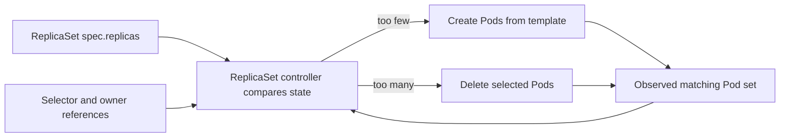
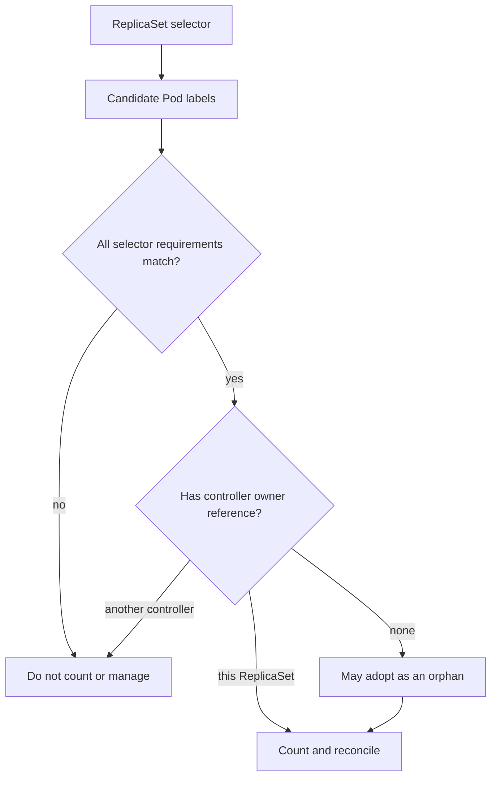
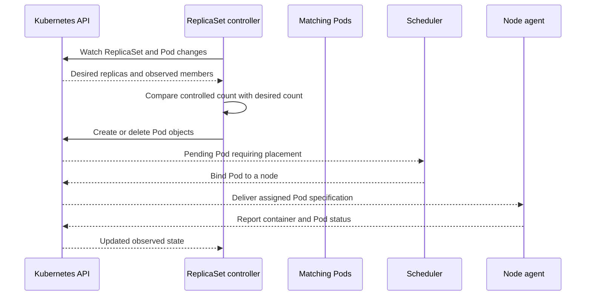
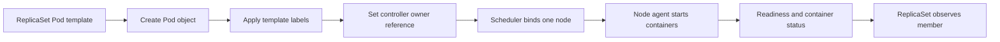
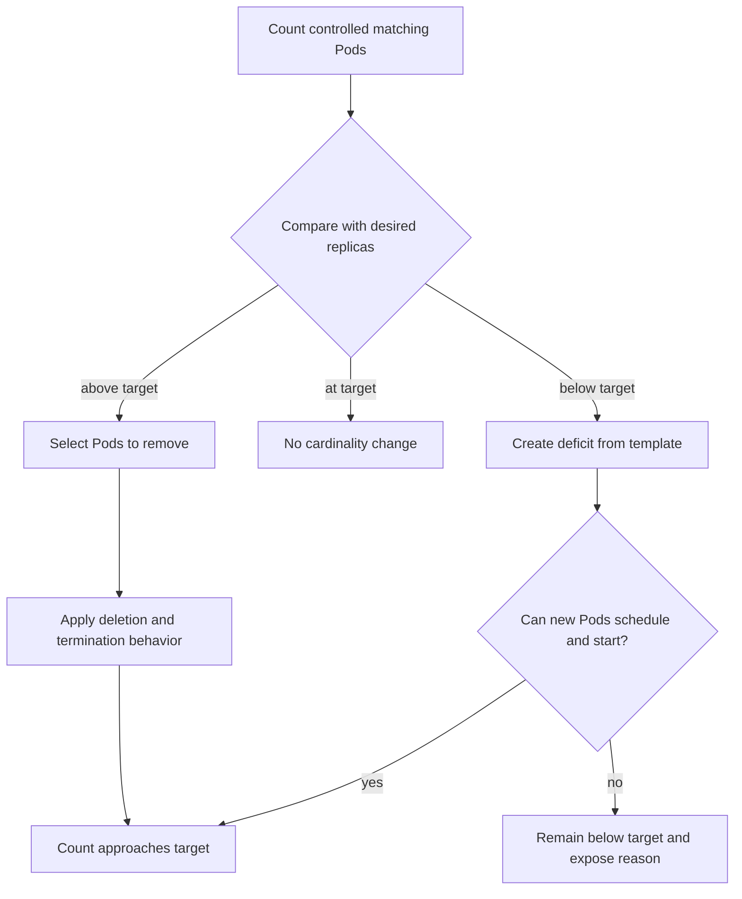
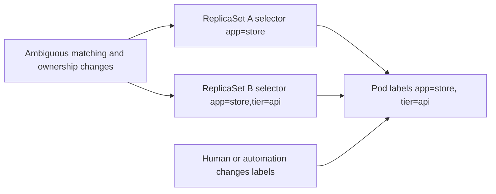

# ReplicaSets

Part: [12 — Kubernetes](PART_OVERVIEW.md)

A ReplicaSet maintains a desired number of matching Pod replicas. It watches the Kubernetes application programming interface (API) for its own state and candidate Pods, compares desired and observed membership, and creates or deletes Pods to move the set toward the requested count. It does not perform a rolling update; a Deployment normally owns and changes ReplicaSets to manage Pod template revisions.

This chapter explains the ReplicaSet controller's selector, ownership, cardinality, adoption, and scaling behavior. CH01 owns Pod lifecycle and identity; CH02 owns Deployment revisions and rollout policy. Part 07 owns general reconciliation and distributed-systems concepts. The upstream Kubernetes documentation consulted for this chapter describes v1.37; confirm behavior and API version against the cluster being operated.

## A Controller for Replica Cardinality



The ReplicaSet is a feedback controller for membership and count. It does not wait for an operator to identify individual failed Pods; it responds to observed state and repeats until the target is approached.

A ReplicaSet specification includes a desired replica count, a label selector, and a Pod template. The controller creates Pods from the template when the controlled set is below the target. It deletes Pods when the controlled set exceeds the target. The controller itself does not start containers; it creates or deletes API objects. The scheduler and node agents then handle placement and runtime.

The observed count is not the same as ready or available capacity. A ReplicaSet can have the requested number of Pod objects while some are Pending, failing probes, or terminating. Its status reports current and ready/available counts; operators should inspect Pod conditions and events to understand why the desired count is not producing service capacity.

The desired count expresses quantity, not placement quality. Three matching Pods may land on one node or zone unless other scheduling constraints distribute them. ReplicaSet ownership does not imply independent failure domains, even distribution, or application health. CH02 and CH09 address rollout and scaling strategy; Part 07 and Part 10 own broader reliability design.

## Selectors Define Membership



Labels identify candidate membership, while the controller owner reference records management. A matching label alone does not mean a ReplicaSet owns every Pod with that label.

A selector can use exact `matchLabels` pairs or set-based `matchExpressions`; all requirements must be satisfied. The Pod template's labels must satisfy the selector. If they do not, the API rejects the ReplicaSet. Selectors should be unique enough that unrelated controllers and workloads cannot accidentally target the same Pods.

ReplicaSets can adopt matching Pods that lack a controller owner reference. This supports recovery when an owning controller disappears and makes direct Pod creation near a selector risky. A bare Pod created with labels matching an active ReplicaSet can be adopted and then deleted if the ReplicaSet is already at its desired count. Conversely, creating the ReplicaSet after matching orphan Pods exist can cause it to adopt those Pods and create only the remaining quantity.

Pods already controlled by another controller are not simply stolen because labels match. The owner reference is part of the control relationship. Avoid overlapping selectors anyway: selector changes, ownership deletion, or controller replacement can expose surprising adoption behavior. When detaching a Pod for debugging, understand that changing its labels may cause the ReplicaSet to create a replacement immediately.

A ReplicaSet uses owner references on controlled Pods so garbage collection and controller logic can follow dependencies. Deleting a ReplicaSet normally deletes its dependent Pods according to API deletion propagation. Orphan deletion can leave Pods running without their former controller; a new ReplicaSet with a compatible selector can later adopt them. This is a deliberate handoff technique, not a routine update strategy.

## Reconciliation, Ownership, and Recovery



The control loop makes API state the coordination boundary. A ReplicaSet can request a Pod but cannot guarantee that capacity, images, volumes, or dependencies allow the Pod to become ready.

When a Pod disappears, the observed count drops; the ReplicaSet requests a replacement. If scheduling constraints cannot be met, the new Pod remains Pending while the ReplicaSet continues to desire it. If a container crashes inside a still-existing Pod, the kubelet may restart that container; the ReplicaSet may not need to create another Pod. This separates node-local container recovery from controller-level replica recovery.

The controller acts asynchronously. A successful API write updates desired state, not the final count. The actual count can lag due to controller queues, quota, API availability, scheduling, node health, image pull, volume attachment, or admission policy. Diagnose the layer that blocks convergence before changing the replica number.

Reconciliation can observe events more than once or after delays. Operators should not depend on one exact API event or immediate single-step behavior. The stable contract is that the controller repeatedly attempts to maintain the matching replica set subject to available resources and policies. Part 07 owns the general control-loop and eventual-convergence concepts; this chapter applies them to the ReplicaSet's Pod set.

## Template and Pod Creation



The template is used when creating new Pods. Editing a ReplicaSet template does not replace existing Pods in a controlled sequence; direct ReplicaSets do not implement rolling update semantics.

New Pods derive labels and specification from the template, with generated metadata such as names and ownership. A ReplicaSet may add a pod-template-hash label when it is managed by a Deployment. That hash distinguishes Deployment revisions; standalone ReplicaSets do not provide equivalent template revision history.

Changes to a direct ReplicaSet's Pod template generally affect future Pods only. Existing Pods are not automatically replaced just because the template changed. To update Pods, a caller would need to coordinate deletion or another controller; doing so safely requires an update strategy that ReplicaSet itself does not provide. This is the principal reason Kubernetes recommends using a Deployment for ordinary stateless applications.

A ReplicaSet manifest might look like this:

```yaml
apiVersion: apps/v1
kind: ReplicaSet
metadata:
  name: catalog-worker
spec:
  replicas: 3
  selector:
    matchLabels:
      app: catalog-worker
      role: worker
  template:
    metadata:
      labels:
        app: catalog-worker
        role: worker
    spec:
      containers:
        - name: worker
          image: registry.example.com/catalog/worker:2.3.1
          resources:
            requests:
              cpu: 200m
              memory: 256Mi
```

This manifest is intentionally minimal. It demonstrates that selector and template labels must align, but omits production readiness, termination, security, image verification, and topology settings. A real service's Pod template should be reviewed using CH01's lifecycle model and the workload's own requirements.

## Scaling and Excess Pods

Scaling changes `.spec.replicas`. Increasing the value asks the controller to create more Pods; decreasing it asks the controller to delete some controlled Pods. If a Horizontal Pod Autoscaler (HPA) targets a ReplicaSet, it can also write the desired replica count, but direct ReplicaSet scaling is uncommon when the ReplicaSet is owned by a Deployment. Do not let manual scripts, declarative configuration, and an autoscaler compete for the same field.



Replica count is a desired cardinality, not a promise that every desired Pod is schedulable or healthy. Capacity and admission constraints can prevent the controller from satisfying a scale-up request.

When scaling down, the controller chooses Pods using best-effort criteria that can include unschedulable or Pending state, a Pod deletion-cost annotation, node distribution, and creation time. The exact order is not an application contract. If a specific Pod must finish work before removal, build an application-level drain and use the appropriate workload controller rather than depending on incidental deletion preference.

Termination is asynchronous. A Pod removed from the desired set may continue consuming resources while it runs `preStop`, drains traffic, and exits within its grace period. Actual running count and resource usage can temporarily exceed the desired replica count during deletion and replacement. Capacity plans must account for termination overlap, not just steady-state replicas.

A ReplicaSet can be scaled to zero without deleting the object. That preserves its template and owner information while stopping its Pods. Deleting the ReplicaSet is different: garbage collection may remove dependent Pods unless orphan propagation is requested. Make the distinction explicit in operations and automation.

## Avoid Competing Controllers and Accidental Adoption



Selectors are part of the controller's authority boundary. Broad or overlapping selectors can cause unintended acquisition, deletion, or cardinality accounting when Pods are orphaned or relabeled.

Do not create ReplicaSets with overlapping selectors or edit generated labels such as `pod-template-hash`. Ensure a direct Pod's labels cannot unintentionally match a ReplicaSet. Review selector changes as ownership changes: adoption can make a controller responsible for Pods it did not create from its current template.

When a ReplicaSet is removed while its Pods remain through orphan deletion, another matching ReplicaSet can adopt them. Adoption does not guarantee those Pods match the new template; the controller may still scale down excess members or create missing ones. Use this behavior only as a planned handoff with readiness, data authority, and ownership understood.

Overlapping selectors can be especially dangerous if two controllers each count or attempt to manage the same population. A controller owner reference generally prevents a second ReplicaSet from taking a Pod already controlled elsewhere, but broad selectors can still create conflicts, unexpected orphan behavior, or misleading status. Design labels around stable workload identity and controller boundaries.

## Deployment Ownership and Alternatives

A Deployment owns ReplicaSets to provide declarative template updates, revision tracking, rolling updates, and rollback history. Most application teams should create and modify a Deployment rather than manipulate its child ReplicaSets. Editing a child ReplicaSet's count or template may be overwritten by its Deployment owner and can disrupt rollout guarantees.

A directly managed ReplicaSet can be useful for custom orchestration, legacy integration, or a workload that does not need updates or revision management. That choice transfers rollout, rollback, and history responsibilities to another mechanism or team. Compare it with Deployment, Job, DaemonSet, and StatefulSet based on workload lifetime, identity, update semantics, and required control.

For finite tasks that should complete, use a Job instead of a ReplicaSet. For one Pod per eligible node, use a DaemonSet. For stable ordinal identity and storage, use a StatefulSet. Kubernetes offers distinct controllers because “keep N Pods” is not the only workload lifecycle contract.

## Worked Scenario: A ReplicaSet Adopts an Orphan Pod

A platform team manually creates a diagnostic Pod with labels `app: catalog-worker` and `role: worker` while the `catalog-worker` ReplicaSet selector matches both labels. The diagnostic Pod has no controller owner reference. The ReplicaSet can adopt it as a member. If the desired count is already met by other matching Pods, it may remove a Pod to return the set to the target; the operator's diagnostic process can be terminated unexpectedly.

The team investigates a report that the diagnostic Pod disappeared. It checks labels, owner references, ReplicaSet events, and the current member count. The Pod was not killed by a node failure; it was selected into the ReplicaSet's set and later removed by cardinality reconciliation. The actual issue was label reuse across an operational tool and a production controller.

The team gives diagnostic Pods a separate label domain and creates them with an explicit owner strategy. It reviews selectors for the other controllers in the namespace and tests an orphan-Pod case in a nonproduction environment. The runbook now warns that removing a controller owner reference or changing labels can alter management immediately. If the diagnostic process must outlive the ReplicaSet, it receives a separate workload object rather than sharing the production selector.

This scenario demonstrates that a ReplicaSet manages the matching set, not merely the Pods it originally created. Selector membership, owner references, and desired cardinality jointly determine behavior.

## Review Questions

- Is the ReplicaSet directly owned or managed by a Deployment, and does the team understand that ownership?
- Does the selector uniquely identify the intended Pod set and match the template labels?
- Could any bare or orphan Pod be adopted unexpectedly?
- Are matching Pods already controlled by another controller, and are ownership references inspected during diagnosis?
- Can the desired count be achieved under current quota, placement, and resource constraints?
- Are Pending, Ready, terminating, and failed Pods distinguished when evaluating replica health?
- Is a direct ReplicaSet genuinely required, given that it does not provide rolling update or revision management?
- Do scale-down expectations rely on best-effort deletion preferences that may change?
- Are direct child ReplicaSet edits avoided when a Deployment owns it?
- Are deletion propagation and orphan handoff deliberate and recoverable?

Further reading: [Kubernetes ReplicaSets](https://kubernetes.io/docs/concepts/workloads/controllers/replicaset/), [Kubernetes Controllers](https://kubernetes.io/docs/concepts/architecture/controller/), [Part 12 Pods](CH01_Pods.md), and [Part 12 Deployments](CH02_Deployments.md).
