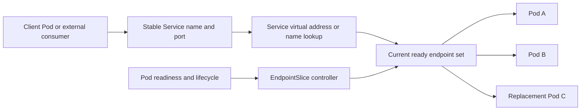
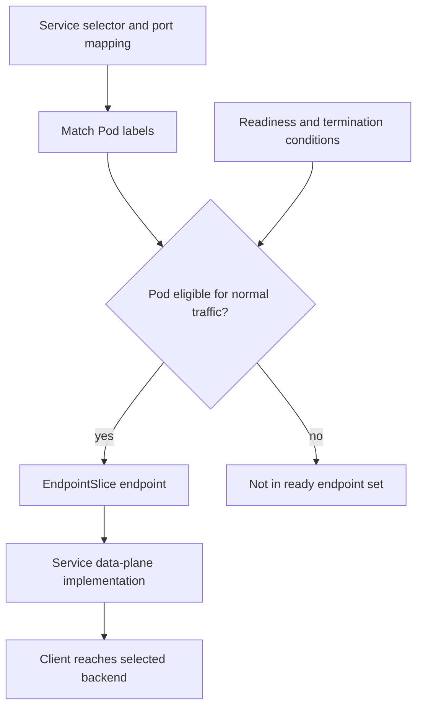
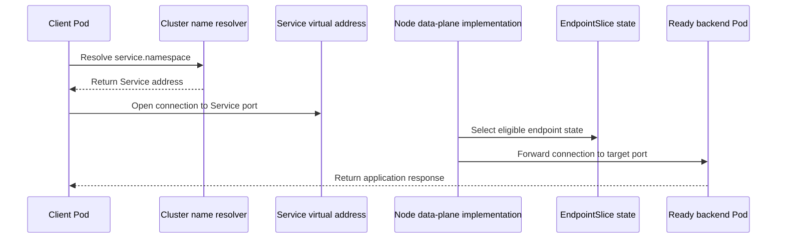
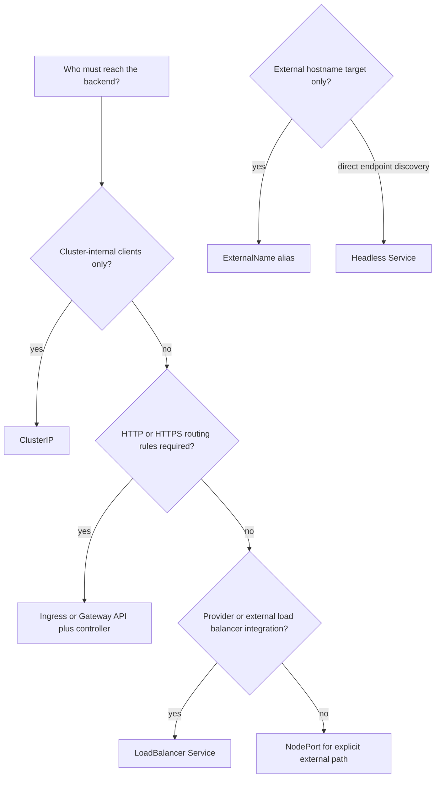
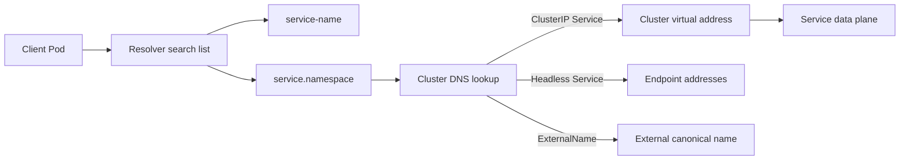

# Services

Part: [12 — Kubernetes](PART_OVERVIEW.md)

A Kubernetes Service gives clients a stable way to discover and reach a logical set of backends while the Pods that implement those backends change. The Service separates client configuration from Pod addresses, selectors, endpoint membership, and traffic policy. It does not run the application, guarantee a healthy backend, or by itself provide a Hypertext Transfer Protocol (HTTP) ingress controller.

This chapter focuses on the upstream Kubernetes Service application programming interface (API), endpoint membership, discovery, and traffic choices. CH01 owns Pod readiness and lifecycle; CH05 owns HTTP ingress and Gateway API; CH06 owns the Container Network Interface (CNI), network policy, and packet-path mechanics. Part 09 owns provider load balancer products and networking integrations. The upstream documentation consulted describes Kubernetes v1.37; traffic-distribution features and implementation behavior must be verified against the target cluster and its network data plane.

## The Service as a Stable Contract

The client targets a stable Service contract; the control plane updates the endpoint set as matching Pods become ready, terminate, or disappear. This decouples clients from ephemeral Pod identity but does not eliminate the need to define traffic and failure behavior.

A Pod's address and lifetime are not stable client contracts. Replicas can be replaced during rollout, node failure, rescheduling, or scaling. If clients cache Pod addresses or enumerate Pods themselves, they inherit endpoint discovery, health, and refresh logic. A Service provides a stable name and port abstraction, usually backed by an allocated Internet Protocol (IP) address and an endpoint set.

A Service specification commonly defines a type, selector, and one or more ports. The selector usually matches Pod labels; the Service controller tracks eligible endpoints in EndpointSlice objects. A Service can also be selectorless and use manually managed EndpointSlices for backends outside the cluster. The application sees a network endpoint contract, while the implementation programs forwarding or returns DNS records depending on the Service mode.

The abstraction has limits. It does not verify application-level correctness; endpoint readiness depends on probes and status. It does not define the external load balancer's algorithm or health-check contract. It does not create HTTP host/path routing by itself. Depending on the proxy implementation and protocol, it may route at connection level rather than balance each application request multiplexed over one connection. Document these implementation boundaries when service-level performance or source-address behavior matters.

## Selectors, Ports, and EndpointSlices

Selector and endpoint state are control-plane data, not a direct proof that packets can reach a Pod. Routing, policy, address family, and node conditions still matter.

A selector is a label query. All requirements must match. Labels are therefore an operational boundary: a broad selector can route traffic to an unintended Pod, while a narrow or mismatched selector can leave a Service with no endpoints. Keep Service and Deployment labels intentional, and test selector behavior before changing a label convention. CH02 owns Deployment selectors and template lifecycle; this chapter focuses on Service membership.

A Service port maps a stable Service port to a target port on the backend. The `targetPort` may be numeric or a named Pod port. Naming allows a backend to change its container port without changing the client-facing Service port, provided the Pod templates retain the expected port name. A Service can expose multiple named ports; when multiple ports exist, each needs a unique name.

EndpointSlices represent subsets of a Service's endpoints, grouped by address type and port/protocol combinations. The control plane creates and updates slices as selected Pods change. A large backend population can be divided among multiple slices instead of one legacy Endpoints object. EndpointSlice conditions distinguish `ready`, `serving`, and `terminating`; clients and data-plane implementations should use the appropriate conditions for normal routing and drain behavior.

EndpointSlice changes are asynchronous. A Pod may transition to terminating while still running, and a client may hold an existing connection after the endpoint is removed from new-connection selection. Endpoint updates propagate through watchers and node-level data planes; they are not a synchronous global switch. Plan for convergence delay and graceful connection drain.

EndpointSlice consumers must aggregate slices for the Service and deduplicate endpoints because an endpoint can temporarily appear in multiple slices as changes propagate. The control plane's slice packing favors fewer updates across nodes over perfect packing. Most application teams should consume Services rather than implementing an endpoint controller; custom consumers need to understand ownership labels, stale watch events, and duplicate addresses.

For a Service without a selector, Kubernetes does not automatically create backend EndpointSlices. A controller or operator must supply and maintain them. This can bridge a migration, expose an external database, or point to a separately managed service, but it creates explicit ownership for health, address changes, and cleanup. Validate that manually supplied addresses are reachable and permitted; a syntactically valid EndpointSlice does not test the network path.

## Service Virtual Address and Traffic Behavior

The virtual address is stable, but its forwarding is implemented by kube-proxy or another compatible data plane. The exact interception, balancing granularity, and source-address effects depend on that implementation and the Service policy.

A normal `ClusterIP` Service receives a cluster-internal virtual address and is the default Service type. The data plane maps traffic to ready backends. A client often connects to the virtual address once per Transmission Control Protocol (TCP) connection; the implementation's selection applies to connections or flows, not necessarily to individual application requests multiplexed over one connection. Long-lived connections can therefore remain pinned to one backend.

Kubernetes Service routing is not identical to a reverse proxy. It generally operates at the network transport path and does not provide HTTP host/path routing, request retries, or application-aware load distribution as part of the core Service API. CH05 covers Ingress and Gateway abstractions; Part 05 owns generic load balancer and reverse proxy behavior.

Session affinity can prefer routing a client source address to the same backend for a configured period. This may help legacy stateful clients but reduces distribution flexibility and does not replace durable session storage. If a client address is hidden by network translation, many users may appear as one source. Test the actual path and workload rather than assuming one client equals one source IP.

Traffic policies and distribution preferences influence endpoint selection. `internalTrafficPolicy: Local` restricts internal traffic to node-local endpoints; if none are available, traffic can fail rather than fall back remotely. `externalTrafficPolicy: Local` can preserve the source address and avoid an extra hop, but incoming nodes without local endpoints may drop traffic and distribute load unevenly. These are semantic trade-offs between locality, availability, source identity, and balance.

In the v1.37 documentation, `trafficDistribution` can express preferences such as `PreferSameZone` or `PreferSameNode`. A preference is not the same as a strict locality guarantee. Weigh reduced latency or cross-zone transfer against endpoint capacity and failure behavior. Part 09 and CH06 own network topology and cloud-specific routing; the Kubernetes Service field expresses only its API-level intent.

## Choose a Service Type and Exposure Boundary

The type chooses a network exposure contract, not the implementation behind it. Confirm the controller or provider component that realizes external exposure, along with its lifecycle, health checks, address allocation, and support boundary.

| Service form | Contract | Main trade-off |
|---|---|---|
| `ClusterIP` | Stable cluster-internal virtual address and Service name | Internal exposure; implementation handles endpoint forwarding. |
| Headless `ClusterIP: None` | Name resolution publishes endpoint addresses instead of a virtual address | Clients discover and select individual Pods; no Service virtual-address proxy or built-in load balancing. |
| `NodePort` | Reserves a port on eligible node addresses and forwards to Service endpoints | Exposes node-level network surface and port range; often used beneath another load balancer. |
| `LoadBalancer` | Requests an external load balancer through an installed controller/provider integration | Provider behavior, cost, address, health checks, and lifecycle vary. |
| `ExternalName` | Name resolution returns a canonical name for another hostname | Name-only indirection; no proxy, endpoint health, or address translation. |

`NodePort` assigns a port from the configured range and makes it available through node addresses according to the data-plane implementation. It gives an external system a stable port target but exposes nodes and requires firewall, address, and availability design. The default port range is configurable; do not hard-code assumptions about it.

`LoadBalancer` asks an integration to provision or configure an external load balancer. Creation is asynchronous and the Service status reports the resulting ingress address or hostname. Kubernetes does not define every provider's balancing algorithm, health check, source-address handling, or cost. Some implementations use NodePorts; others can route directly to Pod endpoints and allow NodePort allocation to be disabled. Part 09 owns provider product mechanics; this chapter owns the Kubernetes request and responsibility boundary.

`ExternalName` returns a Domain Name System (DNS) canonical name (CNAME) rather than forwarding packets. The client resolves the external name and connects directly. Protocols that embed hostnames can behave unexpectedly because the client uses the Service name while the upstream server expects a different HTTP Host header or Transport Layer Security (TLS) certificate name. Use an explicit proxy or Gateway when the path needs protocol mediation, health checks, or policy enforcement.

The `externalIPs` field is deprecated in current upstream documentation and does not allocate or manage the address. Prefer a maintained load balancer integration or Gateway implementation. Do not create an apparent Service exposure contract that depends on unowned external routing configuration.

## Headless Services and Direct Discovery

A headless Service sets `clusterIP: None`. It does not allocate a virtual IP or use the Service proxy for load balancing. With a selector, the EndpointSlice controller tracks selected endpoints and cluster DNS can return their addresses. The client takes responsibility for choosing an endpoint, refreshing DNS, handling stale addresses, and distributing connections.

Headless discovery can be useful when applications need individual peer identities, such as a clustered database or custom protocol that performs its own membership and health logic. It is not inherently more reliable or lower latency: client resolvers may cache records, endpoint readiness affects what is published, and stale answers can outlive Pod replacement. Use normal ClusterIP when clients need a stable virtual endpoint and do not need peer identity.

A headless Service without a selector can publish addresses from manually managed EndpointSlices. That pattern can expose external endpoints through cluster DNS, but it makes the controller or operator responsible for updating membership and readiness. Avoid hand-maintaining endpoints without an owner and a reconciliation mechanism.

## Service Discovery Through the Domain Name System (DNS)

DNS names provide a convenient discovery layer, but the answer differs by Service type. Clients should avoid depending on undocumented search expansions or caching behavior beyond the cluster's DNS contract.

A Service is resolvable by name within the cluster when cluster DNS is configured. A short name resolves in the caller's namespace. Cross-namespace clients use a namespace-qualified name, commonly `service.namespace`; the full name includes `.svc` and the cluster domain, which is configurable rather than universally `cluster.local`.

Normal Services resolve to the Service virtual address. Headless Services resolve to endpoint addresses, commonly one record per ready backend. Named Service ports can also be discoverable through DNS service records. `ExternalName` resolves as a CNAME to the configured name. These differences affect clients: a ClusterIP name typically remains stable while endpoints change, whereas headless answers vary with membership.

DNS resolution is not health checking for every application request. Clients may cache records; resolvers may retry; long-lived connections may retain an old address; and a DNS answer can be correct while the packet path or backend is broken. For critical paths, measure both DNS resolution and connection/result behavior. Part 05 CH08 owns DNS protocol details and caching behavior; this chapter explains Kubernetes names and Service record shapes.

Environment variables can also publish Service addresses, but Pods only receive values for Services that exist when the Pod is created. This creates order dependence and stale configuration when Services change. DNS avoids that creation-order limitation and is usually the more flexible discovery method.

## Readiness, Termination, and Endpoint Health

Endpoint membership follows Pod conditions. For selector-backed Services, the EndpointSlice controller observes matching Pods and their readiness and termination state. A failed readiness probe normally removes the Pod from the ready endpoint set without restarting its container. Liveness failure, by contrast, can restart the container and may reduce capacity while it recovers; CH01 owns the probe distinctions.

EndpointSlice exposes `ready`, `serving`, and `terminating` conditions. The `ready` condition is generally a convenience for endpoints that are serving and not terminating, with special behavior for Services that publish not-ready addresses. During termination, a proxy usually avoids new connections to terminating endpoints, but may continue using endpoints that are still serving if all available endpoints are terminating. Existing connections and data-plane convergence mean a Service change is not an instantaneous drain.

Do not overload readiness with a deep dependency graph that causes every backend to disappear together during a shared outage. Readiness should answer whether a Pod can serve the specific class of traffic. If an optional dependency is unavailable, the application may remain ready and serve degraded functionality; if a critical dependency is absent, the product may prefer to withdraw the endpoint. This is a workload decision that should align with the service contract.

A Service selector can match Pods that are running but not ready; they are represented in endpoint state but should not receive normal traffic by default. Debug by checking the selector, EndpointSlices, conditions, port mappings, DNS, and data-plane implementation. A missing endpoint can be caused by a label mismatch or readiness state even when the Pod phase says Running.

## Worked Scenario: A Service with No Ready Endpoints

A team updates a payment Deployment. Pods are Running, but the internal `payments` Service has intermittent connection failures. The initial response is to increase replicas and restart the Service object. Neither changes the endpoint state.

The on-call engineer inspects the Service selector and finds that the Deployment template added a release label while the Service still selects the old label set. New Pods do not match, so the EndpointSlice contains only terminating endpoints from the prior revision. The application itself is healthy, but the Service has no ready backend for new connections. The team verifies selector and Pod labels, then checks EndpointSlice `ready`, `serving`, and `terminating` conditions to see how the endpoints transition during replacement.

The team fixes the Service selector in a reviewed change and checks that it matches the stable application label rather than the release-specific label. It verifies the named target port against the Pod port, checks that cluster DNS returns the expected ClusterIP, and performs a request from a client Pod. The team also tests a Pod becoming unready and terminating, confirming that new traffic shifts while the old process drains existing work.

The service recovers without increasing replicas. The incident review adds a manifest validation that checks selector-template compatibility and an alert for a Service with zero ready endpoints. The change is measured at the actual client path rather than inferred from the Service object's existence.

## Review Questions

- Does the Service selector identify exactly the intended Pod set, and are labels stable across releases?
- Are Service port, target port, protocol, and named-port contracts explicit and tested?
- Are EndpointSlice conditions and controller ownership understood for readiness, termination, and custom endpoints?
- Is a Service virtual IP needed, or does the client require direct endpoint discovery through a headless Service?
- Is the chosen Service type appropriate for the exposure boundary, and who owns the external implementation?
- Are NodePort or LoadBalancer behaviors validated for addresses, health checks, source IP, node coverage, and capacity?
- Does DNS return the expected record shape and namespace-qualified name, and can clients tolerate updates and caching?
- Are traffic locality preferences compatible with endpoint distribution and failure behavior?
- Are Service readiness and termination semantics aligned with application degradation and connection draining?
- Can responders trace failures across selector, EndpointSlice, DNS, virtual IP, data plane, network policy, and backend readiness?

Further reading: [Kubernetes Services](https://kubernetes.io/docs/concepts/services-networking/service/), [EndpointSlices](https://kubernetes.io/docs/concepts/services-networking/endpoint-slices/), [DNS for Services and Pods](https://kubernetes.io/docs/concepts/services-networking/dns-pod-service/), [Kubernetes Virtual IPs and Service Proxies](https://kubernetes.io/docs/reference/networking/virtual-ips/), [Part 12 Pods](CH01_Pods.md), and [Part 09 Managed Kubernetes](../09_Cloud_Computing/CH08_Kubernetes.md).
