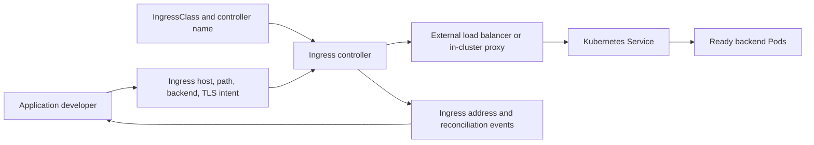
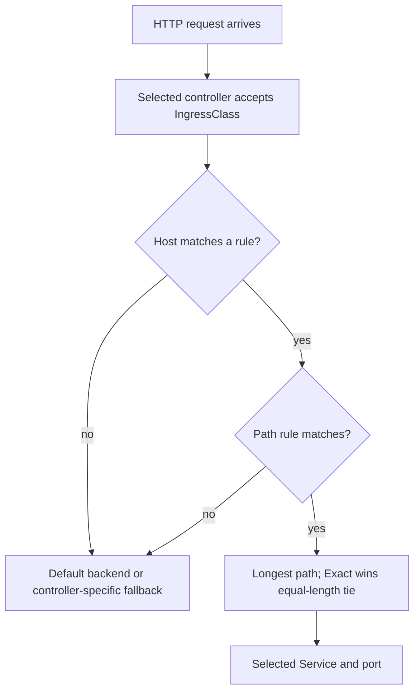
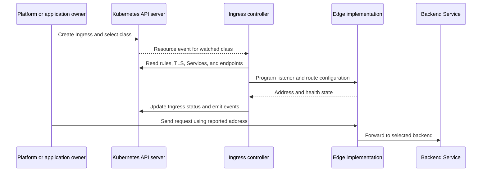
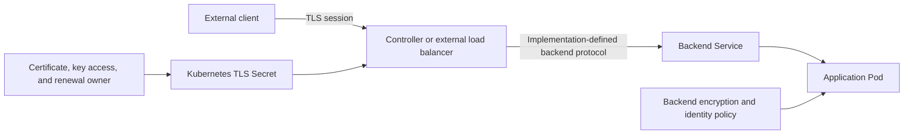
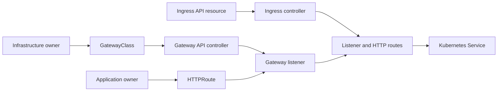

# Ingress

Part: [12 — Kubernetes](PART_OVERVIEW.md)

Kubernetes Ingress is an application programming interface (API) resource for expressing external Hypertext Transfer Protocol (HTTP) and Hypertext Transfer Protocol Secure (HTTPS) routing to cluster Services. It records hosts, paths, backends, and Transport Layer Security (TLS) references, but it does not implement a proxy or load balancer. An Ingress controller watches the resource and configures an implementation such as an external load balancer, an in-cluster proxy, or both. Creating an Ingress without a controller that accepts its class leaves a valid object with no functioning route.

This chapter covers the upstream Ingress API and its controller contract. Part 12 CH04 owns Service endpoint and exposure behavior; Part 09 owns cloud load balancer products; Part 05 owns general reverse-proxy, DNS, certificate, and load-balancing mechanics. Gateway API is the recommended evolution path for new capabilities, but it is a separate add-on API family with its own implementations and lifecycle. The upstream Ingress API remains generally available and is frozen: it is not being removed, but no new API features are planned. Confirm controller and API versions before designing a migration.

## Resource and Controller Are Separate



The Ingress object expresses desired routing. The controller translates it into working traffic infrastructure and reports observed state. These can diverge if the class, controller, Service, certificate, or provider integration is absent or broken.

The API object can express a default backend, HTTP rules with optional hosts and paths, Service backends, and TLS configuration. The IngressClass identifies the controller intended to implement the resource and can reference implementation parameters. Multiple controllers may coexist, each accepting a different class. A cluster may define a default class, but relying on implicit selection makes ownership less visible; production resources should generally name the intended class.

IngressClass is not simply an alias for an old controller annotation. `ingressClassName` references an IngressClass resource, which includes the controller name and may include parameters. The deprecated `kubernetes.io/ingress.class` annotation historically selected implementations, but behavior is controller-specific and the field and annotation are not guaranteed to be direct equivalents. Migrate by confirming what the selected controller watches and which class object it expects.

Controller implementations differ. One may provision a cloud load balancer, another may run a proxy inside the cluster, and some integrate both. They can differ in supported annotations, path behavior, health checks, source-address handling, TLS features, reload strategy, and status reporting. The core API's existence does not guarantee uniform behavior across controllers.

## Request Routing and Match Semantics



Routing is controller-mediated. The API specifies host and path intent; the controller validates and programs a concrete data path that must still reach ready Service endpoints.

A rule can include a host, a set of paths, and a backend for each path. Host matching can be exact or use a single-label wildcard such as `*.example.com`; the wildcard does not match arbitrary nested subdomains. If several paths match, the longest path takes precedence, with Exact preferred over Prefix when otherwise tied. Path matching is case-sensitive.

Ingress supports three path types:

| Path type | Semantics | Portability concern |
|---|---|---|
| `Exact` | Match the path exactly, including case and trailing slash distinction. | Verify controller conformance for normalization and edge cases. |
| `Prefix` | Match path elements separated by `/`, not arbitrary string prefixes. | `/shop` should match `/shop/items`, not `/shopping`; test encoded and normalized paths. |
| `ImplementationSpecific` | Matching behavior is selected by the IngressClass/controller. | Least portable; controller upgrades or migrations can change semantics. |

An Ingress without rules can specify a default backend. If no rule matches and the resource has no default backend, fallback behavior is implementation-specific. A controller can also have a configured default backend outside the Ingress resource. Record which applies; do not assume unmatched traffic is safely rejected or routed to a particular Service.

The API can direct only HTTP and HTTPS traffic. Other protocols need a Service exposure mechanism or a Gateway API route supported by the implementation. Ingress is not a generic TCP/UDP gateway, a Service type, or an application programming interface (API) gateway with all application policy semantics.

## Controller Reconciliation and Class Ownership



The reconcile loop has independent dependencies: resource schema acceptance, controller watch and permission, configuration generation, external provisioning, address publication, and Service endpoint reachability. A controller may be healthy while one Ingress resource is rejected or one backend has no endpoints.

The `ingressClassName` field references an IngressClass. It does not identify a controller binary or cloud product directly. IngressClass `.spec.controller` identifies the implementation family; optional parameters can be scoped cluster-wide or to a namespace according to the API and implementation. Review who may create or modify classes, which tenants can attach Routes or Ingresses to shared infrastructure, and how a default class is governed.

When multiple controllers run in one cluster, class selection is an isolation boundary. An omitted class may be assigned to the default IngressClass when exactly one is marked default; multiple defaults can block creation of classless Ingress resources. Controllers that watch resources without a class can also have implementation-specific behavior. Make class ownership and defaulting explicit and test that a controller does not unexpectedly claim another team's resources.

Controller health and Ingress status are distinct from request success. The controller may publish an address before its configuration is fully propagated; an external load balancer may take time to allocate; the Domain Name System (DNS) may not yet resolve; or a backend may fail its readiness check. Observe controller events, class selection, status address, listener state, endpoint state, and a real request from the intended client network.

## TLS Termination and Trust Boundaries



The Ingress API references a TLS Secret, but the controller determines how that material is consumed and where TLS ends. A declared TLS block alone does not prove that a certificate is valid, current, private, or used by the active listener.

An Ingress TLS entry associates hostnames with a Secret that typically contains `tls.crt` and `tls.key`. The standard API models a TLS listener on port 443 and assumes termination at the ingress point. Traffic from the controller to Services may be plaintext unless the implementation and backend configuration establish another protected path. Decide whether the backend trust boundary requires transport encryption and workload identity; do not infer end-to-end encryption from client-side TLS alone.

Certificate issuance, renewal, key custody, and secret rotation are separate operational responsibilities. Part 05 CH15 owns certificate lifecycle; Part 15 owns general TLS and security principles; Part 09 owns provider certificate and secret services. The Ingress review checks ownership and compatibility: which controller reads the Secret, whether updates are observed, whether the certificate covers the host, how expiration is monitored, and what happens during controller replacement.

Controllers vary in TLS capabilities, cipher policy, mutual authentication, redirects, and backend encryption. Some features are expressed through annotations or custom resources rather than the Ingress API. Such configuration can be useful but ties the workload to an implementation. Record the compatibility constraint and migration cost; avoid representing an annotation as a portable Kubernetes guarantee.

## Configure an Ingress Resource

A simple resource can route one host and a path prefix to a Service:

```yaml
apiVersion: networking.k8s.io/v1
kind: Ingress
metadata:
  name: receipts-edge
spec:
  ingressClassName: public-gateway
  tls:
    - hosts:
        - receipts.example.com
      secretName: receipts-edge-tls
  rules:
    - host: receipts.example.com
      http:
        paths:
          - path: /api
            pathType: Prefix
            backend:
              service:
                name: receipts-api
                port:
                  name: http
```

This example assumes that the `public-gateway` IngressClass exists, its controller supports the API fields, the referenced TLS Secret exists in the Ingress namespace, the `receipts-api` Service exposes a named `http` port, and its endpoints are ready. The manifest describes a desired route; it does not create the controller, provision the certificate, or verify backend health.

Hostnames in TLS configuration should correspond to hosts in rules. Wildcards cover a limited DNS-label pattern, not every possible subdomain. Path rewrites, redirects, authentication, rate limits, and weighted traffic may require controller-specific extensions; keep those behaviors visible in architecture decisions and tests.

A resource backend can reference another Kubernetes resource through a custom resource definition (CRD), instead of a Service, when the controller supports that extension. This is not a portable Service backend and has its own schema, lifecycle, authorization, and health semantics. Use it only when the controller/resource contract is deliberately owned.

## Ingress and Gateway API



Ingress concentrates intent in one resource and relies heavily on controller-specific extensions. Gateway API separates infrastructure, listener, and route roles into a family of resources, which can improve delegation and expressiveness where an implementation supports the needed API version and features.

Upstream Kubernetes recommends Gateway API for new capabilities. The Ingress API remains stable and generally available, but is frozen and is not planned for removal. Existing deployments do not need an automatic migration solely because of that recommendation. Evaluate feature requirements, controller support, migration effort, policy, and platform ownership.

Gateway API is an add-on family of custom resource definitions rather than a core Kubernetes resource set. A GatewayClass identifies a controller implementation; a Gateway represents traffic-handling infrastructure and listeners; an HTTPRoute attaches routing rules to a Gateway and selects backends. The model is role-oriented: infrastructure providers, cluster operators, and application developers can own different layers, with explicit cross-namespace attachment policy.

Ingress-to-Gateway migration is not a kind rename. The APIs differ in resource model, route attachment, status, policy extension, and controller support. Inventory annotations and implementation-specific behavior first. Map each host, path, backend, TLS, and policy requirement to a supported Gateway API resource; run both configurations in a controlled environment; verify request matching, certificate behavior, status conditions, and rollback; then move traffic under a decision authority. Preserve the existing Ingress path until the Gateway implementation is proven.

Choose Ingress for an existing, supported, sufficiently simple HTTP route surface where the controller contract is known. Consider Gateway API where role separation, richer routing, cross-namespace policy, or future extensibility matters and a conformant implementation supports the needed features. For a single Service, a `LoadBalancer` Service may be simpler. The best choice depends on the network and operating model, not resource popularity.

## Failure Modes and Operational Evidence

An Ingress can exist while no route works. Diagnose in layers:

- Confirm the Ingress resource was accepted and has valid host, path type, backend Service, port, and TLS references.
- Confirm `ingressClassName` resolves to an IngressClass whose controller is running and watching that class.
- Inspect controller events and logs for rejected fields, unsupported annotations, conflicts, or failed configuration reloads.
- Confirm the controller or external load balancer has a published address and listener.
- Verify DNS resolves the host to the intended edge address and client TLS trusts the presented certificate.
- Check the path and host against rule matching semantics, then inspect Service selectors and ready endpoints.
- Test from the relevant network boundary; an internal Pod test and an external client test exercise different routes.

A controller upgrade can change annotation parsing, defaults, or proxy behavior even when the Ingress object is unchanged. Pin and test controller versions, preserve a configuration source of truth, and monitor resource status. Multiple Ingresses can compose at the controller level in implementation-specific ways; conflicting host/path claims need an ownership policy and validation.

TLS failures can originate from Secret access, certificate/key mismatch, hostname mismatch, expiry, controller not reloading updates, or a backend protocol mismatch. Record which hop terminates TLS and which team owns it. If the controller is shared, include its failure domain, capacity, and security authority in the workload's review.

## Worked Scenario: A Route Exists but the Host Gets a Default Response

A team creates an Ingress for `receipts.example.com` with a `/api` Prefix path and sees the resource in the API. External requests receive the controller's default response. The team first assumes the backend Service is unhealthy and increases its replicas.

Inspection shows that the Ingress omits `ingressClassName`. The cluster has two controllers, and neither claims classless resources because there is no single default class. The resource is valid but has no implementation. The team assigns the intended class and checks controller events; the controller accepts the rule and reports an edge address.

Requests still fail. DNS resolves correctly, but the client requests `/apix`; this is not a Prefix match for `/api` because matching is by path elements rather than arbitrary string prefix. The controller uses the default backend. A request to `/api/receipts` matches, but the backend then returns an error because the Service's named target port does not correspond to the Pod port.

The team validates the class, host, path cases, named port, EndpointSlices, TLS Secret, and real client path. It adds a request test for exact and prefix behavior and a deployment check that the referenced Service and port exist. A later migration plan considers Gateway API because the organization wants separate infrastructure and application route ownership; the current Ingress remains in place until the Gateway controller and policy are validated.

The incident crossed API acceptance, controller ownership, path semantics, and Service port mapping. Scaling Pods could not fix a route that never selected the Service.

## Review Questions

- Is there a running Ingress controller that explicitly accepts the chosen IngressClass?
- Does every rule specify a supported host, path type, backend Service, and valid port?
- Are path matching, wildcard host scope, default backend, and controller-specific annotations tested?
- Where does client TLS terminate, who owns certificate lifecycle, and how is the backend path protected?
- Does the controller publish and operate the expected edge address and health-check behavior?
- Are multiple controllers, defaults, tenants, and class parameters governed without ambiguous ownership?
- Are Service endpoints, readiness, and named target ports verified independently of the Ingress resource?
- Is the current API's frozen status understood, and is Gateway API adoption justified by an actual requirement?
- Can migration preserve traffic, TLS, policies, and rollback while both APIs are evaluated?
- Do operators have evidence from the client boundary through controller, Service, and Pod when a route fails?

Further reading: [Kubernetes Ingress](https://kubernetes.io/docs/concepts/services-networking/ingress/), [Ingress Controllers](https://kubernetes.io/docs/concepts/services-networking/ingress-controllers/), [Gateway API](https://kubernetes.io/docs/concepts/services-networking/gateway/), [Gateway API ingress migration guide](https://gateway-api.sigs.k8s.io/guides/getting-started/migrating-from-ingress/), and [Part 12 Services](CH04_Services.md).
