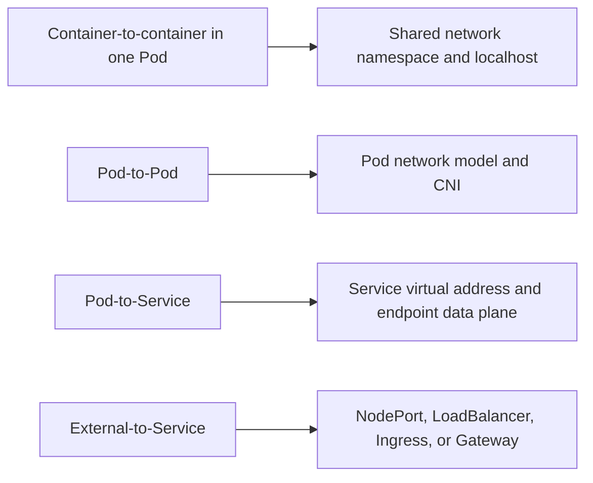
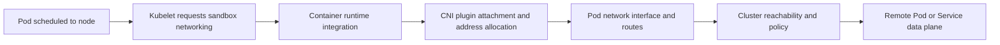
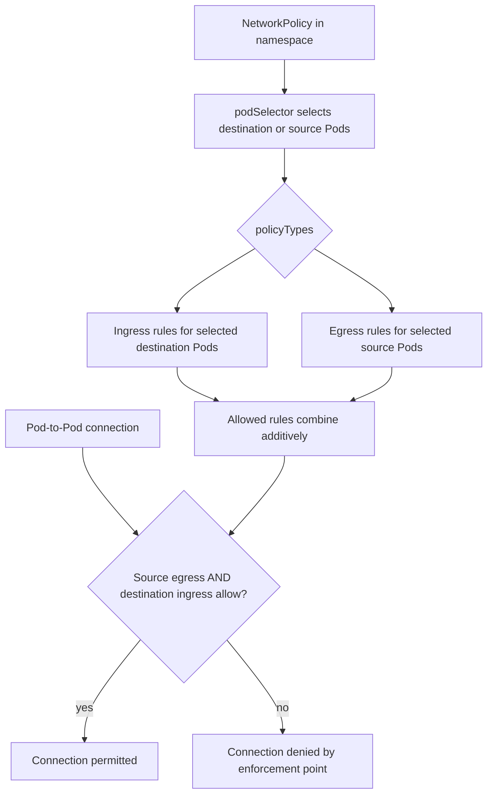
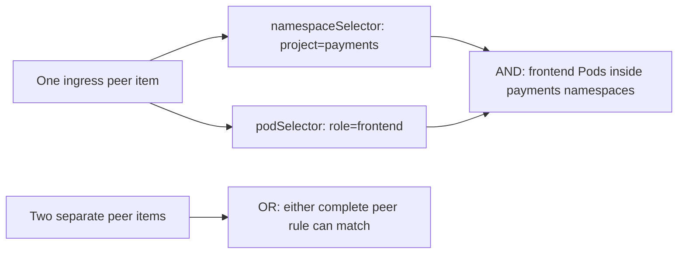
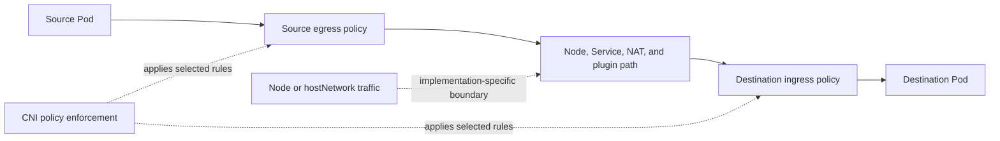

# Networking

Part: [12 — Kubernetes](PART_OVERVIEW.md)

Kubernetes networking is a set of contracts across Pods, Services, names, nodes, and external dependencies. A Pod receives a network identity, Pods can communicate according to the cluster's network model, Services provide stable backend access, and NetworkPolicy resources express selected ingress and egress restrictions. The Kubernetes application programming interface (API) describes intent; a Container Network Interface (CNI) plugin, service data plane, node routing, and provider network implement the actual packet path.

This chapter focuses on upstream Kubernetes networking abstractions and their operational consequences. Part 05 owns Internet Protocol (IP), routing, Domain Name System (DNS), network address translation (NAT), and firewall fundamentals. Part 09 owns provider virtual networks, managed CNI options, and network products. Part 12 CH04 owns the Service API and endpoint behavior; CH05 owns HTTP Ingress and Gateway routing; CH13 owns security foundations. Here, the focus is the Kubernetes contract, enforcement boundaries, and evidence needed to validate a cluster network.

The upstream documentation consulted describes Kubernetes v1.37. CNI features, NetworkPolicy enforcement, data-plane behavior, dual-stack support, and traffic locality are implementation- and version-dependent. Verify the cluster's actual plugin and configuration rather than assuming that creating an API object changes packet behavior.

## Separate the Networking Problems



The four paths have different owners and failure modes. A successful Pod-to-Pod test does not prove a Service VIP works, and a working ingress address does not prove policy permits the backend path.

Containers inside one Pod share the Pod network namespace and can communicate through localhost, with a shared port space. CH01 explains this Pod-level contract. Different Pods use network communication rather than shared process IPC. Service abstractions add stable naming and virtual addresses over changing Pods; CH04 owns those semantics. External access is an additional exposure decision, not an automatic consequence of Pod networking.

The Kubernetes networking model expects each Pod to have a unique address and to communicate with other Pods without application changes, subject to the cluster's configured policy. The model does not prescribe one plugin, overlay protocol, routing design, or provider network. A cluster can implement Pod reachability with routed Pod prefixes, encapsulation, host routing, or another supported design. Each option has different address consumption, maximum transmission unit (MTU), routing scale, observability, and failure characteristics.

Start a workload review with explicit source, destination, protocol, port, identity, and direction. Determine whether the path is Pod-to-Pod, Pod-to-Service, Pod-to-node, Pod-to-external, or external-to-Service. Then inspect which object or implementation controls each segment: namespace and labels, Service selector, EndpointSlice, NetworkPolicy, CNI, node route, NAT, firewall, load balancer, or external dependency.

## Pod Addressing and the CNI Boundary



CNI is an implementation interface used by a runtime to configure network connectivity. It is not the full definition of cluster routing, IP allocation, policy, Service forwarding, or external connectivity; a deployed solution may use multiple components for those jobs.

When a Pod is assigned to a node, the node agent and container runtime arrange a Pod sandbox and invoke the configured networking integration. The plugin may create an interface, allocate an address, add routes, set up virtual Ethernet pairs, or configure an overlay. Additional components can manage address pools, policy enforcement, Service virtual IPs, and external routes. Identify each responsibility and failure signal instead of treating “the CNI” as a single opaque box.

Address planning spans node addresses, Pod addresses, and Service addresses. These ranges must not overlap with one another or with connected enterprise, partner, VPN, or on-premises ranges that need to route into the cluster. Overlap can make routes ambiguous even when local Pod traffic works. Plan expected Pods per node, per-node allocation blocks, rollout surge, autoscaling peaks, and address reuse before selecting a range.

The control plane, node agent, and networking plugin must agree on address families and ranges. In dual-stack clusters, Pod and Service objects can carry both IPv4 and IPv6 addresses, but the provider network, CNI, routing, policy implementation, and external egress must all support the chosen mode. A dual-stack flag alone does not make every application, dependency, or load balancer dual-stack. Test DNS answers, connections, policy, and failover for each family.

Encapsulation can simplify routing across an underlay but adds header overhead and can reduce the effective MTU. Routed Pod prefixes can avoid some encapsulation overhead but require route distribution and scale management. Large packets may be fragmented or dropped if the path MTU is inconsistent; small health checks can pass while bulk transfers fail. Part 05 owns MTU and fragmentation mechanics; Kubernetes operators must verify that the selected plugin, node interface, and external path agree on usable packet size.

The CNI and cloud integration affect address availability, source-address preservation, node failure, and visibility. Part 09 CH05 owns provider network products and managed plugin mechanics. This chapter's review evidence includes Pod and node addresses, assigned ranges, routes, plugin status, policy capability, DNS reachability, and tests that cross node and failure-domain boundaries.

## NetworkPolicy Selectors and Isolation



NetworkPolicy is a Pod-level allow model with independent ingress and egress isolation. For a Pod-to-Pod connection to succeed, applicable source egress rules and destination ingress rules must both permit it.

By default, Pods are non-isolated for ingress and egress. A policy isolates selected Pods in a direction when it declares that direction in `policyTypes`; once isolated, only traffic allowed by applicable rules is permitted, plus implicit reply traffic for allowed connections. Multiple policies do not override each other by priority or order. Their allowed rule sets combine additively. Kubernetes NetworkPolicy has no general explicit-deny rule that overrides a separate allow.

A default-deny policy selects Pods and declares a direction with no allow rules. It isolates the selected Pods for that direction. Ingress and egress are independent: a namespace can deny all inbound traffic while leaving outbound traffic open, or vice versa. A default-deny egress policy also blocks DNS unless a separate rule permits the cluster DNS service. Include required control-plane, identity, telemetry, and dependency paths before enforcing a broad policy.

The policy's `podSelector` identifies the Pods being isolated within the policy's namespace. An empty selector selects all Pods in that namespace. In an ingress `from` or egress `to` peer, a `podSelector` alone selects Pods in the policy's namespace. A `namespaceSelector` selects namespaces. When both selectors appear in one peer item, they are a conjunction: selected Pods within selected namespaces. Two separate peer list items are a union. This YAML distinction can widen a boundary dramatically.



Review the data structure, not just the labels shown in a policy summary. A misplaced list dash can turn a narrow cross-namespace rule into a broad OR condition.

Selectors depend on mutable labels. Namespace labels can be used to group trust zones; Kubernetes also sets an immutable namespace-name label. Ensure that only authorized operators can relabel namespaces or Pods when policy uses those labels as an isolation boundary. A policy selection can change without changing the policy object if labels change.

`ipBlock` selects an IP range and is generally intended for external addresses. Pod addresses are ephemeral; prefer Pod and namespace selectors for workload identity where available. NAT and Service address rewriting can occur before or after policy enforcement depending on the plugin and path. The observed source or destination may be a client, node, load balancer, or translated address. Test the actual packet path before relying on a CIDR allow rule.

## Enforce Policy at the Intended Boundary



The NetworkPolicy API describes intent, but an implementation must enforce it. If the CNI does not support NetworkPolicy, creating the resource has no effect. Confirm enforcement with an allowed and a denied test, not merely by observing that the API object exists.

Kubernetes NetworkPolicy primarily expresses Layer 3 and Layer 4 connectivity: Pod and namespace selectors, IP blocks, protocol, and ports. Supported protocols include Transmission Control Protocol (TCP), User Datagram Protocol (UDP), and, when the plugin supports it, Stream Control Transmission Protocol (SCTP). It does not provide general hostname-based egress rules, Hypertext Transfer Protocol (HTTP) path controls, Transport Layer Security (TLS) inspection, explicit deny precedence, or a universal node policy. Service meshes, ingress controllers, firewalls, and external policy products may add those capabilities, but they have different owners and failure behavior.

This policy isolates receipt Pods for both directions. It allows ingress only from gateway Pods in the `edge` namespace, egress to a ledger Pod in the same namespace, and egress to the cluster DNS Pods. The namespace and Pod selectors in the same peer item form an AND condition. Verify the DNS namespace and labels for the actual cluster; add any other required dependencies deliberately.

```json
{
    "apiVersion": "networking.k8s.io/v1",
    "kind": "NetworkPolicy",
    "metadata": {
        "name": "receipts-api",
        "namespace": "payments"
    },
    "spec": {
        "podSelector": {
            "matchLabels": { "app": "receipts" }
        },
        "policyTypes": ["Ingress", "Egress"],
        "ingress": [
            {
                "from": [
                    {
                        "namespaceSelector": {
                            "matchLabels": { "kubernetes.io/metadata.name": "edge" }
                        },
                        "podSelector": {
                            "matchLabels": { "app": "ingress-gateway" }
                        }
                    }
                ],
                "ports": [{ "protocol": "TCP", "port": 8080 }]
            }
        ],
        "egress": [
            {
                "to": [{ "podSelector": { "matchLabels": { "app": "ledger" } } }],
                "ports": [{ "protocol": "TCP", "port": 5432 }]
            },
            {
                "to": [
                    {
                        "namespaceSelector": {
                            "matchLabels": { "kubernetes.io/metadata.name": "kube-system" }
                        },
                        "podSelector": {
                            "matchLabels": { "k8s-app": "kube-dns" }
                        }
                    }
                ],
                "ports": [
                    { "protocol": "UDP", "port": 53 },
                    { "protocol": "TCP", "port": 53 }
                ]
            }
        ]
    }
}
```

Unlisted ingress and egress paths are denied for these selected Pods, subject to the API's node and reply traffic rules and the plugin's enforcement behavior. The policy is not effective if the networking implementation does not enforce NetworkPolicy.

`hostNetwork` Pods share the node network namespace. Upstream documentation describes NetworkPolicy behavior for such Pods as undefined across implementations because plugins may not distinguish their traffic from node traffic. Avoid relying on Pod selectors to isolate host-network workloads unless the specific plugin documents and tests the behavior. Host-level firewalling and node controls belong to their established owners.

Policy changes and enforcement are distributed. A plugin may need time to observe a new policy and program node-level rules. New Pods can briefly start before policy enforcement is complete, or have isolation applied before allow rules are ready, depending on implementation. Existing connections may or may not be terminated when policies change. Applications should tolerate transient connectivity differences; high-assurance changes need an implementation-specific rollout and test plan.

Policy scope also has exceptions. Node-to-Pod traffic and loopback behavior may be allowed or handled specially. Some cluster services use host networking or node-local routes. A least-privilege design should enumerate required control-plane and node paths rather than assume a namespace's default-deny policy blocks all possible sources.

## DNS, Service, and Egress Paths

DNS is an application dependency and a network path. A Pod's resolver configuration usually points to a cluster DNS service, which resolves Service names and forwards other queries according to cluster configuration. Egress policy must allow the actual DNS destination, protocol, and port. Some clusters use node-local DNS caches or different labels and addresses; discover the real topology instead of copying a `kube-system` rule blindly.

Service traffic has a distinct path from direct Pod traffic. A client connects to a Service virtual address or DNS answer; a data-plane implementation chooses an endpoint and may rewrite addresses. A NetworkPolicy can select the backend Pods, but the point at which the packet is translated affects source and destination fields observed by the policy engine. CH04 owns Service behavior; this chapter requires tracing the complete path when policy and Service routing interact.

Egress traffic may pass through a node gateway, network address translation, an egress gateway, a private endpoint, or a partner connection. Distinguish workload identity from network address: many Pods may share one translated source address, while a Pod address can change on replacement. Use selectors and identity-aware controls for workload authorization where possible; use IP blocks where the network boundary is the intended control.

NetworkPolicy applies to connections involving selected Pods. It does not control every packet in a cluster or secure arbitrary node traffic. Ingress exposure can also involve Service, LoadBalancer, Ingress, Gateway, external firewall, and provider routing layers. Validate each layer independently and assign an owner to the boundary between them.

## Dual-Stack and Topology Considerations

A dual-stack cluster assigns both Internet Protocol version 4 (IPv4) and version 6 (IPv6) addresses to Pods and can expose Services through both families. The control plane, kubelet, CNI, Service implementation, nodes, DNS, and external networks must agree on primary family and address ranges. An application that listens only on one family or a NetworkPolicy plugin that handles one family differently can produce asymmetric success.

Test family selection and fallback for each Service. Single-stack, preferred dual-stack, and required dual-stack policies have different creation behavior when a family is unavailable. Existing Service address-family fields may have mutability constraints. Do not assume that adding IPv6 to a node network changes existing Pod or Service behavior without a planned migration.

Topology-aware routing can prefer same-zone endpoints to reduce latency or cross-zone traffic. It relies on topology labels, endpoint counts, allocation heuristics, and consumer support. If traffic is heavily concentrated in one zone, local endpoints can overload even while other zones have spare capacity. The system may fall back to cluster-wide routing when hints are missing or safeguards fail; locality should be treated as a preference unless a strict policy explicitly constrains endpoints.

Measure cross-zone traffic, endpoint distribution, client origin, latency, and failure behavior before enabling locality preferences. Ensure each zone can handle the traffic it may receive during a zone disruption. Part 10 and Part 07 own general failure-domain and resilience reasoning; Part 09 owns provider topology. Kubernetes networking expresses local routing preferences but does not establish the workload's capacity plan.

## Worked Example: Default-Deny Egress Breaks Name Resolution

A team applies a namespace-wide NetworkPolicy that denies all egress, then adds an allow rule for the payment database Pods on TCP port 5432. The application starts, but it intermittently reports the database hostname as unresolved. The Service and database Pods are healthy, and a temporary direct-IP test succeeds.

The team traces the path. The application Pod is isolated for egress, so its DNS query to the cluster resolver is denied. The database allow rule covers the later application connection but not the name-resolution request. The team confirms the actual resolver address, namespace, labels, and protocol by inspecting a Pod's resolver configuration and testing from the same network context.

The policy is updated with a narrowly scoped DNS allow rule for the cluster's DNS workload on UDP and TCP port 53. The team tests name resolution, the database connection, denied access to an unrelated namespace, and external egress. It also validates that policy enforcement is active in the selected CNI and repeats the test after Pod replacement.

The incident was not a DNS outage or database failure; it was a missing network dependency in the policy model. The successful direct-IP test masked service discovery as a separate path. The team adds DNS and telemetry dependencies to its namespace onboarding checklist and documents how the selected network plugin applies policy updates.

## Review Questions

- Are node, Pod, and Service address ranges non-overlapping with connected enterprise and partner networks?
- Does the CNI implement the required addressing, routing, dual-stack, and policy features, and who operates each component?
- Can operators trace Pod-to-Pod, Pod-to-Service, and Pod-to-external packets across node and zone boundaries?
- Are ingress and egress isolation activated intentionally, with a tested default-deny and required DNS/control-plane exceptions?
- Do NetworkPolicy selectors and list structure encode the intended AND/OR trust boundary?
- Are source/destination NAT and Service translation effects understood for the policy implementation?
- Are DNS, identity, telemetry, storage, and external dependency paths explicitly allowed where needed?
- Are host-network Pods and node-originated traffic handled through an appropriate, documented control?
- Does policy rollout eventually converge without exposing workloads beyond the accepted enforcement window?
- Do IPv4/IPv6 and topology-locality choices work under load and zone failure, not only in a single-node test?

Further reading: [Kubernetes Cluster Networking](https://kubernetes.io/docs/concepts/cluster-administration/networking/), [Network Policies](https://kubernetes.io/docs/concepts/services-networking/network-policies/), [Dual-Stack Networking](https://kubernetes.io/docs/concepts/services-networking/dual-stack/), [Topology-Aware Routing](https://kubernetes.io/docs/concepts/services-networking/topology-aware-routing/), [Part 09 Networking](../09_Cloud_Computing/CH05_Networking.md), [Part 05 TCP/IP](../05_Networking_and_OS/CH03_TCPIP.md), and [Part 12 Services](CH04_Services.md).
