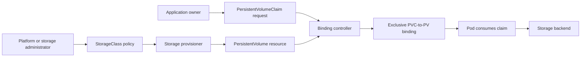
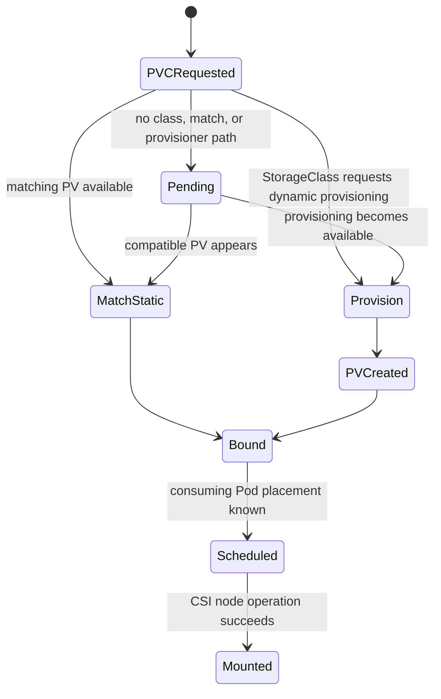
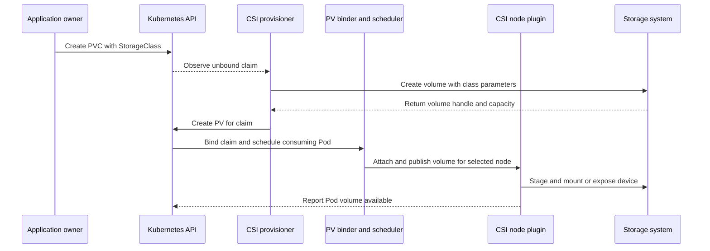
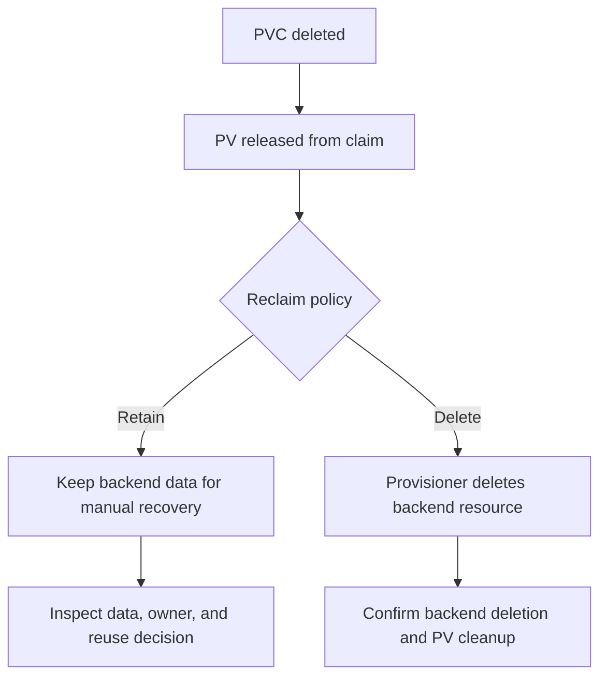
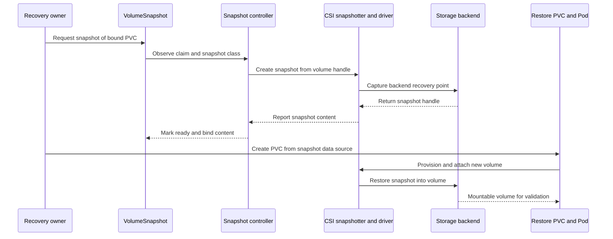

# Storage

Part: [12 — Kubernetes](PART_OVERVIEW.md)

The Kubernetes application programming interface (API) separates how capacity is provided from how a workload requests and consumes it. A PersistentVolume (PV) represents a storage resource available to the cluster; a PersistentVolumeClaim (PVC) requests storage using properties such as capacity, access mode, and storage class. A StorageClass describes a provisioning policy, and a controller can bind a claim to a matching PV or request a new volume from a provisioner.

This chapter focuses on Kubernetes storage abstractions, binding and provisioning, topology, reclaim behavior, expansion, and snapshot workflows. Part 09 CH06 owns provider storage products, protocols, guarantees, and price/performance tiers. Part 06 owns database engine persistence and recovery semantics. Part 12 CH08 owns Pod volume declarations and mount behavior; CH01 owns Pod lifecycle and identity. The Container Storage Interface (CSI) driver and its sidecars implement provider or vendor-specific operations; Kubernetes does not create a storage backend merely because a PVC object exists.

The upstream documentation consulted describes Kubernetes v1.37. CSI feature support, volume access modes, topology, expansion, and snapshots depend on cluster version and driver capabilities. Verify both the Kubernetes API feature and the specific driver implementation before relying on them.

## Separate Provisioning from Consumption



The StorageClass and provisioner express how storage may be supplied; the PVC expresses what a workload requests. This separation lets application teams request capacity without embedding provider-specific storage identifiers in every Pod manifest.

A PV is a cluster-scoped API object whose lifecycle is independent of any one Pod. It describes capacity, class, access modes, volume mode, reclaim policy, topology affinity, and the backing plugin or CSI handle. A PVC is namespaced and requests capacity, class, access modes, and optionally other selectors or a specific volume. A PVC-to-PV binding is one-to-one and exclusive: after binding, that PV is reserved for that claim, even if the backend supports multiple consumers.

A Pod consumes a claim by naming it in a volume declaration; container mounts are a separate Pod-level decision covered in CH08. If the PVC is Pending, the Pod cannot use it. A bound claim is not proof that the volume can attach to a particular node, mount successfully, or satisfy application I/O needs. Diagnose the claim, bound PV, provisioner, node topology, CSI operations, and Pod events as separate stages.

Static provisioning starts with administrator-created PVs and claims that match them. Dynamic provisioning creates backend storage when a PVC requests a configured StorageClass. Dynamic provisioning is useful for self-service and scale, but adds an external controller, credentials, capacity and topology constraints, and a reclaim decision. Static PVs offer precise control and can suit pre-existing or local volumes, but require inventory and manual lifecycle management.

## Binding and StorageClass Decisions



Binding may complete before a consuming Pod is scheduled or may be delayed until scheduling constraints are known. The choice matters for topology-constrained storage.

The binder compares requested capacity, access modes, volume mode, class, and selectors against available PVs. A volume can exceed the requested size; a smaller one does not satisfy the claim. A claim with no matching PV can remain Pending until one appears or dynamic provisioning succeeds. Prebinding a claim to a named PV can reserve a specific resource, but it does not override all checks or ensure that a future Pod can schedule where the volume is accessible.

A StorageClass names a provisioner and can supply parameters, reclaim policy, expansion permission, mount options, and volume binding mode. The meaning of provisioner parameters belongs to that driver, not to the core Kubernetes API. Two classes with similar names can have very different durability, performance, encryption, and failure contracts. Platform teams should publish class descriptions in workload terms, and application teams should request the class whose contract fits their need rather than assume a default is suitable.

A default StorageClass can be applied when a PVC omits `storageClassName`. An explicit empty string (`""`) requests a PV with no class and disables dynamic provisioning for that claim. These are distinct states. Default changes can affect later claims, including some PVCs that were created without an explicit class before a default existed; inspect the actual PVC field and binding result during migration.

With `volumeBindingMode: Immediate`, binding or dynamic provisioning can occur as soon as the PVC is created. This can place a zonal volume before the scheduler knows where the workload must run. If a Pod is later constrained to another zone, the claim may make it unschedulable. `WaitForFirstConsumer` delays binding and provisioning until a consuming Pod is considered, allowing scheduling constraints and storage topology to be considered together. It does not remove driver limits; it aligns the first binding decision with a consumer.

Avoid setting `nodeName` on a Pod using a `WaitForFirstConsumer` claim because it bypasses the scheduler decision point and can leave the PVC Pending. Use supported scheduling constraints such as node selectors or affinity so the scheduler can coordinate Pod placement and storage binding.

## CSI Provisioning, Attach, and Mount Lifecycle



CSI divides controller-side provisioning/attachment operations from node-side staging/mount operations. Driver deployment, sidecar versions, permissions, and failure handling are part of the platform contract, not an intrinsic property of a StorageClass name.

A CSI controller plugin can provision, attach, detach, resize, and snapshot volumes when supported. A node plugin performs node-specific staging, mounting, and publishing. Sidecars such as external provisioners or resizers watch Kubernetes resources and call the CSI driver. Exact components depend on the driver and feature; a PVC can remain Pending because a provisioner is absent, while a bound volume can fail later during attach or mount.

The PV handle connects the Kubernetes object to an external storage resource. Protect that mapping during backup, migration, and disaster recovery. A stale PV may reference a deleted or inaccessible backend; a manually removed cloud disk can leave a claim that appears bound but cannot mount. Use the driver and storage service's operational records alongside Kubernetes events.

Volume topology constrains where a volume is available. A zonal disk can bind correctly yet prevent a Pod from moving to a node in another zone. Local PVs are tied to a node and require node affinity; they can offer low latency but make node loss a data-availability event. Shared filesystems or replicated storage can support broader placement but have different consistency, performance, and failure properties. Part 09 owns provider storage guarantees; this chapter makes topology part of the scheduler and claim contract.

Storage capacity tracking can help the scheduler avoid nodes or topology segments without sufficient storage when the CSI driver publishes capacity and the class uses delayed binding. Capacity information can become stale and is not a guarantee that provisioning succeeds. Several volume requests may partially succeed before another fails; recovery can require cleanup or administrator intervention.

## Access Modes and Volume Modes

Access modes influence PV/PVC matching and, for some modes, constrain where a volume can be mounted. Common values include `ReadWriteOnce` (read-write from one node), `ReadOnlyMany` (read-only from many nodes), `ReadWriteMany` (read-write from many nodes), and `ReadWriteOncePod` (read-write from one Pod). Support depends on the volume plugin and CSI driver; the claim's declared mode is not a general filesystem lock or an application-level concurrency-control mechanism.

`ReadWriteOnce` means one node, not necessarily one Pod. Multiple Pods on that node may use the volume depending on driver and filesystem behavior. `ReadWriteOncePod` is the single-Pod constraint and is only available for CSI volumes with compatible sidecars and cluster version. `ReadWriteMany` is a request for multi-node read/write access, not a guarantee that all storage products support safe concurrent application writes.

Volume mode is either `Filesystem` or `Block`. Filesystem mode mounts a filesystem directory into a Pod. Block mode exposes a raw device path and requires the application to manage its contents and consistency. The storage backend and driver must support the requested mode. Do not choose raw block solely to avoid filesystem overhead without measuring and accepting the additional application responsibility.

Access modes do not necessarily enforce read-only behavior after a volume is mounted. For example, `ReadOnlyMany` does not guarantee that the underlying backend or all consumers enforce immutable contents. Set read-only mount properties and backend permissions where required, and test the actual enforcement boundary. CH08 owns the Pod's volumeMount and volumeDevices fields; Part 15 owns broader storage security controls.

## Reclaim, Expansion, and Data Lifecycle



The reclaim policy controls what happens to the backing resource after a claim is released. Deleting the Kubernetes claim and deleting the backend data are not always the same event; verify both control-plane status and storage-system outcome.

Dynamically provisioned PVs inherit a reclaim policy from the StorageClass; the default is commonly `Delete`. With `Delete`, the provisioner attempts to remove the PV and backend resource. With `Retain`, the PV remains Released and the data requires manual handling before reuse. `Retain` can protect important data from accidental claim deletion but creates orphaned resources and a secure cleanup obligation. Choose a policy based on data value, backup, regulatory retention, and operational capability.

Storage object protection finalizers can delay removal while a PVC is in use or a PV remains bound. A `Terminating` claim may still be referenced by a Pod. Do not remove finalizers casually to clear a stuck object; determine whether the backend attachment or data is still active. Finalizer behavior and driver support matter during incident recovery.

PVC expansion is generally a grow operation and requires the StorageClass to allow expansion and the CSI driver/backend to support it. The request can pass through controller-side resize and node/filesystem expansion. Directly editing PV capacity can interfere with resize reconciliation; change the PVC request and observe the resulting status. File-system expansion may occur when a Pod starts or online, depending on filesystem, driver, and Kubernetes support. Kubernetes does not provide a shrink workflow by reducing the claim size.

Snapshots use `VolumeSnapshot`, `VolumeSnapshotContent`, and `VolumeSnapshotClass` resources, which are custom resource definitions (CRDs) supplied through the cluster's snapshot installation. They require CSI driver support and a snapshot controller/sidecar path. A snapshot is not automatically application-consistent; databases may need quiescing, transaction coordination, or native backup semantics. Snapshot deletion policy controls whether the backend snapshot is removed or retained.



The resource chain does not prove application consistency or usable recovery. Validate snapshot readiness, topology, keys, restore capacity, and the database/application recovery procedure separately.

Restoring a PVC from a snapshot creates or provisions a new volume from that point-in-time source. Verify class compatibility, topology, capacity, encryption/key access, recovery order, application integrity, and the total restore time. A snapshot in the wrong zone or under unavailable credentials may not satisfy the recovery objective. Measure against the workload's recovery time objective (RTO) and recovery point objective (RPO); Part 07 owns their formal definitions. Part 06 owns database consistency and restore mechanisms.

## Example: A Claim Bound to a Topology-Aware Class

```yaml
apiVersion: storage.k8s.io/v1
kind: StorageClass
metadata:
  name: retained-zonal
provisioner: csi.example.storage
reclaimPolicy: Retain
allowVolumeExpansion: true
volumeBindingMode: WaitForFirstConsumer
---
apiVersion: v1
kind: PersistentVolumeClaim
metadata:
  name: receipts-data
  namespace: payments
spec:
  accessModes:
    - ReadWriteOncePod
  storageClassName: retained-zonal
  resources:
    requests:
      storage: 20Gi
---
apiVersion: v1
kind: Pod
metadata:
  name: receipts-db
  namespace: payments
spec:
  containers:
    - name: database
      image: registry.example.com/receipts/database:4.2.0
      volumeMounts:
        - name: data
          mountPath: /var/lib/receipts
  volumes:
    - name: data
      persistentVolumeClaim:
        claimName: receipts-data
```

The provisioner name is illustrative and must be replaced by an installed CSI driver. `WaitForFirstConsumer` lets scheduling constraints participate in topology-aware binding; `ReadWriteOncePod` requires CSI support. `Retain` is a deliberate protection choice that requires an owner and cleanup procedure. This example does not configure database backup, credentials, or application-consistent restore.

## Failure Modes and Recovery Evidence

Common failures occur at different points in the lifecycle:

- **PVC Pending:** no matching PV, missing/default class issue, unsupported mode, insufficient capacity, or provisioner error.
- **Provisioning failed:** driver permissions, invalid parameters, quota, backend capacity, or external service failure.
- **Bound but Pod Pending:** zone/node affinity conflict, attachment limit, or scheduling constraint.
- **Pod starts but mount fails:** node plugin, filesystem, secret, device, or access-mode limitation.
- **Expansion stuck:** class disallows growth, driver lacks support, or backend/filesystem expansion remains incomplete.
- **Delete stuck or data unexpectedly removed:** reclaim policy, finalizer, controller health, or ownership mismatch.
- **Restore succeeds but workload is incorrect:** snapshot consistency, key/configuration, data validation, or application recovery sequence is incomplete.

A restore test should begin from an independent recovery point and end with a validated application behavior, not merely a Bound PVC. Measure time to provision, bind, schedule, attach, mount, load, and validate. Record data loss window, manual steps, quota, topology, credentials, and residual risk. Test after driver upgrades, storage-class changes, region/zone changes, and application schema changes.

## Review Questions

- Is the workload requesting capacity through a PVC rather than embedding provider-specific volume identifiers in Pod specs?
- Are the StorageClass provisioner, parameters, defaulting, reclaim policy, expansion, and binding mode understood?
- Does the claim match requested capacity, access mode, volume mode, and topology?
- Can WaitForFirstConsumer coordinate Pod placement with volume topology, and are storage capacity/driver assumptions current?
- Does the access mode express a placement constraint or a true single-Pod need, and does the driver support it?
- What happens to backend data when the PVC is deleted, and who owns a Retain volume or orphaned resource?
- Are snapshot support, CRDs, CSI driver capabilities, deletion policy, and application consistency verified?
- Has a full restore been timed through attach, mount, application startup, and integrity checks?
- Are volume expansion and finalizer failures observable and recoverable without unsafe manual deletion?
- Are provider guarantees and database recovery semantics referenced from their owning parts rather than implied by the Kubernetes API?

Further reading: [Persistent Volumes](https://kubernetes.io/docs/concepts/storage/persistent-volumes/), [Storage Classes](https://kubernetes.io/docs/concepts/storage/storage-classes/), [Volumes](https://kubernetes.io/docs/concepts/storage/volumes/), [Volume Snapshots](https://kubernetes.io/docs/concepts/storage/volume-snapshots/), [Part 09 Storage](../09_Cloud_Computing/CH06_Storage.md), [Part 06 Databases and Storage](../06_Databases_and_Storage/PART_OVERVIEW.md), and [Part 12 Volumes](CH08_Volumes.md).
