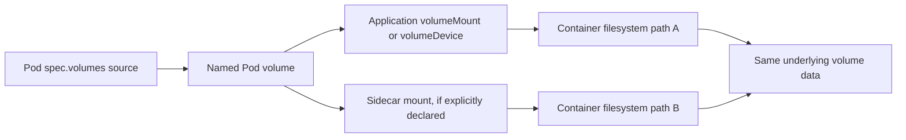
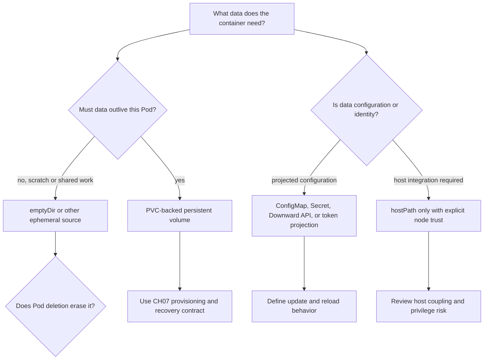
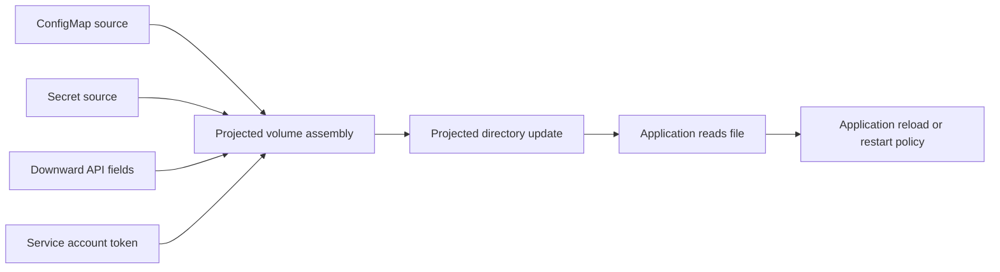
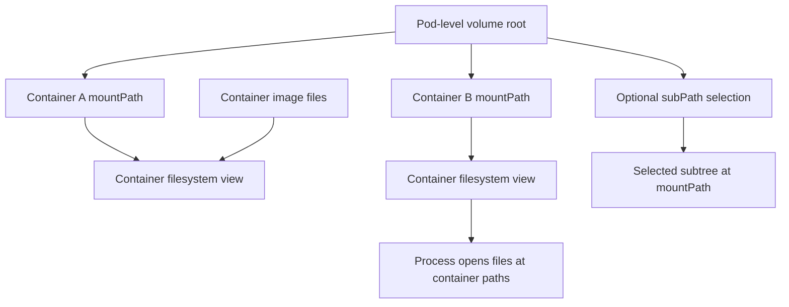

# Volumes

Part: [12 — Kubernetes](PART_OVERVIEW.md)

A Kubernetes volume is a named source of data that a Pod makes available to one or more containers through explicit mounts or device mappings. The Pod declares the volume source; each container independently declares where and how it sees that source. This separates data sharing from image filesystems and lets a workload choose data whose lifetime is scoped to a Pod, backed by a persistent claim, projected from application programming interface (API) resources, or provided by a node or CSI driver.

This chapter focuses on Pod-level volume types, mount paths, sharing, update behavior, and security boundaries. Part 12 CH07 owns PersistentVolume/PersistentVolumeClaim (PV/PVC) provisioning, StorageClass policy, CSI volume lifecycle, topology, reclaim, and snapshots. Part 09 CH06 owns provider storage products; Part 05 CH26/CH28 own filesystem, mount namespace, and container filesystem internals. CH13 owns Kubernetes security and secrets. Here, the central question is what data a container sees, for how long, and under which lifecycle and trust boundary.

The upstream Kubernetes documentation consulted describes v1.37. Some volume sources and fields are version-sensitive; validate them against the cluster API, feature gates, runtime, and admission policy used in deployment.

## Volume Declaration and Mount Contract



The volume name connects a Pod-level source to each container's mount. Containers share data only when they mount the same declared volume; each can use a different path and read/write mode.

A container starts with files from its image and any volumes mounted into its filesystem view. Writes to the image's writable layer do not become a Pod volume and are lost when the container is replaced. A Pod volume provides an explicit boundary for sharing or preserving files, but its lifecycle depends on the volume source. An `emptyDir` survives a container restart in the same Pod; a persistent claim can outlive that Pod; a Secret projection is sourced from an API object.

Every container that needs a volume must declare a mount or device reference to it. A volume declaration alone does not make data visible inside a container. Mounting one volume at different paths can support a sidecar data exchange, separate application directories, or a configuration tree; it also means a write by one container can change what another observes if the source is writable.

A `volumeMount` exposes a filesystem path. A `volumeDevice` exposes a raw block device and is appropriate only when the application understands block I/O and owns the filesystem or data format. CH07 explains `Filesystem` versus `Block` PV/PVC modes and backend support. Avoid selecting a raw device to bypass mount semantics without assigning the application team the additional data-integrity responsibility.

A Pod can declare multiple volume types at once. For example, a service may mount a ConfigMap for non-sensitive configuration, a projected service account token for a bounded identity, an `emptyDir` for scratch files, and a PVC for durable application data. These sources have different update, access, persistence, and security semantics even though all appear under `spec.volumes`.

## Choose a Volume by Lifetime and Source



The type should follow the data's required lifetime and source of truth. A volume's convenient filesystem shape does not make it durable, current, private, or portable.

Use `emptyDir` for scratch state or a bounded exchange between containers in one Pod. It is created when the Pod is assigned to a node and removed when that Pod is removed. A container restart does not clear it, which can help cache recovery or a sidecar handoff. A replacement Pod gets a new `emptyDir`; do not place irreplaceable database state there.

By default, `emptyDir` uses storage associated with the node's kubelet directory. A memory-backed `emptyDir` uses a random access memory (RAM)-backed temporary file system (`tmpfs`) and counts against memory usage. Set size limits when the workload needs bounded scratch space, but also monitor node ephemeral storage and logs; other node usage can exhaust capacity before the volume's configured size is reached. Part 05 CH25 owns kernel memory enforcement; this chapter covers the Pod-level effect.

A PVC-backed volume uses the claim as its source. It separates Pod definition from storage provisioning and can persist beyond Pod replacement. Whether a volume reattaches on another node, remains zone-bound, supports concurrent writers, or can be snapshotted depends on CH07's claim/class and CH07/Part09's driver contract. A Pod mounting a PVC does not itself implement backup or application-consistent recovery.

Projected volumes assemble several API-backed sources into one directory. Common sources are ConfigMap, Secret, Downward API values, and a service account token. This can simplify path layout and let applications read related data from one mount. The values remain subject to source-specific access, rotation, and update behavior. Pod certificate and cluster trust bundle projections are version-sensitive upstream features; use them only when the cluster enables the required support and the workload has a tested reload path.

A `hostPath` mounts a file or directory from the node into a Pod. It couples the Pod to node filesystem layout and can expose credentials, runtime sockets, or host configuration. The same manifest can behave differently across nodes. Prefer a PVC, projected source, or node-level agent with a narrower contract; reserve `hostPath` for cases with an explicit platform owner and read-only boundary where possible.

Image volumes, stable in current upstream documentation since Kubernetes v1.36, mount files from a container image or OCI artifact into a Pod as read-only data. They can distribute static artifacts without copying them into the application image, but require kubelet/runtime support and image-pull credentials. The content is resolved at Pod startup; a new Pod can see a newer referenced artifact. Pin references when reproducibility matters.

## Ephemeral, Projected, and Persistent Lifetimes

```mermaid
sequenceDiagram
    participant Pod as Pod object
    participant Container as Container process
    participant Empty as emptyDir
    participant Claim as PVC-backed volume
    Pod->>Empty: Create when Pod is assigned to a node
    Pod->>Claim: Mount already-bound claim
    Container->>Empty: Write scratch file
    Container-->>Container: Restart after container failure
    Container->>Empty: Scratch file remains in same Pod
    Pod-->>Empty: Delete when Pod is removed
    Pod-->>Claim: Unmount; claim/backend lifecycle continues
```

The same Pod can combine temporary and persistent data, but only the volume's own lifecycle determines what survives. A container restart, Pod deletion, PVC deletion, and backend deletion are different events.

Ephemeral volume sources include `emptyDir`, ConfigMap, Secret, Downward API, and inline CSI ephemeral volumes. Generic ephemeral volumes create a PVC from a claim template owned by a Pod; their backing storage is provisioned and reclaimed through storage-class mechanisms. CSI ephemeral volumes are available only when the driver explicitly supports them. These sources share Pod-scoped intent but have very different backend and cleanup behavior.

A generic ephemeral volume is not equivalent to `emptyDir`. It can request storage through a StorageClass and may use a network-attached or higher-performance backend, while remaining lifecycle-associated with the Pod through an automatically created claim. Deleting the Pod usually deletes that claim and then applies the PV reclaim policy. A `Retain` class can leave data behind, which requires deliberate cleanup. CH07 owns provisioning and reclaim details; CH08 focuses on the Pod template declaration and lifecycle expectation.

Volume names are local to a Pod specification. Two containers can mount a volume read-only or read-write and can choose different paths. If multiple containers write the same files, the application must define concurrency and consistency. Kubernetes does not serialize file writes merely because the containers share a volume.

## Projected Data and Update Behavior



The projection can update files as sources change, but that does not guarantee that the application reloads them. Treat file update and process adoption as separate steps.

ConfigMap and Secret volumes are mounted read-only. The kubelet updates projected data according to its change propagation behavior, but the application must reopen or reload the file to observe new content. A process that reads a configuration file only at startup may continue using the old value. Environment variables are snapshots at container start and do not update in place. Define whether configuration changes trigger a Pod-template rollout, file watcher, or explicit reload signal.

A projected volume can combine Secret, ConfigMap, Downward API, and service account token sources. All sources must be in the Pod's namespace. Relative projection paths compose into a shared directory and must not collide unexpectedly. `defaultMode` controls permissions for projected files, with per-item mode overrides where supported. File ownership and access remain security-sensitive; CH13 owns Kubernetes secret and identity controls.

Projected service account tokens are audience- and time-bounded credentials. The kubelet refreshes the projected file before expiration, but a client that reads it once and caches the value may fail after expiry. Ensure the application reloads the token and that the receiver validates the intended audience. Do not copy the token into logs or a long-lived shared file.

A ConfigMap, Secret, Downward API, or projected file mounted through `subPath` does not receive the normal projected update behavior for that mount. Treat `subPath` as a path-selection mechanism with update caveats, not as an atomic subscription to the source. Before changing a source, confirm how its mounted files update. Define how the application reloads changed content.

## Mount Paths, `subPath`, and Read-Only Behavior



Mount paths are per-container filesystem views. `subPath` exposes a selected subtree of a volume; it does not create a new volume or change the source's lifetime.

A volume can be mounted at different locations for different containers. It cannot be mounted inside another volume, and a volume does not automatically expose its contents to every container in the Pod. Plan mount paths to avoid hiding important image files and ensure mount permissions match the intended reader/writer relationship.

`subPath` lets a container expose a selected volume directory at a separate mount path. It can simplify directory layout, but introduces path and symlink safety considerations. It also prevents normal projected-source updates from appearing through that mount. For high-value data, validate file ownership, update semantics, and cleanup rather than assuming a subdirectory provides an isolation boundary.

`readOnly: true` applies to a specific container mount. Another container can mount the same volume read-write if the Pod spec and backing source allow it. A read-only mount does not guarantee recursive read-only behavior for submounts on Linux in every configuration; recursive read-only support has kernel/runtime/version requirements. Part 05 CH28 owns mount-namespace and propagation mechanics; CH13 owns the security policy around privileged access.

Mount propagation controls whether mounts created on the host or in a container become visible through other mount views. `None` is the normal private behavior; `HostToContainer` propagates host mounts into the container; `Bidirectional` can propagate mounts back to the host and is restricted to privileged scenarios. Bidirectional propagation can damage the host or expose host resources. Most application Pods should not use it; storage plugins and node agents need a carefully reviewed exception.

## Security and Operational Considerations

Projected Secret volumes are read-only and are backed by node-local memory mechanisms, but that does not make them safe by default. Access depends on Pod creation authority, service account and API permissions, node access, mount path, process user, and log/debug tooling. A user who can create Pods in a namespace may be able to mount Secrets in that namespace. CH13 owns these security boundaries.

`hostPath` is particularly sensitive. A read-write mount of a host directory can permit access to node credentials, container runtime sockets, kubelet state, or other Pods' data. Even a read-only mount can reveal sensitive host information. Admission policy should restrict allowed paths and mount modes; platform owners should document approved uses and node-specific assumptions.

A missing mount, permission failure, volume not attached, or projected data not refreshed can appear as an application error. Troubleshoot from Pod events and status through the volume source and mount: verify the name in `spec.volumes`, the volume reference, container mount path, source object existence, node and driver support, and file permissions. For PVC-backed storage, continue into CH07's PV/PVC state and CSI events.

## Worked Example: One Pod, Three Data Lifetimes

A receipt processor needs static settings, a short-lived credential, scratch space for document conversion, and a durable claim ledger. The platform chooses a ConfigMap for non-secret settings, a projected service account token for a bounded API identity, an `emptyDir` for conversion work, and a PVC for the ledger's persistent data. The main container mounts only the paths it needs; a sidecar receives the scratch output read-only to scan completed documents.

When the container restarts after a process failure, the `emptyDir` still holds the in-flight conversion files, while the mounted ConfigMap and token projections are re-presented by kubelet. The client library reloads the token file; the application reloads changed settings only after an explicit signal. When the Pod is replaced, `emptyDir` is deleted and the new Pod mounts the same claim if its StorageClass and topology allow it. A PVC deletion follows CH07's reclaim policy and is not part of ordinary Pod cleanup.

The review tests four cases: container restart without Pod replacement, Pod replacement with the claim reattached, Secret/token rotation with application reload, and deletion of the claim under the selected reclaim policy. It verifies that the sidecar cannot modify the ledger and that no scratch data is mistaken for a durable recovery point. The manifest is useful only when these data-lifetime contracts are understood by application and platform owners.

## Review Questions

- What is the data source and lifetime for each volume: container, Pod, projected API object, PVC, node, or external CSI source?
- Does the Pod declare every volume and each container mount/device independently?
- Which data survives container restart, Pod replacement, node loss, and claim deletion?
- Are read/write permissions, file ownership, `subPath`, and update behavior tested for the actual source type?
- Do projected settings and credentials have an application reload or refresh mechanism?
- Are `hostPath`, mount propagation, and privileged volume operations restricted to justified platform workloads?
- Is an ephemeral source bounded, and is memory-backed scratch accounted against container/node pressure?
- Are CSI or generic ephemeral volumes supported by the installed driver and reclaimed as intended?
- Can a Pod replacement reattach persistent data in the required topology and recovery scenario?
- Are volume behavior and backend guarantees owned by the correct team and linked to CH07/Part 09 evidence?

Further reading: [Kubernetes Volumes](https://kubernetes.io/docs/concepts/storage/volumes/), [Ephemeral Volumes](https://kubernetes.io/docs/concepts/storage/ephemeral-volumes/), [Projected Volumes](https://kubernetes.io/docs/concepts/storage/projected-volumes/), [Part 12 Storage](CH07_Storage.md), [Part 12 Pods](CH01_Pods.md), and [Part 09 Storage](../09_Cloud_Computing/CH06_Storage.md).
