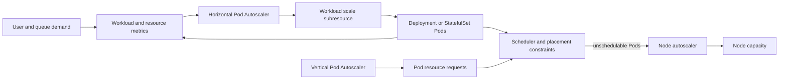
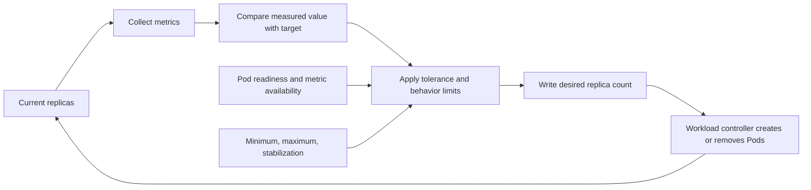
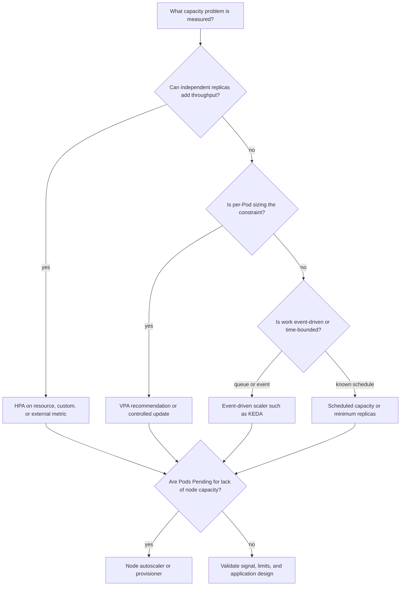

# Autoscaling

Part: [12 — Kubernetes](PART_OVERVIEW.md)

Kubernetes autoscaling adjusts workload replicas, Pod resource allocations, or cluster node capacity in response to demand and constraints. These are separate control loops with different signals and actuators. Horizontal scaling creates or removes Pods; vertical scaling changes CPU or memory requests and sometimes limits; node autoscaling provisions or consolidates Nodes so Pods can be scheduled. A design that configures each loop independently can oscillate, overspend, or leave Pods pending.

This chapter applies autoscaling to Kubernetes workloads. Part 19 owns general performance measurement and capacity engineering; Part 09 owns cloud node and compute products; Part 07 owns distributed feedback and reliability concepts. CH01 owns Pod resource requests and limits, CH02 owns Deployment replica ownership during rollouts, and CH14 owns workload/cluster observability. The focus here is Kubernetes controller behavior, metrics contracts, loop interactions, and failure diagnosis.

The upstream documentation consulted describes Kubernetes v1.37. The Horizontal Pod Autoscaler (HPA) stable API is `autoscaling/v2`; Vertical Pod Autoscaler (VPA) is separately installed; node autoscaler behavior depends on its implementation and provider integration. Verify versions, feature gates, metric adapters, and driver/controller support before relying on current feature maturity.

## Three Scaling Loops, Three Authorities



Horizontal and vertical workload scaling change Pod capacity; node scaling changes the supply on which Pods can run. The owning field for replica count or Pod requests must be explicit so automation and manifests do not continuously overwrite each other.

The HPA is a core Kubernetes API resource and controller that periodically reads metrics and writes the target workload's scale subresource. It does not directly create Pods; a Deployment or other scalable workload changes its own desired replica count and its controller creates or removes Pods. HPA is appropriate when adding replicas can add useful capacity and the workload can distribute work across them.

VPA is an add-on consisting of components that recommend or apply resource requests for a target workload. Its API is a custom resource definition (CRD), and update modes determine whether it only reports recommendations, sets resources at Pod creation, or replaces/resizes running Pods. VPA is useful when per-Pod resource sizing is the problem; changing requests can affect scheduling and disruption.

Node autoscalers observe Pending Pods and scheduling constraints, then provision Nodes that could accommodate them. They can later consolidate underused nodes, which may evict and recreate Pods. Node autoscaling responds to schedulability, not directly to application traffic. Part 09 CH04 and CH08 own provider compute and managed-cluster offerings; this chapter treats the node scaler as an implementation dependency.

Do not let multiple systems own the same desired field. If an HPA controls Deployment replicas, a Git manifest that repeatedly applies a fixed `.spec.replicas` value can override its decisions. If VPA changes requests while a workload is manually edited or another recommender manages them, recommendations can conflict. State which controller owns each field and how desired-state repositories represent delegated fields.

## Horizontal Scaling as a Feedback Controller



HPA control is periodic and uses observed metrics rather than an instantaneous command. Metric delay, Pod startup, readiness, and scaling bounds all affect the actual response to load.

For a simple per-Pod metric, the HPA estimates desired replicas from the ratio of current metric to target metric. Conceptually,

$$
N_{desired} = \left\lceil N_{current} \times \frac{M_{current}}{M_{target}} \right\rceil
$$

The formula is a starting point, not the entire algorithm. The controller applies tolerance, minimum and maximum replica bounds, missing-metric handling, readiness rules, stabilization windows, and configured rate policies. An observed value close to the target may result in no change to avoid reacting to small fluctuations.

Resource utilization targets are calculated relative to resource requests. If a container's central processing unit (CPU) request is absent, CPU utilization for that Pod cannot be calculated as a percentage of request, so the HPA may not act on that metric. An inaccurate request can distort scaling: a request set too high makes measured utilization look lower, while one set too low can cause the HPA to add replicas early. CH01 explains request/limit behavior; Part 19 owns performance characterization.

The `autoscaling/v2` API supports resource, per-Pod custom, object, and external metrics. The resource metrics API is commonly supplied by Metrics Server; custom and external metrics need registered adapters. A metric source is an operational dependency: stale, missing, or delayed metrics can prevent or distort scaling. Verify metric freshness, units, aggregation, labels, and behavior when the metrics API is unavailable.

With multiple metrics, HPA calculates a replica recommendation for each and normally chooses the highest result, then clamps it to the configured minimum and maximum replica count. This lets a workload scale when either CPU or queue backlog requires more replicas, but only if each metric represents actionable capacity. If one metric source fails, scale-down can be withheld when a working metric recommends fewer replicas; scale-up can still proceed when a valid metric indicates more capacity is needed.

## Readiness, Startup, and Stabilization

New Pods do not provide useful capacity immediately. Images must be pulled, volumes mounted, processes initialized, readiness achieved, and downstream connections established. A metric can spike before new replicas are ready, causing repeated scale-up; downscaling too quickly can remove capacity before a delayed metric reflects sustained demand.

HPA treats not-yet-ready Pods and Pods with missing metrics conservatively. During scale-up, not-ready Pods can be assumed to contribute little capacity; for scale-down, missing metrics can be treated as higher consumption to avoid an unsafe reduction. CPU initialization windows can avoid interpreting startup spikes as steady-state load. The exact defaults are cluster-configurable and should be verified for the target version.

```mermaid
sequenceDiagram
    participant Load as Incoming demand
    participant HPA
    participant Deploy as Deployment and scheduler
    participant Pod as New Pod
    participant Metrics
    Load->>Metrics: Demand and utilization rise
    Metrics-->>HPA: Delayed high metric sample
    HPA->>Deploy: Increase desired replicas
    Deploy->>Pod: Create Pod; placement and startup begin
    Pod-->>Metrics: Not Ready; metric may be missing
    HPA->>HPA: Damp recommendation during startup window
    Pod-->>Metrics: Ready and serving
    Metrics-->>HPA: Stable per-Pod utilization
    HPA->>Deploy: Reconcile toward steady replica target
```

Readiness affects both traffic and metric interpretation. If a Pod becomes Ready before its work is initialized, HPA may count capacity that cannot serve the workload; if it remains unready for too long, scale-out can continue while those Pods contribute no useful throughput.

Stabilization windows and scaling policies constrain how rapidly replica counts change. A downscale stabilization window uses recent recommendations to avoid removing Pods during a temporary lull. Scale-up and scale-down policies can limit the number or percentage of replicas changed over a time interval. These settings trade response speed against oscillation, startup cost, and available headroom. They are not substitutes for a metric with a meaningful relationship to demand.

Tune the behavior from observed workload response. An HPA that sees queue depth but has no maximum processing concurrency can overload a database. A CPU target can miss a latency bottleneck caused by lock waits or a slow external service. A queue-age metric may better represent backlog urgency, but requires a custom or external metrics adapter and a defined unit. Use the metric that predicts useful capacity and protect downstream dependencies with concurrency limits or backpressure.

## Choose Horizontal, Vertical, Event-Driven, or Scheduled Scaling



The scaling mechanism should match the bottleneck. HPA, VPA, event-driven scaling, and node scaling are complementary only when their ownership and signals are coordinated.

Horizontal scaling adds replicas. It works when a workload can distribute requests or jobs, shared dependencies can accept the additional concurrency, and the replicas have independent enough failure behavior. It is ineffective for a single-writer bottleneck, a globally serialized task, or a database that is already saturated. Scaling a frontend can amplify load on a constrained backend.

Vertical Pod Autoscaling analyzes resource use and recommends or changes Pod requests and limits. Current VPA modes include recommendation-only (`Off`), setting resources on Pod creation (`Initial`), and update modes that can evict/recreate or attempt in-place changes depending on VPA version and cluster support. VPA is separately installed; it is not a built-in autoscaler API equivalent to HPA. In-place resize support and VPA update modes are version-sensitive; use a recommendation-only phase before allowing automated changes to production Pods.

HPA and VPA can conflict if both manage CPU or memory in ways that change the HPA's utilization denominator. An HPA targeting CPU utilization depends on requests, while VPA may update requests based on observed use. Some combinations are supported with constraints; others can oscillate or produce surprising recommendations. Prefer HPA on a custom/external metric when VPA owns requests, or define clear controlled resources and test the combined loop before production.

Event-driven autoscaling can scale from queue or event metrics and may support scaling to zero. Kubernetes Event Driven Autoscaling (KEDA) is an add-on rather than a core Kubernetes controller. In upstream v1.37 documentation, HPA scale-to-zero for object or external metrics is a beta feature enabled by default; resource metrics alone cannot scale from zero because no running Pod produces them. Cold-start latency, source-service availability, event ownership, and minimum warm capacity must be part of the decision.

Scheduled scaling fits predictable traffic cycles, but a calendar is not a demand measurement. Pair a baseline capacity schedule with metrics and safeguards for unexpected peaks. Scale-down must respect connection draining, queue ownership, singleton work, and data flush behavior.

## Node Autoscaling and the Scheduler Boundary

```mermaid
flowchart LR
    HPA[Workload autoscaler adds Pods] --> Pending[Scheduler finds no fitting node]
    Pending --> Constraints[Requests, affinity, taints, topology, storage]
    Constraints --> Provisioner[Node autoscaler evaluates feasible node shapes]
    Provisioner --> Cloud[Provider capacity and quotas]
    Cloud --> NewNode[New Node joins cluster]
    NewNode --> Scheduler[Scheduler retries placement]
    Scheduler --> Running[Pods start and metrics return]
```



Node autoscaling is driven by Pods that cannot be scheduled and by node consolidation policies. It cannot fix a Pod whose selectors, taints, volume topology, or request size match no configured node shape.

A node autoscaler evaluates declared Pod requests and scheduling constraints. It does not provision from actual runtime utilization alone. If requests are too low, a node may be added that still cannot protect workloads from runtime pressure; if requests are too high, the autoscaler may provision excess capacity or refuse consolidation. Include daemon overhead, system reservations, Pod density, extended resources, volume topology, taints/tolerations, and node affinity when estimating capacity.

Provisioning can fail or lag because of quota, unavailable instance types, provider capacity, incompatible labels, region restrictions, or an autoscaler maximum. A Pod can remain Pending even when the autoscaler is running. Inspect the scheduler's unschedulable reason and the autoscaler's decision events. Part 09 owns provider quotas and node services; CH06 owns Kubernetes-level scheduling constraints.

Node consolidation is also a disruption source. Removing an underused node can evict Pods and trigger rescheduling; PodDisruptionBudgets, termination behavior, local volumes, and replica topology influence whether consolidation succeeds. An autoscaler predicts placement but does not override workload stateful assumptions. Set workload disruption tolerance before enabling aggressive consolidation.

Cluster Autoscaler and Karpenter are common implementation families, but their configuration, supported providers, consolidation, and node lifecycle behavior differ. This chapter does not prescribe a product. Part 09 CH08 evaluates managed Kubernetes operating modes; provider-specific node group, machine class, quota, and pricing belong to Part 09.

## Resource Requests, Limits, and Scaling Signals

HPA CPU and memory utilization targets are percentages of requests, not absolute node usage. Resource requests influence scheduling and scaling calculations; limits constrain runtime use according to resource behavior. See CH01 for the Pod contract. If one container lacks the relevant request, resource utilization may be undefined for that Pod. For multi-container Pods, aggregate resource metrics may hide one hot container; container resource metrics can target an individual container when supported.

A request should reflect a useful scheduling reservation and resource baseline. Measure application steady state, startup peak, batch behavior, and sidecar overhead. If request is below typical consumption, the HPA may scale aggressively and node placement may overpack; if above typical consumption, measured utilization may remain low and hide rising load. A resource metric should correlate with useful throughput or workload pressure, not simply exist in a dashboard.

Custom and external metrics can represent queue length, request rate, concurrency, or backlog age. Define what the metric measures, how it aggregates across Pods or an external object, its freshness, and how it behaves at zero replicas. Queue depth is not always proportional to replicas: a poison-message backlog may grow even as workers increase, and a downstream limit may cap useful concurrency. Scale controls should include maximum replicas and any business or downstream quota.

## Worked Scenario: HPA Scales Out but No New Capacity Appears

A payment API uses an HPA targeting CPU utilization at 65 percent. Its minimum is three replicas and its maximum is thirty. Traffic rises and the controller increases desired replicas. New Pods remain Pending, and the existing Pods continue to receive more load. The team initially raises the HPA maximum, but that changes only the desired count.

Scheduler events show that each new Pod requests 1500 millicores of CPU while the node pool has no shape with sufficient allocatable capacity after system reservations. One Pod also has a topology constraint that rules out the only node group with free resources. The node autoscaler cannot find a feasible configured node; increasing the HPA maximum creates more Pending Pods and no service capacity.

The team revisits measured requests and the topology requirement. The request reflects a synthetic load test that included a one-time startup spike; startup probe behavior and warm-up metrics were not separated. The team adjusts the request from representative steady-state data, preserves headroom for startup, and configures a node shape that satisfies the workload's constraints. It also tests that the database and payment provider tolerate the additional concurrency before allowing more replicas.

After the change, HPA increases replicas, the scheduler places them, and the node autoscaler provisions only when no existing node fits. Scale-down stabilization keeps the new capacity while traffic subsides; node consolidation waits for safe Pod eviction. The team measures request latency, successful payment rate, Pending duration, node provisioning time, and downstream saturation. The scaling design is accepted only when both workload and node loops respond within the service objective.

The scenario separates signal from actuator. HPA correctly requested more Pods, but that did not guarantee a node could run them or that additional replicas could improve the actual bottleneck.

## Review Questions

- Which controller owns replica count, Pod resource requests, and node capacity for this workload?
- Does the HPA metric represent demand and useful capacity, and is its source fresh and available?
- Are resource requests configured for every container that contributes to the HPA metric?
- Do readiness and startup behavior prevent initialization spikes or unready Pods from distorting scaling?
- Are scale-up and scale-down stabilization and rate policies appropriate for startup, drain, and workload variation?
- Can additional replicas serve useful throughput without overloading databases, queues, or external dependencies?
- Do VPA and HPA manage compatible resources and denominators, and has their combined behavior been tested?
- Are event-driven or scheduled scaling choices justified by workload shape and cold-start tolerance?
- Can the node autoscaler satisfy requests and constraints under quota and provider-capacity limits?
- Are node consolidation and scale-down safe for PodDisruptionBudgets, local data, and graceful termination?

Further reading: [Horizontal Pod Autoscaling](https://kubernetes.io/docs/concepts/workloads/autoscaling/horizontal-pod-autoscale/), [Vertical Pod Autoscaling](https://kubernetes.io/docs/concepts/workloads/autoscaling/vertical-pod-autoscale/), [Node Autoscaling](https://kubernetes.io/docs/concepts/cluster-administration/node-autoscaling/), [CH01 Pods](CH01_Pods.md), [CH02 Deployments](CH02_Deployments.md), [CH07 Storage](CH07_Storage.md), and [Part 09 Managed Kubernetes](../09_Cloud_Computing/CH08_Kubernetes.md).
