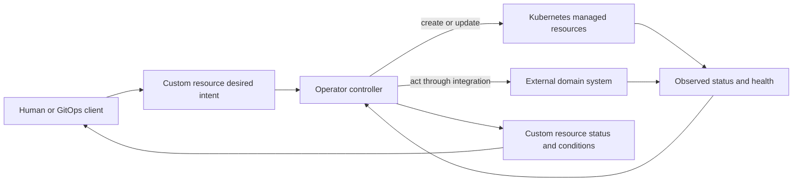
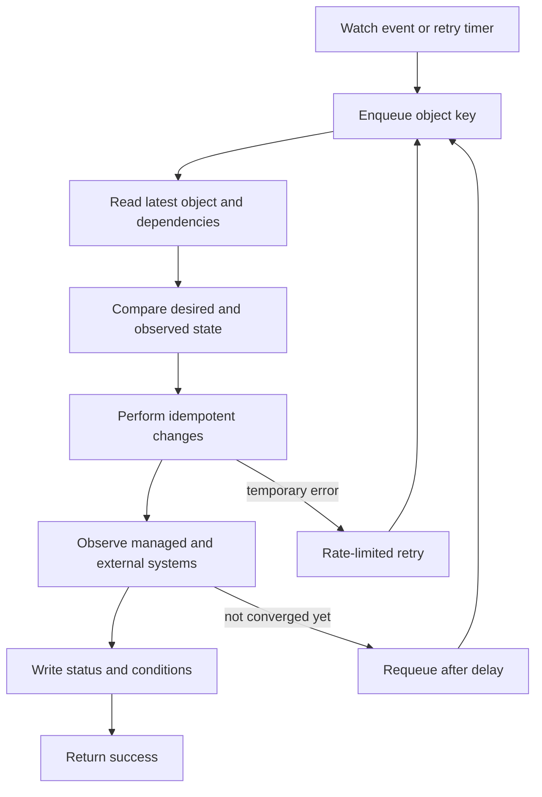
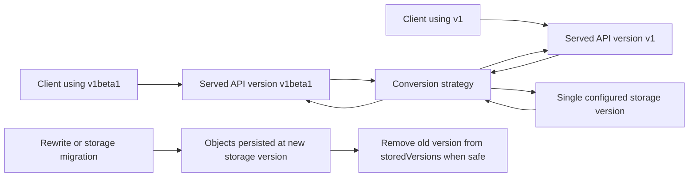
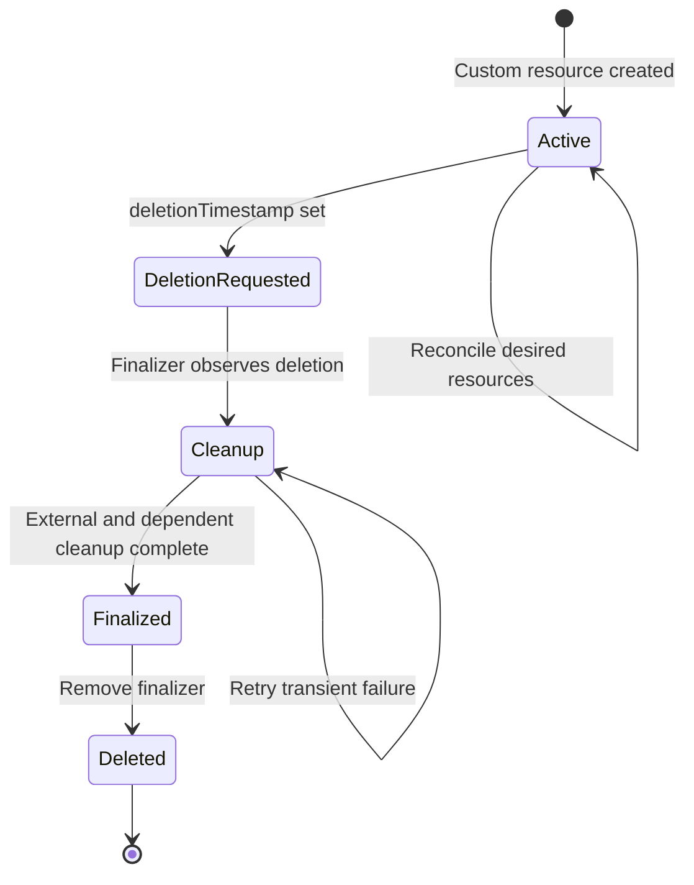
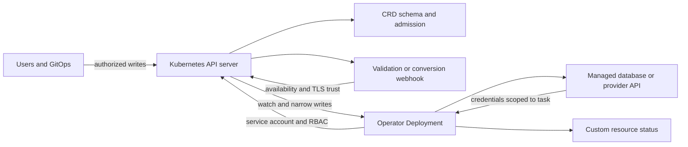

# Operators

Part: [12 — Kubernetes](PART_OVERVIEW.md)

An Operator combines a domain-specific declarative application programming interface (API) with one or more controllers that continually reconcile that intent with Kubernetes objects and, when necessary, external systems. It encodes operational knowledge that would otherwise live in human runbooks: provisioning, upgrades, backups, recovery, failover, or cleanup. The custom resource records the desired service state; the controller keeps trying to make observed state converge toward it.

This chapter focuses on designing and operating Kubernetes Operators. Part 07 owns the general theory of reconciliation and distributed systems; CH11 owns Helm packaging and release workflows; CH12 owns GitOps; CH13 owns security foundations. Part 09 owns provider-managed service offerings. A Kubernetes Operator is not inherently a product, framework, or installation method: it is an application-specific automation pattern using the Kubernetes application programming interface (API).

The upstream Kubernetes documentation consulted describes v1.37. Custom resource definition (CRD) schemas, API version migration, webhook behavior, and controller frameworks have version-specific requirements. Treat example schemas as design illustrations and validate them against the target cluster and Operator release.

## The Operator Contract



The resource is the stable contract between users and automation. The Operator translates domain intent into lower-level actions and reports what it has observed; it should not pretend that an accepted API write means the operation is already complete.

A database Operator might accept a `DatabaseCluster` resource that specifies the database engine version, replica count, storage class, and backup schedule. It can create or update a StatefulSet, Services, configuration, and backup jobs, then report readiness and the observed engine version. It may also orchestrate an external storage or backup service. The custom resource is not the database's data store; it is the declarative configuration for managing that data service.

Kubernetes custom resources provide API storage and watch behavior, but do not themselves perform automation. The Operator controller supplies that behavior. An Operator is justified when the lifecycle requires sustained domain knowledge or automation beyond ordinary object templating: safe database version transitions, backup verification, replica membership, or data recovery sequencing. A collection of static resources, a Helm chart, or a human runbook may be simpler when the lifecycle is mostly create-and-update configuration.

Do not turn the Kubernetes API into a high-volume application database or synchronous remote procedure call (RPC) interface. Custom resources should be compact, declarative objects that are read and changed infrequently. Large user data, telemetry streams, and request-response operations belong in purpose-built services. If a user must submit “do this now” and wait for a transaction result, a declarative API may be the wrong abstraction.

## Design a Custom Resource API

A custom resource should define user-owned desired state under `spec` and controller-reported observed state under `status`. Establish which fields are required, defaulted, immutable, mutable, or meaningful only during creation. Names and units should be explicit. Prefer a small domain vocabulary to exposing every StatefulSet or database implementation detail; an API that simply mirrors underlying objects can lock users to those details without adding operational value.

CRDs define the API group, kind, scope, served versions, storage version, and OpenAPI v3 schema. Structural schemas can validate types, ranges, required fields, and enumerated values; schema defaulting and admission webhooks provide additional controls. Unknown fields may be pruned according to the schema. A rejected or pruned field is much harder to diagnose if the API has no clear validation message or user documentation.

Choose namespaced scope when each instance has namespace ownership, isolation, and lifecycle. Choose cluster scope only when an instance genuinely represents cluster-wide state and access should be managed at that level. Scope affects Role-Based Access Control (RBAC), tenancy, naming, cleanup, and what owner references are possible. A cluster-scoped Operator managing namespaced resources needs deliberate mapping and cannot use arbitrary cross-scope owner references for garbage collection.

Enable the status subresource so users and controllers can have separate write authority. The user updates `spec`; the controller writes `status`. Include conditions with stable types, truthful status, reason, message, and observed generation. A `Ready=True` condition should mean a defined level of service readiness, not simply that the controller created a StatefulSet. If the controller has only processed one generation, report that fact rather than claiming it observed current intent.

```yaml
apiVersion: apiextensions.k8s.io/v1
kind: CustomResourceDefinition
metadata:
  name: databaseclusters.data.example.com
spec:
  group: data.example.com
  scope: Namespaced
  names:
    plural: databaseclusters
    singular: databasecluster
    kind: DatabaseCluster
    shortNames:
    - dbcluster
  versions:
  - name: v1
    served: true
    storage: true
    schema:
      openAPIV3Schema:
        type: object
        required:
        - spec
        properties:
          spec:
            type: object
            required:
            - replicas
            - engineVersion
            properties:
              replicas:
                type: integer
                minimum: 1
                maximum: 9
              engineVersion:
                type: string
                minLength: 1
              backupSchedule:
                type: string
          status:
            type: object
            properties:
              readyReplicas:
                type: integer
              observedGeneration:
                type: integer
              conditions:
                type: array
                items:
                  type: object
                  required:
                  - type
                  - status
                  properties:
                    type:
                      type: string
                    status:
                      type: string
                    reason:
                      type: string
                    message:
                      type: string
                    observedGeneration:
                      type: integer
    subresources:
      status: {}
    additionalPrinterColumns:
    - name: ENGINE
      type: string
      jsonPath: .spec.engineVersion
    - name: READY
      type: integer
      jsonPath: .status.readyReplicas
---
apiVersion: data.example.com/v1
kind: DatabaseCluster
metadata:
  name: ledger
  namespace: payments
spec:
  replicas: 3
  engineVersion: "8.4"
  backupSchedule: "0 2 * * *"
```

This compact example illustrates a namespaced desired-state API and a separately writable status subresource. A production schema must validate cron syntax, define field semantics and compatibility, and avoid promising an update path that the controller cannot safely implement. Backup policy details can be moved into a dedicated resource if independent lifecycle and ownership are important.

## Reconciliation, Events, and Idempotency



A watch event is a reason to re-evaluate an object, not a durable command to perform exactly one action. Reconciliation should derive the work from current intent and observations so retries, duplicate events, process restarts, and partial failures are normal inputs rather than exceptional cases.

Controllers typically watch resources, enqueue a key such as namespace/name, read the latest object, calculate the required changes, apply them, and update status. Work queues deduplicate keys and can retry failures with rate limiting. Event order and delivery are not an application transaction. The controller must tolerate receiving the same key repeatedly and should not assume one callback for each spec change.

Idempotency means applying reconciliation more than once has the same intended effect as applying it once. Use deterministic names, stable ownership references, compare-before-write, and declarative patches that modify only controller-owned fields. Avoid generating a new child object or external resource on every retry. For an external provider that supports operation tokens, use a stable idempotency key and persist enough intent to safely resume after a controller restart.

The controller should fetch current objects and handle optimistic concurrency conflicts. Another controller, user, or admission mutation may change an object between read and update. On a conflict, re-read and recompute rather than blindly retrying a stale patch. Use status updates sparingly: emitting a status write on every reconcile can create event loops, extra API load, and confusing audit noise. Report actual transitions and current conditions.

A reconcile can partially succeed. It might create a Service but fail to provision a database, or provision a database but fail before writing its endpoint into status. Each step should be discoverable from observed resources or durable external operation state. The next reconciliation must resume safely or compensate with a documented cleanup action. Avoid pretending that Kubernetes API writes and external provider operations form one atomic transaction.

Transient failures should be retried with bounded backoff and useful conditions. Permanent invalid intent should produce a clear status condition or admission rejection rather than an infinite rapid retry. A controller must also make progress after an unavailable dependency returns. Backoff protects a failing API or provider from retry storms, while periodic resync or watches ensure missed transient events do not permanently strand state.

## Generation, Resource Version, and Status

Kubernetes object `metadata.generation` tracks changes to desired configuration, while `metadata.resourceVersion` changes as the object is updated in storage. Status updates can change resourceVersion without changing generation. Use observed generation in conditions so a consumer can distinguish “Ready for the latest requested configuration” from “Ready for an earlier spec.” Do not treat resourceVersion as a time or ordering token across unrelated objects.

```mermaid
sequenceDiagram
    participant User
    participant API as Kubernetes API server
    participant Controller
    participant Child as Managed resource
    User->>API: Update spec; generation advances
    API-->>Controller: Watch event with new generation
    Controller->>API: Read latest spec and resourceVersion
    Controller->>Child: Apply desired child state
    Child-->>Controller: Observed child status
    Controller->>API: Write status with observedGeneration
    API-->>User: Ready condition for processed generation
    Note over Controller,API: Status changes resourceVersion; it need not change generation
```

Status is an API for users, other controllers, and automation. Stable conditions are easier to consume than parsing human messages. Keep condition types and meanings consistent; make messages useful for diagnosis; and set `observedGeneration` when the condition describes the current spec. A condition can report `Progressing`, `Degraded`, or `Ready`, but each type needs a documented meaning and transition policy.

A controller can receive its own status update as a watch event. Predicates should filter changes only when it is safe to do so; filtering solely by generation can miss deletion timestamp and finalizer changes because those metadata updates do not necessarily advance the spec generation. Test event predicates against spec changes, status writes, finalizer changes, and owner deletion.

Controllers should use status subresources and narrow field ownership. Server-side apply can help record field ownership for child resources, but field managers do not replace an API ownership design. If users are expected to customize some child fields, define which fields are authoritative and how user edits are preserved or reported as drift. An Operator that silently overwrites every field can surprise users; one that never repairs drift is not actually managing that state.

## CRD Versions and Conversion



Serving a new version and changing the stored representation are different operations. A safe CRD upgrade must keep clients compatible, preserve data through conversion, migrate stored objects, and only then remove an old version.

A CRD can serve multiple versions while persisting custom resources in one storage version. With identical schemas, the `None` strategy changes the API version representation without translating field semantics. If a field is renamed, split, removed, or changes units, conversion logic must preserve intent in both directions or define an explicit lossy migration. Conversion webhooks are an availability dependency for API reads and writes that require conversion; deploy and test them before enabling a version that depends on them.

Changing the storage version does not automatically rewrite existing objects. Reads can be served in another version while the stored representation remains unchanged. Existing objects must be rewritten or migrated before the old version can be removed from `status.storedVersions` and the CRD. Plan the migration and rollback sequence across controller, webhook, CRD, clients, and stored instances; back up data and test large-resource behavior before production rollout.

API evolution is also user experience. Validate required fields and defaults early; avoid changing units or semantics in place; deprecate fields and versions with a transition period; and publish a migration guide. If the Operator upgrade cannot read older resources, its own deployment may strand every custom resource in the cluster.

## Ownership, Finalizers, and Deletion

Owner references let Kubernetes garbage collection associate dependent objects with an owner. They are appropriate when deleting the owner should delete that child and the scope rules allow the reference. Labels help select groups but are not proof of ownership. If a managed resource may be adopted, shared, or retained, define the policy explicitly rather than treating matching labels as permission to delete it.

Finalizers coordinate cleanup that Kubernetes garbage collection cannot perform, such as removing an external database or taking a final backup. Add a qualified finalizer before creating external state. When deletion is requested, the API server sets a deletion timestamp and leaves the object present while finalizers remain. The controller observes that state, performs idempotent cleanup, and removes its finalizer only after the required action succeeds.



A finalizer is a lifecycle promise, not a cleanup callback attached to deletion. It can leave an object in `Terminating` indefinitely if the controller is removed, loses access, or the external service is unavailable. The Operator must expose cleanup progress, retry safely, document recovery, and preserve enough credentials and network access to finish the work during upgrades.

Do not remove a finalizer merely to make a stuck object disappear. First establish what external state it protects and whether cleanup has occurred; manually removing it can orphan costly resources or destroy recovery paths. Conversely, do not add a finalizer after deletion has already begun: Kubernetes restricts adding new finalizers once a deletion timestamp is set. Register it before provisioning side effects.

Deletion policy is part of the custom resource API. Decide whether deleting the custom resource deletes data, retains a database, takes a final backup, or transfers ownership. Separate durable user data from disposable child objects. Provide an explicit retention or backup workflow when deletion is irreversible, and make default behavior visible before production adoption.

## Deployment, RBAC, and Failure Boundaries



An Operator adds code, permissions, and often webhook availability to the cluster. Treat the controller, its service account, admission/conversion webhooks, and external credentials as production components with explicit owners and failure procedures.

Use Role-Based Access Control (RBAC) rules limited to required API groups, resources, verbs, and namespaces. A controller that only manages namespaced resources should not receive cluster-admin access. Separate read-only watch access from write access where practical; use the status subresource for controller status; and scope external credentials to the domain resources it owns. Test installed roles rather than relying on SDK-generated defaults.

The Operator's own Deployment needs health checks, resource requests, rollout strategy, and a version-compatible upgrade path. During high availability (HA) operation, leader election can reduce duplicate active reconciliation for components that require a single writer. It does not eliminate duplicate events, process restarts, or external operation ambiguity; idempotency remains necessary. If workers run concurrently, ensure one resource key is not processed unsafely in parallel and external APIs can tolerate the resulting concurrency.

Admission webhooks can reject invalid objects or apply defaults; conversion webhooks translate API representations. If a webhook is unavailable or its certificate and service configuration are wrong, API writes or reads that depend on it can fail. Set appropriate timeout/failure policy, monitor the endpoint, and ensure webhook behavior is deterministic and side-effect-free. Do not put slow provisioning or long-running migrations in admission; those belong in reconciliation after the API write.

The controller may have direct authority in an external database, cloud API, or storage service. The Kubernetes audit log does not prove what that controller did externally. Record operation identifiers and outcomes without logging credentials or sensitive payloads. Provide a break-glass procedure that distinguishes suspending reconciliation, revoking external access, and deleting managed resources.

## Upgrade, Uninstall, and Recovery

Treat CRD, controller, webhook, client, and custom-resource upgrades as one compatibility program. A safe rollout generally introduces a controller that understands old and new representations before clients begin writing the new form. Install and verify a conversion webhook before CRD requests require it. Migrate stored objects, then stop serving old versions only after clients have moved and the storage migration is verified.

An Operator uninstall is not necessarily resource deletion. Removing the controller while leaving CRDs preserves the custom resources but stops reconciliation; deleting a CRD removes its custom resource API and objects, and can trigger cleanup through finalizers and garbage collection. Document whether managed child resources and user data are retained, and make the uninstall process explicit. For stateful systems, export or back up custom resource specifications and underlying data before uninstalling the API that manages them.

Recovery plans should cover API-server or external-service outage during reconciliation, a controller restart after a partial operation, invalid old custom resources, a stuck finalizer, expired credentials, and a failed CRD conversion. The safe result may be to pause changes and report a degraded condition; it should not be to fabricate readiness or delete data to unblock the controller.

## Worked Example: Database Engine Upgrade

A `DatabaseCluster` runs three replicas on engine version 8.3. A user changes `spec.engineVersion` to 8.4. The Operator validates the requested upgrade path, records the observed generation, checks backup freshness and replica health, then prepares a versioned StatefulSet template. It upgrades replicas in an order that preserves the database's quorum and waits for readiness before proceeding.

A controller restart occurs after one replica is updated but before status is written. On restart, the controller reads the custom resource and actual StatefulSet/Pod state, recognizes the completed step, and resumes instead of repeating a destructive operation. If a database health check fails, it stops progression and reports `Degraded=True` with the current and desired versions. It does not claim success because the desired StatefulSet template exists.

If the user deletes the custom resource during the upgrade, the finalizer policy determines whether the Operator stops, completes or rolls back the upgrade, creates a final backup, and retains or deletes the database. That policy must be defined before the incident. The controller's write permissions are limited to its resource types, the external credential is limited to the database account, and audit records connect each reconciliation attempt to the resulting provider operation.

The acceptance tests inject duplicate watch events, controller restart between steps, external API timeout, readiness failure, concurrent spec change, and deletion during upgrade. The test verifies status generation, retry idempotency, data retention, and recovery instructions. Only after these cases are safe does the API become a supported lifecycle contract.

## Review Questions

- Does the custom resource represent stable declarative intent rather than an imperative long-running command or bulk data store?
- Are CRD scope, schema, defaults, status, conditions, and field ownership documented and validated?
- Can the controller safely reconcile duplicate events, process restarts, conflicts, and partially completed external operations?
- Does status distinguish the latest observed generation from an older ready state?
- Are owner references, labels, and finalizers used for distinct and explicit lifecycle purposes?
- Can finalizer cleanup retry safely, and is there a documented recovery path if the controller is unavailable?
- Are version conversion, storage migration, client compatibility, and rollback tested before retiring an API version?
- Do controller and webhook RBAC rules grant only required access, and are external credentials narrowly scoped?
- Can an Operator upgrade or uninstall occur without accidentally deleting user data or stranding custom resources?
- Is the operational burden and control-plane coupling justified compared with a chart, workload controller, or runbook?

Further reading: [Operator Pattern](https://kubernetes.io/docs/concepts/extend-kubernetes/operator/), [Custom Resources](https://kubernetes.io/docs/concepts/extend-kubernetes/api-extension/custom-resources/), [Controllers](https://kubernetes.io/docs/concepts/architecture/controller/), [Finalizers](https://kubernetes.io/docs/concepts/overview/working-with-objects/finalizers/), [CRD Versioning](https://kubernetes.io/docs/tasks/extend-kubernetes/custom-resources/custom-resource-definition-versioning/), [CH11 Helm](CH11_Helm.md), and [CH12 ArgoCD](CH12_ArgoCD.md).
