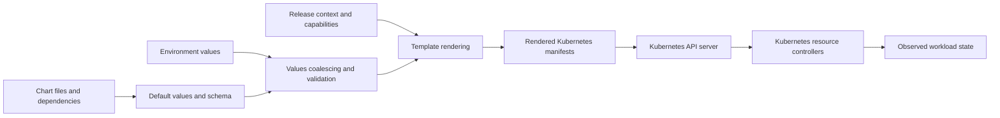
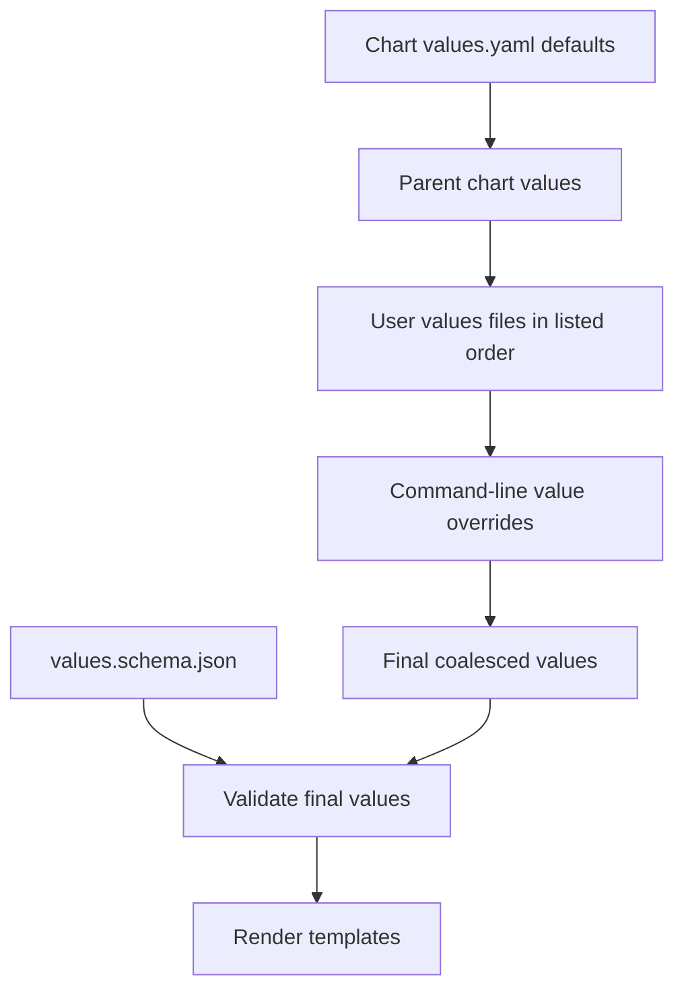
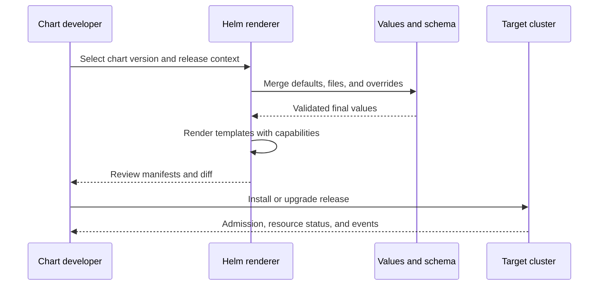
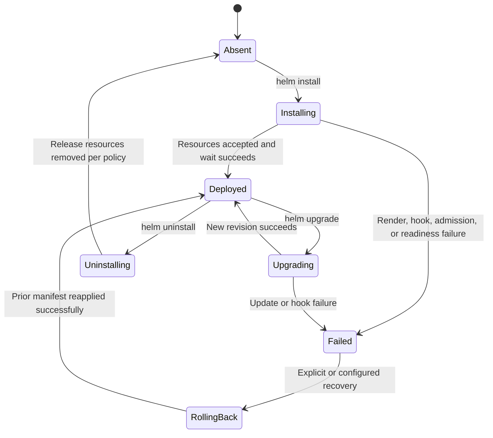
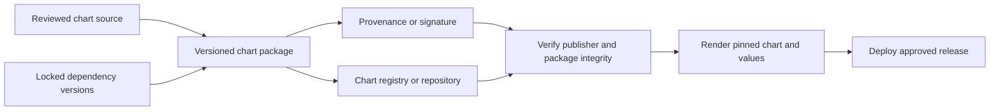
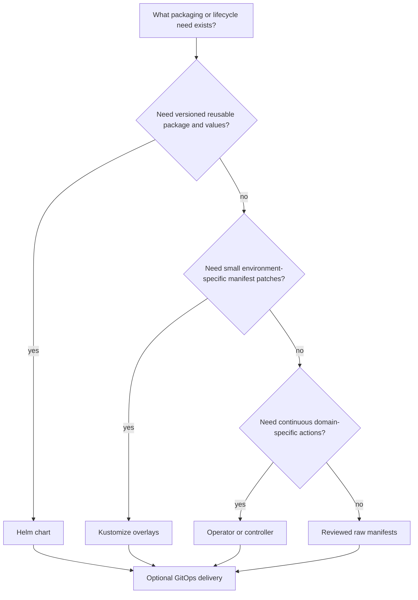

# Helm

Part: [12 — Kubernetes](PART_OVERVIEW.md)

Helm packages Kubernetes application programming interface (API) resource definitions as charts, combines chart defaults with user-supplied configuration, renders templates into manifests, and tracks installations as releases. It is useful when teams need a repeatable package with configurable deployment inputs and revision history. It is not a substitute for Kubernetes controllers, continuous reconciliation, application data migration, or artifact trust policy.

This chapter focuses on Helm-specific chart, template, values, release, and distribution mechanics. CH10 owns the Operator pattern; CH12 owns GitOps reconciliation; Part 13 owns delivery pipelines; Part 09 owns registry products. Kustomize, raw manifests, and Operators appear here only as alternatives. Helm renders and submits resources at a release operation; the controllers that manage those resources remain responsible for ongoing Kubernetes convergence.

Helm documentation consulted reflects Helm 4.3.0. Some current chart, values, and provenance pages explicitly warn that they have not yet been updated for Helm 4. Treat exact command flags and lifecycle behavior, especially custom resource definition (CRD) handling, as version-sensitive and test against the pinned Helm client.

## Chart Source to Kubernetes Objects



A chart describes desired resource objects and their configurable fields. Rendering is a build-like stage whose output should be inspected before it is sent to a cluster.

A chart is a directory or packaged archive containing `Chart.yaml`, a default values file written in YAML Ain't Markup Language (YAML), optional `values.schema.json` using JavaScript Object Notation (JSON) Schema, optional dependencies under `charts/`, optional custom resource definitions (CRDs) under `crds/`, and templates under `templates/`. The required `Chart.yaml` identifies the chart name, chart version, chart format version, and optional application version and Kubernetes version constraint. The chart version follows semantic versioning (SemVer) conventions and identifies package changes. The `appVersion` is informational metadata about the application; it does not set the image tag unless a template uses it.

A chart template combines Go template syntax and Helm-provided functions with values and release context. `.Values` supplies configuration; `.Release` supplies release identity and namespace; `.Capabilities` exposes Kubernetes version and API availability. A rendered object can differ by release name, namespace, values, or discovered capabilities. This makes template output a function of both reviewed source and deployment context, so record the exact chart version, values, and target capabilities used for a production change.

Templates should expose a small, documented set of meaningful configuration choices. Excessive conditionals, nested generic maps, and hidden defaults create a second programming language users must debug. Use named helpers for repeated labels and names, quote string values, preserve correct types for integers and booleans, and render with explicit API versions. Avoid evaluating user-controlled strings as templates unless that behavior is required and constrained.

A chart's templates are not a general-purpose substitute for a controller. A template can generate a Job or a custom resource. After Helm finishes, the controller responsible for that object owns its ongoing behavior. If a domain service needs continuous lifecycle operations such as failover or backup verification, a chart can install its Operator but cannot provide those actions by itself.

## Values Precedence and Configuration Boundaries



Values precedence is part of the deployment contract. A seemingly harmless override can replace a security setting, image reference, resource request, or dependency configuration.

Helm starts with the chart's defaults and coalesces values from parent charts and user input. User-supplied files override chart defaults; when multiple files are provided, later files take precedence; command-line overrides can take precedence over those files. The exact flags and semantics should be checked for the client version in use. Setting a value to `null` can remove a default key during merge, which is useful for mutually exclusive Kubernetes fields but can also remove a needed setting.

A `values.schema.json` file defines a schema for the final values object. It can require fields, constrain types and ranges, and reject unknown or malformed configuration before rendering. Schema validation is valuable because a typo in a values file may otherwise become an omitted manifest field or a surprising default. Validate charts in continuous integration (CI) and at deployment time; do not use schema bypass as a routine response to incompatible values.

Separate stable chart defaults from environment-specific configuration. The chart should provide safe, useful defaults; the environment layer should hold only intended deviations such as replica counts, hostnames, storage class, and image digest. Avoid duplicating an entire defaults file for every environment because new chart defaults then fail to propagate. Document whether values are owned by application teams, platform teams, or release automation.

Values are not a safe secret store merely because they are passed on a command line or supplied from a protected file. Release state can persist chart configuration, and rendered Kubernetes Secret objects remain accessible according to cluster authorization, encryption, and audit policy. Do not place credentials in chart source, public values files, shell history, or build logs. Prefer a dedicated secret-delivery integration; CH13 owns Kubernetes secret security.

```yaml
# Chart.yaml
apiVersion: v2
name: ledger-api
version: 1.4.0
appVersion: "8.2.1"
kubeVersion: ">=1.30.0 <1.38.0"
description: Ledger API workload chart
---
# values.yaml
replicaCount: 3
image:
  repository: registry.example.com/ledger-api
  digest: sha256:0123456789abcdef0123456789abcdef0123456789abcdef0123456789abcdef
service:
  port: 8080
resources:
  requests:
    cpu: 250m
    memory: 256Mi
```

The chart version and application version are deliberately separate. The image uses an immutable digest in this example so a chart release does not resolve to different image content later. The chart's version constraint is illustrative; validate its syntax and support range against the Kubernetes versions your team actually tests.

## Template Design and Rendered Manifest Review



A successful render proves that Helm produced text, not that Kubernetes accepted the objects or that the application is healthy. Review both static rendering and cluster-aware validation.

Template helpers should be deterministic. Resource names must remain stable when only unrelated values change; labels should follow Kubernetes recommended label conventions; selectors must not include labels that change during an upgrade. A name derived from a mutable setting can cause replacement rather than update. Avoid generating random values during template rendering because an upgrade can then produce perpetual diffs or unexpected rollouts.

Use `helm lint` and `helm template` with representative values for each supported configuration path. Inspect the rendered manifests for correct YAML types, selectors, names, namespaces, image references, Secret content, resource requests, probes, and security context. A server-side dry run can validate against the target cluster's schemas and admission policy, but it is not a substitute for deploying an upgrade in a test environment.

Use capabilities to support API-version differences only when the chart has a documented compatibility range and test matrix. Hard-coded deprecated API versions can fail on a newer cluster. Conversely, a chart that dynamically selects different APIs can render different manifests against different clusters, so record those capabilities and ensure the rendered output is reviewable.

Template comments and whitespace matter because rendered YAML is the real deployment artifact. Quote string-valued fields such as versions and annotations; do not quote integer fields that Kubernetes expects as numbers. A value that looks like `true`, a number, or a timestamp may be parsed differently by YAML than intended. Prefer schema validation and explicit `quote`/type conversion over relying on the renderer's implicit output.

## Release State, Upgrade, and Rollback



A Helm release is a tracked installation with revision history and configured values. A revision records Helm's view of a deployment operation; it is not a transactional snapshot of every external system or every runtime state transition.

`helm install` creates a new release and submits its rendered resources. `helm upgrade` compares the new rendered state with release history and the cluster, then updates resources according to the configured apply behavior and Helm version. Wait behavior can observe selected Kubernetes readiness conditions, but readiness of a Deployment does not prove end-to-end service correctness. Pair release health with application checks and service-level evidence.

Helm supports retaining release history and rolling a release back to an earlier revision. A rollback applies an older chart rendering to Kubernetes. It does not reverse database schema migrations, external API actions, files written by a hook, or data written by the workload. Resource fields that cannot be updated in place may require replacement and disruption. Before upgrading stateful applications, make the application migration backward-compatible or define a tested backup and recovery path.

A Helm release can also conflict with other field owners. If GitOps, a human operator, and Helm all apply the same object, the last writer and field-management strategy determine the visible result. Choose one desired-state owner for each resource set. CH12 explains how Argo CD reconciles declared state; do not use Helm commands to mutate objects continuously reconciled by GitOps without a deliberate ownership transfer.

`helm uninstall` removes resources tracked by a release according to Helm's behavior and resource retention policy. It may leave hook resources, resources marked to keep, custom resources that have separate controllers, or external data. Inspect release manifests and hooks before uninstalling. “Release absent” does not mean every side effect or data store has been removed.

## Hooks, Jobs, and Lifecycle Hazards

Helm hooks run chart resources at lifecycle points such as pre-install, post-install, pre-upgrade, pre-delete, or test. A Job hook can perform a bounded migration or validation step, but it blocks the release operation until completion or timeout. Hook resources have lifecycle behavior distinct from normal release-managed resources, and cleanup policy must be explicit. Test retries and repeated upgrades to ensure a hook does not execute a destructive operation twice.

Hooks are an imperative escape hatch inside a declarative package. Use them sparingly, make operations idempotent, set deadlines, record outcomes, and specify deletion policy. A failed hook can leave the release in a failed state with partially updated resources. A pre-upgrade database migration can succeed while a later Deployment update fails; Helm's rollback cannot necessarily undo the migration. Prefer backward-compatible expand-and-contract schema changes and a runbook that names the owner of each recovery action.

A Helm test is a chart-defined test resource, commonly a Job that validates a deployed release. It is not automatically a complete acceptance suite. Test the service from a realistic client boundary, exercise dependencies, and verify data behavior after upgrades. Clean up test resources intentionally.

## CRDs and Custom Resources

CRDs are cluster-wide API extensions, while custom resource instances can be namespaced or cluster-scoped. They need a lifecycle owner that understands API schema changes, stored data migration, and dependent resources. A chart that bundles an Operator may ship CRDs and controller resources, but installing the CRD does not install or upgrade the custom resources' domain semantics.

The Helm chart documentation describes special CRD handling under Helm 3: CRDs in `crds/` are plain, non-templated files installed before templates on initial install, and are not managed like ordinary release resources for upgrade, rollback, or uninstall. The current Helm docs flag some of this page as not yet updated for Helm 4. Therefore, do not infer Helm 4 behavior from Helm 3 details; pin Helm, inspect its current documentation and release notes, and test CRD upgrades and removal explicitly.

A CRD update can affect every custom resource of that kind in the cluster. Removing a CRD deletes its custom resource objects, potentially across namespaces. If a chart is responsible for installation, define whether CRD lifecycle is deliberately manual, separately packaged, or managed by a platform process. Preserve custom resource data and conversion support until clients and stored objects have migrated. CH10 owns the Operator's API compatibility and finalizer contracts.

## Dependencies, Distribution, and Trust



A chart is executable deployment intent: its templates can create privileged resources, alter network exposure, or deploy arbitrary images. Protect the path from source through package to cluster with review, reproducible dependencies, provenance, and least privilege.

Chart dependencies are declared in `Chart.yaml` and can be downloaded into the `charts/` directory. Pin dependency versions and commit the generated lock file when reproducible dependency resolution is required. Review dependency sources, chart contents, image references, and transitive dependency changes. A chart version is not sufficient evidence of a trusted publisher or an unmodified archive.

Helm can distribute packages through traditional chart repositories and Open Container Initiative (OCI)-based registries. OCI registries support content-addressed digests, which provide an immutable reference to chart content. Prefer version pinning or digest pinning over an unconstrained “latest” reference. Keep registry credentials out of chart archives and logs.

Helm provenance files can verify package integrity and the signing identity represented by a trusted public key. This verification is only meaningful when the signer identity and key distribution are trusted. For Open Container Initiative (OCI) chart signing, the Helm documentation describes Sigstore-based tooling as an alternative path; treat plugins and their trust configuration as additional supply chain components. A cryptographic signature proves who signed particular bytes under a key, not that the chart is safe or that the signer is authorized to deploy to your cluster.

Run chart linting and rendering in a constrained build environment, pin Helm and plugins, and retain the rendered manifest and chart digest with the deployment record. Deployment credentials should be scoped to the target namespace and resource types where practical. Part 15 owns general software supply chain integrity; this section applies those checks to Helm artifacts.

## Choose Helm, Kustomize, an Operator, or GitOps



Helm answers packaging and parameterization needs. Kustomize overlays patch rendered resources without Go templates; Operators automate ongoing domain lifecycle; GitOps controllers reconcile a repository's desired state. These tools can compose, but each resource needs one clear owner.

Use raw manifests for small, stable resource sets when package reuse is not valuable. Use Kustomize when environment variation is mostly structured patches to a common base. Use Helm when reusable package versions, dependency packaging, and values-driven configuration are worth the template and release-state complexity. Use an Operator when ongoing domain behavior is required, not merely to make installation look declarative. Use GitOps when cluster state should be continuously reconciled from version-controlled declarations; Helm may still be the renderer or source package.

Avoid wrapping every manifest in a chart solely to standardize the command. Chart abstractions have maintenance costs: values compatibility, template validation, dependency trust, and release state. Conversely, copying a complex resource bundle for every environment can create drift. Decide by the frequency of reuse, number of meaningful configuration dimensions, need for lifecycle automation, and ownership model.

## Worked Example: Chart Upgrade With a Database Migration

A ledger API chart version 1.3.0 runs application 8.2.1 and owns a Deployment, Service, and a pre-upgrade migration Job. Version 1.4.0 updates application 8.3.0 and changes the database schema. The team renders both versions with production-like values, validates the target cluster APIs, checks the dependency lock file, and compares the resulting manifests. It confirms the selector is stable, resource requests remain within the cluster budget, and no credential appears in the render output or CI logs.

The migration is designed as an expand step: it adds a backward-compatible column and can be retried without duplicating data. The previous application version continues to function against the expanded schema. The hook has a bounded deadline and cleanup policy; the Job's exit status and migration version are recorded. A rollout can stop before switching application versions if the migration fails.

After the new Deployment is healthy, an application-level test validates writes and reads through the Service. The release record includes the chart package digest, chart version, application image digest, values revision, Helm version, and rendered manifest. If the application rollout fails, Helm can reapply the prior resource definitions, but the team does not assume the database migration has been undone. The migration's backward compatibility is what makes that rollback safe.

An uninstall test verifies which objects Helm removes, which resources are retained, and which hook Jobs remain. The database and custom resources are managed separately and are not deleted by routine API chart removal. This separation gives operators a clear choice between reverting an application package and deleting persistent service state.

## Review Questions

- Is a chart genuinely useful for reuse, configuration, dependency packaging, or release history compared with simpler manifests?
- Are chart version, application version, Kubernetes compatibility, and image identity distinct and pinned?
- Does the values schema validate the final merged configuration, and are precedence and ownership documented?
- Have rendered manifests been reviewed against the target cluster's APIs and admission policies?
- Are hooks bounded, idempotent, retry-safe, and explicit about resource cleanup?
- Does rollback restore only Kubernetes manifests, or does the application migration require a separate recovery plan?
- Are release values, rendered Secrets, and registry credentials protected from logs and unauthorized access?
- Are CRD installation, upgrade, migration, and deletion responsibilities explicit for the pinned Helm version?
- Are chart dependencies locked, reviewed, and distributed with a verifiable integrity/authenticity mechanism?
- Does every resource set have one clear owner across Helm, GitOps, Operators, and human operations?

Further reading: [Helm Charts](https://helm.sh/docs/topics/charts/), [Values Files](https://helm.sh/docs/chart_template_guide/values_files/), [Chart Hooks](https://helm.sh/docs/topics/charts_hooks/), [Helm Upgrade](https://helm.sh/docs/helm/helm_upgrade/), [Helm Rollback](https://helm.sh/docs/helm/helm_rollback/), [OCI Registries](https://helm.sh/docs/topics/registries/), [Helm Provenance](https://helm.sh/docs/topics/provenance/), [CH10 Operators](CH10_Operators.md), and [CH12 Argo CD](CH12_ArgoCD.md).
