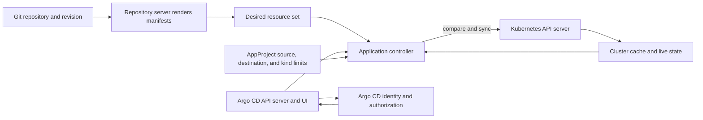
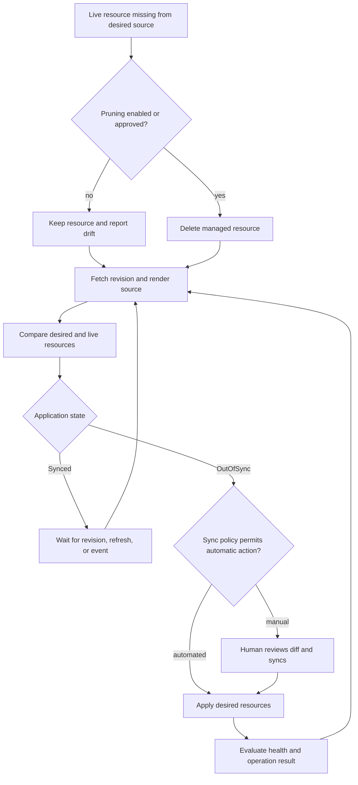
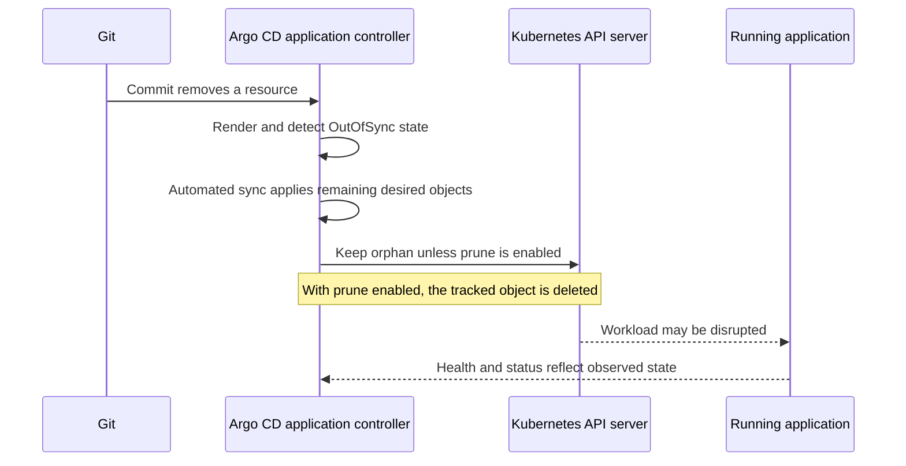
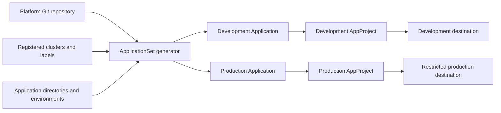
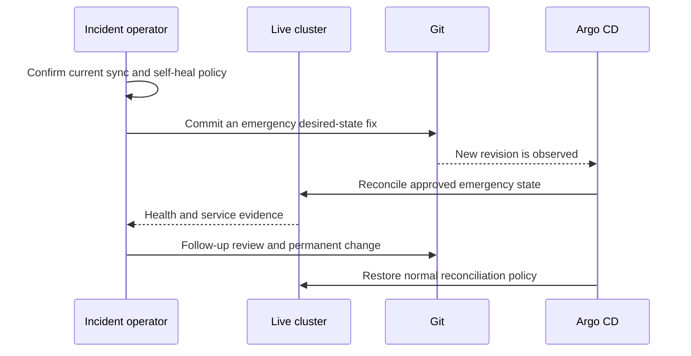

# Argo CD

Part: [12 — Kubernetes](PART_OVERVIEW.md)

Argo CD is a declarative GitOps controller for Kubernetes. It reads application configuration from a configured source, renders the desired manifests, compares them with live cluster objects through the Kubernetes application programming interface (API), and can synchronize differences. Git provides a reviewable desired-state history; Argo CD provides continuous comparison and optional correction. A successful commit or sync operation is not itself proof that a user-facing service is healthy.

This chapter focuses on Argo CD Application and AppProject configuration, source rendering, sync and prune behavior, drift, promotion, access boundaries, and recovery. CH11 owns Helm chart packaging; CH10 owns Operator reconciliation; Part 13 owns Git and pipeline mechanics; Part 15 owns security foundations. Argo CD can render Helm charts and can manage Operators and their custom resources, but those tools retain their own responsibilities.

The official stable documentation consulted describes current stable behavior, but features and deletion semantics can change between Argo CD releases. Pin the controller and command-line versions, review matching release notes, and test automated sync, prune, Application deletion, and multi-source behavior on the deployed version.

## Architecture and Ownership



The repository server produces manifests from a source revision and rendering configuration. The application controller compares that desired output with observed cluster state and performs sync operations when authorized by the Application policy or a user.

An Argo CD `Application` identifies a source repository or chart, a revision, a path or chart name, rendering parameters, a target cluster and namespace, and an AppProject. It is itself a Kubernetes custom resource definition (CRD) instance in the Argo CD control namespace. The `Application` describes what Argo CD manages; it does not contain the workload's runtime state.

The repository server fetches source content and renders manifests using configured tools such as plain files written in YAML Ain't Markup Language (YAML), Kustomize, Helm, or a config management plugin. The application controller watches `Application` objects and target clusters, uses cached live state, determines `Synced` or `OutOfSync` status, evaluates health, and invokes sync operations. The Argo CD API server supports the web user interface (UI), command-line tool, authentication, authorization, and operation requests. These components have distinct availability and permission boundaries.

The Git revision and rendering inputs are the source of desired state. A branch or tag can move; a commit identifier or immutable artifact digest provides stronger deployment evidence. External chart repositories, remote Kustomize bases, plugins, and separately stored Helm values introduce additional inputs that should be pinned and reviewed. A repository commit alone is not a complete record if a remote dependency can change without a new commit.

Give each managed resource set one authoritative writer. If Argo CD, Helm commands, an Operator, a human, or another GitOps controller all mutate the same object, the result can oscillate or hide the intended owner. An Operator may own its custom resource's child objects while Argo CD owns the Operator installation and custom resource specification; make this layered ownership explicit.

## Applications and AppProjects

Every Application belongs to an AppProject. The automatically created `default` project is permissive unless administrators restrict it; current documentation describes broad source, destination, and resource-kind access by default. Create dedicated projects with explicit repositories, clusters, namespaces, resource kinds, and team roles before delegating application creation.

```yaml
apiVersion: argoproj.io/v1alpha1
kind: AppProject
metadata:
  name: payments
  namespace: argocd
spec:
  sourceRepos:
  - https://git.example.com/platform/payments-config.git
  destinations:
  - server: https://kubernetes.default.svc
    namespace: payments
  clusterResourceWhitelist: []
  namespaceResourceBlacklist:
  - group: rbac.authorization.k8s.io
    kind: RoleBinding
  roles:
  - name: deployer
    description: May synchronize applications in the payments project
    policies:
    - p, proj:payments:deployer, applications, sync, payments/*, allow
---
apiVersion: argoproj.io/v1alpha1
kind: Application
metadata:
  name: ledger-api
  namespace: argocd
spec:
  project: payments
  source:
    repoURL: https://git.example.com/platform/payments-config.git
    targetRevision: 3a4d6b8c9e0f1234567890abcdef1234567890ab
    path: applications/ledger-api/production
  destination:
    server: https://kubernetes.default.svc
    namespace: payments
  syncPolicy:
    automated:
      selfHeal: true
      prune: false
    retry:
      limit: 5
```

The example restricts one project to a repository, cluster, and namespace, denies a sensitive namespace-scoped kind, and leaves pruning disabled. Production policy should be validated against the installed Argo CD version and the actual target-cluster identity. A project role authorizes actions on Argo CD Applications; it does not replace Kubernetes Role-Based Access Control (RBAC) or determine what the Argo CD controller's destination-cluster credentials can do.

An AppProject constrains permitted source repositories, destination clusters and namespaces, resource kinds, and optional project roles. Cluster-scoped resources should be allow-listed deliberately. A user who can create or edit an Application must not be able to bypass project restrictions by changing its repository or destination. Project role policies should be scoped to the intended applications and actions; avoid broad wildcards unless they are deliberate.

Argo CD's own RBAC and the destination cluster's Kubernetes RBAC are different layers. Argo CD authorization decides who can view, change, or sync an Application. The credentials Argo CD uses to access a destination cluster determine what its controller can apply there. Restrict both. If all Applications share a highly privileged cluster identity, a narrow AppProject still matters but cannot reduce the authority of a compromised controller credential beyond its actual permission set.

Repository credentials and destination-cluster credentials are sensitive. Store them through the supported credential mechanisms, limit who can read or change them, rotate them, and avoid embedding secrets in Application manifests. Use an external secret integration or encrypted-secret workflow for application secrets; Git history is durable, so deleting a plaintext secret in a later commit does not remove previous copies.

## Reconciliation, Drift, Sync, and Prune



`Synced` means the live resources match Argo CD's computed desired representation under configured comparison rules. It does not imply all Pods are ready, the application meets its service objective, or an external dependency is functioning.

Automated sync applies desired changes when the Application is out of sync. Pruning is a separate destructive decision: automated sync does not automatically prune by default. Enabling `automated.prune` permits Argo CD to delete resources that disappear from the desired source. `allowEmpty` adds behavior around a desired source that renders no resources; do not enable it casually. Test repository path changes, renamed resources, empty render output, and accidental deletion before enabling automatic prune for production.

Self-heal controls whether live-cluster changes that differ from source are corrected without a new source revision. With self-heal disabled, a manual change can remain until another sync trigger or explicit operation; in multi-source Applications, another source update may still trigger synchronization. With self-heal enabled, an emergency `kubectl` change can be reverted. Decide in advance whether emergency work begins with a Git commit, a temporary self-heal suspension, or another break-glass procedure.

A diff can hide fields intentionally managed by another controller, such as a replica count adjusted by the Horizontal Pod Autoscaler. Ignoring a difference affects comparison, but does not guarantee the sync stage preserves that field. Configure the appropriate sync behavior when necessary. Make ignored fields narrow and documented. Broad ignore rules can conceal meaningful drift or weaken the Git ownership contract.

Sync operations apply rendered resources through Kubernetes APIs. Health assessment is resource-kind-specific and can be customized. An Application can be `Synced` but `Progressing`, or be `OutOfSync` while some resources are healthy. Use sync status, health status, operation conditions, cluster events, and application-level service checks together when determining whether a release is safe.

## Sync Phases, Waves, and Deletion

Argo CD sync phases and waves order resources within a sync. PreSync hooks run before ordinary sync resources; Sync hooks run during the sync phase; PostSync hooks run after resources have synchronized and are healthy; SyncFail hooks can respond to a failed sync. A resource's sync-wave annotation orders work within a phase. Ordering can help install a CRD before a custom resource or run a bounded validation Job before a rollout, but it does not create a transaction or guarantee arbitrary external readiness.

Hooks are operational code. Jobs should be idempotent, bounded by deadlines, observable, and explicit about cleanup. A migration hook can succeed even if a later Deployment fails; reverting the Git revision does not undo the migration. For long-running domain lifecycle behavior, use an Operator rather than accumulating complex one-shot hooks in an Application.

Prune order and application deletion are separate concerns. Pruning removes resources that are no longer present in desired state; Application deletion may cascade to all resources tracked by that Application when its resource finalizer is present. Non-cascading deletion removes the Application while leaving managed resources in the cluster, which creates a change of ownership. Verify the exact deletion option and finalizer behavior before confirming deletion.



The same source change has different effects based on pruning policy and resource tracking. Resource retention, data preservation, and Application cascade behavior must be part of the release design rather than discovered during teardown.

Use sync options such as prune confirmation, prune-last, or delete protection only for an explicit safety requirement. Per-resource settings can override Application-level defaults. These options are not a replacement for access control, backup, or reviewing the rendered diff. A namespace or persistent claim can contain many other resources or data; deletion requires a stronger approval path than a stateless Deployment update.

## Environments, Promotion, and Source Integrity

```mermaid
flowchart LR
    Build[Build application image once] --> Artifact[Immutable image digest]
    Artifact --> Dev[Development config commit]
    Dev --> Verify[Integration and policy checks]
    Verify --> Stage[Staging promotion commit]
    Stage --> Approve[Review deployment evidence]
    Approve --> Prod[Production config commit]
    Prod --> Argo[Argo CD syncs exact desired revision]
    Argo --> Observe[Health, sync, and service evidence]
```



Promote the same immutable application artifact through environments while changing only intended environment configuration. Git history should show what changed, who approved it, and which artifact was deployed.

Separate application source code from deployment configuration when teams, review rules, or release cycles differ. A build pipeline can publish an image and update a configuration repository with its digest; Argo CD then observes the desired change and deploys it. The pipeline need not have direct access to the production cluster. Protect the configuration repository with required review, branch rules, commit identity, and artifact provenance.

Use a protected tag or immutable commit identifier as `targetRevision` when reproducibility matters. Branch-based tracking is convenient for continuous deployment but means the desired revision moves. Remote Helm charts, external values files, Kustomize bases, and config management plugins add their own revisions, caches, and trust policies. Record these dependencies with the release evidence.

For promotion, prefer a reviewed change to the environment's desired-state source over `argocd app set` parameter overrides that exist only in controller state. Imperative overrides can be useful during diagnosis, but they create a second source of truth and may not be reproducible from Git. Document how temporary overrides are exported or cleared.

A multi-source Application can combine several sources, but ownership becomes less obvious: a change to one source can trigger a new render of all of them. Pin revisions independently and test that a source update cannot unexpectedly alter resources owned by another team. If common configuration is shared, publish a versioned dependency or use a clearly reviewed promotion process.

## ApplicationSets, Bootstrap, and Fleet Ownership

ApplicationSets generate Application resources from generators such as lists, Git directories, clusters, or pull requests. They reduce repetitive declarations across fleets, but generator inputs and templates become a second layer of configuration. Constrain the generator's project, source, and destination; do not interpolate untrusted branch or pull-request input into a privileged production project.

The app-of-apps pattern stores child Applications as resources managed by a parent Application. It can bootstrap a set of applications, but deleting or pruning the parent can cascade to children and then their workloads depending on finalizers and propagation policy. Decide who owns the parent, child Applications, and child workloads. Treat generator or bootstrap repository permissions as control-plane authority, not just application configuration.



The generator controls which Applications exist; each project's source, destination, and resource-kind limits constrain what those generated Applications can deploy. A template that selects an untrusted revision or privileged project can turn fleet generation into a privilege escalation path.

Bootstrap also has a dependency cycle: Argo CD must exist to reconcile the repository that may declare Argo CD itself. Use a documented bootstrap mechanism, pin the initial installation, and define how the first Application or project is restored if the controller is unavailable. Avoid relying solely on a self-managed application to repair every aspect of its own control plane.

## Break-Glass Changes and Rollback



The safest emergency change is usually a reviewed Git change that preserves the source-of-truth contract. When direct cluster mutation is unavoidable, coordinate it with self-heal and automated sync before changing live state.

With automated sync and self-heal enabled, a manual hotfix may be overwritten. Temporarily disabling automation can create an intervention window, but the procedure must identify who restores it and how the final state returns to Git. Do not assume that `argocd app rollback` is available for every Application or behaves like a Git revert; current documentation restricts rollback under automated sync. A Git revert or corrective commit creates an auditable desired-state revision.

A rollback to a previous manifest revision does not necessarily reverse database migrations, external side effects, or controller-owned resources. Verify application compatibility, persistent data, and hook effects. After an incident, reconcile the emergency state into the tracked repository, remove untracked overrides, verify the Application's source revision, and confirm whether self-heal and pruning are intentionally enabled.

## Availability and Operational Recovery

Argo CD availability is separate from application availability. If the control plane is unavailable, already-running workloads can continue to serve traffic, but new commits, drift correction, and deployment operations can be delayed. Repository outages or credential failures prevent new manifests from being fetched; cached revisions may help with existing observation but do not guarantee deployment from unavailable sources.

Argo CD's component architecture and scaling requirements depend on version and fleet size. The application controller watches clusters and maintains cached state; the repository server performs source checkout and manifest generation; the API server and cache support user and controller operations. Monitor reconciliation latency, render failures, queue depth, Kubernetes API errors, repository refresh, sync outcomes, and destination-cluster health. A healthy Argo CD Deployment does not imply that each managed cluster is reachable or synchronized.

High availability configuration protects Argo CD control-plane components, not the applications it deploys. Back up the configuration repository and protect repository/cluster credentials and Argo CD configuration. Since Application objects and many settings are stored in Kubernetes, preserve the Argo CD installation cluster and its critical resources according to the recovery design. Validate restore by re-establishing the controller, credentials, projects, Applications, and source access without accidentally pruning workloads during bootstrap.

## Worked Example: Production Drift During an Incident

The ledger API uses an Application with automated sync and self-heal enabled, but pruning disabled. During a database incident, an operator changes the Deployment's resource request directly in the production cluster to stabilize scheduling. Argo CD detects drift and restores the Git value after its self-heal interval. The manual adjustment does not persist, and the incident worsens.

The team follows a break-glass process: it confirms the Application and affected fields, temporarily suspends self-heal for the targeted Application, records the exact emergency patch and approver, and monitors the service. A reviewer then commits the validated resource change to the production configuration source. Argo CD observes the new commit, applies it, and the operator verifies sync status, Deployment health, and database latency. The temporary override is removed and the Application returns to its normal policy.

Later, the team tests a mistaken deletion from the production path. Because prune is disabled, the removed resource remains live and the Application reports the discrepancy for review. The team confirms the resource identity and data implications before either restoring it to Git or approving deletion. This behavior is intentional: the application is stateless, but its persistent claim and namespace remain protected by policy.

The runbook is considered complete only when the team demonstrates that source outage, Argo CD outage, invalid manifest, failed sync, direct cluster change, and accidental path deletion each have a safe owner and recovery action.

## Review Questions

- Is Git the authoritative desired-state source, and are all rendering inputs pinned or recorded?
- Does each Application use a restricted AppProject with explicit sources, destinations, and resource kinds?
- Are Argo CD RBAC and destination-cluster Kubernetes permissions reviewed as separate security layers?
- Is automated sync enabled only where the team accepts its timing and failure semantics?
- Are prune, allow-empty, self-heal, ignored differences, and application deletion behavior explicit and tested?
- Does the promotion process use immutable artifact identity and reviewable environment changes?
- Are ApplicationSet generators and app-of-apps deletion boundaries constrained?
- Are hooks and sync waves bounded, observable, and safe under retries or partial failure?
- Does the break-glass procedure prevent reconciliation from undoing an emergency fix and restore Git authority afterward?
- Has recovery from repository outage, credential revocation, controller failure, and accidental prune been exercised?

Further reading: [Argo CD Architecture](https://argo-cd.readthedocs.io/en/stable/operator-manual/architecture/), [Automated Sync](https://argo-cd.readthedocs.io/en/stable/user-guide/auto_sync/), [AppProjects](https://argo-cd.readthedocs.io/en/stable/user-guide/projects/), [Sync Waves](https://argo-cd.readthedocs.io/en/stable/user-guide/sync-waves/), [Sync Options](https://argo-cd.readthedocs.io/en/stable/user-guide/sync-options/), [Application Deletion](https://argo-cd.readthedocs.io/en/stable/user-guide/app_deletion/), [High Availability](https://argo-cd.readthedocs.io/en/stable/operator-manual/high_availability/), [CH10 Operators](CH10_Operators.md), and [CH11 Helm](CH11_Helm.md).
