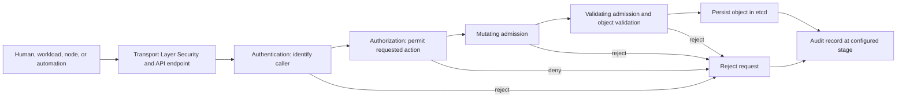
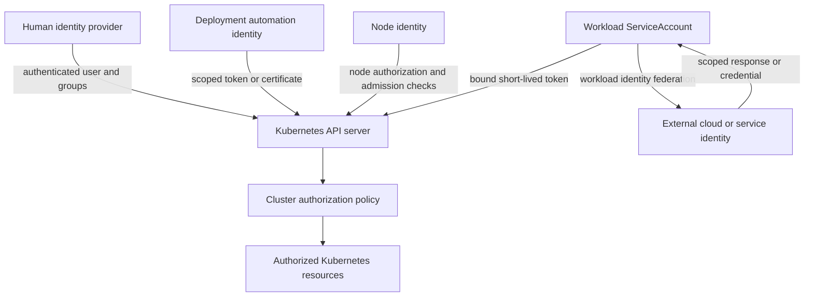
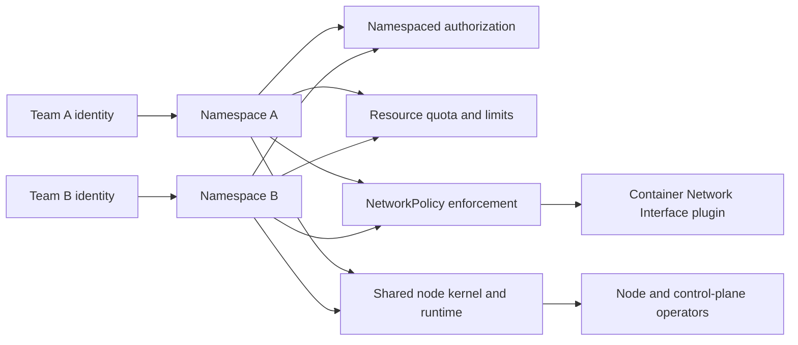
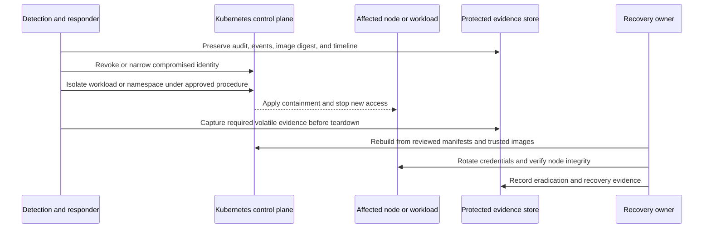

# Security

Part: [12 — Kubernetes](PART_OVERVIEW.md)

Kubernetes security is the combined effect of identity, authorization, admission policy, workload isolation, network controls, secret handling, image trust, node protection, and incident response. No single setting makes a cluster secure. The relevant question is whether each transition of authority is intentional and bounded: who can call the API, what they can cause the cluster to run, which credentials that workload receives, what it can reach, and how operators detect and contain misuse.

The Kubernetes application programming interface (API) is the central control-plane boundary for users, automation, nodes, and workloads. Its request path must be protected separately from the processes and data running on worker nodes.

This chapter applies security controls to Kubernetes clusters and workloads. Part 15 owns general threat modeling and security engineering; Part 09 owns provider identity and access management (IAM), key, network, and managed-cluster services; CH06 owns Kubernetes NetworkPolicy mechanics; CH14 owns telemetry architecture. The boundaries matter: an admission policy cannot compensate for a cloud credential exposed to a Pod, and a namespace boundary does not isolate a hostile tenant from a shared kernel.

The upstream Kubernetes documentation consulted describes v1.37. Admission behavior, feature maturity, Pod Security Standard revisions, service account token formats, and managed-control-plane responsibilities are version- and distribution-sensitive. Validate controls against the deployed cluster and its provider configuration.

## The Kubernetes API Request Path



A request can be rejected at several independent stages. Authentication identifies the principal; authorization evaluates whether that principal may perform the requested action; admission can validate or mutate a proposed object before it is stored.

The Kubernetes API server typically uses Transport Layer Security (TLS) to protect API traffic and authenticate server identity. A private certificate authority (CA) requires clients to trust the correct CA certificate; disabling certificate checks converts an identity boundary into a network guess. Restrict API endpoint exposure to expected administrative and workload paths, and keep the control-plane datastore and kubelet API off public networks.

Authentication mechanisms can include client certificates, bearer tokens, and external identity integrations. Kubernetes represents authenticated users and groups as request identity; it does not require a built-in User object for human accounts. Treat long-lived client credentials as durable authority: protect issuance, storage, rotation, revocation, and audit. Separate human access, automation identities, nodes, and in-cluster workloads instead of sharing a broad administrator identity.

Authorization is evaluated for a specific verb, API group, resource or subresource, namespace, and sometimes object name. Role-Based Access Control (RBAC) is common, but permissions aggregate: a single broad binding can undo several narrow roles. Review effective access, including group membership, service account bindings, wildcard resources and verbs, aggregated roles, impersonation, and privileges granted through workload creation.

A principal that can create or modify Pods, Deployments, Jobs, or other Pod-producing resources can often exercise more authority than its direct Secret `get` permission suggests. It may create a Pod that mounts a namespace Secret, uses a privileged security context, or runs under a more privileged ServiceAccount. Restrict workload creation through admission and namespace policy; do not rely on RBAC verbs alone to express all Pod-spec security controls.

Admission controllers act on create, update, delete, or selected connect requests after authentication and authorization. Mutating admission runs before validating admission; validators should inspect the final mutated object. A rejection stops the request. Admission does not generally govern reads, and policy at admission time does not continuously inspect already-running workloads. Test policy changes against workloads, controllers, and system components before enforcement.

## Human, Workload, Node, and Provider Identities



Different principals need different authorities. A Pod's Kubernetes ServiceAccount identity and its external provider identity are related only through an explicit trust configuration; neither should inherit cluster administrator privileges by convenience.

Create a dedicated ServiceAccount for each workload that needs Kubernetes API access. A Pod that does not call the API should set `automountServiceAccountToken: false` or use a ServiceAccount configured not to automount. When API access is needed, grant the smallest namespaced role that supports the task and test effective permissions. The automatically assigned `default` ServiceAccount is not a workload-specific security design.

Modern Kubernetes uses short-lived, bound ServiceAccount tokens delivered through projected volumes and rotated by the kubelet. These tokens can be audience-bound and associated with a Pod lifetime. Applications must reread rotated token files rather than caching them indefinitely. Avoid manually created, non-expiring ServiceAccount token Secrets except for a justified legacy integration with explicit rotation and revocation controls.

A Pod that can call the Kubernetes API carries the authority of its ServiceAccount. A compromised container may use that authority from inside the Pod. Do not grant list or watch access to Secrets for an application that only needs one credential; those verbs can expose all Secret data in the authorized scope. Prefer delivering only required credentials to the containers that need them, and use a distinct identity for a sidecar or maintenance task when its authority differs.

External workload identity often exchanges a Kubernetes identity for a provider credential under a trust policy. Restrict the issuer, subject, audience, namespace, and ServiceAccount involved. Part 09 owns provider IAM role design and credential services; CH13 owns the Kubernetes identity presented to that trust boundary. A leaked projected token is still a credential until it expires or is revoked.

Node identity is part of the security model. The kubelet should authenticate as its specific node identity; node authorization and the NodeRestriction admission plugin limit which Pod and Node objects a kubelet can modify. Protect node credentials, kubelet configuration, host operating system (OS), container runtime, and control-plane certificates. A compromised node can often access data for Pods that ran on it and can threaten other workloads that share its kernel.

## Admission Policy and Pod Security

Pod Security Standards (PSS) define three cumulative profiles: `privileged`, `baseline`, and `restricted`. The built-in Pod Security Admission (PSA) controller applies those profiles by namespace labels and provides three modes: `enforce`, `audit`, and `warn`. Enforcement rejects violating Pods; audit records violations; warning surfaces violations to the submitting user. Pin the profile version when a cluster upgrade must not silently change policy semantics.

Start with audit and warning on existing namespaces to discover incompatible workloads. Remediate security contexts, host access, capabilities, seccomp settings, and volume types; then enable enforcement. A workload controller's Pod template may pass audit and warning evaluation while enforcement is applied to the Pods it creates. Privileged system agents should be isolated in dedicated namespaces with narrow creation rights and reviewed exceptions, not used as a reason to make every tenant namespace privileged.

PSS is a baseline policy, not a complete workload threat model. The Restricted profile cannot encode every rule for approved images, external endpoints, secret use, resource bounds, tenant-specific placement, or custom capabilities. Combine it with RBAC, admission policies, security context, network policy, and runtime controls. Custom validating or mutating webhooks add availability and supply chain risk; document their timeout and failure behavior and test them during API-server load and webhook outages.

```yaml
apiVersion: v1
kind: Namespace
metadata:
  name: payments
  labels:
    pod-security.kubernetes.io/enforce: baseline
    pod-security.kubernetes.io/enforce-version: v1.37
    pod-security.kubernetes.io/audit: restricted
    pod-security.kubernetes.io/audit-version: v1.37
    pod-security.kubernetes.io/warn: restricted
    pod-security.kubernetes.io/warn-version: v1.37
---
apiVersion: v1
kind: ServiceAccount
metadata:
  name: inventory-reader
  namespace: payments
automountServiceAccountToken: false
---
apiVersion: rbac.authorization.k8s.io/v1
kind: Role
metadata:
  name: inventory-reader
  namespace: payments
rules:
- apiGroups: [""]
  resources: ["pods"]
  verbs: ["get", "list"]
---
apiVersion: rbac.authorization.k8s.io/v1
kind: RoleBinding
metadata:
  name: inventory-reader
  namespace: payments
subjects:
- kind: ServiceAccount
  name: inventory-reader
  namespace: payments
roleRef:
  apiGroup: rbac.authorization.k8s.io
  kind: Role
  name: inventory-reader
```

The example first audits and warns on the Restricted profile while enforcing Baseline. The ServiceAccount is denied an automatically mounted token because this example assumes the application does not call the Kubernetes API; the Role and RoleBinding illustrate how a separate API-using workload identity would be granted narrow access. Do not bind that role to every Pod in the namespace.

Security contexts define the runtime identity and privileges for a Pod or container: non-root user, read-only root filesystem, capability drop/add, privilege escalation, seccomp profile, and platform-specific controls such as SELinux or AppArmor. Choose the least privilege compatible with the application and test on the target operating system and runtime. A field in a manifest is not evidence that the underlying node enforces the requested control; verify kernel, runtime, and provider support.

Avoid privileged containers, host PID/network namespaces, hostPath mounts, host ports, and broad Linux capabilities unless a platform component requires them. A container running as root is not equivalent to host root in every configuration, but it increases the impact of a container escape and often enables additional kernel or device access. Sandbox untrusted workloads or place them on a stronger isolation boundary when namespace policy does not meet the threat model.

## Namespace and Tenant Boundaries



Namespaces group API objects and scope several policies, but do not provide a separate kernel or a complete hostile-tenant isolation boundary. Shared-cluster safety depends on correct authorization, admission, network enforcement, node security, and operator behavior.

Map tenants to namespaces with least-privilege RoleBindings, ResourceQuotas, LimitRanges, Pod Security labels, network policy, and explicit secret access. Protect namespace labels that determine policy: a tenant that can remove an enforcement label can weaken its own boundary. Cluster-scoped resources such as CustomResourceDefinitions, StorageClasses, admission configuration, and webhooks are not contained by a namespace and require platform ownership.

NetworkPolicy is effective only if the installed Container Network Interface (CNI) plugin enforces it. A default-deny ingress and egress policy can establish an allow-list foundation, but Domain Name System (DNS), telemetry, ingress, dependency traffic, and control-plane access need deliberate exceptions. CH06 owns NetworkPolicy selectors and flow behavior; verify the actual data-plane enforcement rather than treating creation of a policy object as proof of isolation.

ResourceQuota and LimitRange help protect fairness and some control-plane capacity, but they do not guarantee isolation from noisy neighbors, network saturation, shared storage behavior, or node compromise. Node pools and taints can reduce co-location, but the kubelet and control plane remain shared authorities. For mutually distrustful tenants or workloads executing untrusted code, compare sandboxed runtimes, virtual control planes, and dedicated clusters. Part 09 owns managed-cluster cost and provider isolation details.

## Secrets, Encryption, and Rotation

A Kubernetes Secret is an API object, not an encrypted secret manager. By default, Secret data is stored unencrypted in the API server's backing etcd data store. Base64 in the `data` field is an encoding, not confidentiality. Enable encryption at rest for the Secret API, protect etcd and its backups, restrict read/list/watch permissions, and prevent Secret values from appearing in logs, manifests, rendered output, or support bundles.

Encryption at rest protects persisted API data only when correctly configured and migrated. It does not protect a plaintext value from an authorized API client, a privileged control-plane host, a process that reads a mounted credential, or a backup that lacks equivalent protection. Key rotation must preserve the ability to decrypt existing data, be applied consistently across API servers, and include rewriting old objects when required. Part 09 owns provider key management service (KMS) offerings and envelope-key controls.

Mount Secret data only into the containers that need it. A Pod-creation permission in a namespace can often be used to mount that namespace's Secrets even without direct Secret read permission, so namespace workload creation belongs in the threat model. Environment variables may leak through process diagnostics or crash reports; projected files have update semantics and applications must reload rotated content. CH08 owns the volume behavior; this chapter owns why the credential should be limited and rotated.

Use external secret delivery or workload identity when it reduces persistent copies and authority. External integration introduces its own availability, authentication, and rotation contracts. A CSI-mounted secret may not appear as a Kubernetes Secret object, but its node plugin, provider identity, and Pod access are still part of the trust chain. Do not call a credential “ephemeral” unless expiry, refresh, and revocation have been tested end to end.

## Image Provenance and Runtime Trust

```mermaid
flowchart LR
    Source[Reviewed source and dependencies] --> Build[Isolated image build]
    Build --> Scan[Vulnerability and policy checks]
    Scan --> Sign[Sign image and publish provenance]
    Sign --> Registry[Trusted registry and immutable digest]
    Registry --> Admission[Admission verifies policy and identity]
    Admission --> Runtime[Node pulls approved image]
    Runtime --> Observe[Runtime monitoring and incident response]
```



An image digest identifies immutable image content; it does not prove that the content is safe or came from an authorized builder. Provenance, signatures, build isolation, dependency review, vulnerability response, admission policy, and runtime controls answer different questions and should not be collapsed into one “trusted image” flag.

Prefer image references by digest for production releases, or ensure tags are immutable and the resolved digest is recorded. A tag can be moved to different bytes. Verify the image publisher and attestations against an independently managed trust policy at build, admission, or both. Kubernetes does not universally enforce image signatures on its own; the enforcement mechanism and its failure behavior are additional cluster components.

Limit who can push to production registries and who can change the admission policy that trusts them. Scan build artifacts for known vulnerabilities, but understand that a clean scan only describes the database and time of that scan. Patch base images, rebuild affected images, and identify running workloads by digest during response. Part 15 owns general software supply chain engineering; Part 09 owns registry services.

Runtime security depends on the node kernel and container runtime. Keep Kubernetes and node components supported and patched; restrict SSH or equivalent administrative access; protect bootstrap credentials and node certificates; configure audit; and minimize host-level components. A managed control plane shifts some operations to the provider but does not remove workload, node, IAM, network, or data responsibilities. Part 09 owns the provider boundary and shared-responsibility model.

## Audit, Detection, and Incident Response

Kubernetes audit logging records API activity according to the configured policy and retention pipeline. Audit records can identify who requested an action, which object was targeted, and whether it succeeded; high-detail request/response bodies can also contain sensitive configuration. Define an audit policy that captures security-relevant changes without indiscriminately retaining Secret payloads, and protect audit storage from cluster administrators or attackers who could alter the evidence.

Collect identity and authorization changes, RoleBindings, ServiceAccount use, admission failures, privileged workload creation, Secret access, image changes, and node lifecycle events. Correlate Kubernetes audit with provider audit, registry records, identity-provider logs, and application signals. CH14 owns telemetry pipeline architecture; the security question here is which evidence survives compromise and who can query it.



Containment must prevent further access without destroying the evidence needed to understand scope. A compromised ServiceAccount, a node credential, an external provider identity, and a human account require different revocation and recovery actions.

An incident procedure should identify the incident commander, cluster/provider owners, credential revocation path, isolation mechanism, evidence store, communication channel, and recovery authority. Preserve audit records, object manifests, image digests, and relevant node data before deleting workloads when feasible. Do not run forensic tools with a broader identity than necessary, and do not trust a compromised cluster as the sole source of its own timeline.

Containment can include disabling a token or binding, restricting network egress, cordoning or replacing a node, suspending GitOps correction, or isolating an entire cluster. Each has availability and evidence tradeoffs. For external-provider credentials, revoke or rotate the provider identity as well as the Kubernetes token that exchanged for it. Rebuild from trusted source and known-good images after establishing the compromised scope; do not restore suspect manifests or credentials without review.

## Worked Example: A Pod-Creation Permission Becomes Cluster Access

A contractor receives permission to create Deployments in a shared `reports` namespace. They do not have direct permission to read Secrets. A compromised deployment token is used to create a Deployment that runs under a ServiceAccount bound to a broader Role and mounts a registry credential Secret. The Pod also requests a hostPath mount and privileged mode.

RBAC alone permits the Deployment object because it checks the requested API verb, not every security-sensitive field in the Pod template. Pod Security Admission rejects privileged mode and hostPath under the namespace's enforced profile. A validating policy also rejects the use of protected ServiceAccounts and unapproved image registries. The RoleBinding giving the contractor workload-creation rights is then narrowed, and the registry credential is rotated because the contractor could already create an arbitrary Pod that referenced it.

Audit records identify the Deployment request and caller. The team preserves the rendered object and audit timeline, verifies that admission rejected the Pod before it ran, checks provider audit for credential use, and confirms no related image or Secret was accessed. Recovery closes the exposed credential path, not just the rejected manifest. The review changes the operational rule: workload creation authority is treated as delegated code execution, and every namespace has an enforced Pod policy before team access is granted.

The example shows defense in depth, not a guarantee. Admission policy blocked specific fields, but the team still investigated the effective ServiceAccount and Secret exposure created by workload-authoring permissions.

## Review Questions

- Which human, automation, node, workload, and provider identities can access this cluster, and how are they revoked?
- Are authentication, authorization, mutating admission, validating admission, and audit independently configured and tested?
- Can a subject create a Pod-producing resource that runs with a more privileged ServiceAccount or mounts another Secret?
- Are RoleBindings narrow by namespace, API group, resource, verb, and subject, with no unnecessary wildcard or impersonation rights?
- Are Pod Security Standards enforced, version-pinned, and backed by reviewed exceptions for system workloads?
- Does the CNI enforce default-deny network policies, and have actual tenant traffic paths been tested?
- Are Secret API data encrypted at rest, protected in backups, narrowly readable, and rotated with a tested consumer refresh path?
- Are images pinned, provenance verified by an explicit trust policy, and running digests traceable to source and build evidence?
- Are node, runtime, control-plane, admission webhook, and provider boundaries assigned to accountable owners?
- Can responders revoke credentials, contain a workload, preserve evidence, and restore from trusted state without relying on the compromised cluster?

Further reading: [Controlling API Access](https://kubernetes.io/docs/concepts/security/controlling-access/), [Admission Controllers](https://kubernetes.io/docs/reference/access-authn-authz/admission-controllers/), [Pod Security Standards](https://kubernetes.io/docs/concepts/security/pod-security-standards/), [Pod Security Admission](https://kubernetes.io/docs/concepts/security/pod-security-admission/), [Service Accounts](https://kubernetes.io/docs/concepts/security/service-accounts/), [Secrets](https://kubernetes.io/docs/concepts/configuration/secret/), [Encryption at Rest](https://kubernetes.io/docs/tasks/administer-cluster/encrypt-data/), [Multi-tenancy](https://kubernetes.io/docs/concepts/security/multi-tenancy/), [Security Checklist](https://kubernetes.io/docs/concepts/security/security-checklist/), [CH06 Networking](CH06_Networking.md), [CH08 Volumes](CH08_Volumes.md), and [CH14 Observability](CH14_Observability.md).
