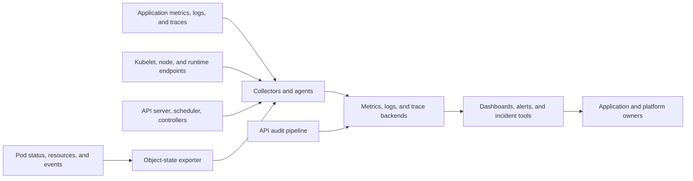
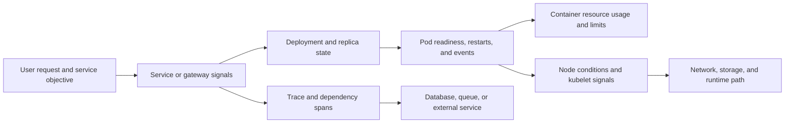
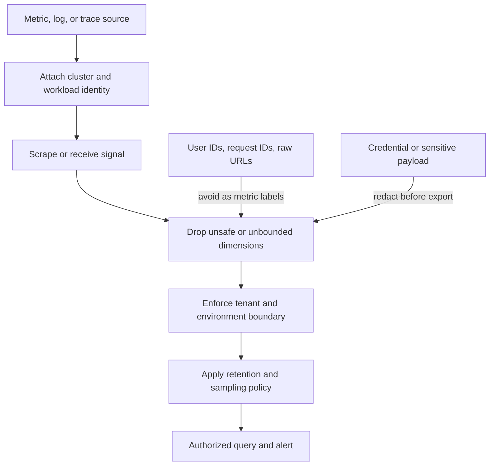
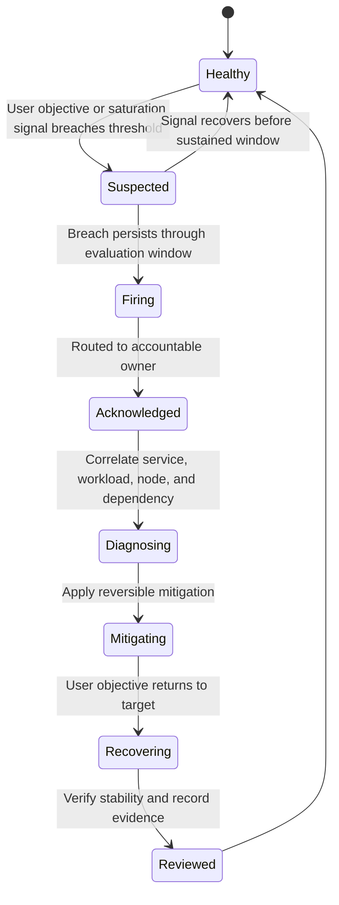
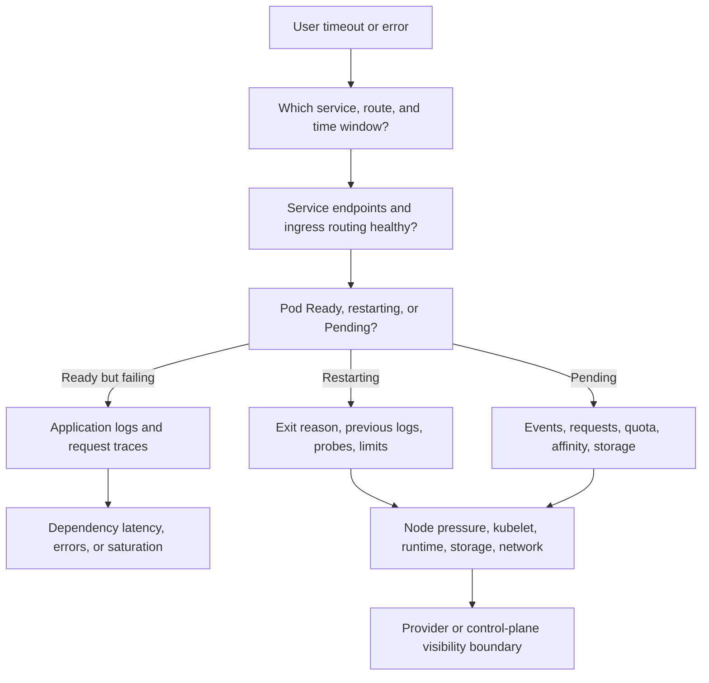

# Observability

Part: [12 — Kubernetes](PART_OVERVIEW.md)

Kubernetes observability connects user-visible outcomes to application, Pod, controller, node, cluster, and dependency state. A metric, log line, event, or trace is useful only when it has an owner, a trustworthy source, a bounded cost, and enough context to answer an operational question. The goal is not to collect every signal; it is to identify which control-plane and workload evidence explains a failure and supports a safe response.

The Kubernetes application programming interface (API) exposes object state and selected resource metrics to clients. These signals complement application telemetry. They do not replace durable monitoring systems.

This chapter applies observability to Kubernetes workloads and control planes. Part 14 owns generic observability design and service-level objectives (SLOs); Part 09 CH10 owns provider monitoring products and managed-service visibility; CH09 owns autoscaling control decisions; CH13 owns security audit and incident evidence. Here, the focus is which signals Kubernetes exposes, how they join across object boundaries, and where platform operators may lack access.

The official Kubernetes documentation consulted describes v1.37. Metrics endpoint stability, the Metrics API, node pressure signals, and managed-cluster access vary by version and distribution. Validate the installed collection components and exact APIs consumed by your autoscalers and dashboards.

## Signal Sources and Collection Paths

Kubernetes does not provide a complete monitoring backend. It exposes some signals and object APIs; a separately operated collection and storage pipeline must retain, query, and alert on them.

Application telemetry describes request rate, errors, latency, queue depth, dependency calls, and domain outcomes. Instrumentation should preserve trace context across service calls and include stable workload identity. Application signals answer whether the service is useful to its users; cluster signals explain where and why it is failing.

Kubernetes object state is visible through API resources such as Pod conditions, Deployment availability, Job completion, Node conditions, and Events. An add-on such as kube-state-metrics converts selected object state into scrapeable metrics. It reports what the API says about objects, not actual CPU consumption or end-user latency. Object-state metrics can reveal a Deployment with unavailable replicas or Pods stuck terminating while resource metrics show a different dimension of the same incident.

Kubernetes components expose Prometheus-format metrics through `/metrics` endpoints, and kubelet exposes additional resource, probe, and container metrics endpoints. A metrics scraper periodically collects those samples into a time-series database. Component metric names and labels have stability guarantees that vary by metric lifecycle; treat alpha and deprecated signals as version-sensitive rather than permanent dashboard contracts.

The Metrics API, commonly served by Metrics Server, provides a small resource-oriented view of central processing unit (CPU) and memory usage for Nodes and Pods. It supports `kubectl top` and autoscaling consumers. It is not a general monitoring pipeline: it does not replace long-term storage, high-resolution application metrics, object-state metrics, logs, or traces. In Kubernetes v1.37, the Metrics API v1 is stable, while the HPA controller's resource metric support remains version-specific; CH09 documents its integration boundary.

Container runtimes capture standard output and standard error from container processes in a runtime-specific format that integrates with the Container Runtime Interface (CRI). The kubelet makes current and previous container logs available through `kubectl logs`, but those files are node-local and rotate. If a Pod is evicted or a node is lost, unshipped logs may be lost. A cluster-level logging pipeline should collect and retain logs independently of the Pod and node lifecycle.

Kubernetes Events are useful short-lived evidence about scheduling, image pulls, mounts, probes, and controller decisions. They are not a durable audit log or a reliable long-term alert source; export them if incident history requires retention. API audit records answer who requested which API action and when, under the configured audit policy. Audit logging is distinct from Events and must be enabled, retained, and protected deliberately; CH13 owns the security evidence policy.

Traces connect a request across services and components with timing and parent-child relationships. Kubernetes v1.37 documents OpenTelemetry Protocol (OTLP) export support for selected system components, but application instrumentation and collector deployment remain explicit. A trace can explain which dependency consumed request time even when every Pod is `Ready` and node CPU appears normal.

## Correlate User Symptoms With Kubernetes State

A diagnosis should preserve the relationship between workload labels, object identity, cluster, namespace, and time. Without that join, dashboards often show a symptom on one screen and a plausible but unrelated cause on another.

Start with the user symptom and its affected route or operation. Identify the Service, ingress or gateway, and Application object that own the workload. Follow its label selectors to Pods and correlate their `Ready` conditions, restarts, rollout revision, termination timestamps, and warning Events. Then compare resource usage against requests and limits, inspect Node pressure and scheduling status, and follow traces to the downstream dependency that owns the delay.

Probe status is not a monitoring system. A readiness probe controls whether a Pod is considered ready for traffic; a liveness probe can restart a container; a startup probe protects slow initialization from premature probe failure. A `Ready=True` Pod can still return slow or incorrect responses, and an unhealthy liveness probe can create a restart loop that obscures an upstream problem. CH01 owns probe semantics; CH14 owns how to correlate probe state with service symptoms and alerting.

Resource usage needs context. A CPU percentage without the Pod request, limit, container identity, time window, and node capacity can be misleading. A memory working set is an estimate, not identical to every process-level allocation or the kernel's eviction decision. For scheduling failures, compare requests with allocatable capacity and placement constraints; for runtime degradation, correlate throttling, memory pressure, restarts, and application latency.

## Metrics, Object State, and Cardinality

Metrics labels support grouping and filtering, but each distinct label combination creates a time series with storage and query cost. A label that contains a request identifier, user identifier, full URL, or arbitrary error text can produce unbounded cardinality. Keep metric labels to bounded dimensions such as service, namespace, workload, region, and stable result class. Put high-cardinality debugging detail in logs or traces with access and retention controls.

Tenant attribution must be consistent from collection to query. Attach stable cluster, environment, namespace, and workload labels at collection time; prevent an untrusted tenant from spoofing platform labels; and enforce query authorization at the backend. A shared dashboard that filters by namespace is not an isolation boundary if every tenant can query the underlying raw metrics or logs.

Different metric sources answer different questions:

- Resource usage metrics show short-window CPU and memory for Nodes and Pods and feed basic autoscaling. Their collection cadence and retention are limited by the Metrics API implementation.
- Component metrics show control-plane and node-agent behavior such as request errors, queue pressure, scheduling latency, and runtime resource use. Check their documented stability and access controls.
- Object-state metrics report API object fields such as desired replicas, ready replicas, restart counts, phases, and conditions. They require an exporter and inherit the exporter’s API watch permissions.
- Application metrics express service behavior, saturation, errors, and business outcomes. Instrumentation and semantic consistency are application-owner responsibilities.
- Custom or external metrics can drive CH09 autoscaling, but metric freshness, units, aggregation, and failure behavior must be part of the scaling contract.

## Logs, Events, Traces, and Audit

A node-level logging agent, often deployed as a DaemonSet, can collect container and node logs and forward them to an external backend. This reduces dependence on short-lived `kubectl logs` access. Sidecar logging agents can isolate formats or destinations, but they consume per-Pod resources and may duplicate collection; use them only when the application or trust boundary requires a sidecar-specific path.

Structure application logs with stable service identity, severity, trace identifier, and event type. Avoid credentials, tokens, sensitive request bodies, and unbounded user data. Define retention, access, and deletion requirements before shipping data across tenant or regulatory boundaries. Control-plane logs may be provider-managed or unavailable to cluster users; Part 09 owns the platform visibility contract.

Traces need propagation across ingress, application, queue, and dependency boundaries. Use consistent service names and deployment versions, sample high-volume traffic intentionally, and preserve high-value error traces when practical. A trace with missing downstream spans can indicate uninstrumented code, a collector/export problem, or a broken context propagation boundary rather than absence of a dependency call.

Audit is different from application logging. Audit policy chooses which API requests and fields to retain at stages such as request received or response complete. Logging request and response bodies can capture Secrets or other sensitive objects; metadata-only policies reduce exposure but may not answer every forensic question. Configure audit retention and export out of the cluster control plane, and validate that failed authorization and admission decisions are captured at useful detail.

## Cardinality, Tenancy, and Collection Cost

Signal volume is a security, reliability, and cost concern. Cardinality growth can overload scrapers and storage; excessive logging can consume node disks; trace sampling can hide rare failures; and broad tenant access can expose sensitive operational data.

Calculate the number of series before adding labels. For a metric with several labels, the potential series count is approximately the product of the cardinality of each label. Add environment, cluster, namespace, status, and region only when they support an operational query; reject arbitrary tenant-provided labels or URL parameters. Use recording rules or aggregation to retain the question's answer instead of every raw dimension.

Monitor the collectors themselves: scrape failures, dropped samples, queue/backlog, ingestion delay, storage growth, trace export errors, log rotation, and audit backend loss. A dashboard that stays green while its collector has stopped ingesting data is a monitoring failure. Set alerts for stale data and missing critical targets, not only for high workload values.

## Alerts, Objectives, and Ownership

An alert should describe an actionable user or platform risk, have an owner, state the evidence needed to respond, and link to a dashboard or runbook. Start with user-facing SLO signals such as request success rate or latency, then add Kubernetes symptoms that help explain or prevent the breach. Alerting on every restart, warning Event, or resource spike creates noise and can train responders to ignore important signals.

Use a hierarchy of symptoms and causes. A sustained increase in request errors or latency may page the service owner; a Pending Pod count or node-pressure signal can help diagnose capacity; a single transient image pull event may be better recorded for investigation than paging immediately. The severity depends on duration, impact, redundancy, and recovery time, not only the metric name.

A Kubernetes alert needs enough labels to route without creating high-cardinality series. Include stable service, cluster, namespace, and severity labels; include a human-readable summary and the relevant object or query in annotations. Ensure tenant-facing teams cannot change the alert rule that protects shared control-plane capacity without platform review.

Alert state is an operational workflow, not a Kubernetes object phase. Define what happens when alerts are not acknowledged, the owner is unavailable, the telemetry pipeline is stale, or the cluster's control plane is itself degraded.

## Troubleshoot From Symptom to Owning Layer

Troubleshooting becomes faster when each branch has an owning team and an evidence source. Start with a narrow time range and one affected request path; expand only when evidence points to a shared dependency or platform layer.

For a `Pending` Pod, inspect scheduler Events, resource requests, quotas, affinity and taints, image pull authorization, and PersistentVolumeClaim (PVC) binding or topology. For `CrashLoopBackOff`, inspect the current and previous container logs, termination reason, restart count, startup/liveness probes, resource limits, and recent rollout changes. For `Ready` endpoints with service timeouts, inspect request traces and application-level latency before assuming the Pod is healthy in the user-visible sense.

If only one node or namespace is affected, compare node conditions, kubelet/runtime health, Container Network Interface (CNI) enforcement, storage attach/mount events, and workload placement. If many workloads fail simultaneously, inspect API-server reachability, scheduler/controller health, Domain Name System (DNS), ingress, network data plane, and provider status. A managed control plane may expose symptoms without exposing component logs or metrics; define the support path and evidence the provider can supply.

## Worked Example: Pods Are Ready, but Requests Time Out

An order API remains `Ready` and its Deployment reports the desired replica count as available, yet the edge service reports a rise in request timeouts. A basic `kubectl top` check shows moderate CPU and memory. The team does not conclude that Kubernetes is healthy: those are short-window resource metrics and do not explain request latency.

A request trace shows that the API spends most of its time waiting on a database call. Application metrics show increased connection-pool wait time and a queue of pending database operations. The database client is retrying after a storage latency increase. Pod events show no restarts, and node resource pressure is absent. The service owner reduces write concurrency and restores database capacity; the platform team confirms that the node and volume are healthy through their separate telemetry path.

The alert uses the request-latency objective to page the API owner, links to the trace view, and adds database saturation context. A secondary alert detects an absent resource-metrics scrape so missing data is not mistaken for low usage. The incident review records which traces and database signals were necessary, removes a high-cardinality request identifier from metric labels, and retains it only in access-controlled traces.

This incident crossed application, workload, and data-service ownership. Pod readiness and resource metrics were useful evidence, but neither represented the end-to-end service objective.

## Review Questions

- Does every critical service objective have an accountable owner and a user-visible signal?
- Can metrics, logs, traces, Events, and audit records be distinguished by source, lifecycle, and retention?
- Are application, object-state, resource, and component metrics correlated with cluster, namespace, workload, and time?
- Are metric labels bounded, tenant attribution protected, and sensitive payloads redacted before export?
- Does the resource Metrics API serve only the short-window CPU/memory use case, with a separate pipeline for durable monitoring?
- Are `Ready` and probe signals treated as workload state rather than proof of user-facing health?
- Are collector health, missing data, dropped samples, log rotation, and audit export monitored?
- Can responders move from Pending, CrashLoopBackOff, or timeout to the owning controller, node, dependency, or provider boundary?
- Are control-plane logs and metrics available to cluster operators, and is the provider support path defined where they are not?
- Has a realistic failure injection validated alert routing, diagnosis, mitigation, recovery, and evidence retention?

Further reading: [Kubernetes Observability](https://kubernetes.io/docs/concepts/cluster-administration/observability/), [Resource Metrics Pipeline](https://kubernetes.io/docs/tasks/debug/debug-cluster/resource-metrics-pipeline/), [System Metrics](https://kubernetes.io/docs/concepts/cluster-administration/system-metrics/), [Kubernetes Object-State Metrics](https://kubernetes.io/docs/concepts/cluster-administration/kube-state-metrics/), [Logging Architecture](https://kubernetes.io/docs/concepts/cluster-administration/logging/), [Auditing](https://kubernetes.io/docs/concepts/cluster-administration/audit/), [CH01 Pods](CH01_Pods.md), [CH09 Autoscaling](CH09_Autoscaling.md), and [CH13 Security](CH13_Security.md).
