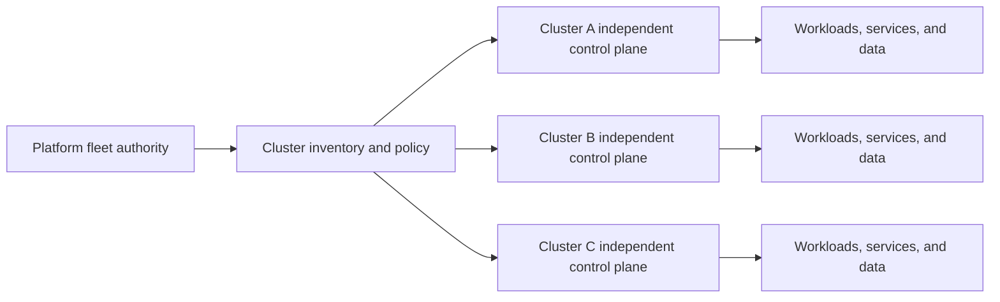
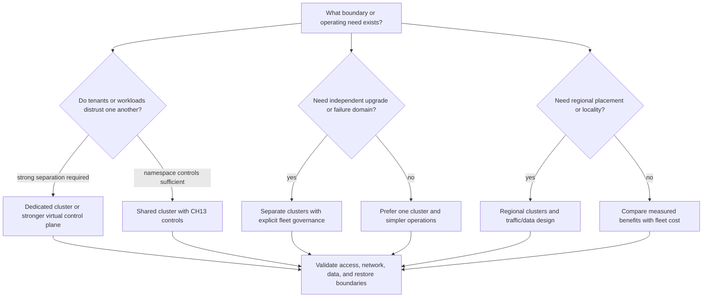
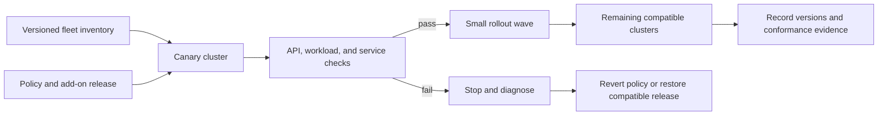
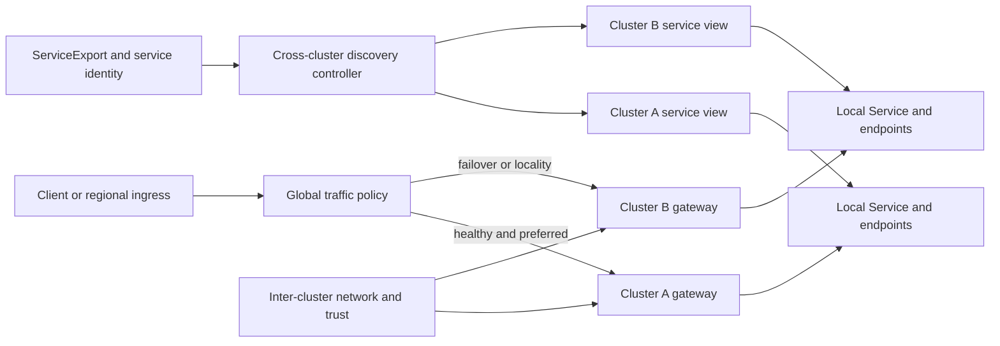
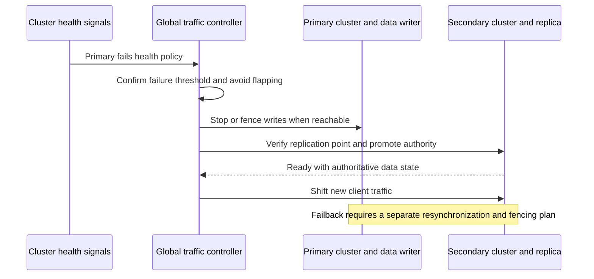

# Multi-Cluster

Part: [12 — Kubernetes](PART_OVERVIEW.md)

A multi-cluster Kubernetes architecture operates two or more independent clusters as one application, platform, or fleet. It can improve fault isolation, support regional placement, separate tenants, stage upgrades, or meet governance constraints. It also creates new coordination problems: each cluster has its own application programming interface (API) server, control loops, credentials, networking, capacity, and version state. Multiple clusters do not automatically provide service failover, data replication, consistent policy, or a shared workload scheduler.

This chapter focuses on Kubernetes fleet and workload boundaries. Part 09 CH08 owns provider fleet products, account and region mechanics, and managed-cluster lifecycle; Part 10 CH10 owns hybrid and multi-cloud architecture; Part 07 owns distributed data and service semantics; CH12 owns GitOps; CH14 owns observability. CH13 owns security controls for each cluster. The chapter specifies the Kubernetes and application contracts those systems must coordinate.

The Kubernetes documentation consulted describes v1.37. Cluster lifecycle APIs, service export/import, fleet controllers, identity federation, and cross-cluster networking are not all part of Kubernetes core and vary by implementation. Pin component versions and validate the supported cluster matrix before promising fleet-wide behavior.

## Independent Clusters and Fleet Control

Each cluster is an independent Kubernetes API and scheduling domain. A fleet manager can coordinate intent across them, but it does not make their control planes, data stores, or workloads one atomic system.

A cluster contains its own control plane, cluster-scoped resources, namespaces, scheduler, controllers, and node fleet. A Service, NetworkPolicy, Secret, CustomResourceDefinition, or RoleBinding in one cluster is not automatically present in another. A fleet process must explicitly create resources in each target cluster and track partial success, version differences, and connectivity loss.

Common fleet topologies include a hub-and-spoke management cluster that configures remote workload clusters, a set of regional cells with independent ingress and data, and a central control plane that observes but does not host application workloads. Keep fleet-management components outside a workload failure domain when they need to repair that domain. A single global fleet controller or credential store can also become a high-impact compromise target; constrain its access and failure blast radius.

A cluster inventory should record stable cluster identity, region or site, owner, environment, Kubernetes version, enabled APIs and add-ons, policy state, capacity, lifecycle phase, and connectivity status. Names alone are not reliable identity across rebuilds. Avoid deriving authorization or data ownership solely from mutable display names or labels supplied by an untrusted cluster.

## Decide Whether a Second Cluster Is Justified

Multiple clusters are a deliberate trade of local simplicity for independent lifecycle, failure, security, or placement boundaries. They are not a default remedy for every availability concern.

Use separate clusters when independent control-plane upgrades, tenant trust, compliance boundary, region placement, resource scale, or fault containment justify the cost. Consider namespaces when the isolation threat model is compatible with shared control planes and nodes; CH13 explains residual tenant risks. Consider a second cluster only when its independence is operationally real: separate credentials, capacity, network paths, backups, and tested recovery.

Estimate the full fleet cost: cluster base capacity, control-plane charges, add-ons, registry and network transfer, observability retention, policy operations, on-call burden, and upgrade work. A fleet with many small clusters can cost more and fail more often than a well-governed shared cluster. Part 09 owns provider pricing and managed-cluster feature comparison.

Do not confuse multi-cluster with high availability (HA). Replicas distributed across two clusters help only if traffic can reach the surviving replicas, the data remains correct, the service identity works in that cluster, and the failover controller can make a safe decision. For stateless services, duplicate compute may be straightforward; for stateful services, the data-authority transition is usually the hard part.

## Fleet Lifecycle, Version, and Policy Management

A fleet lifecycle includes cluster provisioning, bootstrap, registration, credential distribution, add-on installation, policy assignment, workload placement, upgrades, recovery, and decommissioning. Cluster API is a Kubernetes Special Interest Group (SIG) sub-project that provides declarative cluster lifecycle APIs. It is one ecosystem option; Kubernetes core does not require it. Managed providers and other lifecycle tools expose different ownership and recovery boundaries; Part 09 owns those product choices.

Track compatibility explicitly. A fleet may contain clusters at different Kubernetes minors during staged upgrades, but every controller, admission webhook, custom resource definition (CRD), metrics adapter, Container Network Interface (CNI), Container Storage Interface (CSI) driver, and workload chart must support the relevant version window. Kubernetes API removal and control-plane/node version-skew policies apply per cluster, not to the fleet average. Do not roll out a new CRD or policy to a cluster before its consumers can read it.

Roll out fleet changes in bounded waves with a known-good cluster, explicit health gates, and the ability to stop before broad propagation. A cluster count is not a health gate; choose evidence that checks API readiness, workload behavior, policy admission, network and storage add-ons, and representative service paths.

Policy-as-code or GitOps can keep clusters aligned, but uniform manifests do not guarantee uniform behavior when versions, admission configuration, provider features, or add-on releases differ. Separate shared baseline policy from cluster-specific overlays. Record the allowed differences and drift owner. CH12 owns the GitOps application mechanics; this chapter owns the fleet-level compatibility and rollout intent.

A control-plane failure does not necessarily stop already-running workloads in each target cluster, but it can interrupt fleet reconciliation and management operations. A fleet manager that is unavailable must not cause every cluster to lose its local control loops. Define what continues locally, what waits for central authority, how stale credentials are handled, and how operators regain control without creating competing owners.

## Service Discovery, Traffic, and Network Trust

Kubernetes Service discovery and cluster Domain Name System (DNS) are ordinarily scoped to one cluster. A `ClusterIP` and its EndpointSlices do not automatically span clusters. To present one logical service across clusters, the architecture needs an explicit service discovery and traffic layer: global or regional load balancers, gateways, a service mesh, or a multi-cluster service implementation. CH04 owns a Service within a cluster; CH05 owns Kubernetes ingress; CH06 owns cluster network mechanics.

The Kubernetes Special Interest Group (SIG) Multi-Cluster Services API (MCS API) defines resources such as `ServiceExport` and `ServiceImport` to express cross-cluster service discovery intent. It is not sufficient by itself to establish network reachability, address allocation, traffic encryption, health-based failover, or policy enforcement. A compatible controller and data plane must implement the API across participating clusters. Treat its version, supported service types, and failure semantics as implementation-specific.

Service export and import describe discoverability; the path from client to a healthy endpoint still depends on routing, health detection, network reachability, and authorization in each cluster.

Choose where traffic selection occurs and what constitutes health. DNS-based failover has resolver caches and client connection pools; a global load balancer may see a gateway as healthy while the backing service is failing; a mesh can provide richer identity and routing but adds control planes and certificates. Define health checks that reflect the relevant user operation, not merely the existence of a Pod.

Inter-cluster networking can use routed Pod networks, gateways, tunnels, overlays, or a service mesh. Each choice changes Internet Protocol (IP) overlap constraints, maximum transmission unit (MTU), latency, bandwidth, firewall rules, address ownership, and failure diagnosis. Do not assume Pod IPs are routable between clusters or that NetworkPolicy semantics extend across cluster boundaries. Document both the data path and the control path used to program it.

Cross-cluster traffic needs an explicit trust policy. Authenticate workloads separately in each cluster and decide whether to federate identity, issue cluster-specific credentials, or use a service-mesh identity. Set audience and trust boundaries for projected tokens and certificates. A service-discovery record should not be treated as proof that the endpoint belongs to an authorized workload.

## Workload Placement and Data Authority

Workload placement can be static, policy-driven, or responsive to cluster capacity and health. The Kubernetes scheduler places Pods only within its own cluster. A fleet controller, GitOps generator, or application-level router chooses which cluster receives a workload; each target cluster then schedules its Pods locally. Placement metadata should include region, data locality, compliance class, capacity, version compatibility, and dependencies.

Replicating a Deployment across clusters does not replicate its database or provide a safe failover protocol. Define the authoritative writer, replication mode, acceptable replication lag, and the operation that promotes a secondary. For active-active writes, define how conflicts resolve. Require idempotent write operations. For active-passive, specify fencing so the former primary cannot continue accepting writes after promotion.

Recovery Point Objective (RPO) describes the acceptable data-loss window; Recovery Time Objective (RTO) describes the acceptable service recovery window. A design cannot meet these objectives by adding replicas alone. Test the restore point, promotion sequence, credentials, network route, DNS/cache behavior, and return-to-primary procedure under the actual failure conditions.

Traffic failover and data promotion are coordinated but distinct decisions. If the primary is partitioned rather than stopped, both clusters accepting writes can create split-brain data loss.

For stateless workloads, route traffic only after the destination has enough capacity, current configuration, required secrets, service identity, and healthy dependencies. For stateful workloads, prevent duplicate leaders, stale writes, and unsafe automated failback. The application data owner must approve the promotion protocol; Part 07 owns distributed consistency and data semantics, while provider storage and replication products belong to Part 09.

## Identity, Governance, and Fleet Observability

Each cluster has separate users, ServiceAccounts, RoleBindings, cluster roles, admission policies, and audit configuration. A fleet administrator may hold credentials to many clusters; compromise of that identity can bypass every local namespace boundary. Use per-cluster or short-lived federated access where practical, scope permissions to the action and target cluster, and log fleet-controller actions with cluster identity and release revision.

Apply a common security baseline while preserving justified local policy. A policy rollout should account for system namespaces, cluster add-ons, and different admission versions. Emergency exceptions need an owner, expiry, and evidence; silent permanent exceptions create divergent security boundaries. CH13 owns control definitions; this chapter owns consistency and propagation across the fleet.

Fleet observability needs a stable cluster identifier, environment, region or site, workload, namespace, and software version. Do not rely only on a cluster name that may be reused after rebuild. Track fleet-level API availability, upgrade state, policy drift, node capacity, traffic health, replication lag, and telemetry freshness alongside workload-level signals. CH14 owns signal collection and diagnostic design.

A central observability service can fail or lose connectivity while applications continue. Local cluster alerting and logs should preserve enough evidence to diagnose an isolated cluster until central ingestion returns. Control access and retention so one tenant or cluster administrator cannot read another tenant's application data through shared dashboards.

## Worked Example: Regional Cluster Loss

A checkout service runs in two regions. Each cluster has a local gateway and stateless API replicas. A global traffic layer routes users to the nearest healthy gateway. The primary region owns the write database; the secondary region receives replicated data and serves read-only traffic until promotion. Cluster policies, workload identities, and image digests are versioned separately for each region.

During a regional outage, the health controller observes that the primary gateway and database are unreachable. The traffic layer stops sending new requests to that region. The data owner checks replication lag, fences the former writer, and promotes the secondary only after its recovery point meets the service's RPO. The traffic layer then sends write traffic to the promoted region. If fencing cannot be confirmed, the system remains read-only rather than risking concurrent writers.

The fleet manager is also unreachable from the secondary region, but local Kubernetes controllers continue to run existing workloads. Local observability retains gateway, API, and database evidence. Operators use the documented break-glass identity to inspect the secondary, and do not create a replacement cluster or apply new policy until ownership is clear.

After the primary region returns, it is not immediately reintroduced as a writer. Data is resynchronized from the new authority, cluster versions and policy are reconciled, and health checks are repeated. Failback occurs as a separately approved change. The exercise records traffic recovery time, actual data loss, identity revocation behavior, and any central tooling dependency that was unavailable.

## Review Questions

- What specific security, regional, scale, lifecycle, or failure boundary justifies each additional cluster?
- Are clusters independently recoverable, with local control loops and protected credentials when the fleet manager is unavailable?
- Is there a version and API compatibility matrix for Kubernetes, CRDs, controllers, admission, networking, and storage add-ons?
- Who selects workload placement, and does every target meet policy, capacity, dependency, and data-locality constraints?
- What component provides cross-cluster service discovery and routing, and which failures does its health check detect?
- Are cluster identities, ServiceAccount tokens, federation audiences, and inter-cluster trust scoped and revocable?
- What is the authoritative data writer, and how are replication lag, fencing, promotion, and failback handled?
- Are RPO and RTO targets validated by a cluster-loss and data-authority exercise?
- Can fleet-wide policy and version rollouts stop safely after a canary or wave fails?
- Are cluster and tenant labels, logs, traces, audit records, and metric access consistent across the fleet?
- Can operators diagnose and recover a cluster when the central fleet, network, or telemetry service is unavailable?

Further reading: [Kubernetes Cluster Administration](https://kubernetes.io/docs/concepts/cluster-administration/cluster-administration-overview/), [Control Plane and Node Communication](https://kubernetes.io/docs/concepts/architecture/control-plane-node-communication/), [Cluster API](https://cluster-api.sigs.k8s.io/introduction), [Multi-Cluster Services API](https://github.com/kubernetes-sigs/mcs-api), [CH06 Networking](CH06_Networking.md), [CH09 Autoscaling](CH09_Autoscaling.md), [CH12 Argo CD](CH12_ArgoCD.md), and [CH14 Observability](CH14_Observability.md).
