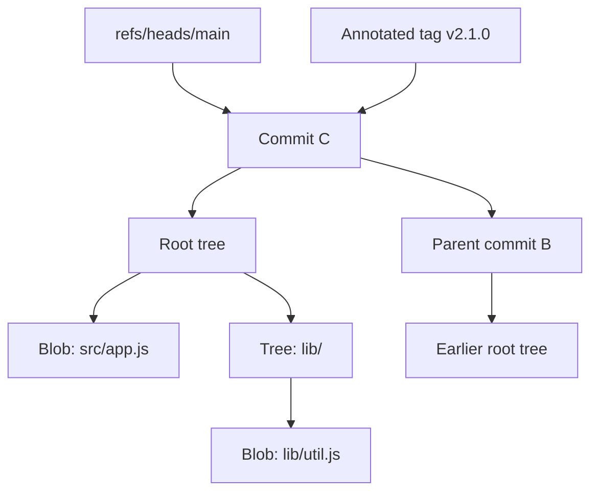
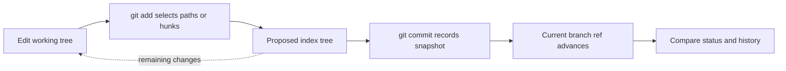
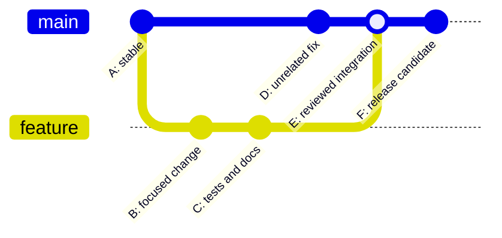
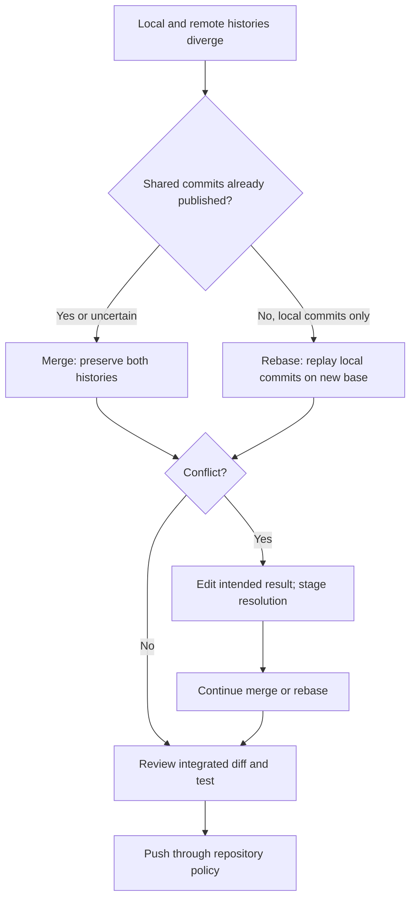
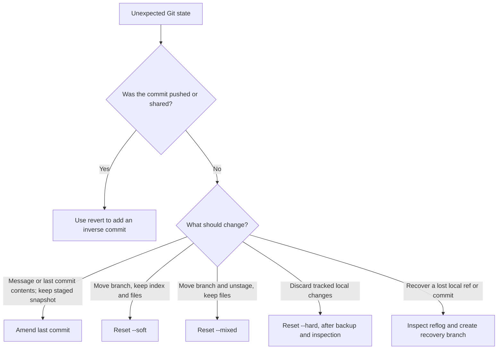

# Git

Part: [13 — DevOps](PART_OVERVIEW.md)

Git is a distributed version-control system for recording and exchanging snapshots of files. Its content-addressed object database stores file contents and directory trees, while references such as branches and tags give useful names to selected history. That model supports parallel work, review, release traceability, and recovery, but it does not by itself guarantee code quality, secure provenance, or a successful deployment.

This chapter owns Git's object model, local change states, branch and integration mechanics, collaboration workflows, history repair, and repository operations. Part 05 owns the underlying network protocols; Part 15 owns the broader security and software supply chain threat model. Later Part 13 chapters apply Git to automation and GitOps without repeating these mechanics.

## Why Git Is More Than a Backup Tool

A useful version history answers four questions: what changed, who recorded it, what earlier state it builds on, and how a team can reproduce or reverse the change. Git answers these questions by storing immutable objects and moving references, rather than by saving a complete copy of every file for each revision. Branches are cheap names for candidate histories, so developers can work independently and integrate through explicit review and merge operations.

Git is distributed: a clone normally contains the repository's reachable history and can create commits without a network connection. A remote is another repository with which refs and objects can be exchanged. This makes offline work and flexible collaboration possible, but creates an important boundary: a local commit is not automatically shared, reviewed, backed up, or released.

Treat Git as a change-coordination substrate. The repository records source and related text-based configuration; continuous integration (CI) systems test changes; continuous delivery (CD) systems package or deploy them; and release controls determine which changes reach users. A green check or a protected branch is evidence within that chain, not a proof that every production property is correct.

## The Object Model

Git stores typed objects in an object database. Each object's identifier is derived from its type, size, and content, so changing the content creates a different identifier. Most existing repositories use SHA-1 object identifiers; Git also supports repositories using SHA-256, with interoperability and tooling constraints that should be checked before choosing that format. The practical rule is to treat object identifiers as opaque identifiers, not as security approval or human-friendly version numbers.

The core objects are:

| Object | Contents | Role |
|---|---|---|
| Blob | File bytes | Stores file content, without its path or filename |
| Tree | Names, modes, and object identifiers | Represents a directory snapshot and points to blobs or subtrees |
| Commit | A root tree, parent commit identifiers, identity, timestamps, and message | Records one repository snapshot and its place in history |
| Annotated tag | Tagger metadata, message, optional signature, and target identifier | Records a named release or other durable annotation |

A path is not part of a blob. If two paths contain identical bytes, they can refer to the same blob. A tree supplies the names and directory structure. A commit points to a root tree and one or more parents; the parent links form a directed acyclic graph (DAG) of history. A normal commit has one parent, a root commit has none, and a merge commit generally has two or more.

The branch and tag in this model are refs outside the immutable commit object. Moving `main` to a later commit does not rewrite the commits it previously named. The old commit remains available while reachable through another ref or reflog, and may eventually be pruned if it becomes unreachable and cleanup expires it.

Objects are initially written as loose objects and can later be packed for space and access efficiency. Packfiles store compressed object data and may use deltas between similar versions; a delta is a storage optimization, not a change to Git's logical object model. `git gc` and related maintenance operations repack reachable objects and prune eligible unreachable data. Routine maintenance is usually automatic, but large repositories, long-lived clones, and aggressive cleanup policies deserve operational attention.

## The Local Change Model: Working Tree, Index, and Commit

Git separates the files being edited from the snapshot prepared for the next commit. The working tree is the checked-out filesystem. The index, often called the staging area, describes the exact tree selected for the next commit. The current commit is the snapshot currently named by `HEAD` or its attached branch. This separation lets a developer make several edits but commit only a deliberate subset.

`git status` summarizes differences among these states. A path can have staged changes, unstaged changes, or both: for example, a file can be staged and then edited again. `git diff` compares the working tree with the index; `git diff --cached` compares the index with `HEAD`. The distinction matters during review because the commit contains the index snapshot, not every visible working-tree change.

`git add` writes or reuses blob objects and updates index entries. It does not mean “add this file forever”; it means “include this content in the next snapshot.” Use `git add -p` to stage selected hunks when a file contains multiple logical changes. Before committing, inspect the staged patch with `git diff --cached`, check status, run relevant tests, and make sure the staged change tells one coherent story.

An index can hold multiple stages for paths with unresolved merge conflicts. Those entries represent the common base and competing sides rather than one resolved file. Editing the working-tree file and staging the resolution replaces those conflict stages with a normal index entry. Avoid treating conflict markers as the conflict itself; the real state is represented in the index until resolution is staged.

## Commits, Identity, and Meaningful History

Creating a commit writes a tree from the index, creates a commit object that points to that tree and its parent, then advances the current branch ref. A commit records author and committer metadata separately: author identifies the original change attribution, while committer identifies who created this particular commit object. A rebase or cherry-pick can preserve author attribution while creating a new commit with a different committer and parent.

Identity values such as name and email are metadata configured by the user or environment. They are not proof of identity. Signed commits can add cryptographic evidence that a key approved a commit object, but signature verification depends on key trust, policy, and correct enforcement. A verified signature does not establish that the code is safe or that required review and testing occurred.

Prefer small, coherent commits with messages that explain intent and decision context. The diff answers what changed; the message should explain why, constraints, and consequences that are not obvious from the diff. Conventional Commit prefixes may support automation, but a prefix alone is not a substitute for useful content. Keep generated files and unrelated formatting churn out of a commit when that makes review harder.

Commit hooks can run local checks, but a developer can bypass many local hooks and local environments vary. Required checks belong in an enforced server-side or CI policy as well. Do not make commits depend on undocumented machine state, secrets, or untracked files. A reproducible commit should identify all inputs needed for the intended build or test, or document the remaining external dependencies.

## References, Branches, and Tags

A reference (ref) is a readable name for an object identifier. Branch refs usually name commits; tags can name commits or other objects. `HEAD` usually is a symbolic reference to the current local branch, such as `refs/heads/main`. In a detached-`HEAD` state, `HEAD` points directly to a commit instead. Commits made in that state are not automatically attached to a branch, so create a branch if the work should remain reachable.

A branch is a movable ref, not a separate copy of the repository. Creating a branch is inexpensive because it adds a name; switching branches changes the checked-out snapshot and updates `HEAD`. This is why many short-lived branches are practical, while long-lived branches accumulate integration distance and conflicts.

Lightweight tags are simple refs. Annotated tags are tag objects containing metadata and a message, and can be signed. For published releases, annotated (and where policy requires, signed) tags provide clearer release intent than a branch name that can move. Protect release refs on the server and record the exact source commit and artifact digest in release evidence.

Remote-tracking refs such as `origin/main` record the last fetched view of a remote branch. They are local observations, not live pointers that update immediately when another contributor pushes. `git fetch` downloads reachable objects and updates remote-tracking refs according to configured refspecs; it does not merge changes into the checked-out branch.

## Collaboration Workflows and Branch Topology

Teams choose a collaboration model based on review needs, release cadence, access boundaries, and the cost of integration delay. The model should make the authoritative branch, review gate, test evidence, and release source unambiguous.

| Workflow | Strengths | Costs and risks | Suitable conditions |
|---|---|---|---|
| Trunk-based development with short branches | Small integration batches; fast feedback; frequent releasable mainline | Requires reliable automation, small changes, and feature isolation | Teams can keep main healthy and release independently of exposure |
| Feature branches with pull-request review | Clear review boundary and isolated work | Long-lived branches create drift and delayed feedback | Changes need asynchronous review or protected integration gates |
| Release branches | Stabilization and maintenance of supported release lines | Fixes must be propagated; branch count and divergence grow | Multiple versions must be supported at once |
| Fork-and-pull | Contributors can propose changes without direct write access | Maintainers handle synchronization and contribution volume | Open-source or cross-organization collaboration |

Trunk-based work is not “no review” or “commit directly to production.” It means keeping the integration branch continuously viable through small changes, automation, and reversible releases. If a feature is incomplete, use a runtime control such as a feature flag, while recognizing that flags have lifecycle and security implications covered in Part 13 CH14. A broad branch policy should not force every team into the same workflow when release and compliance constraints materially differ.

## Merge, Rebase, and Conflict Resolution

When Git integrates histories, it finds a merge base: the best common ancestor of the histories being combined. A three-way merge compares the base with each side and combines nonconflicting changes. If the target has not advanced beyond the source, Git can fast-forward by moving the target ref. Otherwise a merge commit records both parents, preserving the fact that two histories were integrated.

Rebase replays commits onto a new base, creating new commit objects with new parent links and therefore new identifiers. It can produce a linear history, but it rewrites the identity of the replayed commits. Do not rebase commits other people may already have based work on unless the team has explicitly coordinated a history rewrite. A merge preserves shared commit identity and is generally safer for published shared history.

When a conflict occurs, inspect the three versions and the surrounding intent, not just the conflict markers. Determine the desired behavior, edit the file, run focused tests, stage the resolved path, and continue the operation. `git rerere` can record and reuse a prior conflict resolution, but reuse is not validation: rerun tests and inspect the result. Avoid automatically choosing the current or incoming branch for broad conflict sets without verifying each path's semantics.

## Remote Collaboration and Safe Publication

`git push` asks a remote to update refs and transfer any objects it lacks. A non-fast-forward update is rejected by default because it could discard commits reachable from the remote branch. Resolve the divergence by fetching and integrating, then push again. Avoid blind force pushes: they can remove other contributors' published work from the branch history.

If rewriting a branch is necessary and permitted, use `--force-with-lease` rather than plain `--force`. A lease checks that the remote ref still matches the value the local repository expects, reducing the chance of overwriting a push made since the last fetch. It is not a replacement for branch protection, review, communication, or a backup; an explicit expected object identifier can make the intended comparison clearer for high-risk operations.

`git pull` is a convenience operation that fetches and then integrates, usually by merge or rebase depending on configuration and options. Because defaults vary, teams should document the expected behavior and encourage explicit integration commands where ambiguity would be costly. Before publishing, verify that the outgoing history matches the intended target references. Before integration, fetch remote changes, then inspect their effects.

Repository servers often enforce protected branches, required reviews, required status checks, signed-commit policies, and restrictions on force-push or deletion. These controls must be configured on the authoritative server. A local convention cannot protect a shared branch from a client that ignores it.

## History Repair and Recovery

Choose a recovery operation by asking two questions: which state should change (commit ref, index, or working tree), and has the affected history been shared? The safest repair is the narrowest one that preserves work and does not surprise collaborators.

`git commit --amend` replaces the current commit with a new commit object. It is appropriate for a local unpublished correction, not for silently changing a shared commit. `git reset` moves the current branch and can also change the index and working tree: `--soft` keeps both; `--mixed` (the default) resets the index but keeps working-tree edits; `--hard` resets both and can discard tracked edits. Check `git status`, inspect the target commit, and make a temporary branch or patch before destructive repair.

`git revert <commit>` creates a new commit that applies an inverse patch. It is usually the right choice for undoing a published change because it preserves the shared history. Reverting a merge requires specifying the mainline parent and has future merge consequences; explain the choice and test the resulting behavior rather than treating it as a mechanical undo.

The reflog records recent local movements of refs and `HEAD`. It can help recover a branch or commit after a reset, rebase, or accidental ref movement. Reflogs are local, expire according to configuration and maintenance, and are not a durable backup. If a valuable commit appears in the reflog, create a named recovery branch promptly and push it only after review. For important work, use a backup ref or patch before risky operations.

## Repository Scale and Specialized Storage

Repository performance depends on working-tree size, history depth, file count, object packing, and the number of paths changed by common operations. Monorepos simplify atomic cross-component changes and shared tooling but need ownership boundaries, fast incremental tests, and attention to sparse checkout and build graph costs. Multirepos isolate permissions and release lifecycles but add version coordination, dependency automation, and cross-repository change overhead. Choose based on change coupling, access control, release independence, and tooling maturity, not ideology.

Use Git Large File Storage (LFS) or an artifact store for large binary assets that change frequently and do not benefit from text diffs. LFS stores pointer files in Git and the large content in a separate service, creating a new availability, authorization, backup, and retention dependency. Submodules pin another repository at a commit but add initialization, update, and contributor workflow complexity; document the expected commands and pin immutable commits. Partial clone and sparse checkout can reduce local transfer or working-tree size, but they add server and client capability assumptions.

Useful maintenance and diagnosis commands include `git count-objects -vH`, `git maintenance run`, and `git fsck --full`. Run repair or cleanup commands only after understanding reachability and backup state. Large generated files, secrets, build outputs, and dependency caches usually belong outside ordinary source history or behind an intentional artifact strategy.

## Security and Governance

Repository access is a security boundary because history can contain source, deployment configuration, infrastructure definitions, and sensitive operational context. Apply least privilege to write access, protect release and default branches, require review proportional to risk, and keep CI credentials short-lived and narrowly scoped. Part 15 owns the general security and software supply chain threat model; this section applies it to Git collaboration.

Never commit credentials with the expectation that a later deletion makes them safe. Removing a secret from the latest tree does not remove earlier commits, forks, clones, caches, or artifacts. Revoke and rotate the credential first, assess exposure, then coordinate any history rewrite and notify downstream consumers. Secret scanning and push protection help prevent some leaks but do not replace credential lifecycle controls.

Commit and tag signatures can provide evidence that a particular key signed a specific object. Establish how keys are verified, revoked, rotated, and associated with identities; otherwise “signed” may be only a technical property with no trusted meaning. Artifact provenance should connect source commit, build identity, dependencies, tests, and produced artifact digest. A branch name alone is mutable and is insufficient release evidence.

## Production Debugging and Operational Checklist

When a Git operation fails, capture the repository state before changing it. Start with `git status --short --branch`, `git log --graph --decorate --oneline --all -n 30`, `git show --stat --oneline HEAD`, and `git remote -v`. Avoid pasting private remote URLs, patches, or configuration into public issue trackers because they can expose internal names or secrets.

| Symptom | Likely cause | Safe first checks |
|---|---|---|
| Push rejected as non-fast-forward | Remote has commits absent locally | Fetch; inspect remote-tracking history; choose merge or rebase deliberately |
| File appears both staged and modified | It changed again after staging | Inspect `git diff` and `git diff --cached`; stage the intended final content |
| Branch appears detached | `HEAD` points directly to a commit | Identify whether work must persist; create a branch before switching away |
| Merge reports conflicts | Both sides changed overlapping content or structure | Inspect base and both sides; resolve by intended behavior; run tests |
| Commit seems lost after reset or rebase | A ref moved or rewritten | Inspect reflog; create a recovery branch before cleanup |
| Repository is unexpectedly large | Large files, retained history, or inefficient packing | Inspect object statistics and history; avoid destructive history rewrite before backup |
| Authentication suddenly fails | Credential expiry, revoked key, SSO, or remote policy change | Verify remote host and credential method; rotate/update through approved process |

For recovery, prefer a second clone or a bundle/backup before experimental repair. Preserve the original repository state and create a new ref for any commit you may need. A normal clone does not include all unreachable objects or every local reflog, so it is not a full forensic copy.

## Worked Case: A Release Fix After the Branch Has Moved

A developer starts `fix/payment-timeout` from `main`, commits a timeout correction, and opens a review. While review is underway, another approved change reaches `main`. The developer should fetch and inspect the new commit before integration. If the fix branch is unpublished to other collaborators and linear history is the team's convention, the developer can rebase onto the updated main, resolve any conflicts, rerun the focused payment tests, and push. If reviewers or other developers have based work on the fix branch, merge the updated main instead to preserve the shared commit identities.

After the review gate passes, the repository server merges the change and runs required checks. The release pipeline should record the resulting immutable commit identifier, artifact digest, dependency evidence, and deployment result. If the fix causes a regression after publication, use a revert commit or the release system's tested rollback strategy; do not rewrite the shared main branch to make the incident disappear from history. The team then links the incident evidence to a follow-up change and verifies that the fix addresses the observed failure mode.

The decision is not “merge is good” or “rebase is clean.” It depends on whether the branch is shared, which history contract the team uses, how costly conflict resolution is, and what evidence must remain traceable. The chosen operation should preserve reviewability and produce a tested, reproducible release source.

## Common Mistakes and Anti-Patterns

- Committing secrets and assuming a later deletion erases the exposure.
- Using `git add .` without reviewing the staged patch, especially in repositories with generated files or local configuration.
- Rewriting a shared branch with `--force` and discarding commits others depend on.
- Treating a green CI result as proof of runtime health or a commit signature as proof of safe code.
- Keeping feature branches open until integration is a large, high-risk event.
- Using one commit for unrelated changes, making review and selective rollback difficult.
- Rebasing published commits without coordination, or merging without understanding the resulting ancestry.
- Running `reset --hard`, `clean`, history filters, or garbage collection before preserving recoverable work.
- Relying on local hooks or branch naming conventions as if the server enforced them.
- Using mutable branch names as the only evidence of what was released.

## Choosing a Git Workflow

Choose the least complex workflow that meets the team's review, release, and compliance requirements. Prefer short-lived changes, frequent integration, protected shared branches, automated checks, and explicit release evidence. Add release branches, signing requirements, or stricter approvals where parallel supported versions or risk justify the operational cost.

| Decision | Prefer the first option when | Prefer the second option when |
|---|---|---|
| Merge or rebase | The commits are shared, or preserving exact published history matters | Commits are local and unpublished, and a linear branch history is useful |
| Trunk-based or long-lived feature branch | Changes can be integrated in small increments with reliable checks | Work must remain isolated for a bounded, documented reason |
| Monorepo or multirepo | Cross-component changes and shared tooling dominate | Independent access and release lifecycles dominate |
| Annotated or lightweight tag | Release intent, metadata, or signature is valuable | A temporary local pointer is sufficient |
| Revert or reset | The change is shared or published | The change is local, unpublished, and the desired index/worktree state is understood |

## Review Questions and Exercises

1. Explain why a branch is inexpensive in Git and why moving it does not rewrite the commit it previously named.
2. A file has both staged and unstaged changes. Which commands show each patch, and which content is included in the next commit?
3. A remote branch advanced after your last fetch. Why is `--force-with-lease` safer than `--force`, and what risks remain?
4. When should a team prefer a merge over a rebase? Explain using shared commit identity and collaboration state.
5. A production secret was committed and then deleted. What actions are required beyond editing the latest file?
6. Draw the objects created by a normal commit and by a merge commit, including their tree and parent relationships.
7. In a disposable test repository, create a branch, make a commit, amend it, and recover the original commit through the reflog. Record which object identifiers changed.
8. Create a conflict in two branches, inspect the staged conflict state, resolve it, and verify the final tree with tests and `git diff --check`.

## Architecture Review Checklist

- Is the authoritative repository and branch clear for each change type?
- Are branch protection, review requirements, and required checks enforced by the server?
- Are changes small enough to review and integrate without long-lived divergence?
- Does the team know when it may merge, rebase, revert, or rewrite history?
- Are commits and releases traceable to immutable source and artifact identifiers?
- Are secrets, large binaries, generated outputs, and external dependencies handled deliberately?
- Can a contributor recover from common ref movement, merge, and staging mistakes without destroying work?
- Are repository backups, credential rotation, key revocation, and maintenance responsibilities assigned?

## Summary

Git's collaboration model follows from a small set of mechanics: content-addressed objects represent snapshots and history; the index selects the next snapshot; refs name commits and move as work progresses; and remotes exchange objects and refs under collaboration policy. Understanding those mechanics makes merge, rebase, release, and recovery choices explainable rather than ritualistic.

Use Git history to make change intent and evidence inspectable. Keep shared history stable, preserve recovery paths before destructive operations, protect credentials and refs on the authoritative server, and connect the released artifact to an immutable source revision. Git records collaboration; it does not replace code review, testing, security policy, or operational verification.
