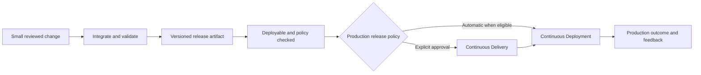
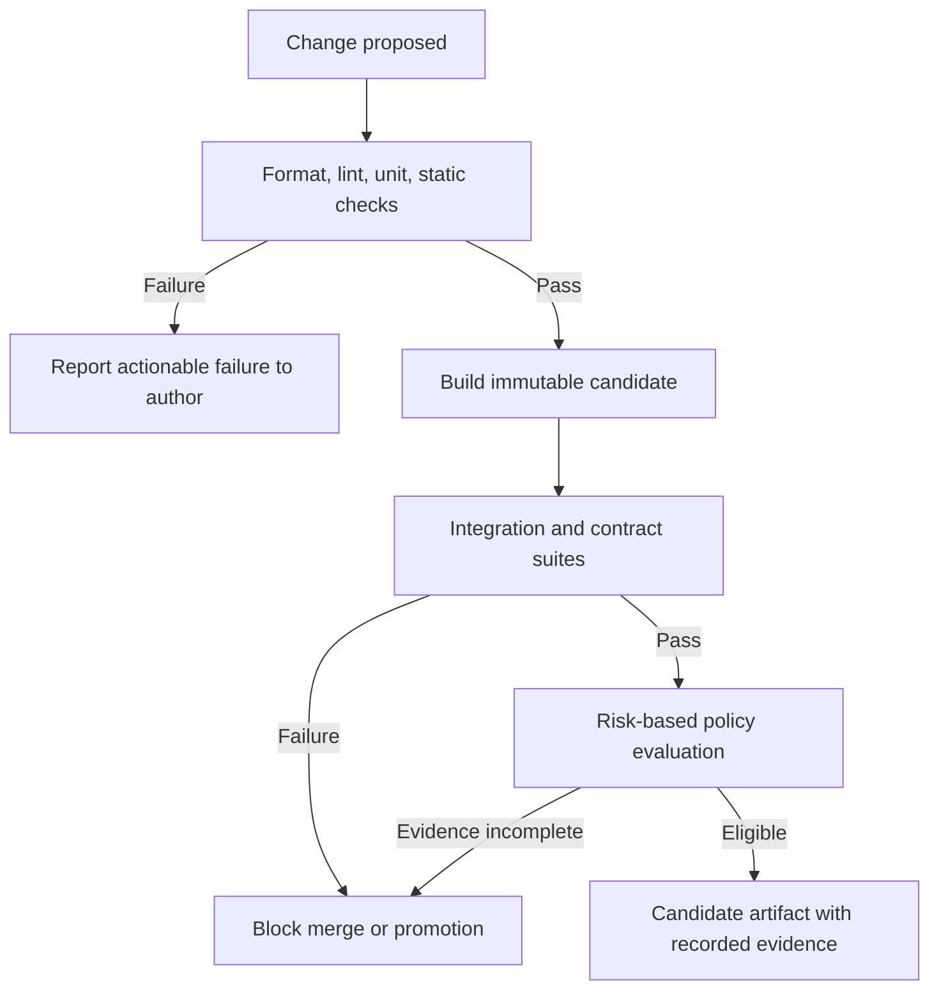
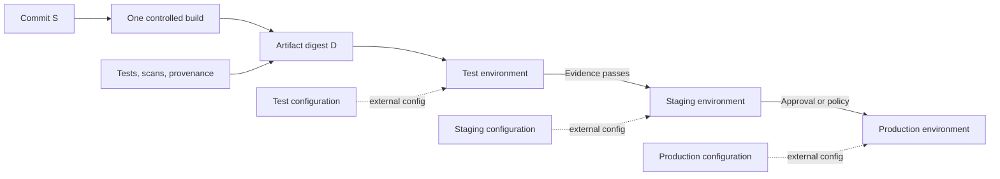
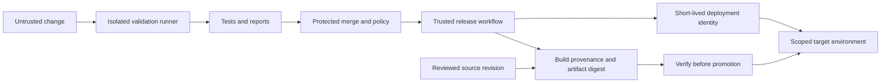
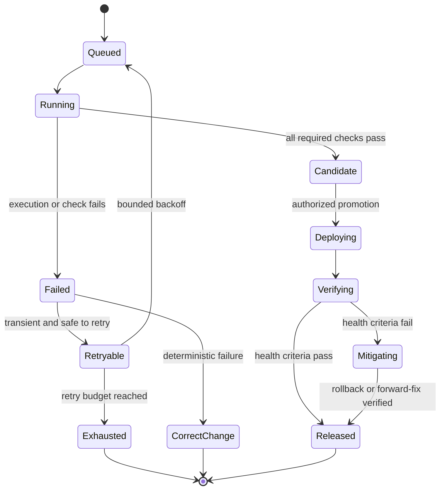

# CI/CD (Continuous Integration / Continuous Delivery)

Part: [13 — DevOps](PART_OVERVIEW.md)

Continuous Integration (CI) is the practice of integrating small changes into a shared source line frequently and validating them with repeatable automation. Continuous Delivery (CD) extends that path so a verified change can be released predictably, usually with an explicit decision before production. Continuous Deployment goes one step further: every change that satisfies the release policy is automatically deployed to production. These terms describe operating practices as much as tools; a YAML file alone does not create them.

This chapter owns tool-neutral pipeline architecture: triggers, build and test stages, artifact identity, promotion, environment boundaries, policy gates, and feedback. [CH01 Git](CH01_Git.md) owns Git objects and collaboration mechanics. [CH05 GitHub Actions](CH05_GitHub_Actions.md), [CH06 Jenkins](CH06_Jenkins.md), and [CH07 Azure DevOps](CH07_Azure_DevOps.md) own their products. Part 15 owns security foundations; Part 14 owns observability; CH13-16 own deployment strategy details such as progressive delivery, flags, blue-green, and canary deployment.

## The Delivery Problem and Its Terms

Without a repeatable delivery path, teams rely on local builds, manually copied files, undocumented approvals, and environment-specific fixes. The result is slow feedback and weak evidence: the artifact tested may not be the artifact deployed, and a successful command may not mean the service is healthy. A pipeline makes change handling visible and repeatable, but it can also automate mistakes faster. Its design must make the accepted source, produced artifact, authorization, and release outcome traceable.

CI means that changes are integrated into a shared mainline in small batches and validated promptly. It depends on developers integrating often, resolving conflicts near their cause, and keeping the mainline usable. Running tests only on long-lived feature branches is automated testing, but it does not deliver the short feedback loop or integration discipline of CI.

Continuous Delivery means the software remains in a deployable state through automated build, test, packaging, and release preparation. Production release may require an explicit human decision or a separate business window. Continuous Deployment removes that manual production-release gate for changes that pass the defined policy. Both require operational readiness and a reliable rollback or mitigation path; automation does not remove accountability for release decisions.

The key distinction is where authorization and release decisions occur, not whether the pipeline has a button. A manual approval inside a fully automated path can still be Continuous Delivery. An automatic production rollout can be Continuous Deployment only when the eligibility policy, evidence, and system response are intentionally defined.

## Pipeline as a Change-Control System

A pipeline is a controlled process that consumes an event and inputs, executes work, emits artifacts and evidence, and may request changes in other systems. Its stages form a directed acyclic graph (DAG), not necessarily a single serial script. Independent tests can run in parallel; stages with data dependencies must wait for their prerequisites. The pipeline definition itself is production code: it needs review, version control, testing, permission limits, and change history.

```mermaid
flowchart LR
    Event[Commit, merge, tag, or schedule] --> Source[Resolve immutable source revision]
    Source --> Build[Build in controlled environment]
    Build --> Unit[Unit and static checks]
    Build --> Package[Package once]
    Unit --> Contract[Integration and contract checks]
    Package --> Scan[Scan and attest artifact]
    Contract --> Gate[Eligibility policy]
    Scan --> Gate
    Gate --> Store[Immutable artifact store]
    Store --> Stage[Deploy to representative environment]
    Stage --> Verify[Smoke and health verification]
    Verify --> Promote[Authorize or automatically promote]
    Promote --> Prod[Production deployment]
    Prod --> Feedback[Operational signals and release record]
```

The event starts a run, but it is not necessarily the source identity. A branch event may resolve to a commit that changes while a job is queued; a release record should capture the exact commit identifier used. Inputs also include dependency versions, build image, compiler, build scripts, configuration, and external services. If an input can change without appearing in the record, then an identical commit can produce a different result.

Separate workflow orchestration from the policy it enforces. A pipeline should make explicit which checks are required, which failures block progress, who can override a block, and what evidence an override requires. Put reusable policy in versioned, reviewable components where that improves consistency, but avoid opaque central abstractions that make it impossible for application teams to diagnose a failure.

## Triggers, Change Scope, and Concurrency

Common triggers include a pull request or merge request, a merge to the protected integration branch, a release tag, a scheduled validation, and an approved manual operation. A pull-request run should validate the proposed change without granting it production credentials. A merge-to-main run should verify the integrated result. A release trigger should refer to an immutable commit or artifact identity, not a mutable name alone.

Path filters and conditional jobs can avoid irrelevant work in large repositories, but incorrect filters silently remove required checks. Establish a small set of unconditional safety checks and test the routing logic that selects specialized suites. In a monorepo, a change-impact graph can select dependent tests, but periodically compare it with broader runs to detect missing dependency edges.

Concurrent runs create race conditions when they publish the same tag, update a shared test environment, or deploy the same service. Use concurrency groups or environment locks for resources that must have one writer. Canceling an older run can save resources, but only cancel work when doing so cannot leave a partial deployment or skip required cleanup. A retry should operate on a stable input and should not duplicate external side effects.

## Build, Test, and Policy Gates

The quality strategy should provide fast, useful feedback early and deeper assurance before higher-risk release stages. A build validates that the declared source and dependencies can produce an artifact. Unit tests check local behavior; integration tests exercise real boundaries; contract tests verify assumptions between independently deployed components; end-to-end tests validate selected user-visible paths. Static analysis, dependency checks, license checks, and security tests add distinct evidence, each with limits.

Gate semantics must be explicit. A required check that is skipped, times out, or cannot report should not silently become success. Define whether a flaky test is retried, quarantined, or blocks release; retries that hide nondeterminism can create false confidence. Publish the failing test, relevant logs, source revision, environment, and owner-facing next step. A gate should have a responsible owner and an exception process with expiration, rationale, and follow-up.

Use risk-based checks rather than asking every pipeline to run every possible test. A documentation-only change may use a narrow suite; a database migration or identity-policy change deserves additional validation. Keep test fixtures representative enough to catch integration failures, while avoiding production data in lower environments. [Part 14 Observability](../14_Observability/PART_OVERVIEW.md) owns telemetry concepts; this chapter specifies that the pipeline must preserve evidence and produce useful feedback.

## Artifact Identity and Promotion

Build an artifact once from a resolved source revision, then promote that same artifact through environments. Rebuilding separately for test, staging, and production weakens confidence because tool versions, dependencies, timestamps, or environment variables may change the output. If environment-specific values must differ, inject them at deployment through a controlled configuration boundary rather than mutating the packaged artifact.

Artifacts may be binaries, container images, packages, static bundles, infrastructure plans, or signed deployment manifests. Give each artifact an immutable identifier, such as a cryptographic digest, and retain the source revision and build evidence that produced it. A human-friendly version or tag can point to the artifact but may be mutable unless repository policy prevents movement.

Promotion is an authorization to use an already identified artifact in a new context, not a new build. The release record should link the artifact digest to its source commit, dependency and build inputs, test and scan evidence, approver or policy decision, target environment, and deployment result. If an emergency rebuild is necessary, create a new artifact identity and rerun the required checks rather than labeling it as if it were the earlier tested build.

Environment parity does not mean identical scale or production data. It means the differences that could change release behavior are known: runtime versions, network policy, identity configuration, schema state, feature settings, and dependent service versions. Document exceptions and validate the production-specific configuration before promotion.

## Environment Boundaries and Deployment Authorization

An environment is a boundary for configuration, data, credentials, access, and release risk. Development environments should enable fast iteration; integration environments should expose service contracts; staging should represent important production properties; production should have tightly controlled access and measurable health. Avoid using environment names as a substitute for a trust model: a “staging” account with production credentials is not a meaningful safety boundary.

Promotion can be automatic between low-risk environments and approval-based for production, regulated workloads, or high-impact changes. An approval should bind to a specific artifact and deployment plan. It should identify the decision owner, evidence reviewed, intended scope, and expiration. A blanket approval that authorizes any artifact or any future run undermines the gate.

Progressive rollout, blue-green switching, canary analysis, and feature flags are deployment strategies rather than generic pipeline stages. The pipeline can invoke and verify them, but strategy details belong to CH13-16. A release orchestrator should know when to stop, how to restore service, and whether application state changes make rollback unsafe.

Database changes are a frequent exception to simple “deploy previous version” rollback. Prefer backward-compatible expand-and-contract sequences: add compatible schema, deploy code that can work with old and new forms, migrate data, then remove obsolete schema only after dependent code has moved. A destructive migration can make the previous binary unusable even when the artifact is available; test migration order and recovery against representative data.

## Credentials, Trust Boundaries, and Provenance

Pipelines execute code from repositories and dependencies, so they are part of the software supply chain and an attractive target. A pull-request job may execute contributor-controlled scripts. Do not expose deployment credentials, signing keys, or privileged service tokens to an untrusted change. Separate validation jobs from privileged release jobs, scope permissions to the minimum required action, and prefer short-lived federated identity over long-lived stored credentials when the platform supports it. Part 15 owns the broader threat model and security control foundations.

Runner isolation matters because a workflow can access the filesystem, network, environment variables, and credentials available to its process. A container boundary is not automatically a strong tenant-isolation boundary if the runner host, socket, cache, or token is shared. Use ephemeral runners for untrusted jobs where practical; restrict network egress and write access; prevent untrusted builds from poisoning caches consumed by privileged jobs.

Provenance answers which source and build process produced an artifact. An attestation can bind the artifact digest to a source revision, builder identity, workflow definition, dependency materials, and results. Verification then checks that the artifact being promoted matches the expected source and policy. Signing adds authenticity evidence only when trust roots, key protection, identity, revocation, and enforcement are well defined. Part 15 covers these controls in depth.

Secrets should be fetched just in time, masked in logs where possible, and unavailable to jobs that do not require them. Masking is not a guarantee: scripts can encode or transform values, and debug output can expose process state. Never pass secrets as command-line arguments when they may appear in process listings or logs. Rotate credentials after exposure and treat repository history as durable; deleting a leaked value from a later commit does not revoke it.

## Caching and Reproducibility

Caching can reduce feedback latency and compute cost by reusing dependencies or intermediate build outputs. A cache key should include all inputs that affect correctness, such as lockfiles, compiler or runtime version, operating system, build configuration, and relevant source. A partial key can improve reuse through a fallback cache, but the build must still validate its outputs rather than assuming a cache entry is correct.

Do not cache final release artifacts under a mutable key when the release process expects immutable identity. Separate cache namespaces by trust level so untrusted pull requests cannot populate data later used by privileged release jobs. Set retention and size limits, and make cache misses a performance cost rather than a correctness failure. If a cold build cannot reproduce the artifact, the cache has hidden an undeclared dependency.

Reproducible builds aim for the same inputs to yield byte-identical outputs. This can be difficult when timestamps, nondeterministic archive ordering, unpinned dependencies, network fetches, or platform-specific tools affect output. Record build inputs and make dependencies immutable or integrity-checked. Where exact reproducibility is not practical, provenance and verification still make the process more inspectable, but they do not provide the same guarantee.

## Failure Semantics and Recovery

Pipelines fail for transient reasons such as runner loss, network timeouts, and service throttling, as well as deterministic reasons such as compilation errors, policy violations, or invalid configuration. Classify failure before retrying. Retrying a deterministic failure wastes capacity; retrying a non-idempotent deploy operation may duplicate side effects. Make retries bounded, add backoff for transient shared dependencies, and preserve the original failure evidence.

A failed deployment is not necessarily a failed pipeline run until the system records the observed outcome. A deploy command may time out after the target accepted the change. Query target state before retrying, use idempotent operations where possible, and attach an operation identifier so repeated requests can be recognized. Keep cancellation and cleanup behavior explicit: a canceled job should not leave a lock, partial environment, or orphaned resource that blocks the next release.

For pipeline availability, identify the critical path and its external dependencies: source hosting, runner capacity, package repositories, artifact stores, identity providers, test environments, and deployment APIs. Provide queue visibility and a documented manual recovery path for a platform outage. A manual fallback should preserve the same artifact identity, approvals, and audit trail rather than bypassing every safety control.

## Feedback, Measures, and Operational Ownership

The most useful pipeline feedback arrives quickly, points to a specific change, and tells its owner how to investigate. Report the failed stage, command or test, source revision, environment, relevant log excerpt, and a link to detailed evidence. Keep logs long enough for diagnosis but redact sensitive values and restrict access according to their contents.

Measure change lead time, deployment frequency, change failure rate, and time to restore service as system-level delivery outcomes, not as individual performance targets. These measures need consistent definitions and context: a deployment may be a service change or a production release; a failure may be detected immediately or days later. Optimizing a single number can encourage risky releases, fragmented deployments, or under-reporting. Pair speed measures with reliability, user impact, security, and recovery evidence.

Assign clear ownership for pipeline definitions, shared runners, reusable templates, policy gates, artifact retention, and deployment credentials. Platform teams can provide paved paths, but application owners remain accountable for tests, runtime health, and service recovery. An unowned pipeline accumulates disabled checks, stale dependencies, and undocumented bypasses.

## Worked Case: A Payment Service Release

A payment service team has a small change to retry a request after a transient processor timeout. The change is proposed through a reviewed pull request. An isolated job checks formatting, unit behavior, static analysis, and a contract suite against a processor stub. It has no production token and cannot publish a release artifact. The protected merge is blocked if required checks fail or are missing.

After merge, a trusted workflow resolves the commit identifier, installs lockfile-pinned dependencies, builds the service once, and emits an immutable package digest with provenance. Integration tests run against a representative processor sandbox. Security and license checks produce evidence tied to the digest. The release system promotes that digest to staging, injects staging configuration, and verifies health and payment test transactions without using production customer data.

Production requires approval from the designated release owner. The approval references the exact digest, migration status, test evidence, and rollout plan. The deployment proceeds to a small cohort under the service's established canary policy. Error rate, timeout rate, and payment completion are compared to defined thresholds during the analysis window. A threshold breach stops promotion and triggers the tested mitigation path; a healthy interval permits the next cohort. The final release record links commit, digest, approver, configuration version, health outcome, and any incident.

The architecture choice is to build once and promote by immutable digest, use a separate trusted release workflow, and keep the production approval attached to a specific candidate. This costs more pipeline and evidence design than manually copying a package, but reduces ambiguity about what was tested and who authorized production use. The team accepts that staging cannot perfectly reproduce processor behavior and compensates with contract tests, sandbox integration tests, and production cohort observation.

## Common Failure Modes

- Rebuilding separately in each environment and assuming the output is identical.
- Treating a pipeline green check as proof that deployment succeeded or users are healthy.
- Giving pull-request code access to production credentials or privileged runner hosts.
- Allowing a skipped or missing required check to count as success.
- Making retries unlimited or retrying operations that are not idempotent.
- Caching outputs across trust boundaries or using incomplete cache keys for correctness-sensitive work.
- Promoting mutable tags without verifying the artifact digest.
- Using broad manual approvals that are not tied to an artifact, environment, or expiration.
- Building a large, serial test suite that gives slow, unhelpful feedback and is routinely bypassed.
- Treating environment parity as identical infrastructure instead of identifying behaviorally important differences.
- Relying on a rollback command without checking database, data, or external side-effect compatibility.
- Measuring only deployment frequency and ignoring user impact, recovery, and change risk.

## Pipeline Architecture Decisions

Start with the change types, risk, release cadence, and recovery needs. Then decide which events require validation, what can run in parallel, which artifact format and identity are authoritative, how environments differ, and where a human or policy gate belongs. Select a managed product or self-hosted runner based on access boundaries, network needs, compliance, capacity, and operational ownership; product mechanics are deferred to the dedicated tool chapters.

| Decision | Prefer the first option when | Prefer the second option when |
|---|---|---|
| Continuous Delivery or Continuous Deployment | A production decision, business window, or risk review is intentionally retained | Evidence is reliable, changes are low-risk, and automatic release policy is approved |
| Build once or rebuild per environment | Artifact identity and tested-output equivalence matter | The artifact is inherently environment-specific and the variation is recorded and validated |
| Managed or self-hosted runners | Standard isolation and supported integrations satisfy constraints | Private network access, custom hardware, or strict control justifies operating runner infrastructure |
| Serial or parallel checks | Stages depend on shared state or ordered outputs | Checks are independent and parallelism shortens feedback without exhausting shared capacity |
| Manual or automated gate | A human decision adds accountable context not encoded by policy | Eligibility is measurable and policy can safely decide from complete evidence |

## Review Questions and Exercises

1. Distinguish Continuous Integration, Continuous Delivery, and Continuous Deployment by describing the workflow and release decision for each.
2. Why should production receive the artifact digest tested in staging rather than a rebuild from the same branch?
3. Which jobs in a pull-request pipeline may execute contributor-controlled code, and what credentials or network access should they have?
4. A deploy request times out after submission. What evidence should the pipeline gather before it retries?
5. Design a minimal test-stage graph for a service with a database migration and a public API contract. Identify which checks block merge and which block production promotion.
6. In a disposable pipeline, simulate a cache miss, a flaky integration test, and a deployment timeout. Decide which conditions retry, fail, or require human diagnosis.
7. Draw the provenance chain from source revision to artifact digest to production deployment, including the evidence and authorization at each boundary.

## Architecture Review Checklist

- Are CI, Continuous Delivery, and Continuous Deployment practices distinguished in policy and in fact?
- Does each run bind to an immutable source revision and all correctness-relevant inputs?
- Are required checks explicit, enforced, owned, and unable to fail open when skipped or unavailable?
- Is one tested artifact promoted across environments, with configuration differences externalized and recorded?
- Are untrusted change-validation jobs isolated from deployment identities, signing keys, and privileged caches?
- Are approvals scoped to a specific artifact and target, with expiry and audit evidence?
- Are retries bounded and safe for the operation, and is uncertain deployment state queried before repetition?
- Can operators stop, mitigate, or recover a partial release without losing artifact and decision traceability?
- Do pipeline feedback and measures connect to developer action and user outcomes?
- Is there an accountable owner for pipeline code, runners, policy, artifacts, and recovery procedures?

## Summary

CI/CD is an operating model implemented through a controlled, observable pipeline. Its core contract is to resolve a change, produce a validated artifact, preserve its identity and evidence, authorize its movement between environments, and learn from the resulting deployment. Continuous Delivery keeps production release deliberate; Continuous Deployment automates that decision only when explicit policy and operational evidence justify it.

Build once, promote by immutable identity, isolate untrusted work from privileged credentials, and make gate, retry, approval, and recovery semantics explicit. The pipeline should shorten feedback while preserving the evidence needed to understand and control risk. Tool choice matters, but clear ownership and trustworthy change flow matter more.
