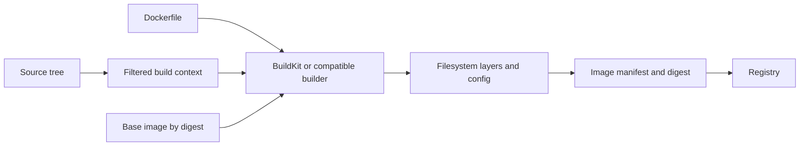
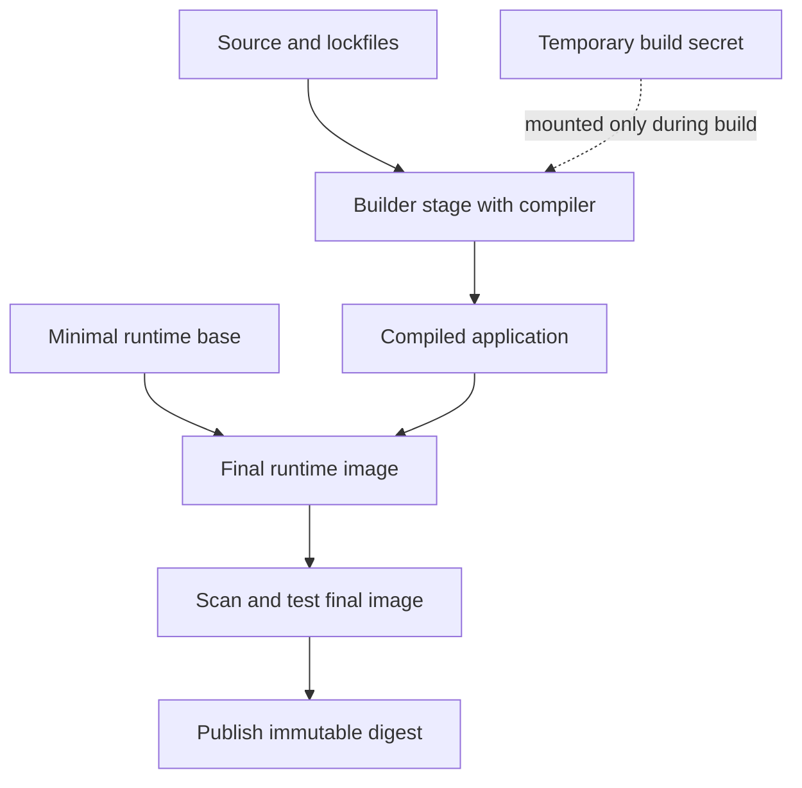
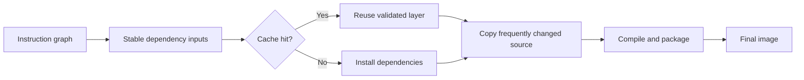
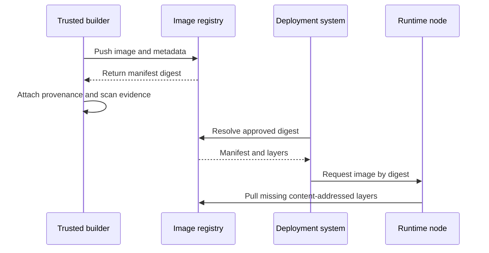
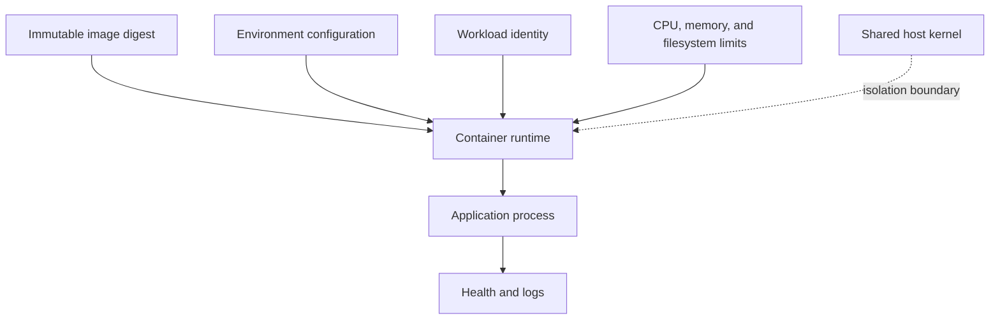

# Docker

Part: [13 — DevOps](PART_OVERVIEW.md)

Docker is a developer and build toolchain for packaging an application with a filesystem and runtime configuration into an image that can be distributed and started as a container. An image is an immutable template; a container is a running instance with process, namespace, resource, and lifecycle controls supplied by its runtime. Part 05 CH28 owns container and operating-system internals. This chapter focuses on image construction, build context, cache, distribution, and delivery workflow. Part 09 owns provider registries; Part 12 owns Kubernetes deployment.

## Image Build Model

A Dockerfile describes build instructions. The builder receives a build context, resolves the base image and dependencies, executes build steps, and records filesystem changes and image metadata. The result is an image manifest referencing configuration and filesystem layers. Tags provide readable names; digests identify immutable content. Docker Engine, BuildKit, and compatible builders may differ in capabilities, so pin and test the builder used in production.

The context is the set of files the builder can access. A broad context increases transfer time, cache invalidation, and the chance of accidentally including credentials or local output. Keep it small and use `.dockerignore` to exclude version-control metadata, build products, secrets, and unrelated directories. Exclusion rules are part of the build contract and should be reviewed like the Dockerfile.

Image layers are content-addressed filesystem changes. The Dockerfile instruction ordering can affect cache reuse: stable dependencies should generally be copied and installed before frequently changed source, while correctness must never depend on a stale cache. Part 05 CH28 explains the underlying layer and union-filesystem model; here the practical concern is making rebuilds predictable and efficient.

## Dockerfile Design and Build Reproducibility

Pin base images by digest for controlled builds, and update them through a deliberate dependency process. Pin package versions or use lockfiles where the package ecosystem supports it. Avoid unpinned network downloads during image construction: the same source commit can otherwise produce different images. Record the builder version and relevant build arguments as inputs.

Use multi-stage builds to separate compilation tools from the runtime image. The final stage should contain only the application and its runtime dependencies. Run as a non-root user when feasible, define a clear entrypoint, and make configuration explicit. Keep secrets out of `ARG`, `ENV`, build context, and image layers; use builder-supported secret mounts for build-time access, and runtime secret delivery for application credentials.

Build-time and runtime dependencies differ. Installing a compiler into the final image increases attack surface and size; omitting a required shared library causes runtime failure. Test the final image itself, not only the builder stage. Use an explicit health probe contract in the deployment platform rather than assuming that a process-start signal means the application is ready.

## Build Cache and Performance

Builders cache instruction results using the instruction and its relevant inputs. A changed early layer invalidates dependent later layers, so high-churn inputs placed too early cause unnecessary work. Dependency caches can accelerate package installation, but should be keyed by lockfile, operating system, architecture, and tool version where relevant. Treat caches as performance aids, never as authoritative build inputs.

BuildKit supports parallelizable graph execution and cache mounts in addition to traditional layer caching. Remote cache export can help ephemeral continuous-integration runners, but the cache source is a trust boundary: an untrusted pull request should not be able to poison outputs consumed by a privileged release build. Isolate cache scopes and validate output provenance.

Measure cold and warm build times separately. If builds are slow, identify network downloads, context size, serialization, cache misses, and CPU or memory pressure before adding more cache layers. A fast incremental build is not evidence that a clean build is reproducible; retain periodic clean builds in continuous integration.

## Image Identity, Distribution, and Runtime Contract

An image tag is a mutable reference unless the registry enforces immutability. A digest identifies a manifest and its referenced content. For releases, record and deploy the digest; keep tags for human navigation. A multi-architecture image can use an index digest that selects a platform-specific manifest at pull time, so record the target architecture and test each supported platform.

Registry authentication, retention, replication, vulnerability scanning, and policy are part of artifact availability and trust. Part 09 covers managed registry products. Configure lifecycle retention so deployed digests remain available for rollback and incident analysis. Verify that the registry and deployment platform agree on the manifest format and architecture.

An image is not a complete deployment. Runtime configuration includes environment variables, mounted files, identity, ports, resource limits, filesystem permissions, network policy, and persistent storage. Keep these concerns outside the image where they vary by environment. Part 12 CH11 covers container scheduling and lifecycle at the Kubernetes layer.

## Image Security and Operations

Prefer minimal, maintained base images and rebuild when security fixes become available. Scan operating-system packages and application dependencies, but interpret findings against exploitability, reachability, and exposure. A scan is a signal, not a guarantee of safety. Sign or attest images when policy requires verifiable provenance, and enforce verification at deployment rather than relying on a build log no operator checks.

Containers share a host kernel. Image hardening does not replace runtime controls such as least privilege, seccomp or equivalent syscall policy, read-only filesystems where practical, resource limits, and restricted network access. Part 05 CH28 owns isolation mechanics; Part 15 owns the security threat model and general controls.

Common operational failures include an image that works only on a developer workstation, a registry tag that moved, a missing runtime library, incompatible CPU architecture, exhausted ephemeral storage, and a base image removed by retention. Capture image digest, build provenance, logs, and runtime environment in incident evidence. Rebuild from source to verify reproducibility before assuming an old cached artifact is trustworthy.

## Worked Case: A Small API Image

A team packages a compiled API. The Dockerfile uses a pinned builder image, restores dependencies from a lockfile, compiles and tests, then copies only the application output into a minimal runtime image. The build context excludes local secrets and output directories. A clean CI runner builds the image, tests the final image, scans it, and publishes it by digest. The release workflow promotes that digest to staging and production while injecting environment-specific configuration at runtime.

The team keeps the prior production digest for rollback, but tests whether the previous application version remains compatible with the current database schema. Registry lifecycle rules retain all active and recent release digests. This design costs more work than using a mutable `latest` tag, but it makes deployment identity and rollback evidence explicit.

## Common Mistakes and Review Checklist

- Using a mutable tag as the only release identity.
- Copying the entire repository into the build context or embedding secrets in a layer.
- Optimizing cache layout before measuring build bottlenecks.
- Treating a successful builder-stage test as validation of the final image.
- Shipping compilers and package managers in a runtime image without need.
- Assuming image scanning proves safety or replaces runtime isolation.
- Deleting registry content needed for rollback or incident investigation.

Review the pinned base and builder, context exclusions, dependency inputs, final-image tests, runtime user and filesystem, image digest, provenance, retention policy, architecture targets, and rollback compatibility. Ensure the image is portable across intended environments and that runtime configuration does not leak into build-time layers.

## Questions and Exercises

1. Explain why a tag and a digest provide different guarantees.
2. Draw the build context, builder stages, image layers, registry, and runtime configuration boundary.
3. Change an early and then a late Dockerfile instruction in a test repository; compare cache invalidation and cold-build results.
4. Build a multi-stage image and inspect the final image for compilers, credentials, and unnecessary files.
5. A deployment cannot pull the previous version after a failed rollout. Which registry and retention decisions may have caused the recovery gap?

## Summary

Docker turns source and declared build inputs into a distributable image, but reproducibility depends on context control, pinned dependencies, builder behavior, and cache discipline. Build and test the final image, publish it with immutable identity and evidence, and keep environment configuration and runtime policy outside the artifact. Image construction, distribution, and execution each have separate owners and failure modes; a reliable delivery design makes those boundaries visible.
