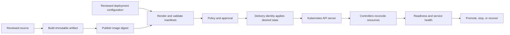
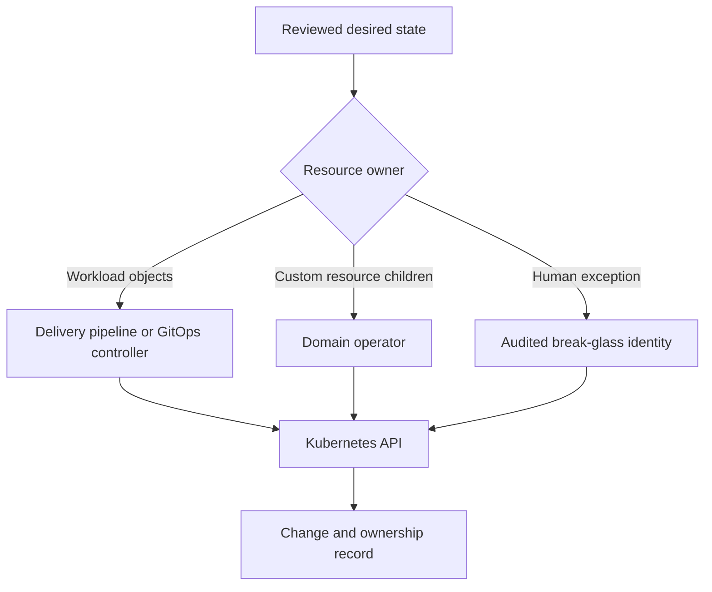
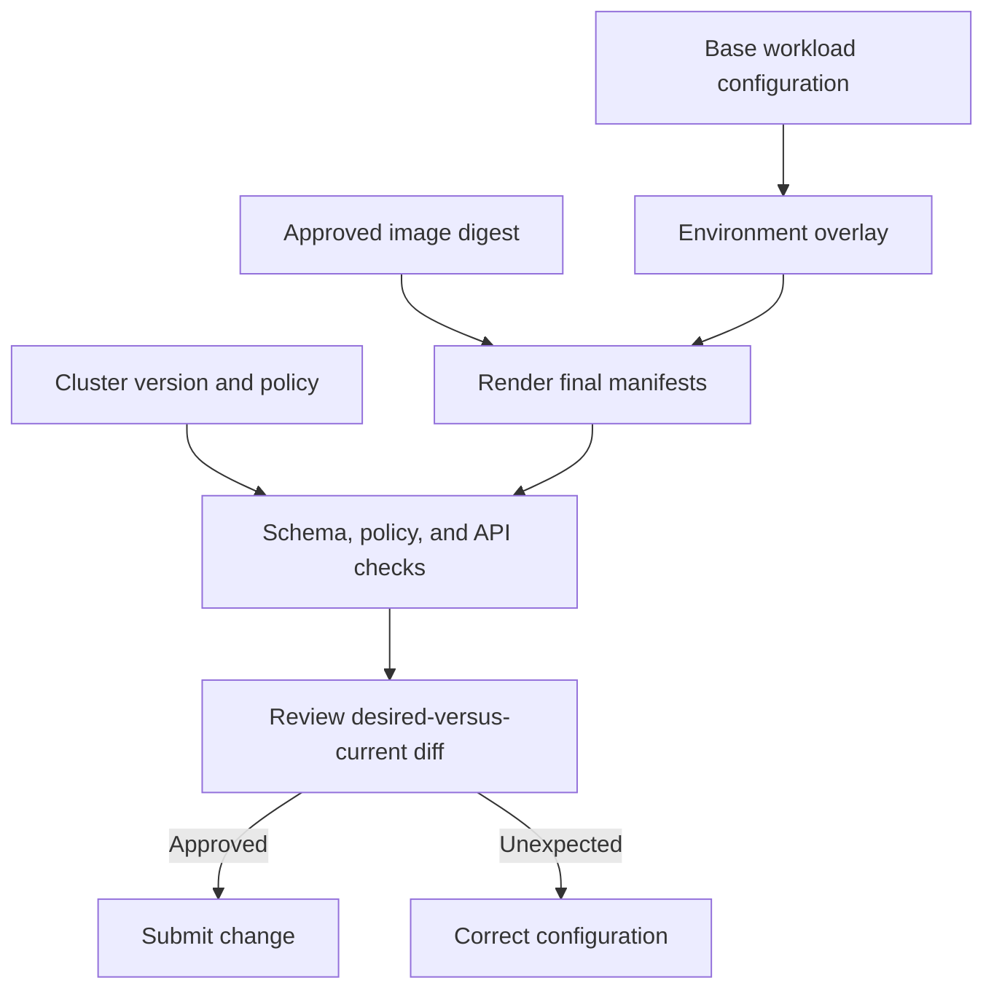
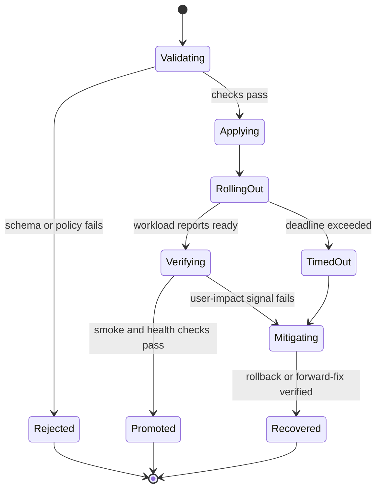
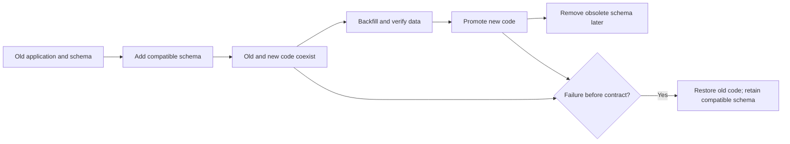

# Kubernetes (Deployment Perspective)

Part: [13 — DevOps](PART_OVERVIEW.md)

This chapter explains how delivery systems move reviewed changes into Kubernetes safely. It focuses on manifest ownership, environment configuration, rollout gates, recovery, and the handoff from imperative deployment to declarative reconciliation. Part 12 owns Kubernetes objects, controllers, scheduling, networking, and storage mechanics; Part 13 owns the delivery workflow. CH12 GitOps covers the general reconciliation model, and Part 12 CH12 covers Argo CD.

## Delivery Boundary and Ownership

A Kubernetes deployment pipeline should treat source, rendered manifests, cluster credentials, and live resources as distinct boundaries. A build produces an application artifact; a configuration repository or package defines the workload; a delivery controller or pipeline requests changes from the API server; Kubernetes controllers then converge observed resources toward their declared specifications. A successful API response is not proof that the new workload is ready or serving correctly.

Give each resource one authoritative writer. Direct `kubectl` changes, Helm release operations, GitOps controllers, and operators can otherwise compete to update the same fields. Assign ownership at the object and field level where server-side apply or multiple controllers are involved. A delivery pipeline can install an operator and define its custom resource, while the operator owns generated child resources; document that division.

## Manifest and Configuration Validation

Validate the exact configuration prepared for submission, not only source templates. Useful checks include schema validation, API-version compatibility, policy rules, image-digest enforcement, resource requests and limits, namespace targeting, and rendered-diff review. Validation should use the Kubernetes version and API capabilities expected in the destination. A dry run can reveal API validation failures but does not prove controller behavior, admission-policy availability, quota capacity, or runtime health.

Environment overlays and parameter files reduce duplication but can also hide drift. Keep common workload intent centralized and make environment-specific differences explicit and reviewable. Avoid copying complete manifests per environment because security and reliability fixes may land in only one copy. Secret values should not appear in source repositories or build logs; use an approved secret-delivery mechanism and narrowly scoped deployment identity.

The rendered diff is a release artifact in its own right: retain the inputs and output so reviewers can see what the system intends to change. For high-risk resources, require explicit review of permissions, ingress exposure, storage changes, and destructive actions. Tool details such as Kustomize, Helm, and server-side apply belong to their owners; the delivery contract remains the same.

## Rollout Gates and Health Evidence

Kubernetes Deployment controllers can report rollout progress, but the pipeline must define the success condition and deadline. Wait for expected replicas and readiness, inspect rollout conditions, and run service-level smoke checks after deployment. Readiness indicates whether a pod should receive traffic according to its probe; it does not prove that an entire business workflow works. Part 14 owns telemetry and alerting; this chapter consumes their signals as promotion evidence.

Set rollout deadlines from expected startup, image-pull, scheduling, and readiness behavior. When a rollout stalls, inspect events, scheduling constraints, image availability, probe failures, quota, and controller status before retrying. A retry that reapplies unchanged manifests can add noise without addressing the cause. Stop promotion when health evidence is missing or ambiguous.

## Rollback and Stateful Change

For a stateless workload with backward-compatible configuration, restoring a previous image and manifest revision may be sufficient. Preserve the last known-good desired state and its digest, and verify rollback health. If new and old versions coexist during a rolling update, they must tolerate the same API, message, and database contracts.

Database schema and persistent data make rollback more complex. Use expand-and-contract migrations: introduce backward-compatible schema, deploy compatible code, migrate data, then remove old structures only after consumers have moved. A previous ReplicaSet does not undo a database migration, external side effect, or irreversible message. Define compensating or forward-fix procedures and test them before production.

## Declarative Delivery and Emergency Changes

An imperative pipeline applies a specific change and records the result. A declarative delivery controller repeatedly compares a desired source with live cluster state and reconciles differences. Do not let both systems authoritatively manage the same resources. When migrating, define a cutover point: stop imperative writes, transfer field/resource ownership, verify the controller's rendered desired state, and only then enable reconciliation or pruning.

Emergency changes sometimes require direct cluster intervention. Define break-glass identity, approval, duration, audit capture, and follow-up reconciliation. Record the live change in the authoritative source promptly; otherwise a later automated apply may revert it or make the emergency state invisible. Avoid treating a direct edit as permanent configuration.

## Worked Case: API Release With Schema Change

A team updates a Kubernetes-hosted API and adds a nullable database field. CI builds and publishes an image by digest. The deployment pipeline renders the environment's manifests, checks policy and resource settings, and shows the exact diff. A gated apply updates the Deployment and a migration Job. The pipeline waits for the Job, rollout, and a payment-path smoke check. It then observes service health before promoting.

When a readiness probe fails, the pipeline stops. Operators find that a required configuration key was absent in the production overlay. They correct the source configuration, validate the render, and deploy the fixed version. Because the schema addition remains backward compatible, the previous application version remains usable if needed. The team records the failure and adds a validation rule for the missing key.

## Common Mistakes and Review Checklist

- Treating API acceptance as proof of successful rollout or service health.
- Applying manifests that were not the ones reviewed or validated.
- Sharing a broad cluster-admin credential with pull-request jobs.
- Allowing Helm, a GitOps controller, and manual scripts to own the same resource.
- Rolling back the application without evaluating schema and data compatibility.
- Pruning or deleting resources automatically without reviewing the ownership graph.
- Using production secrets or data in lower environments without policy and safeguards.

Verify immutable image identity, exact rendered configuration, target cluster/version, access scope, ownership, rollout deadlines, health signals, migration compatibility, rollback path, audit trail, and break-glass procedure. Ensure operators can tell which source revision and deployment identity produced the live state.

## Questions and Exercises

1. Distinguish manifest validation, API acceptance, controller readiness, and user-facing health.
2. Design a delivery identity for one namespace that can deploy an application but cannot change cluster-wide roles.
3. Draw an ownership graph for a GitOps controller, an Operator, a custom resource, and generated child objects.
4. Plan a schema migration that allows old and new application versions to run during a rolling update.
5. Simulate a stalled rollout and identify which API, event, and runtime evidence distinguishes scheduling failure from readiness failure.

## Summary

Kubernetes delivery is a chain from reviewed artifact and configuration to API submission, controller convergence, and verified service health. Make the exact rendered change visible, scope deployment authority, give resources clear owners, and gate promotion on meaningful evidence. Recovery must account for persistent state and external effects, not just the prior pod template.
