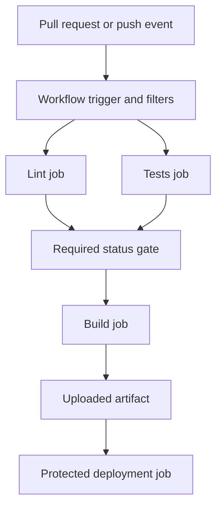
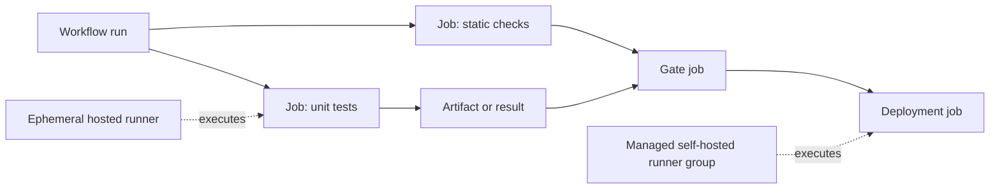
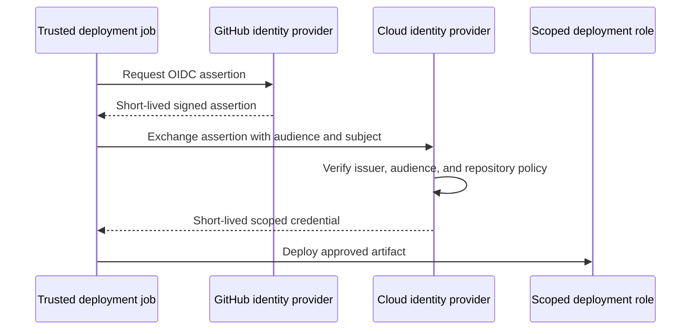
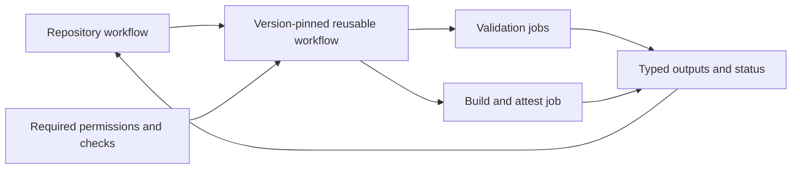
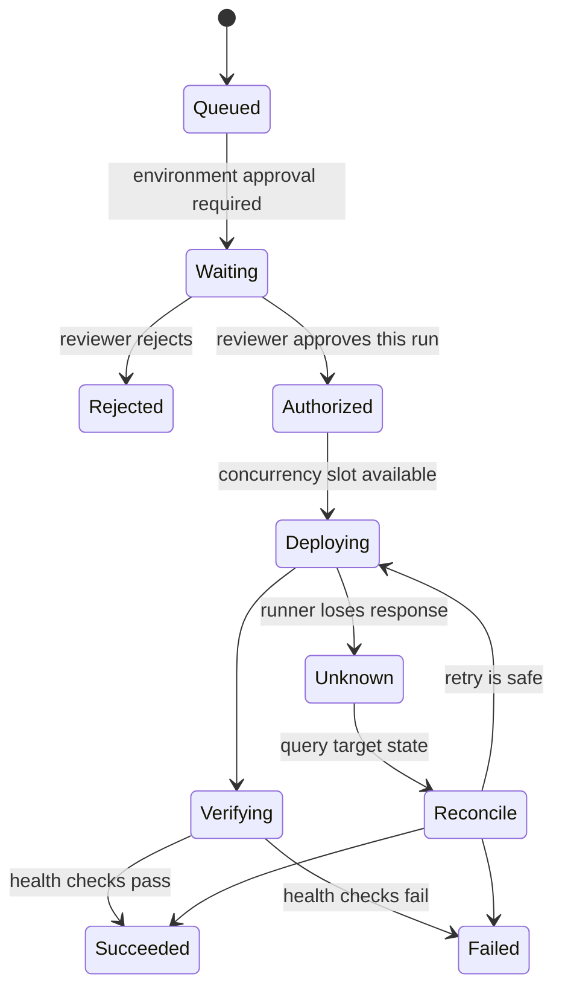

# GitHub Actions

Part: [13 — DevOps](PART_OVERVIEW.md)

GitHub Actions runs event-triggered workflows composed of jobs and steps on hosted or self-hosted runners. It can validate pull requests, build artifacts, and deploy to protected environments. This chapter focuses on workflow topology, permissions, runner boundaries, reusable components, artifacts, and deployment identity. CH02 owns CI/CD principles; Part 15 owns security foundations and software supply chain controls. GitHub changes product behavior over time, so pin action versions and validate against current documentation and organization policy.

## Event-to-Workflow Execution

A workflow file declares triggering events and jobs. A job runs on a selected runner; its steps execute sequentially in that job's workspace. Jobs can depend on other jobs through an explicit dependency graph and can run concurrently when independent. Each job may use a fresh runner, so files are not implicitly shared across jobs; use artifacts for outputs that must cross a job boundary.

Trigger filters are security-sensitive. A workflow that runs only for selected paths must not accidentally omit a required check for a change that affects the build through a shared library or pipeline definition. Pull-request workflows should validate untrusted changes without exposing secrets or write permissions. Events triggered by a trusted merge can run a separate release workflow with narrowly scoped authority.

## Runners, Jobs, and Workspace Boundaries

GitHub-hosted runners provide managed ephemeral environments for common operating systems and architectures. Self-hosted runners provide network reachability, custom hardware, or controlled images, but the organization becomes responsible for patching, isolation, capacity, cleanup, and incident response. A persistent self-hosted runner can retain files, processes, credentials, and caches between jobs; treat it as a shared security boundary, not as an ordinary build VM.

Jobs are isolated execution units. A matrix can test multiple language or platform versions, but matrix expansion affects cost and concurrency. Set explicit timeouts and concurrency controls. Use job dependencies to prevent deployment before required evidence exists; do not rely on visual ordering in a workflow file.

Prefer ephemeral, isolated runners for untrusted pull requests. Restrict network egress where possible, prevent privileged Docker socket access, and destroy or reimage the host after jobs. If self-hosted runners are exposed to forked repositories, assume an attacker can execute code on the runner and potentially reach the network around it.

## Permissions, Tokens, and Deployment Identity

The workflow token can access repository APIs according to its granted permissions. Set the minimum permissions explicitly, often read-only by default, and elevate only the job that needs a specific write operation. A job that checks out and tests source should not inherit package-publish or deployment permissions merely because another job needs them.

For cloud deployment, prefer OpenID Connect (OIDC) federation where supported: the workflow exchanges a short-lived identity assertion for narrowly scoped cloud credentials. Bind trust to repository, branch or environment, and workflow identity. Avoid long-lived cloud keys in repository secrets when federation is available. A protected environment can require reviewers and restrict branches, but its policy must be configured at the organization or repository boundary, not assumed from YAML alone.

Do not expose secrets to untrusted pull-request code or use privileged `pull_request_target` workflows that check out and execute the contributor's head commit. Separate metadata/comment operations from code execution. Masking protects common log cases but cannot prevent a malicious process from transforming or exfiltrating a secret. Part 15 covers threat modeling and identity controls in depth.

## Reusable Workflows, Actions, and Supply Chain

An action packages a step-level operation; a reusable workflow composes jobs and can establish a standardized pipeline contract. Reuse reduces duplication but creates a dependency boundary. Pin third-party actions to immutable commit identifiers or approved releases, review their source and permissions, and update pins through a controlled process. A mutable tag may point to changed code after review.

Reusable workflows should expose narrow inputs and outputs, document permissions, and avoid requiring callers to grant broad token scopes. Version internal templates and provide a migration path. Central policy should make secure use easy, but should not hide failures behind an abstraction that application teams cannot inspect.

Artifacts uploaded from one job can pass build outputs and reports to dependent jobs. Record the source revision and digest; do not assume an artifact name proves content identity. Caches accelerate repeat work, but use complete keys and do not let untrusted jobs populate caches consumed by privileged deployment jobs. CH02 owns the build-once and promotion contract.

## Environments, Concurrency, and Deployment Records

Use environments to scope secrets, required reviewers, branch restrictions, and deployment history. Bind an approval to the exact workflow run and artifact. A protected environment is only as strong as its configured rules and the workflow's ability to select or bypass that environment. Keep production deployment in a distinct job with explicit dependencies and narrow token permissions.

Concurrency groups prevent overlapping deployments to the same target. Decide whether a newer run cancels an older one, queues behind it, or is rejected. Cancellation is unsafe if the existing operation may already have modified production or if cleanup is required. For stateful deployment actions, query target state before retrying.

The deployment record should link workflow run, commit, artifact digest, actor or policy decision, environment, and result. Retain logs and artifacts according to security and audit policy, redact secrets, and make failure reports actionable. Part 14 owns telemetry platforms; GitHub Actions should emit enough identifiers to correlate a run with deployment and runtime evidence.

## Worked Case: Protected Release Workflow

A repository validates every pull request with read-only token permissions on an ephemeral hosted runner. The workflow runs formatting, unit tests, dependency checks, and a build. The required check aggregates all results so a skipped test cannot silently satisfy branch protection. After merge, a trusted workflow builds and scans the release artifact, records its digest, and uploads provenance.

A separate deployment job targets a protected production environment. It requests an OIDC assertion and exchanges it for a short-lived role limited to the service's deployment resources. A reviewer approves the specific candidate; the job deploys the digest and records the environment result. The team uses a concurrency group so two production releases cannot race. If deployment times out, the workflow queries the target and does not blindly repeat a possibly completed operation.

## Common Failure Modes and Review Checklist

- Broad default token permissions granted to every job.
- Unpinned third-party actions or reusable workflows with excessive trust.
- Pull-request code executed in a job that can access secrets or privileged runner networks.
- Self-hosted runner state or credentials persisting across untrusted jobs.
- A required check being skipped due to path filters or conditional job logic.
- Artifacts passed between jobs without verifying source and content identity.
- Deployment approvals that do not bind to a specific candidate or environment.
- Concurrent deployments racing or cancellation leaving an unknown target state.

Review event filters, permissions per job, runner isolation, action pinning, workflow reuse contracts, cache trust, artifact digests, OIDC subject restrictions, environment protection, concurrency policy, log retention, and recovery behavior. Verify organization-level policy independently of workflow code.

## Questions and Exercises

1. Draw the job DAG for pull-request checks and explain which jobs may run concurrently.
2. Design a permission map for validation, package publication, and production deployment jobs.
3. Explain how OIDC federation prevents stored-key exposure and which claims the cloud role should verify.
4. Review a workflow that executes a pull-request head revision while holding a write token; identify the trust-boundary failure.
5. Simulate two deploy runs targeting the same environment and design safe queue, cancellation, and retry behavior.

## Summary

GitHub Actions provides event-driven workflow execution, but safe delivery depends on explicit job dependencies, minimal token scopes, isolated runners, immutable action and artifact identity, and protected deployment environments. Treat workflow code and reusable actions as software dependencies. Separate untrusted validation from privileged release, and retain evidence that connects a reviewed source revision to the deployed artifact and result.
