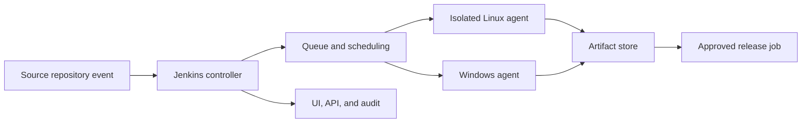
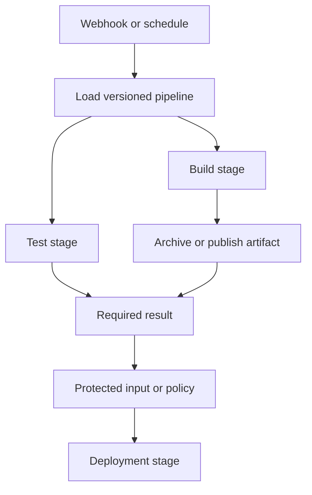
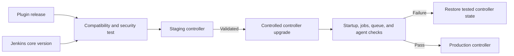
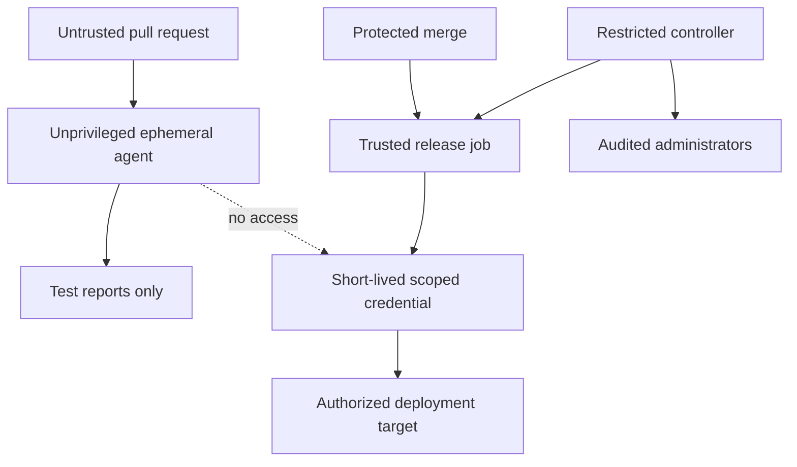
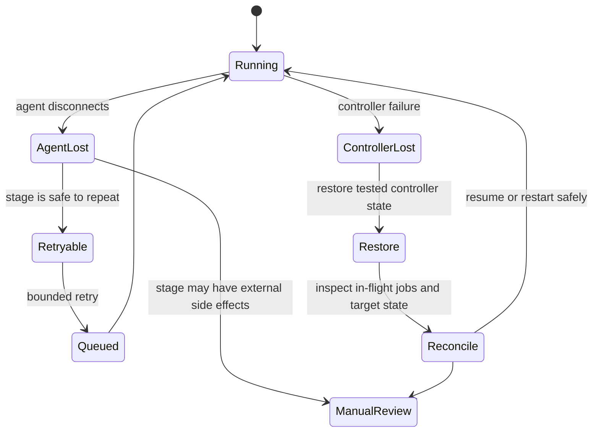

# Jenkins

Part: [13 — DevOps](PART_OVERVIEW.md)

Jenkins is an extensible automation server that coordinates pipeline execution across a controller and one or more agents. It is useful when teams need a flexible automation platform, integration with existing infrastructure, or control over execution environments. Its flexibility also transfers responsibility for upgrades, plugin compatibility, isolation, credentials, availability, and recovery to the operating organization. CH02 owns pipeline design; this chapter owns Jenkins operation and architecture. Part 15 owns security foundations.

## Controller, Agents, and Queue

The controller stores job and pipeline configuration, schedules work, exposes the user interface and APIs, and coordinates agents. Agents provide execution capacity and may run on virtual machines, containers, or static hosts. The controller should not execute untrusted build code. An executor is a concurrent task slot on an agent; sizing it only by CPU count can overload memory, disk, network, or downstream services.

Keep the controller's filesystem and credentials separate from build workspaces. Use labels or clouds to place jobs on the right agent class, and restrict which jobs can use privileged agents. Ephemeral agents reduce persistence and cleanup risk, while static agents may be necessary for specialized hardware or private network reachability. Treat each agent pool as a trust boundary.

## Pipeline-as-Code and Execution Semantics

Jenkins Pipeline definitions can live in source control, either in a repository file or a shared library. Declarative syntax offers a constrained structure for stages and conditions; scripted syntax provides more expressive Groovy-based control. Prefer the narrowest expressive form that keeps behavior reviewable. A pipeline definition should be tested like application code and should not depend on mutable controller-global state that is invisible in the repository.

Stages, parallel branches, post-actions, and agent allocation have distinct failure behavior. A stage can fail while cleanup and reporting still need to run. Use explicit timeouts, bounded retries for transient operations, and cleanup in guaranteed post-processing where appropriate. Avoid swallowing a failed command or marking a build successful after required evidence is missing.

## Plugins, Shared Libraries, and Upgrades

Plugins add source integrations, credentials providers, agents, pipeline steps, and user-interface features. This ecosystem is a strength and a maintenance obligation: plugins can introduce vulnerabilities, incompatible dependencies, startup failures, and controller instability. Maintain an approved plugin catalog, pin versions, test updates in a representative non-production controller, and keep an inventory of plugin ownership and criticality.

Shared libraries centralize policy and reusable pipeline logic. Version them explicitly; avoid silently changing production behavior by moving a mutable library branch. Keep APIs small and document which inputs and permissions a library requires. If a shared library is compromised, it can affect every consuming job, so protect its repository and review path accordingly.

Upgrades should cover Jenkins core and plugins together. Review release notes and Java requirements, back up configuration and job state, test plugin compatibility, and rehearse rollback. A controller backup without compatible plugin versions may not restore behavior. Avoid changing core and many plugins simultaneously unless the test plan can isolate the cause of failure.

## Credentials, Authorization, and Build Isolation

Store credentials in Jenkins credential mechanisms and bind them only to the smallest job or stage that needs them. Masking in logs is a convenience, not a strong confidentiality guarantee. Untrusted pull-request code must not receive signing keys, deployment tokens, or access to controller credentials. Use least-privilege identities, rotate secrets, and prefer short-lived credentials when supported.

The controller's script approval and authorization configuration affect the power available to pipeline code. Restrict administrative roles, separate job configuration from credential administration, and audit changes to plugins, shared libraries, and agent definitions. Do not run builds as a privileged user or mount a host container socket into untrusted agents without understanding that authority.

## Capacity, Availability, and Recovery

Queue length, executor utilization, build duration, agent provisioning delay, and storage pressure indicate different bottlenecks. Add capacity only after determining whether work is CPU-, memory-, disk-, network-, or dependency-bound. Unbounded parallelism can overwhelm package repositories, test databases, or deployment APIs. Apply concurrency limits per repository, environment, and external dependency.

The controller is a critical coordination service. Back up configuration, secrets using an approved protected mechanism, job metadata, plugin inventory, and any required build history. Store artifacts outside the controller when they must survive controller loss. Test restoration to a compatible version and verify that agents can reconnect and jobs can resume or be safely restarted.

An agent disconnect does not prove that a deployment failed; it may have completed while Jenkins lost the response. Query the target before retrying. A controller restore can also replay queued work, so make deployment actions idempotent and reconcile in-flight operation status.

## Worked Case and Review Checklist

A company with private build dependencies operates Jenkins on a protected controller and creates ephemeral agents inside a restricted network. Pull-request jobs use isolated agents and read-only source access. A release job runs only after merge, retrieves a short-lived deployment credential, publishes an immutable artifact reference, and records the target result. Plugin updates are tested against a controller snapshot before production rollout.

Review controller and agent separation, executor limits, trust levels, pipeline versioning, plugin inventory, credential scope, job authorization, queue and storage monitoring, artifact retention, controller backup, and restore rehearsal. Verify that pipeline failures and uncertain deployments have an owner and safe recovery path.

## Questions and Exercises

1. Draw the controller, queue, agent, artifact, and deployment boundaries for a release pipeline.
2. How can an agent disconnect leave deployment state uncertain? Design a safe reconciliation step.
3. Create a plugin upgrade plan that can identify incompatibility and restore the prior controller state.
4. Which permissions should be available to pull-request jobs versus release jobs?
5. Estimate safe executor capacity from CPU, memory, disk, and downstream-service limits rather than CPU alone.

## Summary

Jenkins combines a flexible controller with distributed execution agents and an extensive plugin ecosystem. Reliable operation depends on isolating build trust levels, controlling plugin and shared-library changes, limiting concurrency, protecting credentials, and rehearsing controller recovery. Pipeline-as-code makes automation reviewable only when its dependencies and permissions are also visible and governed.
