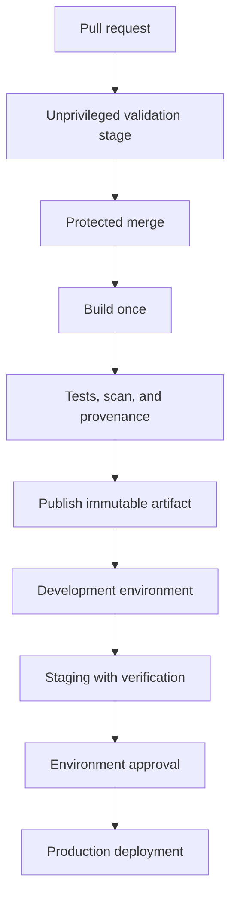
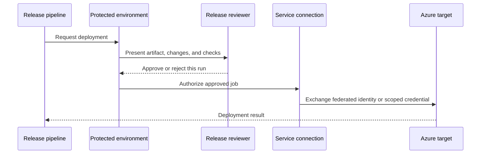
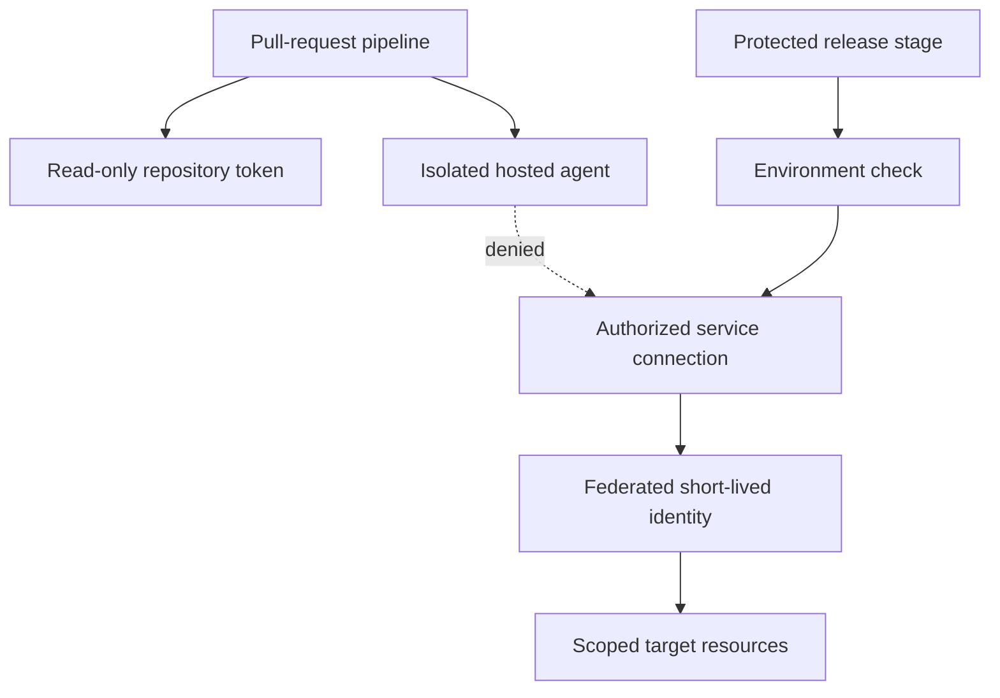
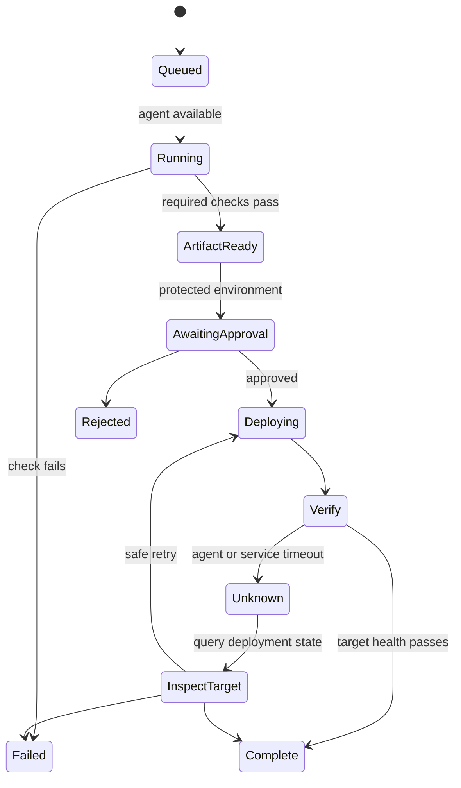

# Azure DevOps

Part: [13 — DevOps](PART_OVERVIEW.md)

Azure DevOps combines source repositories, work tracking, build and release pipelines, artifacts, environments, and service connections. This chapter explains how to compose these capabilities into a governed delivery path, with emphasis on YAML pipelines, agent pools, approvals, credentials, and traceability. Product behavior and licensing evolve; validate current service documentation and tenant policy. CH02 owns CI/CD principles, and Part 09 owns Azure infrastructure products.

## Organization, Project, and Pipeline Boundaries

An organization contains projects, identities, repositories, pipelines, agent pools, service connections, and other resources. Projects can provide useful ownership and permission boundaries, but cross-project access and shared pools require deliberate governance. Keep the number of projects aligned to access, lifecycle, and administration needs rather than treating projects as folders.

A YAML pipeline defines triggers, stages, jobs, steps, variables, and dependencies. Templates can standardize policy and reusable workflow logic. Pipeline YAML should be version-controlled with the application or platform configuration; restrict changes to the policy templates and service connections that grant privileged access.

Map repository, work item, pipeline run, artifact, approval, and deployment identities so an auditor or operator can trace a production change. Linking records is useful only when IDs are immutable and retained for the incident or compliance window.

## Agents, Stages, and Artifacts

Microsoft-hosted agents offer managed, short-lived build environments with defined images and capacity limits. Self-hosted agents can reach private networks or provide specialized tools, but require patching, isolation, cleanup, and capacity management. Separate pools for untrusted validation and privileged deployment; do not let a pull-request job leave state on an agent later used for production release.

Stages represent major lifecycle boundaries such as build, test, staging, and production. Jobs within a stage can run in parallel if independent. Use explicit dependencies and conditions; a skipped job must not make a required stage appear successful. Set timeouts and concurrency controls, and avoid downloading or rebuilding dependencies without a controlled version.

Publish artifacts with immutable identity and promote the same artifact across environments. Pipeline artifacts and Azure Artifacts have different uses: one transports run outputs; the other can host packages and feeds. Define retention, access, and immutability according to whether the object is a temporary build output or a release dependency. CH02 owns the broader artifact-promotion contract.

## Environments, Approvals, and Service Connections

An environment can group deployment targets, history, checks, and approvals. Configure required reviewers, branch controls, exclusive locks, and other checks on the protected resource itself. A YAML condition is not an adequate substitute for resource-level authorization if a contributor can modify the pipeline definition that evaluates the condition.

Service connections are credential and trust boundaries between pipeline execution and external systems. Scope connections to the smallest subscription, project, or target permissions necessary. Restrict which pipelines may use them and review changes to their authorization. Prefer workload identity federation for Azure Resource Manager connections where available instead of long-lived client secrets. Keep approval decisions attached to a specific run and artifact.

Do not grant untrusted pull-request pipelines access to production service connections or variable groups. Secret variables should be limited to jobs that need them, and scripts must not print or transform secrets into logs. Part 15 owns identity and secret threat models; this chapter applies least privilege to Azure DevOps resource boundaries.

## Templates, Variables, and Policy

Templates can enforce common stages, checks, and logging patterns. Use typed parameters, explicit allowed values, and pinned template references. Avoid treating a template as a security boundary if callers can bypass it or alter a trusted reference. Central templates should be versioned, tested, and released with change notes.

Variables are configuration inputs, not an unstructured secret store. Separate non-secret parameters from credentials, document precedence, and ensure production values cannot be overridden by an untrusted pull request. Avoid putting secrets in YAML, command-line arguments, or artifact metadata. Record configuration version or source where it materially affects deployment behavior.

## Failure Handling and Operations

Agent image updates, service outages, throttling, expired credentials, permission changes, and external package-feed failures can interrupt pipelines. Classify a failure before retrying; retries should be bounded and safe for deployment side effects. If an agent loses connectivity after submitting a release, query the environment before repeating it.

Monitor queue wait, agent utilization, stage duration, failure rate, artifact retention, service-connection health, and deployment outcomes. Preserve logs and run metadata while controlling access and retention. A manual recovery route should preserve artifact identity and authorization evidence rather than re-creating a build outside the pipeline.

## Worked Case and Review Checklist

A team stores service code and pipeline YAML in a repository. Pull requests run on a hosted agent with read-only permissions. After merge, the pipeline builds and tests once, publishes an artifact with the commit identifier, then deploys to staging. Environment checks verify smoke tests and configuration. A release reviewer approves the exact run for production. A federated service connection grants a short-lived identity scoped to the service's resource group. The deployment record links work item, commit, artifact, approval, and target result.

Review organization/project boundaries, YAML triggers, template versions, agent trust level, artifact retention, environment checks, service-connection scope, federation claims, variable access, approvals, concurrent deployments, and audit retention. Verify the policy at the service-resource boundary as well as in source-controlled YAML.

## Questions and Exercises

1. Draw the path from work item and commit through artifact, environment approval, and deployment record.
2. Explain why a YAML-only production approval can be bypassed if contributors can change the YAML.
3. Design separate agent pools and token scopes for pull-request validation and production deployment.
4. Identify what should be retained for a package feed versus a one-run pipeline artifact.
5. Simulate an agent loss after a deployment request and describe how to establish actual target state before retrying.

## Summary

Azure DevOps offers an integrated toolset, but integration does not eliminate the need to define resource ownership, agent trust, artifact identity, and approval policy. Keep privileged connections protected at the resource boundary, isolate untrusted jobs, and link each deployed artifact to its source and release evidence. Verify current product behavior as service features evolve.
