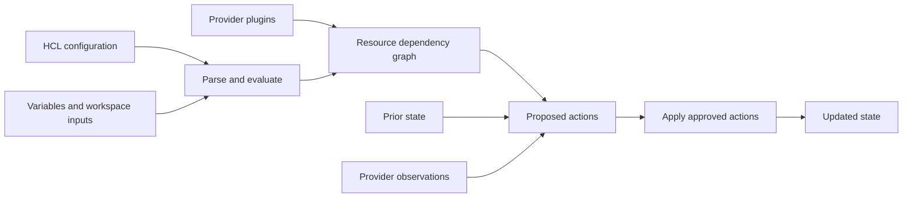
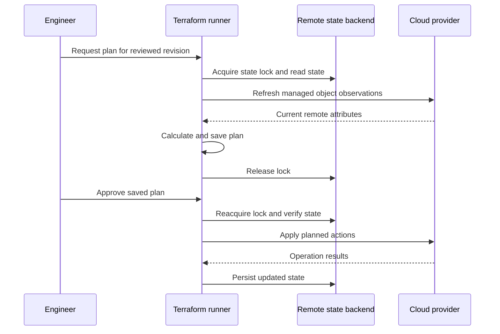
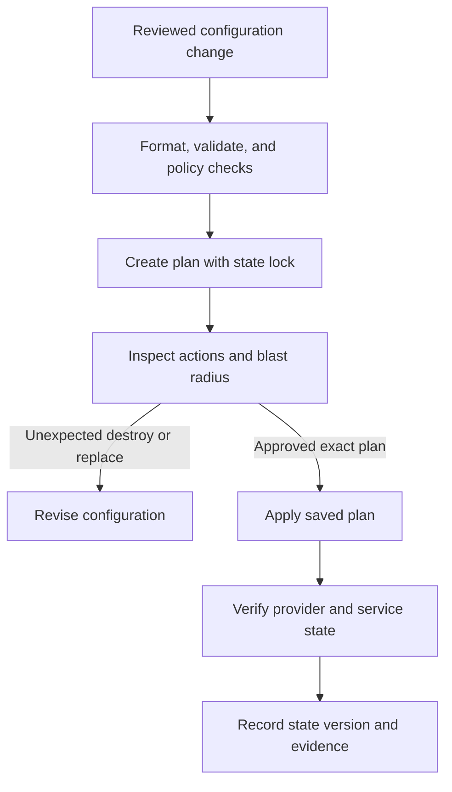
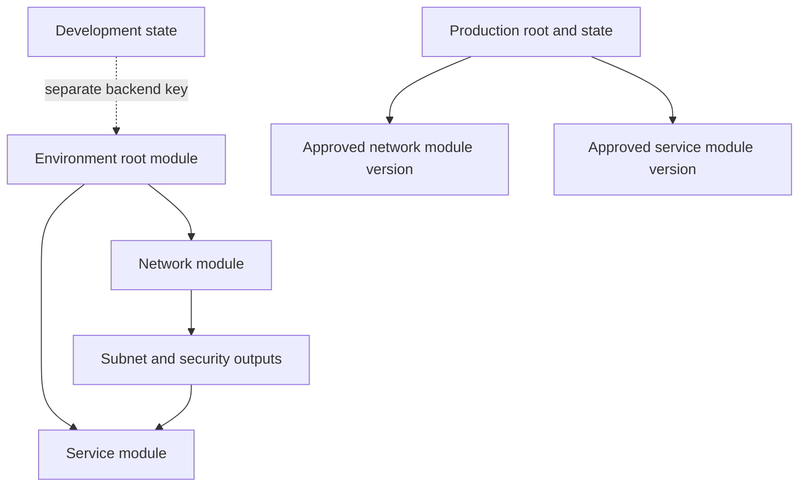
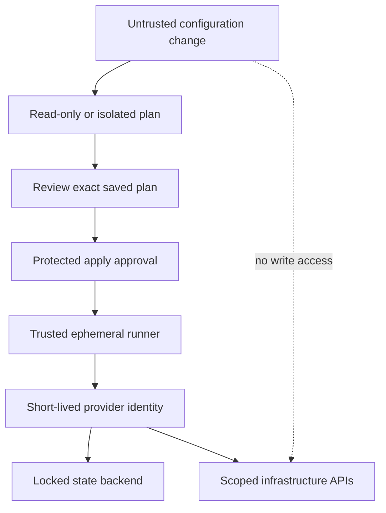

# Terraform

Part: [13 — DevOps](PART_OVERVIEW.md)

Terraform is an infrastructure-as-code tool that evaluates configuration, compares declared resources with recorded state and provider observations, creates an execution plan, and applies selected changes. It is useful for repeatable provisioning and reviewable infrastructure changes. It does not make provider APIs transactional, eliminate drift, or guarantee that a plan remains safe after the world changes. Part 09 owns cloud-resource mechanics; this chapter owns Terraform workflow and state boundaries. CH09 compares Pulumi and CH10 covers configuration management.

## Configuration, Providers, and Resource Graph

Terraform configuration is written in HashiCorp Configuration Language (HCL). Providers implement resource and data-source operations against external APIs. Resources describe managed objects; data sources read objects not managed by the configuration. Expressions and references create dependencies that Terraform evaluates as a directed graph. Explicit dependencies are appropriate when ordering is real but not visible through data references; unnecessary dependencies serialize work and hide the actual contract.

Provider versions and Terraform versions are part of the execution contract. Pin compatible ranges and commit the dependency lock file so checksums and selected provider versions are reviewable. Upgrade providers through a tested change that examines schema changes and planned actions. A provider can have bugs or behavior that differs from the user's mental model; validate high-impact operations in an isolated environment.

## State as an Ownership and Recovery Boundary

Terraform state maps configuration addresses to remote objects and stores attributes needed to plan and update them. It can contain sensitive values even when command output redacts them. Protect the backend with encryption, access controls, audit, versioning, and recovery. Do not commit production state or pass it through untrusted logs.

Remote state enables collaboration only when locking and access control are correctly configured. A lock serializes operations that could otherwise overwrite each other's state view. It does not make a provider operation atomic, and a stale lock should be investigated before removal. Separate state by lifecycle and blast radius: one enormous state couples unrelated teams and increases the consequences of a mistaken apply; excessively fragmented state adds dependency orchestration and coordination costs.

State addresses are Terraform's identity for managed resources. Renaming a resource block can look like delete-and-create unless a `moved` declaration or state operation communicates the identity transition. Import associates an existing remote object with configuration and state; it does not automatically produce correct configuration. Review the resulting plan to ensure Terraform manages the intended object without replacing it.

## Plan, Review, Apply, and Drift

`terraform plan` calculates proposed actions from configuration, state, and provider observations. It can show create, update, replace, and destroy actions. A plan is a point-in-time proposal, not a guarantee of the result if remote state, permissions, or provider behavior changes before apply. For high-risk changes, save the plan produced by CI and apply that exact plan after approval rather than recalculating a different proposal.

Drift occurs when remote infrastructure changes outside the declared workflow or when state no longer describes the actual object. A refresh-only plan can reveal observations, but blindly applying a plan can either overwrite an intentional emergency fix or incorporate an unsafe manual change. Decide whether configuration or the remote object is authoritative, then update one side through a reviewed process. Import, state move, and refresh commands are recovery tools that require backups and clear ownership.

Destroy and replacement actions deserve explicit review. A plan can be syntactically valid and still delete a data store or rotate an identity used by production. Use policy-as-code to block prohibited regions, public exposure, missing tags, or destructive actions, but keep the policy version and exception rationale in evidence. Policies can also be wrong; provide an accountable exception path.

## Modules, Environments, and Composition

Modules package configuration interfaces and can reduce duplication. A module should expose deliberate inputs and outputs, validate assumptions, document resource ownership, and avoid hiding provider behavior behind excessive abstraction. Pin remote module sources to an immutable release or commit for repeatable plans. Treat module upgrades like code changes with plan review.

Separate environments and teams using explicit state and access boundaries. Workspaces can provide multiple state instances for the same configuration, but they do not automatically provide strong security isolation. Backend keys, identities, and permissions must enforce separation. Avoid using a workspace name as the sole control over production credentials or destructive commands.

For cross-state dependencies, publish minimal outputs through a controlled interface rather than granting broad access to another team's full state. Consider lifecycle coupling, access, and consistency when choosing state boundaries. Terraform is strongest when each state has a clear owner and an operation can be planned and recovered within a bounded scope.

## CI, Security, and Failure Recovery

Run formatting, validation, provider-lock checks, policy tests, and plan generation in CI. Keep apply permissions separate from pull-request validation and grant them only to a protected release identity. Do not execute untrusted configuration with privileged provider credentials. Use short-lived federation where possible; store backend credentials and provider secrets outside source and plan artifacts.

Plans and state can contain secret values, resource identifiers, topology, and outputs. Restrict downloads, logs, caches, and artifact retention. Redaction is not a guarantee that every secret is absent. Use provider-native secret references rather than materializing credentials into Terraform-managed values when the service supports them.

An apply can fail after some provider operations succeed. Terraform state may record completed operations, but a provider timeout can leave remote state uncertain. Preserve the plan, logs, state version, and operation identifiers. Re-read state and remote objects before retrying; do not edit state files directly. Back up state before state surgery, and use supported commands such as `state mv`, `state rm`, or import only with a reviewed recovery plan.

## Worked Case: Network Change With Shared State

A platform team proposes a subnet expansion. CI checks formatting and module tests, creates a plan using a remote locked state, and stores the plan as a restricted artifact. Reviewers verify that the plan adds a subnet and updates route associations without replacing the gateway or deleting existing ranges. Policy confirms the address block is approved. A protected apply job receives short-lived cloud credentials and applies the saved plan.

The provider times out after creating the subnet. The job does not immediately reapply. An operator inspects the state version and provider object, confirms the subnet exists, then re-runs a plan to determine whether state needs refresh or the resource was partially recorded. The team records the recovery and adds a targeted operational test. This approach sacrifices the simplicity of a one-command apply for a stronger audit and recovery trail.

## Common Mistakes and Decision Checklist

- Sharing one state file across unrelated ownership or failure boundaries.
- Storing state or plan artifacts in public or broadly accessible locations.
- Applying a newly calculated plan instead of the reviewed saved plan.
- Assuming a lock makes cloud operations atomic.
- Ignoring destroy or replacement actions because the plan command succeeded.
- Running apply with credentials available to untrusted pull-request code.
- Renaming resources without handling their state identity transition.
- Using workspace names as security boundaries without backend and identity controls.
- Treating a refresh or import as proof that configuration is correct.

Decide state boundaries from ownership, lifecycle, and blast radius; decide module boundaries from stable interfaces; pin providers and modules; enforce plan review; and make state recovery rehearsable. CH09 compares language-based infrastructure definitions, but this chapter owns Terraform's state, plan, and apply workflow.

## Questions and Exercises

1. Draw the configuration-to-provider graph and explain how a reference creates an implicit dependency.
2. Design a remote state backend with locking, version recovery, least-privilege access, and audit.
3. Review a plan that replaces a database because a resource address changed. Propose a safe state migration.
4. Simulate a provider timeout after partial apply; list the evidence needed before retrying.
5. Design CI permissions so pull-request plans cannot mutate production and approved applies use short-lived identity.

## Summary

Terraform turns configuration, state, and provider observations into a proposed infrastructure change. The safety of that process depends on clear state ownership, locking, immutable dependency inputs, exact plan review, scoped apply identity, and tested recovery. A successful apply command is not equivalent to a verified service outcome; inspect resulting infrastructure and record the evidence that connects source to change.
