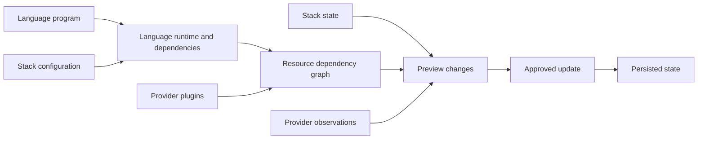
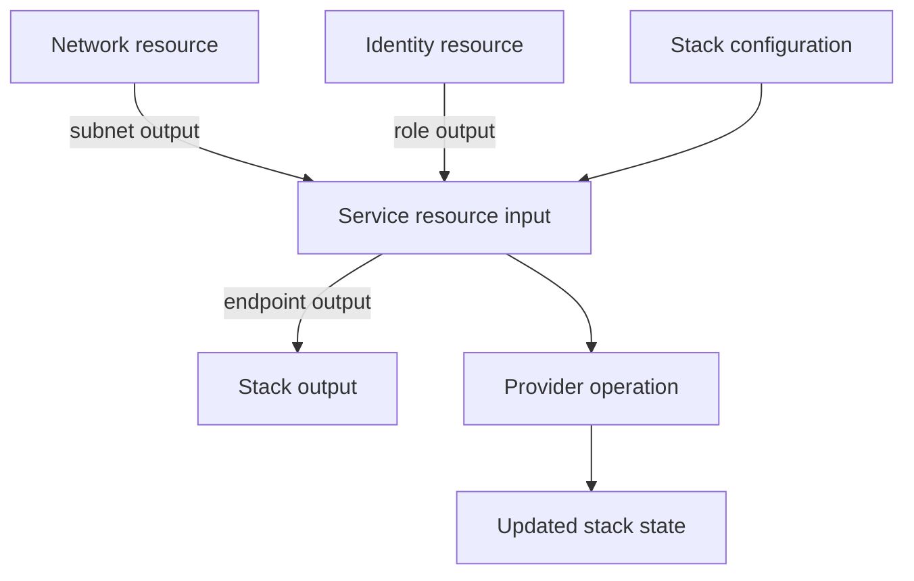
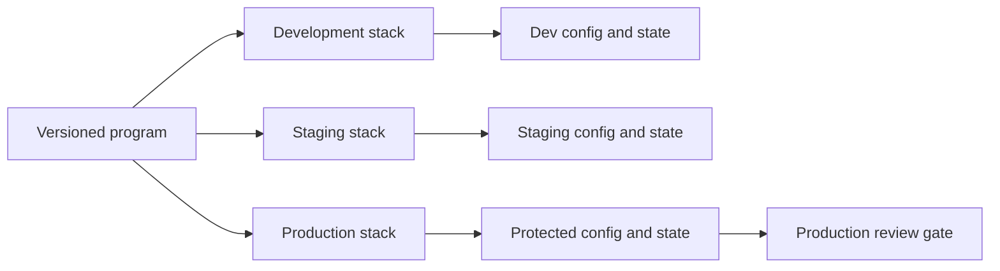
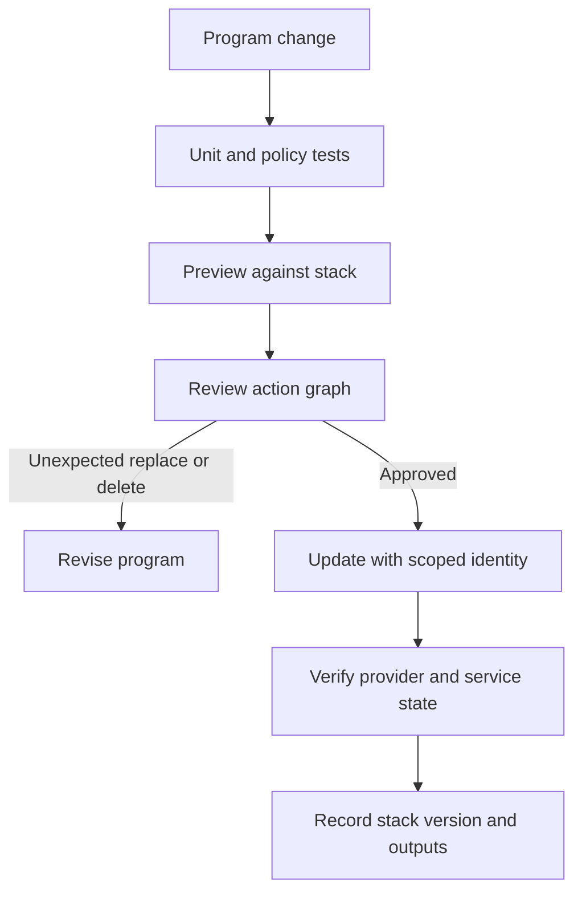
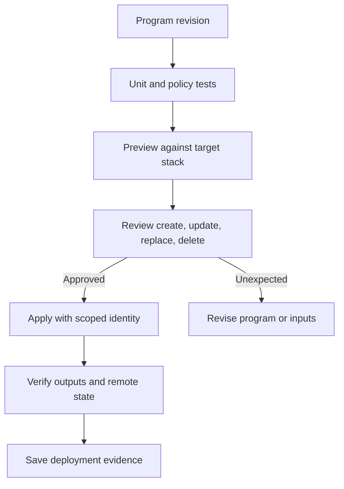

# Pulumi

Part: [13 — DevOps](PART_OVERVIEW.md)

Pulumi provisions infrastructure by evaluating programs written in general-purpose languages and turning declared resources into a dependency graph. It supports familiar language tooling, abstractions, tests, and package ecosystems, but also inherits their risks: hidden side effects, nondeterministic evaluation, runtime dependencies, and abstraction that obscures the proposed infrastructure. CH08 Terraform owns infrastructure-as-code fundamentals and state/plan review; Part 09 owns provider resource behavior.

## Program Evaluation and Resource Graph

A Pulumi program declares resources through provider packages. Inputs and outputs connect resources: an output from one resource can become an input to another, establishing dependency order. The engine evaluates the program, compares the resulting graph with stack state and provider observations, and presents a preview or performs an update. Treat the program as an infrastructure description, not as an unrestricted script whose every side effect is safe to repeat.

The program should be deterministic for the same versioned inputs. Avoid reading the wall clock, random values, mutable external APIs, or local machine state during evaluation unless the resulting variation is deliberate and recorded. Use provider lookups and explicit configuration for external facts; test helper functions and keep resource declarations easy to inspect.

## Inputs, Outputs, and Dependency Semantics

An input describes a value known now or produced by another resource. An output represents a value that may be available only after provider operations complete. Composing outputs preserves dependency ordering and allows secret taint to propagate. Avoid extracting asynchronous values through blocking or side-effectful shortcuts that bypass the engine's dependency model.

A dependency in the graph affects create and delete order. Explicit dependency declarations are appropriate for ordering not captured by data flow, but unnecessary dependencies can serialize updates and hide undeclared coupling. Preview the graph for replacement cascades. Changes to output shape or logical resource names can cause replacement or state movement; review the proposed action rather than assuming a source diff maps one-to-one to provider changes.

## Stacks, Configuration, and State

A stack is an isolated instance of a Pulumi program with its own configuration and state. It often corresponds to an environment boundary or deployment lifecycle. Configure separate identities and backends for production and lower environments. A stack name alone is not a security boundary; backend access and provider credentials enforce authority.

State maps program resource identities to provider objects and records outputs, dependency edges, and secret values. Protect it with access controls, encryption, history, and restore procedures. Use stack references for intentionally shared outputs, exposing only necessary values. Sharing an entire state file increases access coupling and blast radius.

Store sensitive values through Pulumi's secret configuration mechanisms and protect encryption keys. Secret marking reduces accidental disclosure in output, but does not eliminate access risk: state readers, providers, debug logs, and program code may handle plaintext during execution. Rotate exposed credentials and review historical state versions.

## Preview, Update, and Testing

Preview is the proposed resource action set. Generate it from the exact reviewed program revision, provider versions, stack configuration, and backend state. Review replacements, deletions, permission changes, public endpoints, and data loss risk. Production update should use the same inputs and protected identity as the approved preview, and the run should preserve its result for audit.

Unit tests can validate transformation logic without creating real infrastructure. Integration tests can use an isolated account or project and must clean up safely. Policy packs can reject unsafe resource configurations, but policy version and exception decisions belong in the release record. A passing preview cannot guarantee provider API success or healthy application behavior.

## Language and Provider Trade-offs

Using a general-purpose language makes loops, functions, packages, and type systems available, which can improve reuse and testing. It can also obscure the final graph behind helpers, import arbitrary runtime dependencies, and make static review harder. Keep abstractions aligned to stable infrastructure concepts, expose meaningful inputs, and preserve a readable preview.

Compared with declarative HCL, Pulumi may fit teams already strong in a supported language or that need richer abstraction and testing. Terraform may fit teams that value its configuration language, mature ecosystem, and established state workflows. Compare provider coverage, team skill, governance, backend, policy tooling, and upgrade practices; avoid choosing solely by syntax preference. CH08 remains the owner of shared state and plan concepts.

## Worked Case and Review Checklist

A platform team models a network and application service. The service consumes the network's subnet output, so the engine orders creation and replacement based on the graph. Development and staging stacks run previews on pull requests with read-only provider access. A protected production workflow reviews the preview, acquires scoped credentials, updates the stack, and verifies the service endpoint. State access is limited to the platform team; consuming teams receive only endpoint and identity outputs.

Review program determinism, runtime and provider pins, dependency graph, state boundary, secret handling, preview retention, policy tests, production identity, replacement risk, stack output exposure, and recovery. Confirm that developers can understand the preview without tracing deeply nested abstractions.

## Questions and Exercises

1. Draw the resource graph for a network, identity, and service, showing input/output dependencies.
2. How can a time-dependent value make repeated program evaluation produce different infrastructure?
3. Design separate stack permissions for developers who can preview but cannot update production.
4. Write tests for a resource-construction helper and a policy that blocks public storage.
5. Compare a Pulumi and Terraform design for the same service using state, reviewability, language skill, and lifecycle cost.

## Summary

Pulumi evaluates a program into a resource graph, then previews and applies changes using stack state and providers. Safe use depends on deterministic inputs, visible dependencies, protected state, careful output/secret handling, and review of the exact proposed actions. Language flexibility is valuable when it improves reuse and tests without hiding the infrastructure contract.
